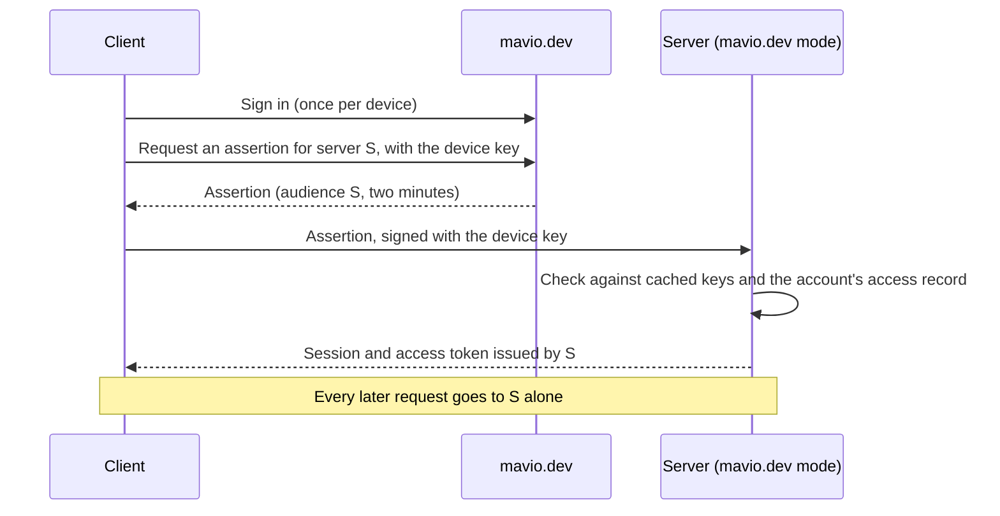

# Mavio Accounts

> English | [简体中文](accounts.zh-CN.md)

> Related: [Architecture](architecture.md) · [Domain Model](domain.md) · [Clients](clients.md) · [mavio.dev](mavio-dev.md) · [Roadmap](roadmap.md) · [AGENTS.md](../AGENTS.md)

> Who may use a Mavio server and how they sign in. A server runs in one of two modes: in **mavio.dev mode** every user is a Mavio account and mavio.dev keeps the accounts, who may reach which libraries, friends and Homes, after the model of plex.tv; in **standalone mode** the server keeps its own users, with the same model minus everything that spans servers. This document describes the design; mavio.dev itself is described in [mavio.dev](mavio-dev.md). It is built in phase P27 of the [Roadmap](roadmap.md).

---

## 1. Principles

1. **One mode per server.** A server signs people in either with Mavio accounts or with its own users.
2. **One model in both modes.** Both modes have one administrator per server, members, managed users with PINs, and one library access record per member; standalone mode lacks only Homes, friends and mavio.dev's services.
3. **A server has exactly one administrator.** In mavio.dev mode it is the account that claimed the server, in standalone mode the user created when the server was set up. Everyone else is a member.
4. **The server issues every token it accepts.** mavio.dev issues short sign-in assertions that a server exchanges for its own session; it never holds a token that opens a server.
5. **mavio.dev is never on the request path.** It takes part in signing in and in changing who may reach what; a signed-in device keeps working while mavio.dev is unreachable.
6. **mavio.dev knows access, not media.** It keeps which libraries a member may reach and with which restrictions; items, watch history and playback state stay on the server.

## 2. Server Modes

| | mavio.dev mode | Standalone mode |
| :--- | :--- | :--- |
| Users | Mavio accounts | Users of the server |
| Administrator | The account that claimed the server | The user created at setup |
| Members | Accounts given access to the server | Users the administrator created or invited by link |
| Managed users | Managed accounts of a Home (§3.5) | Managed users of the server (§4.1) |
| Library access | Kept by mavio.dev, synchronized to the server | Kept by the server |
| Switching users | Within a Home, on any member's device | Within the server, on the administrator's devices |
| Friends and Homes | Yes | No |
| mavio.dev's services (relay, certificates, discovery) | Yes | No |
| Signing in a television | A code at mavio.dev/link | The server's Quick Connect |

A new server asks which mode to use on first start; mavio.dev mode then starts claiming (§3.2). The server keeps the mode in the `accounts` group of its settings.

### 2.1 Changing the Mode
The administrator changes a server's mode by hand. It removes all user data (users, sessions, devices, watch history, playlists and preferences) and keeps libraries, metadata and server settings:

1. Stop the server and back up its database: a copy of `mavio.db`, or a dump of the PostgreSQL database.
2. Delete every user with `DELETE FROM users;` (in `sqlite3`, after `PRAGMA foreign_keys = ON;`). Every table holding a user's data refers to `users` with `ON DELETE CASCADE`, so the users' data goes with them.
3. Delete the mode with `DELETE FROM settings WHERE key = 'accounts';`.
4. When leaving mavio.dev mode, also remove the server from the administrator's servers at mavio.dev.
5. Start the server; its setup asks for the mode as on first start.

## 3. mavio.dev Mode

### 3.1 Accounts
A **Mavio account** has a stable ID unique across mavio.dev, a user name, a display name and an avatar. It is one of two kinds:

| Kind | Signing in | Created by |
| :--- | :--- | :--- |
| **Full account** | E-mail and password or passkey, optionally TOTP | The person |
| **Managed account** | None; reached only by switching within its Home (§3.6) | Its Home's administrator (§3.5) |

Every account may have a four-digit **PIN**, which guards switching to it and is not a credential. A full account sets its own PIN, which nobody else can change; a managed account's PIN is set by its Home's administrator. A managed account can be converted into a full account: the person sets an e-mail address and a password, and the account keeps its ID, data, access and Home membership.

A server learns an account's ID, user name, display name, avatar and kind; it learns the e-mail address only when the person agrees.

### 3.2 Servers and Claiming
* A server's **ID** is the fingerprint of its identity public key (§5.1) and is its OpenID Connect `client_id` at mavio.dev; it authenticates with a JWT signed by its identity key (`private_key_jwt`).
* **Claiming** registers the server with mavio.dev through a registration request signed with its identity key. It is done by signing in to mavio.dev from the server's setup, or, for a server without a browser at hand, with a claim code from mavio.dev/claim passed in `MAVIO_CLAIM_TOKEN` and valid for a few minutes. The claiming account becomes the server's administrator.
* The administrator manages the server's settings and libraries and grants, edits and revokes library access. When the administrator's account is lost, the server's command line returns the server to the unclaimed state and another account claims it; the server stays in mavio.dev mode, so its user data stays.
* The server keeps a connection to mavio.dev ([mavio.dev §3](mavio-dev.md#3-push-to-servers)), through which it receives changes to its access records (§3.3) and revocations (§5.5). A server that was offline asks for the changes it missed when it reconnects.

### 3.3 Library Access
A server's administrator gives another account access with one **library access record** per server and account:

| Field | Meaning |
| :--- | :--- |
| Libraries | Which of the server's libraries the account reaches |
| Content rating limit | The highest rating shown, and whether unrated items are hidden |
| Labels | Labels whose items alone are shown, and labels whose items are hidden; an item has the tags of its ancestors too, so labelling a series covers its episodes |
| Downloads | Whether the account may download items for offline playback |

Granting access to an account sends it an invitation, and the record takes effect when the account accepts it. The administrator edits or revokes a record at any time.

When access is revoked, the server keeps the account's user record and watch history and ends its sessions; access granted again finds them as they were. The administrator can purge an account without access from the server, with its data.

The server publishes its libraries' IDs, names and types to mavio.dev so that access can be edited from anywhere. mavio.dev keeps the records and the server enforces its synchronized copy.

### 3.4 Friends
**Friends** are a relationship between two full accounts: one sends a request by user name or e-mail address and the other accepts; either can end it. Friends are where an administrator picks whom to give access, and granting access to an account that is not yet a friend sends a friend request along with the invitation.

Friendship and library access are independent: an administrator may be friends with someone who has no access to their servers, removing a friend leaves the access records as they are, and revoking access leaves the friendship. Managed accounts have no friends.

### 3.5 Home
A **Home** is a group of up to **15 accounts, its administrator included**, who share devices and the administrator's Mavio Pass:

* **Administrator**: the account that created the Home. It invites and removes members, creates and deletes managed accounts, and sets their PINs and restriction profiles.
* **Full members**: full accounts that accepted an invitation. Inviting full accounts requires the administrator to hold a Mavio Pass; any account can create a Home and add managed accounts.
* **Managed accounts**: created inside the Home. A managed account has a **restriction profile** (younger child, older child, teenager or none) that applies on every server on top of its access records, and it can be given access only to servers whose administrator is its Home's administrator.

An account belongs to at most one Home. A full member who accepts an invitation to another Home leaves its current one; a Home's administrator has to dissolve the Home before joining another.

Inviting someone into the Home offers, in the same step, access records on each server the Home's administrator administers; access to servers the administrator claims later is granted as to anyone else (§3.3).

| Event | Full member | Managed account |
| :--- | :--- | :--- |
| Leaves the Home (only full members can) or is removed | Becomes the administrator's friend; its access records stay | Deleted with its data: the account, and its user records, watch history and playlists on every server; servers offline at the time delete them when they reconnect |
| The administrator dissolves the Home | As above | As above |

Before a managed account is deleted, the client lists what will be removed.

When the administrator's Mavio Pass lapses, the Home is **frozen**: no full members can be invited and the Pass is no longer shared. Existing members, managed accounts and switching keep working, and managed accounts can still be added. Renewing the Pass unfreezes the Home.

### 3.6 Switching Users
On any device signed in as a member of a Home, a client lists every member of the Home and switches to one, entering the target's PIN when it has one; the device's mavio.dev session becomes the target's, and so do its server list and server sessions. A full account signing in with its own credentials on a new device needs no PIN.

A Home trusts its members: a full member who does not want others in the Home to switch to them sets a PIN. Wrong PINs slow down progressively; after five wrong PINs for a full account, switching to it needs its password.

### 3.7 Mavio Pass
Mavio Pass pays for what mavio.dev itself provides, such as the relay; nothing a server does depends on it. An account's **effective Pass** is its own, or its Home administrator's while the Home is not frozen. A stream may go through the relay when the viewer or the server's administrator has an effective Pass.

## 4. Standalone Mode

### 4.1 Users
| Kind | Signing in | Created by |
| :--- | :--- | :--- |
| **Administrator** | Password or passkey, optionally TOTP | Setup; exactly one per server |
| **Member** | Password or passkey, optionally TOTP | The administrator, or the member through an invitation link |
| **Managed user** | None; reached only by switching (§4.4) | The administrator |

User names are unique on the server, case-insensitively. Every user may have a PIN: managed users' PINs are set by the administrator, everyone else sets their own. A managed user has a restriction profile like a managed account (§3.5); the administrator converts it into a member by giving it a credential, or an invitation link through which the person sets one, and it keeps its data.

### 4.2 Library Access
Every member and managed user has one library access record with the fields of §3.3, kept by the server and edited by the administrator. Disabling a user keeps its data; the administrator can purge it.

### 4.3 Joining and Signing In
* **Invitation links**: the administrator creates a link with an expiry (up to 30 days), a number of uses (up to 100) and a preset access record; the invitee opens it in a client and creates a member with a password or passkey. A link made for a managed user is used once and converts that user into a member, keeping its access. Each use is counted when it is accepted, so concurrent invitees cannot exceed the number; the administrator lists and revokes links, and expired ones are deleted by the daily cleanup.
* **Quick Connect**: a television shows a code and a user signed in to the server on another device approves it, signing the television in as that user.
* Failed sign-ins slow down progressively per user and per address and lock the user out for a period; they never disable a user.

### 4.4 Switching Users
On a device signed in as the administrator, a client lists all the server's enabled users and switches to one, entering the target's PIN when it has one. Switching changes the user of the device's session in place, so its token and refreshes act as the target from then on, and the session remembers the administrator who switched; the device keeps the ability to switch, so it can switch back to the administrator, with the administrator's PIN if set. This gives the administrator nothing new, since the administrator can reset any user's credentials anyway. Wrong PINs slow down progressively per target user, as failed sign-ins do (§4.3).

### 4.5 Recovery
The server's command line resets the administrator's credentials (`mavio admin reset-password` and its kin), with the access to the server's files that this needs.

## 5. Keys and Tokens

### 5.1 Server Identity
Every server has an Ed25519 identity key pair, created on first start and kept with its data. Its ID is the first 20 bytes of the public key's SHA-256 in lowercase base32, 32 characters that also form a DNS label ([mavio.dev §4.1](mavio-dev.md#41-names)). In mavio.dev mode the server signs its requests to mavio.dev with it, and mavio.dev gives the public key to clients, which check it when they connect, so that no other server can impersonate it on the same address.

### 5.2 Device Keys
A client generates an Ed25519 key pair per installation and keeps the private key in the platform's key store (the Keychain, Android Keystore, the Windows credential store, Secret Service; in browsers, a non-extractable WebCrypto key in IndexedDB). Every sign-in binds the session to the device's public key.

### 5.3 Server Tokens
* An **access token** is short-lived (an hour), signed by the server and bound to the session; requests carry it in the `Authorization` header.
* A device refreshes it by signing, with its device key, a nonce the server gives; there is no long-lived bearer token, so a stolen access token is good until it expires and cannot be renewed.
* A session ends after a period without use set by the administrator (90 days by default). Users see and end their own sessions; the administrator sees and ends everyone's.
* **API keys** for integrations are created by the administrator, shown once, stored only as hashes and act as the administrator.

### 5.4 Media URLs
Direct play, HLS playlists and segments, images and subtitles are fetched with short-lived URLs the server signs for one session and one item, so that players and casting receivers need no headers and no token appears in a URL that outlives its use.

* A signed URL is `signed/{token}/{path}`. The token names the session and its expiry and authenticates them, with the first segments of the path, under a key derived from the server's identity key; the paths below those segments share it, so an HLS playlist's relative segments, subtitles and attachments need no tokens of their own.
* The server returns signed URLs in its responses: a playback's media, subtitles and attachments, items' and people's images, libraries' collages, trickplay sheets and chapter images.
* A playback's URLs expire with the playback. An image's URL stays the same for twelve hours, so that caches keep their copies, and is accepted for twelve more.
* Every URL stops working when its session ends or its user is disabled, checked at most every 30 seconds.
* The same paths without the prefix take the credentials of the Connect API instead, for API keys and plugins.

### 5.5 Sign-in Assertions
A **sign-in assertion** is a JWT mavio.dev signs for one server: its audience is the server's ID, it names the account, the device's public key and a nonce, and it is valid for two minutes. The server checks it against mavio.dev's keys, which it caches, checks the account's access record, and accepts each assertion once.

When access is revoked, or an account is suspended, deleted or reported compromised, mavio.dev tells the servers concerned through their connections, and they end the account's sessions.

## 6. Signing In

* The server's web interface signs in through the OpenID Connect authorization code flow with PKCE, with the server's ID as `client_id`.
* A television signs in to mavio.dev with a code: it shows the code, and the person enters it at mavio.dev/link or approves it in a client signed in to mavio.dev, which names the device being signed in.
* While mavio.dev is unreachable, open sessions keep refreshing against the server's synchronized access records; new sign-ins wait for mavio.dev.
* A standalone server signs in with its own credentials and Quick Connect (§4.3) and never contacts mavio.dev.

## 7. Clients

A client shows one **sign-in** at a time: either a Mavio account, with the servers the account administers or has access to, or a user of one standalone server, with that server. Every sign-in made on the device is kept, so that the person changes sign-ins without entering credentials again:

* A kept sign-in is its device-bound session (§5.2): a mavio.dev session, or a standalone server's session. The client keeps no password.
* Changing sign-ins shows the other sign-in's content. The sign-ins not shown keep their sessions and refresh them when shown again; one whose session ended (§5.3) asks to sign in again.
* Removing a kept sign-in signs it out and ends its session.
* A server added by address, local discovery or a QR code that turns out to be in mavio.dev mode is reached through a Mavio account.

Changing sign-ins is the client's own and differs from switching users: switching within a Home (§3.6) or within a standalone server (§4.4) changes who is signed in within one sign-in, which then keeps the user switched to.

## 8. Server Implementation

* **Two ports.** `libs/core` defines a sign-in port, which verifies a sign-in (credentials, a Quick Connect approval or a sign-in assertion) and returns the user's ID, and a user directory port, which lists the users, names the administrator and gives each user's library access record. `apps/server` wires one implementation of each from the mode: in standalone mode over the server's own tables, in mavio.dev mode over its synchronized copy of mavio.dev's records. Everything after signing in is shared by both modes: sessions, device keys, tokens, media URLs, the enforcement of library access and the users' watch data.
* **Users.** The `users` table has a `kind` (administrator, member or managed), the user's library access record, and a nullable, unique `account_id`, the Mavio account's ID in mavio.dev mode. In mavio.dev mode a user record is created when an access record for the account arrives, and for the administrator when the server is claimed. Credentials (password hashes, passkeys, TOTP secrets, PIN hashes) are kept in a table of their own, used in standalone mode only.
* **Standalone credentials.** Passwords are hashed with argon2id ([Architecture §11](architecture.md#11-api-and-authentication-appsserver)); TOTP (RFC 6238) is computed with the standard library's HMAC; passkeys use `go-webauthn/webauthn`. A passkey belongs to the host name a browser reached the server at, its relying party, taken from the request's origin, which must be HTTPS, or HTTP on `localhost`; it works at that host only, and IP addresses cannot have passkeys. A passkey signs in alone; TOTP is the second factor of a password.
* **Management in mavio.dev mode.** Clients manage access, friends and Homes at mavio.dev itself; the server's RPCs that manage users and access answer `failed_precondition`. Switching users within a Home happens between the client and mavio.dev, and the server only sees a sign-in with a new assertion.
* **Server information.** `AuthService.GetAuthInfo`, which needs no sign-in, gives the server's mode with its ID and name, so that a client knows how to sign in before it does.

## 9. mavio.dev

| mavio.dev holds | mavio.dev never holds |
| :--- | :--- |
| Accounts: e-mail addresses, credentials, PIN hashes, Mavio Pass | Standalone servers or their users |
| Servers in mavio.dev mode: identity keys, administrators, published addresses, library IDs, names and types | Items, watch history, playback state |
| Library access records and their invitations | What an account did on a server |
| Friends and Homes | |

It is the OpenID Connect issuer of servers in mavio.dev mode, keeps their access records and pushes changes and revocations to them, signs in televisions with codes, and runs the relay, certificates and discovery for those servers; how it is built and deployed is described in [mavio.dev](mavio-dev.md).

## 10. Security Notes

* **A compromised mavio.dev** can forge assertions and access records but holds no server tokens; the administrator can take the server out of mavio.dev mode (§2.1).
* **mavio.dev's keys** are cached with their expiry and refetched on a key ID the server does not know, at most once a minute.
* **PINs** are four digits and guard switching between people who share devices; they are never a credential for signing in, and wrong PINs are throttled.
* **Stored secrets** are hashes, public keys or sealed: password, PIN, API key and invitation token hashes, device and passkey public keys, and TOTP secrets sealed with AES-GCM under a key derived from the server's identity key. A copy of a server's database lets nobody sign in.
