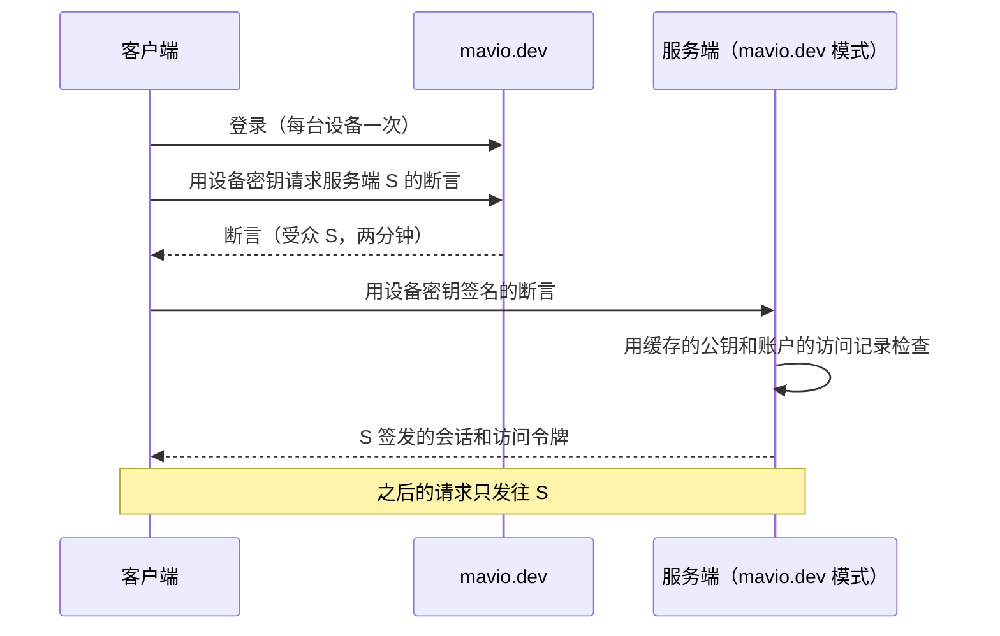

# Mavio 账户

> [English](accounts.md) | 简体中文

> 相关文档：[系统架构](architecture.zh-CN.md) · [领域模型](domain.zh-CN.md) · [客户端](clients.zh-CN.md) · [mavio.dev](mavio-dev.zh-CN.md) · [路线图](roadmap.zh-CN.md) · [AGENTS.zh-CN.md](../AGENTS.zh-CN.md)

> 谁可以使用一台 Mavio 服务端，以及如何登录。服务端以两种模式之一运行：**mavio.dev 模式**下，每个用户都是 Mavio 账户，由 mavio.dev 仿照 plex.tv 的模型保存账户、谁能访问哪些媒体库、好友与 Home；**独立模式**下，服务端保存自己的用户，模型相同，只是没有跨服务端的部分。本文描述设计；mavio.dev 本身见 [mavio.dev](mavio-dev.zh-CN.md)。在[路线图](roadmap.zh-CN.md)的 P27 阶段实现。

---

## 1. 原则

1. **一台服务端只有一种模式。**服务端要么用 Mavio 账户登录，要么用自己的用户登录。
2. **两种模式是同一个模型。**两种模式都有每台服务端一个的管理员、成员、带 PIN 的托管用户，以及每个成员一条媒体库访问记录；独立模式只是没有 Home、好友和 mavio.dev 的服务。
3. **一台服务端恰好有一个管理员。**mavio.dev 模式下是认领它的账户，独立模式下是安装时创建的用户。其他人都是成员。
4. **服务端接受的每个令牌都由它自己签发。**mavio.dev 签发短期登录断言，由服务端换成自己的会话；它从不持有能打开服务端的令牌。
5. **mavio.dev 从不在请求路径上。**它只参与登录和访问权限的变更；mavio.dev 不可达时，已登录的设备照常工作。
6. **mavio.dev 知道访问权限，不知道媒体。**它保存成员能访问哪些媒体库、带哪些限制；条目、观看记录和播放状态都留在服务端。

## 2. 服务端模式

| | mavio.dev 模式 | 独立模式 |
| :--- | :--- | :--- |
| 用户 | Mavio 账户 | 服务端的用户 |
| 管理员 | 认领服务端的账户 | 安装时创建的用户 |
| 成员 | 被授予访问权限的账户 | 管理员创建或用链接邀请的用户 |
| 托管用户 | Home 的托管账户（§3.5） | 服务端的托管用户（§4.1） |
| 媒体库访问 | 由 mavio.dev 保存，同步到服务端 | 由服务端保存 |
| 用户切换 | 在 Home 内，任何成员的设备上 | 在服务端内，管理员的设备上 |
| 好友与 Home | 有 | 无 |
| mavio.dev 的服务（中转、证书、发现） | 有 | 无 |
| 电视登录 | 在 mavio.dev/link 输入代码 | 服务端的 Quick Connect |

新服务端首次启动时选择模式；选择 mavio.dev 模式后开始认领（§3.2）。服务端把模式保存在设置的 `accounts` 组中。

### 2.1 切换模式
管理员手动切换服务端的模式。切换会删除全部用户数据（用户、会话、设备、观看记录、播放列表和偏好），保留媒体库、元数据和服务端设置：

1. 停止服务端并备份数据库：复制 `mavio.db`，或导出 PostgreSQL 数据库。
2. 用 `DELETE FROM users;` 删除所有用户（在 `sqlite3` 中先执行 `PRAGMA foreign_keys = ON;`）。每张保存用户数据的表都以 `ON DELETE CASCADE` 引用 `users`，因此用户的数据随之删除。
3. 用 `DELETE FROM settings WHERE key = 'accounts';` 删除模式。
4. 离开 mavio.dev 模式时，还要在 mavio.dev 上把服务端从管理员的服务端中移除。
5. 启动服务端；安装向导会像首次启动时一样询问模式。

## 3. mavio.dev 模式

### 3.1 账户
**Mavio 账户**有一个在 mavio.dev 内全局唯一且稳定的 ID、用户名、显示名和头像。它分两种：

| 种类 | 登录方式 | 创建者 |
| :--- | :--- | :--- |
| **完整账户** | 邮箱加密码或通行密钥，可选 TOTP | 本人 |
| **托管账户** | 无；只能在所在 Home 内切换进入（§3.6） | 所在 Home 的管理员（§3.5） |

每个账户都可以有一个四位数 **PIN**，用来保护切换到该账户，它不是凭据。完整账户自己设置 PIN，别人无法修改；托管账户的 PIN 由所在 Home 的管理员设置。托管账户可以转为完整账户：本人设置邮箱和密码，账户保留其 ID、数据、访问权限和 Home 成员身份。

服务端能得到账户的 ID、用户名、显示名、头像和种类；只有本人同意时才能得到邮箱。

### 3.2 服务端与认领
* 服务端的 **ID** 是其身份公钥（§5.1）的指纹，也是它在 mavio.dev 的 OpenID Connect `client_id`；它用身份密钥签名的 JWT 认证（`private_key_jwt`）。
* **认领**通过用身份密钥签名的注册请求，把服务端注册到 mavio.dev，请求携带几分钟内有效的认领码。服务端的安装向导通过登录 mavio.dev 取得认领码并传给 `AuthService.ClaimServer`；手边没有浏览器的服务端，则把从 mavio.dev/claim 取得的认领码传入 `MAVIO_CLAIM_TOKEN`，在未认领状态下启动时自行认领。认领让模式尚未设置的服务端进入 mavio.dev 模式。认领的账户成为服务端的管理员：创建其用户，服务端已有该用户时则将其提升，其他管理员降为成员。
* 管理员管理服务端的设置和媒体库，授予、修改和撤销媒体库访问。管理员的账户丢失时，用 `mavio admin unclaim` 把服务端恢复为未认领状态，同时把管理员降为成员并在所有设备上登出，再由另一个账户认领；服务端仍处于 mavio.dev 模式，因此用户数据保留，已应用变更的位置也保留。
* 服务端与 mavio.dev 保持一条连接（[mavio.dev §3](mavio-dev.zh-CN.md#3-向服务端推送)），通过它接收访问记录（§3.3）的变更和吊销（§5.5）。离线过的服务端重新连接时补取错过的变更。

### 3.3 媒体库访问
服务端的管理员用**媒体库访问记录**为其他账户授予访问权限，每个服务端与账户之间一条：

| 字段 | 含义 |
| :--- | :--- |
| 媒体库 | 账户能访问服务端的哪些媒体库 |
| 内容分级上限 | 显示的最高分级，以及是否隐藏未分级的条目 |
| 标签 | 只显示带这些标签的条目，以及隐藏带这些标签的条目；条目也带有其祖先的标签，因此给剧集加上标签即覆盖其各集 |
| 下载 | 账户能否下载条目离线播放 |

授予访问会向该账户发出邀请，账户接受后记录生效。管理员可以随时修改或撤销记录。

访问被撤销时，服务端保留该账户的用户记录和观看记录，并结束其会话；再次授予访问时一切如旧。管理员可以把没有访问权限的账户连同其数据从服务端清除。

服务端向 mavio.dev 公布其媒体库的 ID、名称和类型，以便在任何地方编辑访问权限。记录由 mavio.dev 保存，服务端按同步来的副本执行。

### 3.4 好友
**好友**是两个完整账户之间的关系：一方按用户名或邮箱发出请求，另一方接受；任何一方都可以解除。管理员从好友中挑选授予访问的对象，向尚不是好友的账户授予访问时，会随邀请一起发出好友请求。

好友关系与媒体库访问相互独立：管理员可以与无权访问其服务端的人是好友，删除好友时访问记录保持不变，撤销访问时好友关系保持不变。托管账户没有好友。

### 3.5 Home
**Home** 是最多 **15 个账户（含管理员）**组成的群组，成员共用设备并共享管理员的 Mavio Pass：

* **管理员**：创建 Home 的账户。它邀请和移除成员，创建和删除托管账户，并设置托管账户的 PIN 和限制档。
* **完整成员**：接受了邀请的完整账户。邀请完整账户需要管理员持有 Mavio Pass；任何账户都能创建 Home 并添加托管账户。
* **托管账户**：在 Home 内创建。托管账户有一个**限制档**（低龄儿童、大龄儿童、青少年或无），在每台服务端上叠加在其访问记录之上；它只能获得管理员就是其 Home 管理员的服务端的访问权限。

一个账户最多属于一个 Home。完整成员接受另一个 Home 的邀请时离开当前 Home；Home 的管理员必须先解散自己的 Home，才能加入别的 Home。

邀请某人加入 Home 时，同一步骤中会为 Home 管理员所管理的每台服务端提供访问记录；管理员之后认领的服务端，像对其他人一样授予访问（§3.3）。

| 事件 | 完整成员 | 托管账户 |
| :--- | :--- | :--- |
| 离开 Home（只有完整成员可以）或被移除 | 成为管理员的好友；访问记录保留 | 连同数据一起删除：账户本身，以及它在每台服务端上的用户记录、观看记录和播放列表；当时离线的服务端在重新连接时删除 |
| 管理员解散 Home | 同上 | 同上 |

删除托管账户前，客户端列出将被删除的内容。

管理员的 Mavio Pass 过期时，Home 被**冻结**：不能邀请完整成员，也不再共享 Pass。已有成员、托管账户和切换照常工作，仍然可以添加托管账户。续订 Pass 后 Home 解冻。

### 3.6 用户切换
在任何以 Home 成员身份登录的设备上，客户端列出 Home 的所有成员并切换到其中一个，目标有 PIN 时需要输入；设备的 mavio.dev 会话随之变为目标账户的，服务端列表和服务端会话也一样。完整账户在新设备上用自己的凭据登录时不需要 PIN。

Home 信任其成员：不希望 Home 中的其他人切换到自己的完整成员应设置 PIN。错误的 PIN 会逐步减速；完整账户连续五次输错 PIN 后，切换到它需要输入密码。

### 3.7 Mavio Pass
Mavio Pass 为 mavio.dev 自身提供的服务付费，例如中转；服务端的任何功能都不依赖它。账户的**有效 Pass** 是它自己的 Pass，或者在 Home 未冻结时其 Home 管理员的 Pass。观看者或服务端管理员拥有有效 Pass 时，串流可以经过中转。

## 4. 独立模式

### 4.1 用户
| 种类 | 登录方式 | 创建者 |
| :--- | :--- | :--- |
| **管理员** | 密码或通行密钥，可选 TOTP | 安装向导；每台服务端恰好一个 |
| **成员** | 密码或通行密钥，可选 TOTP | 管理员，或成员本人通过邀请链接 |
| **托管用户** | 无；只能切换进入（§4.4） | 管理员 |

用户名在服务端内唯一，不区分大小写。每个用户都可以有 PIN：托管用户的 PIN 由管理员设置，其他人自己设置。托管用户和托管账户（§3.5）一样有限制档；管理员给它一个凭据，或一个让本人设置凭据的邀请链接，就把它转为成员，数据保留。

### 4.2 媒体库访问
每个成员和托管用户都有一条字段同 §3.3 的媒体库访问记录，由服务端保存，由管理员编辑。停用用户会保留其数据；管理员可以清除它。

### 4.3 加入与登录
* **邀请链接**：管理员创建带有效期（最长 30 天）、使用次数（最多 100 次）和预设访问记录的链接；受邀者在客户端打开它，用密码或通行密钥创建成员。为托管用户创建的链接只能使用一次，把该用户转为成员，访问记录保留。每次使用在接受时计数，因此并发的受邀者不会超出次数；管理员可以列出和撤销链接，过期的链接由每日清理删除。
* **Quick Connect**：电视显示一个代码，在另一台设备上已登录该服务端的用户批准后，电视以该用户身份登录。
* 登录失败按用户和地址逐步减速，并在一段时间内锁定该用户；从不停用用户。

### 4.4 用户切换
在以管理员身份登录的设备上，客户端列出服务端所有已启用的用户并切换到其中一个，目标有 PIN 时需要输入。切换就地改变设备会话的用户，此后其令牌与刷新都以目标用户身份行事，会话记下执行切换的管理员；设备仍保留切换的能力，因此可以切回管理员，管理员设置了 PIN 时需要输入。这不会给管理员带来任何新的权力，因为管理员本来就能重置任何用户的凭据。错误的 PIN 按目标用户逐步减速，与登录失败相同（§4.3）。

### 4.5 恢复
服务端的命令行可以恢复管理员，这需要访问服务端文件的权限：`mavio admin reset-password` 设置新密码，关闭管理员的 TOTP，结束其会话并打印其名字。它直接操作服务端的数据库，无论服务端是否在运行，并记入活动日志。

## 5. 密钥与令牌

### 5.1 服务端身份
每台服务端都有一对 Ed25519 身份密钥，首次启动时创建，与其数据一起保存。它的 ID 是公钥 SHA-256 的前 20 字节的小写 base32 编码，共 32 个字符，同时也是一个 DNS 标签（[mavio.dev §4.1](mavio-dev.zh-CN.md#41-名称)）。mavio.dev 模式下，服务端用它签名发往 mavio.dev 的请求，mavio.dev 把公钥提供给客户端，客户端连接时检查它，使其他服务端无法在同一地址上冒充它。

### 5.2 设备密钥
客户端每次安装生成一对 Ed25519 密钥，私钥保存在平台的密钥存储中（Keychain、Android Keystore、Windows 凭据存储、Secret Service；浏览器中是 IndexedDB 里不可导出的 WebCrypto 密钥）。每次登录都把会话绑定到设备公钥。

### 5.3 服务端令牌
* **访问令牌**短期有效（一小时），由服务端签名并绑定到会话；请求在 `Authorization` 头中携带它。
* 设备用设备密钥签名服务端给出的随机数来续期；没有长期的持有者令牌，因此被盗的访问令牌只在过期前有效，且无法续期。
* 会话在管理员设定的闲置期（默认 90 天）后结束。用户可以查看和结束自己的会话；管理员可以查看和结束所有人的会话。
* 供集成使用的 **API 密钥**由管理员创建，只显示一次，只保存哈希，以管理员身份行事。

### 5.4 媒体 URL
直接播放、HLS 播放列表和分段、图片和字幕都通过服务端为一个会话和一个条目签名的短期 URL 获取，使播放器和投屏接收端无需请求头，也不会有令牌出现在比其用途存活更久的 URL 中。

* 签名 URL 形如 `signed/{token}/{path}`。令牌写明会话及其过期时间，并以从服务端身份密钥派生的密钥，连同路径的前几段一起认证；这几段之下的路径共用该令牌，因此 HLS 播放列表中的相对分段、字幕和附件无需各自的令牌。
* 服务端在响应中返回签名 URL：播放的媒体、字幕和附件，条目和人物的图片，媒体库的拼贴图，缩略图拼图和章节图片。
* 播放的 URL 随播放结束而失效。图片的 URL 在十二小时内保持不变，以便缓存保留副本，此后再被接受十二小时。
* 会话结束或其用户被禁用后，所有 URL 都会失效，最多每 30 秒检查一次。
* 不带前缀的相同路径改为接受 Connect API 的凭据，供 API 密钥和插件使用。

### 5.5 登录断言
**登录断言**是 mavio.dev 为一台服务端签名的 JWT：受众是服务端 ID，载明账户、设备公钥和一个随机数，有效期两分钟。服务端用缓存的 mavio.dev 公钥检查它，核对账户的访问记录，每个断言只接受一次。

访问被撤销，或账户被停用、删除、报告被盗时，mavio.dev 通过连接通知相关服务端，服务端结束该账户的会话。

## 6. 登录

* 服务端的 Web 界面通过带 PKCE 的 OpenID Connect 授权码流程登录，以服务端 ID 作为 `client_id`。
* 电视用代码登录 mavio.dev：电视显示代码，用户在 mavio.dev/link 输入，或在已登录 mavio.dev 的客户端中批准，批准界面会写明被登录的设备。
* mavio.dev 不可达时，已打开的会话按服务端同步来的访问记录照常续期；新的登录要等 mavio.dev 恢复。
* 独立服务端用自己的凭据和 Quick Connect（§4.3）登录，从不联系 mavio.dev。

## 7. 客户端

客户端一次只显示一个**登录**的内容：要么是一个 Mavio 账户，连同该账户管理或有权访问的服务端；要么是一台独立服务端的一个用户，连同这台服务端。设备上做过的每次登录都会保留，用户无需再次输入凭据就能更换登录：

* 保留的登录就是它绑定设备的会话（§5.2）：mavio.dev 会话，或独立服务端的会话。客户端不保存密码。
* 更换登录后显示另一个登录的内容。未显示的登录保留会话，再次显示时续期；会话已经结束（§5.3）的登录会要求重新登录。
* 移除保留的登录会退出它并结束其会话。
* 通过地址、局域网发现或二维码添加后发现处于 mavio.dev 模式的服务端，通过 Mavio 账户访问。

更换登录是客户端自己的功能，与用户切换不同：在 Home 内（§3.6）或在独立服务端内（§4.4）切换用户，改变的是同一个登录中登录的是谁，之后这个登录保留切换到的用户。

## 8. 服务端实现

* **两个端口。**`libs/core` 定义登录端口和用户目录端口。登录端口校验一次登录（凭据、Quick Connect 批准或登录断言）并返回用户 ID；用户目录端口列出用户、指明管理员，并给出每个用户的媒体库访问记录。`apps/server` 按模式为每个端口装配一个实现：独立模式基于服务端自己的表，mavio.dev 模式基于从 mavio.dev 同步来的记录副本。登录之后的一切由两种模式共用：会话、设备密钥、令牌、媒体 URL、媒体库访问的执行，以及用户的观看数据。
* **用户。**`users` 表有 `kind`（管理员、成员或托管）、用户的媒体库访问记录，和一个可空且唯一的 `account_id`，即 mavio.dev 模式下 Mavio 账户的 ID。mavio.dev 模式下，账户的访问记录到达时创建其用户记录；管理员的用户记录在服务端被认领时创建。凭据（密码哈希、通行密钥、TOTP 密钥、PIN 哈希）保存在单独的表中，只在独立模式下使用。
* **独立模式的凭据。**密码用 argon2id 哈希（[系统架构 §11](architecture.zh-CN.md#11-api-与认证appsserver)）；TOTP（RFC 6238）用标准库的 HMAC 计算；通行密钥使用 `go-webauthn/webauthn`。通行密钥属于浏览器访问服务端时所用的主机名，即其依赖方，取自请求的来源，来源必须是 HTTPS，或 `localhost` 上的 HTTP；通行密钥只在该主机上可用，IP 地址不能有通行密钥。通行密钥单独即可登录；TOTP 是密码的第二因素。
* **mavio.dev 模式下的管理。**客户端直接在 mavio.dev 上管理访问、好友和 Home；服务端管理用户和访问的 RPC 返回 `failed_precondition`。Home 内的用户切换发生在客户端与 mavio.dev 之间，服务端只看到一次带新断言的登录。
* **服务端信息。**无需登录的 `AuthService.GetAuthInfo` 给出服务端的模式及其 ID 和名称，客户端在登录前就知道该如何登录；在模式选定之前，以及 mavio.dev 模式的服务端未被认领时，它报告需要安装。
* **与 mavio.dev 的连接。**`internal/cloud` 用身份密钥为服务端发往 mavio.dev 的 `mavio.cloud.v1.ServerService` 的请求签名、认领服务端，并为已认领的服务端保持到 mavio.dev 的 WebSocket（[mavio.dev §3](mavio-dev.zh-CN.md#3-向服务端推送)）。账户设置保存管理员的账户和服务端已应用的最后一项变更的游标；服务端用 `ListChanges` 取得其后的变更，并在推进游标的事务中应用它们。

## 9. mavio.dev

| mavio.dev 保存 | mavio.dev 从不保存 |
| :--- | :--- |
| 账户：邮箱、凭据、PIN 的哈希、Mavio Pass | 独立服务端及其用户 |
| mavio.dev 模式的服务端：身份公钥、管理员、公布的地址、媒体库的 ID、名称和类型 | 条目、观看记录、播放状态 |
| 媒体库访问记录及其邀请 | 账户在服务端上做了什么 |
| 好友与 Home | |

它是 mavio.dev 模式服务端的 OpenID Connect 签发方，保存它们的访问记录并向它们推送变更和吊销，用代码登录电视，并为这些服务端提供中转、证书和发现；它如何构建和部署，见 [mavio.dev](mavio-dev.zh-CN.md)。

## 10. 安全说明

* **mavio.dev 被攻破**时，攻击者可以伪造断言和访问记录，但拿不到服务端令牌；管理员可以让服务端离开 mavio.dev 模式（§2.1）。
* **mavio.dev 的公钥**连同有效期一起缓存，遇到不认识的密钥 ID 时重新获取，每分钟至多一次。
* **PIN** 是四位数字，只在共用设备的人之间保护切换；它从不作为登录凭据，输错会被限速。
* **保存的秘密**都是哈希、公钥或密封的：密码、PIN、API 密钥和邀请令牌的哈希，设备和通行密钥的公钥，以及用从服务端身份密钥派生的密钥以 AES-GCM 密封的 TOTP 秘密。拿到服务端数据库的副本也无法登录。
