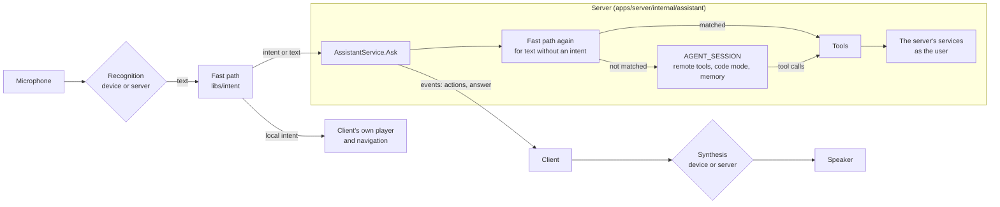

# Mavio Assistant

> English | [简体中文](assistant.zh-CN.md)

> The assistant of Mavio's clients: spoken or typed requests such as "play the next episode of Severance", "subtitles two seconds earlier" or "the Nolan films I haven't finished, best rated first, on the living room TV", carried out as the user. Simple commands are understood by a grammar on every platform and on the server, with no AI model; anything else goes to a model through the AI gateway with the server's tools. Speech is recognized and synthesized on the device where it can be, else by the server's speech plugins. Related: [Architecture](architecture.md) · [Plugins](plugins.md) · [Clients](clients.md) · [Television](tv.md) · [Roadmap](roadmap.md)

## 1. Principles

* **Two paths, one set of actions.** The fast path (a grammar, §4) and the AI path (a model, §6) end in the same tools (§5), implemented once in the server; a command understood by the grammar does exactly what the model would do with it.
* **Useful without AI.** A server with no AI gateway plugin, or a user without the AI path, still controls playback, finds and plays titles, switches subtitles and audio, and navigates by voice. The fast path is designed as a product of its own, not as a cache in front of the model.
* **The device first, the server as fallback** — for recognition, synthesis and understanding alike. Audio leaves the device only when the device cannot recognize it; the grammar runs on the device and again on the server for requests that arrive as text.
* **The server decides and acts; the client listens, speaks and plays.** Library queries, other devices, permissions and conversations are the server's; the microphone, the speaker, the screen and the client's own player are the client's.
* **As the user, never more.** Every tool runs as the user who spoke, under the user's library access, parental limits and permissions; the assistant reaches nothing the user could not reach through the UI.
* **Push to talk.** Listening starts with a button or key and ends when it is released or the speech ends; there is no wake word and no listening in the background.
* **Remember only what the server does not know.** Watch history, ratings, favorites and stream preferences are read through tools when needed; memory (§7.2) keeps only what the user says about themselves.

## 2. Overview

| Part | Where | What |
| :--- | :--- | :--- |
| Intent parser | `libs/intent` (Rust) | The grammar of each language, normalization of numbers, durations and ordinals, the dialog state; linked by the native clients, run as one WASM module by the web UI and by the server on wazero (§4.3) |
| Assistant service | `apps/server/internal/assistant`, `mavio.assistant.v1.AssistantService` | Requests, the server's fast path, slot resolution, the tools, conversations, the listening and speech routes |
| AI path | `AGENT_SESSION` ([Plugins §8.15](plugins.md#815-ai-gateway-and-agent-sessions)), `plugins/agent` | The model with the server's tools as remote tools, code mode, memory |
| Speech | `SPEECH_TO_TEXT` and `TEXT_TO_SPEECH` ([Plugins §8.16](plugins.md#816-speech-recognition-and-synthesis)), `plugins/voice` | Recognition and synthesis services; the same recognizers transcribe subtitles ([Architecture §14.5](architecture.md#145-translation-and-transcription)) |
| Clients | Every client ([Clients](clients.md)) | Push to talk, the device's recognizer and voices, the assistant's panel, the client actions, the system assistants (§9) |

## 3. A Request

1. **Listening**: the user holds the assistant button or key (§9). The client recognizes the speech itself where its recognizer is usable for the language, else streams it to the server (§8.2); partial text shows as it comes.
2. **The client's fast path**: the final text is parsed by `libs/intent` with the client's dialog state (§4.2). An intent about the client itself — its player (pause, seek, subtitles, volume) or navigation without a target to resolve — is carried out at once, with no request.
3. **`Ask`**: anything else is sent to `AssistantService.Ask` with the text, the intent when the grammar matched, and the context: the device's session, what it plays and where, the screen and the item shown or selected, and the UI's language. Typed requests and the system assistants' (§9.6) arrive the same way.
4. **The server's fast path**: text without an intent is parsed on the server by the same module. A matched intent has its slots resolved (§4.4) and becomes one tool call (§5).
5. **The AI path**: text the grammar did not match, or an intent asking for what only a model can do, goes to the user's conversation (§7.1) when the AI path is available to the user (§10), else the server answers with suggestions (§4.5).
6. **Events**: `Ask` streams what happens: the intent understood, each tool as it runs with a short summary, client actions (§5.2), a confirmation to ask for (§5.3), the answer's text as it grows, and the end with the conversation's ID.
7. **Answer**: the client carries out the client actions, shows the answer and the results, and speaks the answer sentence by sentence (§8.3) when the request was spoken and the user lets it.
8. **Recording**: the request and its answer are added to the user's conversation, by the fast path too, so that a later request can refer to them ("who directs it?").

## 4. Fast Path (`libs/intent`)

### 4.1 Intents
| Group | Examples | Tool |
| :--- | :--- | :--- |
| Playback control | pause, resume, stop, "back 30 seconds", "go to 1:20:00", "skip the intro", next and previous episode, from the start, faster and slower, volume up, down or to a level, mute | `control` on this device, or on a device named ("pause the bedroom") |
| Streams | subtitles on or off, "Chinese subtitles", "original audio", "Japanese audio with English subtitles", "subtitles two seconds earlier" | `set_streams` |
| Play | "play Interstellar", "play Severance season 2 episode 3", "continue Severance", "play something from my favorites", "a random comedy from the 90s", "play the album Blue", "play Interstellar on the living room TV", "move this to the bedroom" | `play` |
| Search and navigation | "search Nolan", "open Interstellar", "open Movies", "go home", "go back", "show my downloads" | `search_library`, client actions |
| Questions with templates | "what is this", "who is in this", "how long is left", "when does it end", "what episode is this" | `get_now_playing`, `get_item` |
| User data | mark played or unplayed, add to favorites, "add to Watch Later" | `set_user_data`, `add_to_playlist` |
| Requests | "request Dune Part Three", "download the new season of Severance" | `request_title` |
| Dialog | yes, no, cancel, "the second one", "the last one", "more" | the pending confirmation or the last results |

### 4.2 Grammar
* **Data, not code**: each language's grammar is a file of patterns with typed slots (`title`, `person`, `genre`, `year`, `duration`, `position`, `ordinal`, `language`, `device`, `season`, `episode`, `number`) and lists of synonyms, compiled into the module when it is built. Chinese and English come first; a language is added by adding its file and its cases.
* **Normalization** before matching: full-width and half-width forms, Traditional and Simplified Chinese, punctuation and filler words, Chinese and English numbers ("三十秒", "一分半", "two and a half minutes", "第二季第三集"), times of day and positions ("一小时二十分"), and ordinals.
* **Matching** takes every pattern of the request's language and of English, which mixed requests use for titles; the best match covers the most text with the fewest free slots. A free slot (`title`, `person`) takes the text left, which the server resolves (§4.4); a typed slot must parse.
* **Dialog state**, given with each parse: whether a confirmation is pending, how many results were last shown, and what plays. Dialog patterns match only when their state holds: "yes" means something only while a confirmation is pending, "the second one" only after results.
* **Outcome**: an intent with its slots and a confidence, `full` when the whole text matched, `partial` when a pattern matched with text left over, or nothing.

### 4.3 One Implementation, Three Hosts
* `libs/intent` is a Rust crate with no dependencies on I/O. The native clients link it through `libs/client-rust` (UniFFI and the C ABI expose `parse_intent`).
* It also builds as one WASM module (`wasm32-unknown-unknown`) with no imports, exporting allocation and `parse`, whose request and answer are protobuf messages of `mavio.assistant.v1` (`ParseIntentRequest`, `Intent`). The web UI instantiates it through `libs/client-ts`, and the server runs the same file on wazero, as it runs WASM plugins, so the grammar never has a second implementation.
* The module is built by Nx (`intent:wasm`) and is not committed; the server's `build` embeds it and the web's `build` bundles it, as the server embeds the web UI.

### 4.4 Slots on the Server
* **Titles and people** are resolved against the user's libraries: by name, original name, alternative titles and sort name, tolerant of recognition errors; Chinese names also by their pinyin, so that a homophone the recognizer chose still finds the title. A title with seasons resolves season and episode by its numbering ([Domain Model §4.3](domain.md#43-hierarchies)).
* **Ambiguity**: one clear match is acted on; several close ones are returned as results to choose from ("the second one"); none falls back to a search of the text, or to the AI path when it is available.
* **Devices** are resolved by name among the user's online devices and the plugins' remote devices ([Plugins §7](plugins.md#7-remote-devices)); "here" is the requesting device.
* **Context**: "this", "it" and "him" refer to what plays, else the item shown or selected, else the last item of the conversation.

### 4.5 Without AI
When the AI path is unavailable, an unmatched request is searched as a title or person, so that saying a name alone finds it; a partial match acts when its slots resolve, and otherwise the answer lists what the assistant understands, with examples in the user's language. The suggestions come from the grammar itself, so they never offer what the fast path cannot do.

### 4.6 Tests
The cases of each language (`libs/intent/testdata/cases/<language>.yaml`: text, dialog state, expected intent) are run by the crate's tests, by the server against the WASM module on wazero, and by `libs/client-ts` against the same module in Node, so that the three hosts are checked to agree.

## 5. Tools and Actions

### 5.1 Tools
The server's tools are Go functions in `apps/server/internal/assistant/tools`, each with a name, a description for models, a JSON Schema of its arguments and one of its results, and a TypeScript declaration generated from them for code mode (§6.2).

| Tool | What it does |
| :--- | :--- |
| `search_library` | Items of the user's libraries by text, kind, genre, year range, person, studio, rating, played and favorite state, with an order and a limit |
| `get_item` | An item's details: names, overview, people, numbering, runtime, streams, the user's data |
| `list_next_up`, `list_resume` | What the user is watching: next episodes, items in progress |
| `get_now_playing` | What a device plays: item, position, streams, speed |
| `list_devices` | The user's online devices and the remote devices, with what each plays |
| `read_subtitles` | The text of an item's subtitle around a position, never after the position the user has reached, so that questions about the story do not spoil it |
| `play` | Plays items, a query's results, shuffled or not, from the resume position, the start or a time, on a device |
| `control` | Pause, resume, stop, seek, skip a media segment, next or previous, speed, volume, mute, on a device |
| `set_streams` | Audio and subtitle streams by language or index, subtitles off, the subtitle offset |
| `set_user_data` | Played state, favorite, rating |
| `add_to_playlist` | Adds items to a playlist, made when missing |
| `request_title` | Requests a title from discovery ([Architecture §13.7](architecture.md#137-discovery-requests-and-issues)) under the user's request permissions |
| `navigate` | Only a client action: opens a screen |

### 5.2 Client Actions
A tool acting on the requesting device returns client actions instead of sending it commands: `play` (items, position, streams), `control`, `navigate` (an item, a library, a search, a settings section, home, back) and `show_items` (results to choose from). Other devices are commanded through `SessionService.SendCommand`, as remote control does ([Plugins §7](plugins.md#7-remote-devices)). A client that cannot carry an action out says so in its next request, and the server answers with what it can do instead.

### 5.3 Confirmation
A tool may require confirmation. Its call then returns a pending confirmation, with a sentence saying what will happen, instead of acting; the client shows it with Confirm and Cancel and speaks it, and the answer comes back as a dialog intent ("yes", "cancel") or the buttons' own `Ask`, with no model involved. The call waits — in the model's conversation too, durably (§6.1) — until it is confirmed, canceled, or the conversation ends. Which tools require it is set in the tools' definitions.

### 5.4 As the User
Every call runs as the user of the request and, for actions on the requesting device, as that device; library access, parental limits, the transcoding and request permissions and playback limits apply as in the UI, and actions are logged in the activity log as the user's, noted as made through the assistant.

## 6. AI Path

### 6.1 The Server's Tools as Remote Tools
The model runs in the `AGENT_SESSION` plugin, the tools in the server ([Plugins §8.15](plugins.md#815-ai-gateway-and-agent-sessions)):
* The server creates each conversation with the declarations of its tools. The plugin registers them as pi-durable tools whose execution hands the call to the server and waits for its result.
* The server holds one `WatchAgentToolCalls` stream per plugin, which lists the calls waiting and then each new one: call ID, conversation, tool and arguments. The server runs the call as the conversation's user and answers it with `SubmitAgentToolResult`: the model's text, the structured result, and whether it failed.
* Calls are durable on both sides. pi-durable commits a call before it runs and declares the remote tools safe to replay, so after the plugin restarts it hands the same call again with the same ID; the server keeps the results of the calls it ran for a day, by call ID, and answers a repeated call with the kept result without running it again. After the server restarts, the stream lists again the calls still waiting.
* Answers stream to the client as they grow (`StreamAgentMessage`); the server turns the model's text and its tool calls into `Ask`'s events.

### 6.2 Code Mode
For models that write code well, a conversation also offers pi-durable's code mode: the model writes JavaScript that calls the tools (`await tools.search_library(…)`) in a QuickJS sandbox, and only the script's output reaches the model. A request needing several steps — search, filter, order, play — is one script instead of a round trip to the model per step, and large results are filtered in the sandbox instead of filling the model's context. Each call in a script is a nested call of a remote tool, so it reaches the server as any call does, and a script interrupted by a restart resumes without running its finished calls again. Code mode is set per model in the assistant settings (§10); the tools stay offered directly beside it, for single steps.

### 6.3 What the Model Sees
* **Instructions**, stable so that providers' prompt caches hold: the assistant's role and rules (act through the tools, ask when ambiguous, never spoil, answer briefly for speech), the server's name and the user's name and language, the tools, and the user's memories (§7.2).
* **The context of each request** — the device, what it plays and where, the screen, the time — comes with the request's message, not in the instructions, which would change with every request.
* **Answers** are short and speakable: what was done, or the answer, with details shown as results rather than read out.

## 7. Conversations and Memory

### 7.1 Rolling Conversations
* Each user has one current conversation, across their devices. A request after the conversation has been idle longer than the settings' idle time (30 minutes), or on another day in the server's time zone, starts a new one.
* Fast-path requests are added to the conversation as a message and its answer without asking the model (`AddAgentMessages`), so that the model knows what was done when the next request needs it.
* The server records each conversation's user, its first device and when it started and last changed; the dialog state of §4.2 (the pending confirmation, the last results, the last item) is kept in memory for the current conversation.
* Long conversations are compacted by pi-durable. Users list, read and delete their conversations; those older than the settings' retention (30 days) are deleted, and deleting a conversation purges it from the plugin's database ([Plugins §8.15](plugins.md#815-ai-gateway-and-agent-sessions)). Without the AI path, no conversation is stored; the dialog state alone is kept.

### 7.2 Memory
* **What is remembered**: what the user tells about themselves that the server does not hold — "I don't watch horror", "my daughter is called Mia", "we watch the Bake Off on Saturdays", "I prefer the original audio". What the server holds (history, ratings, favorites) is read through tools; a preference the server has a setting for (the subtitle and audio languages) is set there instead, through a tool, so that the fast path and every client follow it too.
* **Where**: a pi-durable document family in the plugin's database, keyed by the server's user ID, each memory with its text, when and in which conversation it was learned, and when it was last used.
* **Learning**: the model calls `remember` and `forget`, tools of the plugin itself, when the user asks it to or says something lasting; and when a conversation ends, the plugin consolidates it in a background task: the model reads the conversation with the user's memories and proposes additions, corrections and removals, so that duplicates merge and contradicted memories go.
* **Using**: memories are in the instructions while they fit a budget (2,000 tokens); beyond it the instructions hold the most used and the rest are found with `recall`, which searches them with pi-durable's BM25 search.
* **Control**: users list, edit and delete their memories in the client's settings, and can turn memory off; deleting a user deletes their memories and conversations. Managed users have memories of their own, which only they and the administrator who manages them see.

## 8. Speech

### 8.1 Recognition
* **The device's recognizer first**, where it runs on the device for the language: Apple's speech framework, Android's on-device recognizer. The client gives it the hints of `GetAssistantHints` where it takes contextual phrases: titles being watched, recently added titles, people and the user's devices.
* **The server's recognizer** (§8.2) when the device's cannot recognize the language, needs a network service the user has not allowed, or is missing — the web UI's in most browsers (§9.2) and the desktop app's.
* The user chooses the order in the client's settings; a recognizer that fails falls back to the other.

### 8.2 Listening on the Server
* `AssistantService.StartListening` returns a WebSocket URL signed for the session, valid for a minute, with the recognizer chosen (the settings', else the first ready `SPEECH_TO_TEXT` recognizer) and the language.
* The client sends 16 kHz mono 16-bit PCM in binary frames and a final message when the user releases the key; the server forwards it to the recognizer as a stream with the user's hints and sends back partial and final text. Without a release, the speech ends after a second of silence detected by Silero VAD (`libs/media/vad`), and an utterance lasts at most 30 seconds.
* Recognizers that do not stream are given the utterance once it ends. Audio is never stored.

### 8.3 Synthesis
* **The device's voices first**: the browser's `speechSynthesis`, `AVSpeechSynthesizer`, Android's `TextToSpeech`, with a voice of the answer's language.
* **Server voices** (`TEXT_TO_SPEECH`) when the user chooses one, or when the device has no voice for the language: `POST /assistant/speech` with the text, the voice and the language returns the audio, Opus in Ogg or MP3 as the client asks.
* Answers are spoken a sentence at a time as the text arrives, so speech starts before the answer ends; speaking stops when the user talks or presses the button again.

### 8.4 Speech Plugins
`SPEECH_TO_TEXT` and `TEXT_TO_SPEECH` ([Plugins §8.16](plugins.md#816-speech-recognition-and-synthesis)) are provided by `plugins/voice`, a Go process plugin connecting to the services the administrator configures, each a recognizer or voices named `<plugin>/<id>`:
* recognition: whisper-asr-webservice, the OpenAI-compatible transcription API (OpenAI, Groq, speaches with faster-whisper, and other servers serving it), Deepgram, Azure Speech, Google Cloud Speech-to-Text, and Volcengine's and Alibaba Cloud's recognition for Chinese;
* synthesis: the OpenAI-compatible speech API (OpenAI, speaches with Kokoro or Piper), ElevenLabs, Azure Speech, Google Cloud Text-to-Speech, and Volcengine's and Alibaba Cloud's.

Each recognizer tells whether it streams, gives timestamps, detects the language, translates to English and takes hints, and its languages and longest audio; the server uses each only for what it can do.

### 8.5 Subtitles
Transcribing subtitles uses the same recognizers ([Architecture §14.5](architecture.md#145-translation-and-transcription)): a recognizer with timestamps transcribes a video's audio into a subtitle, so that any service configured for the assistant also transcribes subtitles, and Whisper is one of them rather than a subtitle provider of its own.

## 9. Clients

### 9.1 Common to Every Client
* **The assistant's panel** opens over any screen, the player included: the text heard as it grows, the answer, results as cards to choose from, and a pending confirmation with Confirm and Cancel; it takes typed requests too. It closes on its own a few seconds after an answer with nothing to choose.
* **Push to talk** with the assistant button: held to talk, or tapped to talk until the speech ends.
* **Settings**: whether answers are spoken, the voice, the order of recognizers, memory and its list, and the conversations; the server's assistant settings are in its AI settings for administrators ([Clients §6.3.13](clients.md#6313-ai)).
* **The client's fast path** runs before `Ask` (§3), so that player commands take effect with no request and no network.

### 9.2 Web (`apps/web`), First
* **Microphone**: `getUserMedia`, which browsers grant only to secure pages — a server's HTTPS address (its `mavio.site` certificate, [Accounts](accounts.md)), app.mavio.dev or `localhost`. Over plain HTTP the panel takes typed requests only and says why.
* **Recognition**: the server's when a `SPEECH_TO_TEXT` plugin is ready, else the browser's `SpeechRecognition` where it exists, which most browsers run on their maker's servers; the user may put the browser's first. Audio is captured by an `AudioWorklet` that resamples it to 16 kHz PCM for the WebSocket.
* **Synthesis**: `speechSynthesis`, or server voices played from the speech route a sentence at a time.
* **Input**: the assistant button in the top bar and in the player's controller, and a key held to talk, listed with the player's shortcuts; in television mode the button is focusable like any other.

### 9.3 Apple (`apps/ios`, `apps/macos`, `apps/tvos`)
* **iPhone, iPad and Mac**: the speech framework's on-device recognition with the hints as contextual strings, `AVSpeechSynthesizer`, and App Intents, so that Siri, Shortcuts and Spotlight play titles and control playback in Mavio through `Ask`.
* **Apple TV**: the Siri Remote's microphone belongs to the system, so the assistant's field takes the system's dictation; App Intents serve Siri where tvOS offers them.

### 9.4 Android (`apps/android`, `apps/android-tv`)
* **Phones and tablets**: `SpeechRecognizer`, on device where available, with the hints as biasing strings, and `TextToSpeech`.
* **Android TV and Google TV**: the remote's microphone through `SpeechRecognizer` in the assistant's panel, opened by the remote's search or assistant key while the app is in front; the system's voice search reaches the app through its search intents and `MediaSession`'s play-from-search, which go through `Ask`.

### 9.5 Desktop (`apps/desktop`)
The server's recognizer and voices, with the microphone captured by the platform's audio API; without a speech plugin, typed requests only.

### 9.6 System Assistants
Requests from Siri, Shortcuts, Android's voice search and play-from-search arrive at the app as text or as a title to play; the app sends them to `Ask` as its own requests are, so that they take the same paths.

## 10. Settings and Privacy

* **The server's assistant settings**: whether the assistant is on, its model (`ai/<provider>/<model>`) and whether code mode is used with it, which users may use the AI path, the idle time and retention of conversations, whether memory is on, the recognizer and the default voice of each language, and whether hints are sent to recognizers.
* **The user's settings** (§9.1) are kept on the device, the voice and the order of recognizers per device.
* **Privacy**: audio is never stored, and leaves the device only for the server's recognizer and, through it, the service the administrator configured. Requests and answers are stored only in conversations, deleted after the retention time or by the user; memories are visible to the user and deleted with them. The AI path's tokens and cost are counted per conversation and shown with it.

## 11. Testing

* The fast path's cases on its three hosts (§4.6); the slot resolver against a seeded library, with names misrecognized as homophones.
* The tools through `Ask` with fake devices, as the remote control's tests do; confirmation, cancellation and expiry.
* An end-to-end test with the built `plugins/agent` and a model served by a fake OpenAI-compatible API on the loopback interface: a request the grammar does not match becomes tool calls run as the user, one through code mode, and a tool call interrupted by restarting the plugin is answered once.
* Listening and speech with `plugins/voice` and fake whisper-asr-webservice, OpenAI-compatible and streaming services; subtitle transcription as in [Architecture §14.5](architecture.md#145-translation-and-transcription).
* Each client's panel in its snapshot tests ([Clients §6.8](clients.md#68-galleries-and-visual-review)).
