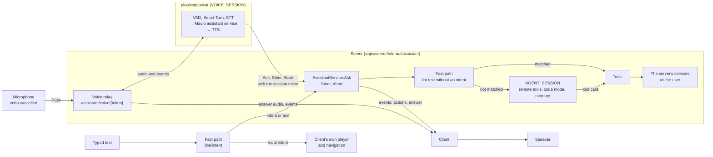

# Mavio Assistant

> English | [简体中文](assistant.zh-CN.md)

> The assistant of Mavio's clients: spoken or typed requests such as "play the next episode of Severance", "subtitles two seconds earlier" or "the Nolan films I haven't finished, best rated first, on the living room TV", carried out as the user. Simple commands are understood by a grammar on every platform and on the server, with no AI model; anything else goes to a model through the AI gateway with the server's tools. Spoken requests are voice sessions: the client streams the microphone to the server, which relays it to `plugins/pipecat`, a Pipecat pipeline that detects turns, recognizes, asks the assistant and speaks the answer, barge-in included. Related: [Architecture](architecture.md) · [Plugins](plugins.md) · [Clients](clients.md) · [Television](tv.md) · [Roadmap](roadmap.md)

## 1. Principles

* **Two paths, one set of actions.** The fast path (a grammar, §4) and the AI path (a model, §6) end in the same tools (§5), implemented once in the server; a command understood by the grammar does exactly what the model would do with it.
* **Useful without AI.** A server with no AI gateway plugin, or a user without the AI path, still controls playback, finds and plays titles, switches subtitles and audio, and navigates by voice. The fast path is designed as a product of its own, not as a cache in front of the model.
* **One voice pipeline, through the server.** Speech is recognized, its turns detected and answers spoken by one pipeline, `plugins/pipecat` (§8), never by the device's recognizers and voices, so that every client hears and speaks alike and turn-taking, barge-in and echo handling are built once. Clients reach it only through the server, which authenticates, relays and records; they use none of Pipecat's client SDKs. The grammar still runs on the device for typed requests, and on the server for everything else.
* **The server decides and acts; the client captures, plays and shows.** Library queries, other devices, permissions and conversations are the server's; the microphone, the speaker, the screen and the client's own player are the client's.
* **As the user, never more.** Every tool runs as the user who spoke, under the user's library access, parental limits and permissions; the assistant reaches nothing the user could not reach through the UI.
* **Listening only in a session the user opened.** A voice session starts with the assistant button or key and ends when the user closes it or stays silent; there is no wake word and no listening in the background.
* **Voice is optional.** A server without `plugins/pipecat` has a typed assistant; the voice assistant needs that plugin and nothing else.
* **Remember only what the server does not know.** Watch history, ratings, favorites and stream preferences are read through tools when needed; memory (§7.2) keeps only what the user says about themselves.

## 2. Overview



| Part | Where | What |
| :--- | :--- | :--- |
| Intent parser | `libs/intent` (Rust) | The grammar of each language, normalization of numbers, durations and ordinals, the dialog state; linked by the native clients, run as a WASM module by the server on wazero (§4.3) |
| Assistant service | `apps/server/internal/assistant`, `mavio.assistant.v1.AssistantService` | Requests and their steering and aborting, the server's fast path, slot resolution, the tools, conversations, voice sessions and their relay, kept speech |
| AI path | `AGENT_SESSION` ([Plugins §8.15](plugins.md#815-ai-gateway-and-agent-sessions)), `plugins/agent` | The model with the server's tools as remote tools, code mode, memory |
| Voice | `VOICE_SESSION` ([Plugins §8.16](plugins.md#816-voice-sessions-and-transcription)), `plugins/pipecat` | The voice pipeline on Pipecat: voice activity, turn detection, recognition and synthesis services, barge-in, and the assistant as its agent (§8) |
| Transcription | `SPEECH_TO_TEXT` ([Plugins §8.16](plugins.md#816-voice-sessions-and-transcription)), `plugins/pipecat` | Subtitles transcribed from a video's audio with timestamps ([Architecture §14.5](architecture.md#145-translation-and-transcription)), apart from the voice pipeline |
| Clients | Every client ([Clients](clients.md)) | The voice session's capture and playback with the platform's echo cancellation, the assistant's orb and cards, the client actions, the system assistants (§9) |

## 3. A Request

1. **Input**: the user speaks in a voice session (§8) or, on Apple TV, dictates (§9.3). In a voice session, the pipeline detects the end of the user's turn, recognizes it — partial text shows as it comes — and asks the assistant with the turn's text, as the user, through the session's token (§8.4). Dictated text and the system assistants' requests (§9.6) go to the client's fast path first.
2. **The client's fast path**, for typed text only: the text is parsed by `libs/intent` with the client's dialog state (§4.2). An intent about the client itself — its player (pause, seek, subtitles, volume) or navigation without a target to resolve — is carried out at once, with no request.
3. **`Ask`**: anything else is sent to `AssistantService.Ask` with the text, the intent when the grammar matched, and the context: the device's session, what it plays and where, the screen and the item shown or selected, and the UI's language. A voice session's turns carry the context the client last sent in the session.
4. **The server's fast path**: text without an intent is parsed on the server by the same module. A matched intent has its slots resolved (§4.4) and becomes one tool call (§5).
5. **The AI path**: text the grammar did not match, or an intent asking for what only a model can do, goes to the user's conversation (§7.1) when the AI path is available to the user (§10), else the server answers with suggestions (§4.5).
6. **Events**: `Ask` streams what happens: the intent understood, each tool as it runs with a short summary, client actions (§5.2), a confirmation to ask for (§5.3), the answer's text as it grows, and the end with the conversation's ID.
7. **Answer**: the client carries out the client actions and shows the answer and the results; in a voice session the pipeline speaks the answer as its text grows, and the client plays it (§8.5).
8. **Recording**: the request and its answer are added to the user's conversation, by the fast path too, so that a later request can refer to them ("who directs it?").

## 4. Fast Path (`libs/intent`)

### 4.1 Intents
| Group | Examples | Tool |
| :--- | :--- | :--- |
| Playback control | pause, resume, stop, "back 30 seconds", "go to 1:20:00", "skip the intro", next and previous episode, from the start, faster and slower, volume up, down or to a level, mute | `control` on this device, or on a device named ("pause the bedroom") |
| Streams | subtitles on or off, "Chinese subtitles", "original audio", "Japanese audio with English subtitles", "subtitles two seconds earlier" | `set_streams` |
| Play | "play Interstellar", "play Severance season 2 episode 3", "continue Severance", "play something from my favorites", "a random comedy from the 90s", "play the album Blue", "play Interstellar on the living room TV", "move this to the bedroom" | `play` |
| Search and navigation | "search Nolan", "open Interstellar", "open Movies", "go home", "go back", "show my downloads" | `search_library`, client actions |
| Questions with templates | "what is this", "who is in this", "how long is left", "when does it end", "what episode is this" | `get_now_playing`, `get_item` |
| User data | mark played or unplayed, add to favorites, "add to Watch Later" | `set_user_data`, `add_to_playlist` |
| Requests | "request Dune Part Three", "download the new season of Severance" | `request_title` |
| Dialog | yes, no, cancel, "the second one", "the last one", "more" | the pending confirmation or the last results |

### 4.2 Grammar
* **Data, not code**: each language's grammar is a file of patterns with typed slots (`title`, `person`, `genre`, `year`, `duration`, `position`, `ordinal`, `language`, `device`, `season`, `episode`, `number`) and lists of synonyms, compiled into the module when it is built. There are grammars for Chinese (Simplified and Traditional), English, Japanese, Korean, German, French and Spanish; a language is added by adding its file and its cases.
* **Normalization** before matching: full-width and half-width forms, Traditional and Simplified Chinese, punctuation and filler words, Chinese and English numbers ("三十秒", "一分半", "two and a half minutes", "第二季第三集"), times of day and positions ("一小时二十分"), and ordinals.
* **Matching** takes every pattern of the request's language and of English, which mixed requests use for titles; the best match covers the most text with the fewest free slots. A free slot (`title`, `person`) takes the text left, which the server resolves (§4.4); a typed slot must parse.
* **Dialog state**, given with each parse: whether a confirmation is pending, how many results were last shown, and what plays. Dialog patterns match only when their state holds: "yes" means something only while a confirmation is pending, "the second one" only after results.
* **Outcome**: an intent with its slots and a confidence, `full` when the whole text matched, `partial` when a pattern matched with text left over, or nothing.
* **Replies and examples**: each grammar also holds the fast path's answers in its language ("Playing Dune.", "Paused."), filled with their arguments, durations spoken in the language, and the examples §4.5 suggests, so that a host answers in the request's language with no strings of its own.

### 4.3 One Implementation, Three Hosts
* `libs/intent` is a Rust crate with no dependencies on I/O. The native clients link it through `libs/client-rust` (UniFFI and the C ABI expose `parse_intent`).
* It also builds as one WASM module (`wasm32-unknown-unknown`) with no imports, exporting its memory, allocation, `intent_parse`, `intent_reply`, `intent_examples` and `intent_languages`, whose requests and answers are protobuf messages of `mavio.intent.v1` (`ParseIntentRequest`, `Intent`); a call returns the answer's address and length packed in one 64-bit integer. The server runs it on wazero, as it runs WASM plugins, so the grammar never has a second implementation; `libs/client-ts` (`Grammar`) instantiates it in its tests.
* The module is built by Nx (`intent:wasm`) and is not committed; the server's `build` embeds it, as the server embeds the web UI.

### 4.4 Slots on the Server
* **Titles and people** are resolved against the user's libraries: by name, original name, alternative titles and sort name, tolerant of recognition errors; Chinese names also by their pinyin, so that a homophone the recognizer chose still finds the title. A title with seasons resolves season and episode by its numbering ([Domain Model §4.3](domain.md#43-hierarchies)).
* **Ambiguity**: one clear match is acted on; several close ones are returned as results to choose from ("the second one"); none falls back to a search of the text, or to the AI path when it is available.
* **Devices** are resolved by name among the user's online devices and the plugins' remote devices ([Plugins §7](plugins.md#7-remote-devices)); "here" is the requesting device.
* **Context**: "this", "it" and "him" refer to what plays, else the item shown or selected, else the last item of the conversation.

### 4.5 Without AI
When the AI path is unavailable, an unmatched request is searched as a title or person, so that saying a name alone finds it; a partial match acts when its slots resolve, and otherwise the answer lists what the assistant understands, with examples in the user's language. The suggestions come from the grammar itself, so they never offer what the fast path cannot do.

### 4.6 Tests
The cases of each language (`libs/intent/testdata/cases/<language>.yaml`: text, dialog state, expected intent) are run by the crate's tests, by the server against the WASM module on wazero, and by `libs/client-ts` against the same module in Node, so that the three hosts are checked to agree.

## 5. Tools and Actions

### 5.1 Tools
The server's tools are Go functions of `apps/server/internal/assistant`, each with a name, a description for models, and JSON Schemas of its arguments and of its result, from which code mode (§6.2) declares them to scripts.

| Tool | What it does |
| :--- | :--- |
| `search_library` | Items of the user's libraries by text, kind, genre, year range, person, studio, rating, played and favorite state, with an order and a limit |
| `get_item` | An item's details: names, overview, people, numbering, runtime, streams, the user's data |
| `list_next_up`, `list_resume` | What the user is watching: next episodes, items in progress |
| `get_now_playing` | What a device plays: item, position, streams, speed |
| `list_devices` | The user's online devices and the remote devices, with what each plays |
| `read_subtitles` | The text of an item's subtitle around a position, never after the position the user has reached, so that questions about the story do not spoil it |
| `play` | Plays items, a query's results, shuffled or not, from the resume position, the start or a time, on a device |
| `control` | Pause, resume, stop, seek, skip a media segment, next or previous, speed, volume, mute, on a device |
| `set_streams` | Audio and subtitle streams by language or index, subtitles off, the subtitle offset |
| `set_user_data` | Played state, favorite, rating |
| `add_to_playlist` | Adds items to a playlist, made when missing |
| `request_title` | Requests a title from discovery ([Architecture §13.7](architecture.md#137-discovery-requests-and-issues)) under the user's request permissions |
| `navigate` | Only a client action: opens a screen |

### 5.2 Client Actions
A tool acting on the requesting device returns client actions instead of sending it commands: `play` (items, position, streams), `control`, `navigate` (an item, a library, a search, a settings section, home, back) and `show_items` (results to choose from). Other devices are commanded through `SessionService.SendCommand`, as remote control does ([Plugins §7](plugins.md#7-remote-devices)). A client that cannot carry an action out says so in its next request, and the server answers with what it can do instead.

### 5.3 Confirmation
A tool may require confirmation. Its call then returns a pending confirmation, with a sentence saying what will happen, instead of acting; the client shows it with Confirm and Cancel and speaks it, and the answer comes back as a dialog intent ("yes", "cancel") or the buttons' own `Ask`, with no model involved. The call waits — in the model's conversation too, durably (§6.1) — until it is confirmed, canceled, or the conversation ends. Which tools require it is set in the tools' definitions.

### 5.4 As the User
Every call runs as the user of the request and, for actions on the requesting device, as that device; library access, parental limits, the transcoding and request permissions and playback limits apply as in the UI, and actions are logged in the activity log as the user's, noted as made through the assistant.

## 6. AI Path

### 6.1 The Server's Tools as Remote Tools
The model runs in the `AGENT_SESSION` plugin, the tools in the server ([Plugins §8.15](plugins.md#815-ai-gateway-and-agent-sessions)):
* The server creates each conversation with the declarations of its tools. The plugin registers them as pi-durable tools whose execution hands the call to the server and waits for its result.
* The server holds one `WatchAgentToolCalls` stream per plugin, which lists the calls waiting and then each new one: call ID, conversation, tool and arguments. The server runs the call as the conversation's user and answers it with `SubmitAgentToolResult`: the model's text, the structured result, and whether it failed.
* Calls are durable on both sides. pi-durable commits a call before it runs and declares the remote tools safe to replay, so after the plugin restarts it hands the same call again with the same ID; the server keeps the results of the calls it ran for a day, by call ID, and answers a repeated call with the kept result without running it again. After the server restarts, the stream lists again the calls still waiting.
* Answers stream to the client as they grow (`StreamAgentMessage`); the server turns the model's text and its tool calls into `Ask`'s events.

### 6.2 Code Mode
For models that write code well, a conversation also offers pi-durable's code mode: the model writes JavaScript that calls the tools (`await tools.search_library(…)`) in a QuickJS sandbox, and only the script's output reaches the model. A request needing several steps — search, filter, order, play — is one script instead of a round trip to the model per step, and large results are filtered in the sandbox instead of filling the model's context. Each call in a script is a nested call of a remote tool, so it reaches the server as any call does, and a script interrupted by a restart resumes without running its finished calls again. Code mode is set per model in the assistant settings (§10); the tools stay offered directly beside it, for single steps.

### 6.3 What the Model Sees
* **Instructions**, stable so that providers' prompt caches hold: the assistant's role and rules (act through the tools, ask when ambiguous, never spoil, answer briefly for speech), the server's name and the user's name and language, the tools, and the user's memories (§7.2).
* **The context of each request** — the device, what it plays and where, the screen, the time — comes with the request's message, not in the instructions, which would change with every request.
* **Answers** are short and speakable: what was done, or the answer, with details shown as results rather than read out.

## 7. Conversations and Memory

### 7.1 Rolling Conversations
* Each user has one current conversation, across their devices. A request after the conversation has been idle longer than the settings' idle time (30 minutes), or on another day in the server's time zone, starts a new one.
* Fast-path requests are added to the conversation as a message and its answer without asking the model (`AddAgentMessages`), so that the model knows what was done when the next request needs it.
* The server records each conversation's user, its first device and when it started and last changed; the dialog state of §4.2 (the pending confirmation, the last results, the last item) is kept in memory for the current conversation.
* Long conversations are compacted by pi-durable. Users list, read and delete their conversations; those older than the settings' retention (30 days) are deleted, and deleting a conversation purges it from the plugin's database ([Plugins §8.15](plugins.md#815-ai-gateway-and-agent-sessions)). Without the AI path, no conversation is stored; the dialog state alone is kept.

### 7.2 Memory
* **What is remembered**: what the user tells about themselves that the server does not hold — "I don't watch horror", "my daughter is called Mia", "we watch the Bake Off on Saturdays", "I prefer the original audio". What the server holds (history, ratings, favorites) is read through tools; a preference the server has a setting for (the subtitle and audio languages) is set there instead, through a tool, so that the fast path and every client follow it too.
* **Where**: a pi-durable document family in the plugin's database, keyed by the server's user ID, each memory with its text, when and in which conversation it was learned, and when it was last used.
* **Learning**: the model calls `remember` and `forget`, tools of the plugin itself, when the user asks it to or says something lasting; and when a conversation ends, the plugin consolidates it in a background task: the model reads the conversation with the user's memories and proposes additions, corrections and removals, so that duplicates merge and contradicted memories go.
* **Using**: memories are in the instructions while they fit a budget (2,000 tokens); beyond it the instructions hold the most used and the rest are found with `recall`, which searches them with pi-durable's BM25 search.
* **Control**: users list, edit and delete their memories in the client's settings, and can turn memory off; deleting a user deletes their memories and conversations. Managed users have memories of their own, which only they and the administrator who manages them see.

## 8. Voice

### 8.1 Voice Sessions
* A **voice session** is one spoken exchange, of one or many turns, between a user on a device and the assistant. `AssistantService.StartVoiceSession` opens one with the device's session, the language, the mode (§8.3), the audio the client plays (§8.5) and the client's context; it fails with `failed_precondition` when no `VOICE_SESSION` plugin is ready. It returns a WebSocket URL on the server, `/assistant/voice/{token}`, which the client connects to within a minute.
* The server then opens the session in the plugin ([Plugins §8.16](plugins.md#816-voice-sessions-and-transcription)) with what the pipeline needs: the recognizer and voice of the language (§10), the turn settings, the user's hints (titles being watched, recently added titles, people, the user's devices) and the session token (§8.4). It relays the client's WebSocket to the plugin's, both ways, unchanged; the plugin is reached only by the server, on its socket.
* A session ends when the client closes it, when the user stays silent for the settings' idle time after the last answer (8 seconds), after an hour, or when the plugin stops; the server then revokes its token. One device has at most one session; a new one ends the old.

### 8.2 The Pipeline (`plugins/pipecat`)
The plugin builds one Pipecat pipeline per session:

```text
WebSocket in (16 kHz PCM, events)
 → Silero VAD
 → STT service of the recognizer
 → user turn processor: start and stop strategies (§8.3)
 → Mavio assistant service: Ask, Steer, Abort (§8.4)
 → sentence aggregator
 → TTS service of the voice
 → WebSocket out (PCM, events)
```

* **Transport**: Pipecat's FastAPI WebSocket transport with a serializer of Mavio's protocol (§8.6), not RTVI. Its output paces the answer's audio as a real-time device would, so that Pipecat knows what was spoken when the user interrupts.
* **Services**: the recognizer's and the voice's Pipecat services, configured in the plugin's settings (§8.7); a segmented recognizer, such as Whisper or the OpenAI transcription API, is given each utterance the VAD delimits, a streaming one the audio as it comes.
* **What is spoken**: the voice's TTS service is given the answer's text without its emoji and pictographs, which no TTS service pronounces, and nothing of a sentence of those alone; the answer's text shown and kept is unchanged.
* **Timing**: the plugin logs, for each session, when its first audio came and the loudest sample of its first second, which tells a silent microphone from a quiet one, when the VAD heard speech and silence, when the user's turns started and ended, and when the assistant spoke, counted from the session's start.
* **No LLM service.** The pipeline's agent is the assistant itself, reached through `Ask`, so that the fast path, the tools, permissions, conversations and memory stay the server's and spoken and typed requests take the same paths. Pipecat's LLM services, context aggregators and speech-to-speech models are not used.

### 8.3 Turns
* **Start**: Silero VAD (0.2 seconds of speech) starts the user's turn. While the assistant speaks, a turn starts only after at least two recognized words, partial transcripts included and each Chinese or Japanese character counted as a word, so that a cough, "mm" or the assistant's own echo does not interrupt it. The VAD hears speech only above a volume, which Pipecat measures over a window of 400 ms, reading nothing until the window is full, and smooths from zero; the plugin's VAD measures it from a session's first audio instead, so that what a user says as the session opens is heard.
* **End**: after 0.2 seconds of silence, Smart Turn v3 — a model of 8 MB run on the CPU in 10–65 ms, bundled with Pipecat, for 23 languages including Chinese — reads the last 8 seconds of the turn's audio and says whether the user has finished. A finished turn ends at once; an unfinished one waits until the user speaks again or for the settings' longest pause (3 seconds).
* **Modes**: `conversation`, the default, listens hands-free between answers, with barge-in, until the session ends (§8.1); `push_to_talk` listens while the button or key is held, the client sending `ptt_start` and `ptt_end` (§8.6), and the release ends the turn, for television remotes and noisy rooms; `dictation` sends the final transcripts of its turns and asks and speaks nothing, for the text fields the user dictates into ([Clients §6.3.26](clients.md#6326-ai-conversations)).
* **Barge-in**: a turn starting while the assistant speaks interrupts it: the pipeline stops speaking, the client drops the audio it holds (`interrupt`), and the run of the answer is aborted (§8.4).

### 8.4 The Assistant as the Pipeline's Agent
The Mavio assistant service is a Pipecat `AIService` modeled on Pipecat's OpenClaw gateway: it handles only frames of its own, so the rest of the pipeline decides how text becomes speech.
* **Run**: each finished turn sends its text to `AssistantService.Ask` as a run, one at a time per session. The run's events come back as frames: started, the answer's text as it grows, client actions, a confirmation, and exactly one end — completed, cancelled or failed.
* **Session token**: the server gives the plugin a token for each session, which acts as the session's user on the session's device for `Ask`, `SteerAsk` and `AbortAsk` of that session alone, until the session ends. The plugin calls them on the host API with that token and needs no permission to act as users.
* **Steer**: a user who goes on speaking after a turn ended, before the answer is spoken, has not been interrupted but has paused. The new turn's text steers the run (`SteerAsk`): a fast-path run is parsed again with the joined text, and an AI-path run gets it as a steering message, which pi-durable places at the run's next boundary ([Plugins §8.15](plugins.md#815-ai-gateway-and-agent-sessions)). An answer that comes while the user is speaking again is held, not spoken over them: if the turn ends with words, the run has answered and can no longer be steered, so its answer is dropped unheard, the run ends cancelled, and the turn's text starts the next run, the answered request staying in the conversation before it; a turn without words lets the held answer be spoken. A run or a steer carries only what the user said since the last one: what was asked is in the conversation, whether or not its answer was heard. A run that replaces another whose answer is still being spoken first interrupts that speech, so that the next answer does not follow it and the relay does not keep it as the next run's (§8.8).
* **Held effects**: tools and client actions that change something — `play`, `control`, `set_streams`, `set_user_data`, `add_to_playlist`, `request_title`, navigation — are held until the turn has stood for the settings' commit delay (0.7 seconds) with the user silent; tools that only read run at once. A steered run drops what it held and calls again, so "play Interstellar… no, Inception" plays only Inception.
* **Abort**: barge-in after the answer started, or the session ending, aborts the run (`AbortAsk`): the fast path stops, the AI path aborts its conversation's run in pi-durable, and the run ends cancelled. What was done stays done; the interrupting turn is a new run.
* **Confirmation** (§5.3): the pipeline speaks the sentence and the user's next turn answers it, as the grammar's dialog intents ("yes", "cancel"), or the confirmation card's buttons do.

### 8.5 Audio and Echo
* **Up**: 16 kHz mono 16-bit PCM in binary frames of 20 ms. The client captures it with the platform's echo cancellation, noise suppression and gain control on, so that the assistant does not hear itself; the plugin needs no echo cancellation of its own, and no WebRTC.
* **Down**: the answer's speech as 16-bit PCM in binary frames, at the rate the session's `ready` event gives (24 kHz).
* **Platforms** (§9): the browser's `getUserMedia` constraints `echoCancellation`, `noiseSuppression` and `autoGainControl`; on Apple, `AVAudioEngine` with voice processing on its input node, which cancels the echo of what the engine plays; on Android, `AudioRecord` from `VOICE_COMMUNICATION` with `AcousticEchoCanceler` and `NoiseSuppressor`, playing through an `AudioTrack` with `USAGE_VOICE_COMMUNICATION`, or `USAGE_ASSISTANT` on a device without an earpiece, as a TV, so that it follows the media's volume.

### 8.6 Protocol
The WebSocket carries binary audio frames (§8.5) and JSON events, `{"type": …}`, the same between the client and the server and between the server and the plugin:

| Direction | Events |
| :--- | :--- |
| Client → | `ptt_start`, `ptt_end` (push to talk); `context` (the screen, the item shown, what plays, when it changes); `text` (a typed turn in the session); `played` (the answer's audio the client has played, by answer ID, after an `interrupt`); `close` |
| → Client | `ready` (session ID, the rates of the audio); `user_started`, `user_stopped`; `transcript` (partial or final text, language); `interrupt` (drop the audio held); `run` (run ID), `intent`, `tool`, `action` (a client action, §5.2), `confirm`, `answer` (the answer's text as it grows, with its ID); `bot_started`, `bot_stopped`; `end` (completed, cancelled or failed, with the conversation's ID); `error` |

The relay reads only `answer`, `end` and the answer's audio, to keep speech (§8.8).

### 8.7 Recognition and Synthesis Services
* The plugin's settings configure **recognizers** and **voices** from the Pipecat services it bundles, each with an ID the server generates, its service, a name the administrator gives it, whether it is enabled, and its service's settings — key (a secret), model, voice, region or address — of which the plugin declares what Mavio needs, not every parameter of the service. A service may be configured more than once, as two OpenAI-compatible servers.
* **Bundled** are the services the Pipecat team maintains whose dependencies install as wheels on every platform the plugin ships for, without PyTorch: Whisper on speaches, the plugin's container dependency, on the container engine's NVIDIA GPU when it gives one; Kokoro and Piper on the server's CPU; and the cloud services such as OpenAI and OpenAI-compatible servers (speaches, Groq), Deepgram, AssemblyAI, Google Cloud, ElevenLabs, Cartesia, Soniox and Speechmatics. Community packages, and services needing PyTorch or a vendor's SDK under a licence of its own, are not bundled.
* **Local models** — Whisper's from Hugging Face into its container's volume, through speaches' models API, and Kokoro's and Piper's from their releases into the plugin's data folder, through the server's proxy — are downloaded by a plugin task when an administrator chooses them, with its progress by the models done and the bytes of those whose size is known; a recognizer or voice whose model is missing is not ready. Whisper's sizes run from tiny (75 MB) to large-v3 (3 GB), with large-v3-turbo (1.6 GB) between.
* **Voices of several languages**: a Kokoro or Piper voice lists one or more of their voices, each speaking the language its name tells (`zf_xiaobei` Mandarin, `en_US-lessac-medium` American English); it speaks the languages of its voices, and a session speaks with the first of its language, by its whole tag, else by its primary language. Kokoro's default lists one voice of each of its languages, all in its one model; each Piper voice listed is downloaded.
* **Hints** go to the services that take them: the key terms of Deepgram, AssemblyAI and Cartesia's ink-2 models, Soniox's context terms, Speechmatics' additional vocabulary, Google's phrase sets, and the prompts of Whisper and the OpenAI transcription API.
* **Ready**: `ListVoiceServices` lists the services, the recognizers and voices configured, with their languages, and whether each is ready, so that the assistant settings offer them (§10).

### 8.8 Kept Speech
The server keeps what the assistant spoke with the answer in its conversation: it collects each answer's audio as it relays it, cut where the client was interrupted, and when the answer ends encodes it with ffmpeg as Opus, in a file of the speech folder (`speech-dir`, `speech/` in the server's home), in a folder per conversation holding a file per answer. `GetAssistantConversation` lists each answer's speech as a URL, which serves the conversation's user alone, with a `formats` query naming the encodings the client plays — `opus` (in Ogg), `aac` (in ADTS), `mp3`, `flac` and `wav`; speech kept in none of them is converted by ffmpeg to the most balanced, Opus first, then AAC, MP3 and the lossless ones, and kept in that encoding too. Deleting a conversation, by the user or after the retention, deletes its speech. What the user said is never kept.

### 8.9 Subtitles
Transcribing subtitles is not a voice session: Pipecat's recognition services join an utterance's segments and drop their times. `plugins/pipecat` provides `SPEECH_TO_TEXT` with **transcribers** of its own ([Architecture §14.5](architecture.md#145-translation-and-transcription)): Whisper through speaches' transcription API, with segments, language detection and its VAD filter, on the models the voice pipeline uses too; and the OpenAI-compatible transcription API answering `verbose_json`. Transcription runs in Whisper's container, one video at a time, so that the plugin's voice sessions keep their latency while a film is transcribed. The server's subtitle source `transcription` offers the subtitles of providers `transcription/<transcriber>`.

## 9. Clients

### 9.1 Common to Every Client
* **The orb and cards** ([Components: Assistant](../libs/design/components.md#assistant)) show over any screen, the player included, with the page left as it is: an orb floating on its own shows the voice session's state from its events — opening, listening, the user speaking or pausing, thinking, speaking, interrupted, not listening, an error — and cards beside it show what the user said as it grows, the answer with its words lit as they are spoken, the tools run, results to choose from and a pending confirmation with Confirm and Cancel. There is no text field: the assistant is spoken to. They go away on their own a few seconds after the session ends or after an answer with nothing to choose or confirm, by a click or tap outside them, and by Escape or Back.
* **Voice sessions** (§8): the assistant button tapped starts a conversation, held talks while held (push to talk); tapped again, it ends the session. Clients capture and play with the platform's echo cancellation (§8.5), drop the audio they hold on `interrupt`, and carry out `action` events as `Ask`'s client actions. Without a ready `VOICE_SESSION` plugin, or without a microphone, the button shows a card saying why.
* **Settings**: memory and its list, and the conversations, each saying why it is missing: the assistant off on the server, or memory needing the assistant's AI, which the user may not have; the server's speech settings link to Plugins when no `VOICE_SESSION` plugin runs; the server's assistant settings are in its AI settings for administrators ([Clients §6.3.13](clients.md#6313-ai)).
* **The client's fast path** runs before `Ask` for typed requests (§3), so that player commands take effect with no request and no network.

### 9.2 Web (`apps/web`), First
* **Microphone**: `getUserMedia`, which browsers grant only to secure pages — a server's HTTPS address (its `mavio.site` certificate, [Accounts](accounts.md)), app.mavio.dev or `localhost`. Over plain HTTP the assistant's card says why it cannot listen.
* **Capture and playback**: an `AudioWorklet` resamples the echo-cancelled microphone to 16 kHz PCM for the WebSocket; the answer's PCM plays through the same `AudioContext`, whose output is what the browser's echo cancellation removes. Kept speech plays in the encodings `canPlayType` says the browser plays.
* **Opening**: the press makes the `AudioContext`, which may then play, and loads the worklet while the microphone opens. What the user says before the session's WebSocket opens, which waits for the plugin to make the session's services, is held and sent once it does. The orb's pill says it is loading until the microphone's first audio other than digital silence comes, a few hundred milliseconds and now and then a second or two, and that it listens from then on, since what is said earlier is not captured. A microphone giving nothing but digital silence for two seconds, as a muted or virtual input such as a loopback device does (a browser can keep giving a site one whatever the system's choice), is replaced by another, the system's default first, and the one then heard is asked for exactly in later sessions, since a browser ranks its own choice above an ideal one; when none is heard, an error asks for another microphone. The Assistant settings choose the microphone in the browser, System default first, once the browser names its microphones, which takes the microphone's permission once; System default is asked for as the browser's entry for the system's own where it lists one.
* **Input**: the assistant button in the sidebar (its header, or the rail after search), the compact header, the television's top bar and the player's controller, shown when the server's assistant is on; and V held to talk outside text fields; on phones the compact header's button and the player's are the way in. Pressing the orb itself starts or ends a session, held to talk as the button. In television mode the button is focusable like any other, and Back dismisses the assistant before it goes back.

### 9.3 Apple (`apps/ios`, `apps/macos`, `apps/tvos`)
* **iPhone, iPad and Mac**: voice sessions captured and played by one `AVAudioEngine` with voice processing on, in an audio session of mode `voiceChat`; App Intents, so that Siri, Shortcuts and Spotlight play titles and control playback in Mavio through `Ask`.
* **Microphone on the Mac**: voice processing listens only to the system's default input, so the Assistant settings' microphone, System default first, keeps the default captured with voice processing; another chosen there is captured by an `AVAudioEngine` of its own, with no voice processing, set to that device, while the answer plays through the first.
* **Ways in on iPhone and iPad**: the assistant button in the header and in the player's controls, tapped or held as in §9.1; and an App Shortcut, Talk to Mavio, which opens the app with a voice session started, so that the Action Button, a control of Control Center and the Lock Screen, and Siri start one.
* **Apple TV**: the Siri Remote's microphone belongs to the system, so the assistant button opens the system's dictation at once, with no field shown, and what it returns goes to `Ask` as one request, shown with the orb and cards as a voice session's; App Intents serve Siri where tvOS offers them.

### 9.4 Android (`apps/android`, `apps/android-tv`)
* **Phones and tablets**: voice sessions captured by `AudioRecord` from `VOICE_COMMUNICATION` with `AcousticEchoCanceler` and `NoiseSuppressor`, played by `AudioTrack` with `USAGE_VOICE_COMMUNICATION`.
* **Ways in on phones and tablets**: the assistant button in the header and in the player's controls, tapped or held as in §9.1; a launcher shortcut, Talk to Mavio, on the app's icon held, and a Quick Settings tile, each opening the app with a voice session started; the system's back dismisses the assistant before it goes back.
* **Android TV and Google TV**: push to talk with the remote's microphone, captured by `AudioRecord` while the remote's search or assistant key is held with the app in front, from `VOICE_RECOGNITION` or the plain microphone where `VOICE_COMMUNICATION` has none. A remote's microphone gives audio only while its own key is held: a microphone giving none at first is told and taken back once it does, the gaps are sent as silence so that the session ends the turn, a microphone that stops, as one the TV's own assistant takes, is opened again, and a remote's microphone key the system leaves unmapped (a Xiaomi remote's) starts a conversation; the system's voice search reaches the app through its search intents and `MediaSession`'s play-from-search, which go through `Ask`.

### 9.5 Desktop (`apps/desktop`)
Voice sessions with the microphone captured by the platform's audio API with its echo cancellation.

### 9.6 System Assistants
Requests from Siri, Shortcuts, Android's voice search and play-from-search arrive at the app as text or as a title to play; the app sends them to `Ask` as its own typed requests are, so that they take the same paths.

## 10. Settings and Privacy

* **The server's assistant settings**: whether the assistant is on, its model (`ai/<provider>/<model>`) and whether code mode is used with it, which users may use the AI path, the idle time and retention of conversations, whether memory is on; and for voice, the recognizer and the voice of each language (`<plugin>/<recognizer>`, `<plugin>/<voice>`), whether recognizers get the users' hints, the longest pause of a turn, the commit delay and the idle time of a session (§8.3, §8.4, §8.1).
* **Privacy**: what the user says is never stored; it leaves the server only for the recognition service the administrator configured, and never when that service runs on the server, as Whisper does in its container. Requests and answers are stored only in conversations, with the speech of the answers (§8.8), deleted after the retention time or by the user; memories are visible to the user and deleted with them. The AI path's tokens and cost are counted per conversation and shown with it.

## 11. Testing

* The fast path's cases on its three hosts (§4.6); the slot resolver against a seeded library, with names misrecognized as homophones.
* The tools through `Ask` with fake devices, as the remote control's tests do; confirmation, cancellation and expiry; `SteerAsk` with held effects dropped, and `AbortAsk`.
* An end-to-end test with the built `plugins/agent` and a model served by a fake OpenAI-compatible API on the loopback interface: a request the grammar does not match becomes tool calls run as the user, one through code mode, a run steered and a run aborted, and a tool call interrupted by restarting the plugin is answered once.
* `plugins/pipecat`'s pipeline under pytest with Pipecat's test utilities, its recognition and synthesis services faked: turns ending on Smart Turn and on the longest pause, steer within the commit delay, an answer held while the user goes on and dropped or spoken, barge-in aborting the run, push to talk, and the protocol's serializer; Smart Turn and Silero against recorded speech fixtures ([Testing](testing.md)).
* The relay with a fake plugin: tokens, the session's end and revocation, kept speech cut at an interruption; subtitle transcription as in [Architecture §14.5](architecture.md#145-translation-and-transcription).
* Each client's orb and cards in its snapshot tests ([Clients §6.8](clients.md#68-galleries-and-visual-review)).
