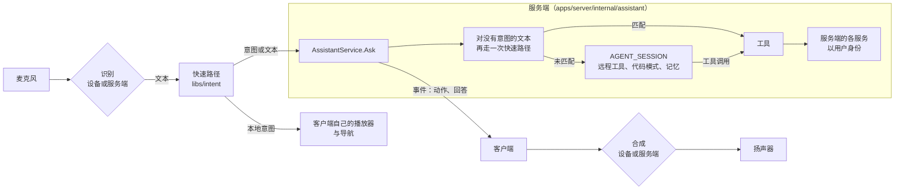

# Mavio 助手

> [English](assistant.md) | 简体中文

> Mavio 各客户端的助手：以说话或打字提出的请求，如“播放《人生切割术》的下一集”“字幕提前两秒”“我没看完的诺兰电影，评分高的在前，放到客厅电视上”，以用户的身份执行。简单命令由各平台与服务端上的语法理解，不需要 AI 模型；其余请求经由 AI 网关交给模型，使用服务端的工具。语音尽量在设备上识别与合成，设备不能时由服务端的语音插件完成。相关文档：[架构](architecture.zh-CN.md) · [插件](plugins.zh-CN.md) · [客户端](clients.zh-CN.md) · [电视端](tv.zh-CN.md) · [路线图](roadmap.zh-CN.md)

## 1. 原则

* **两条路径，一套动作。** 快速路径（语法，§4）与 AI 路径（模型，§6）最终都落到同一套工具（§5），这些工具在服务端只实现一次；语法理解的命令与模型执行同一命令的效果完全相同。
* **没有 AI 也好用。** 没有 AI 网关插件的服务端，或不能使用 AI 路径的用户，仍能用语音控制播放、查找并播放作品、切换字幕与音轨、导航。快速路径作为独立的产品功能设计，而不是模型前面的缓存。
* **设备优先，服务端兜底**——识别、合成与理解都是如此。只有设备无法识别时，音频才离开设备；语法在设备上运行，对以文本到达的请求在服务端再运行一次。
* **服务端决策与执行；客户端负责听、说与播放。** 媒体库查询、其他设备、权限与会话属于服务端；麦克风、扬声器、屏幕与客户端自己的播放器属于客户端。
* **以用户身份，绝不越权。** 每个工具都以说话的用户身份运行，受该用户的媒体库访问、家长限制与权限约束；助手触及不到用户在界面上触及不到的东西。
* **按住说话。** 收听以按钮或按键开始，在松开或语音结束时结束；没有唤醒词，也不在后台收听。
* **只记住服务端不知道的东西。** 观看历史、评分、收藏与音轨字幕偏好在需要时通过工具读取；记忆（§7.2）只保存用户关于自己说过的话。

## 2. 概览

| 部分 | 位置 | 内容 |
| :--- | :--- | :--- |
| 意图解析器 | `libs/intent`（Rust） | 各语言的语法，数字、时长与序数的规范化，对话状态；原生客户端链接它，Web UI 与服务端（在 wazero 上）运行同一个 WASM 模块（§4.3） |
| 助手服务 | `apps/server/internal/assistant`，`mavio.assistant.v1.AssistantService` | 请求、服务端的快速路径、槽位解析、工具、会话、收听与语音路由 |
| AI 路径 | `AGENT_SESSION`（[插件 §8.15](plugins.zh-CN.md#815-ai-网关与智能体会话)），`plugins/agent` | 以服务端工具为远程工具的模型、代码模式、记忆 |
| 语音 | `SPEECH_TO_TEXT` 与 `TEXT_TO_SPEECH`（[插件 §8.16](plugins.zh-CN.md#816-语音识别与合成)），`plugins/voice` | 识别与合成服务；同样的识别器也转写字幕（[架构 §14.5](architecture.zh-CN.md#145-翻译与转写)） |
| 客户端 | 每个客户端（[客户端](clients.zh-CN.md)） | 按住说话、设备的识别器与语音、助手面板、客户端动作、系统助手（§9） |

## 3. 一次请求

1. **收听**：用户按住助手按钮或按键（§9）。客户端的识别器能识别该语言时由客户端自己识别，否则把语音以流式发给服务端（§8.2）；部分文本随到随显示。
2. **客户端的快速路径**：最终文本由 `libs/intent` 结合客户端的对话状态（§4.2）解析。关于客户端自身的意图——它的播放器（暂停、跳转、字幕、音量），或无需解析目标的导航——立即执行，不发请求。
3. **`Ask`**：其余请求连同文本、语法匹配时的意图以及上下文发往 `AssistantService.Ask`。上下文包括设备的会话、它正在播放什么以及播放到哪里、当前屏幕与显示或选中的条目、界面语言。打字的请求与系统助手的请求（§9.6）以同样方式到达。
4. **服务端的快速路径**：没有意图的文本由同一个模块在服务端解析。匹配到的意图解析槽位（§4.4）后成为一次工具调用（§5）。
5. **AI 路径**：语法未匹配的文本，或要求只有模型才能做的事的意图，在该用户可使用 AI 路径时（§10）进入用户的会话（§7.1），否则服务端以建议作答（§4.5）。
6. **事件**：`Ask` 以流式传送发生的一切：理解到的意图、每个运行中的工具及简短摘要、客户端动作（§5.2）、需要询问的确认（§5.3）、逐步增长的回答文本，以及带会话 ID 的结束事件。
7. **回答**：客户端执行客户端动作，显示回答与结果；请求是说出来的且用户允许时，逐句朗读回答（§8.3）。
8. **记录**：请求及其回答加入用户的会话，快速路径的也一样，使后续请求可以引用它们（“它是谁导演的？”）。

## 4. 快速路径（`libs/intent`）

### 4.1 意图
| 类别 | 示例 | 工具 |
| :--- | :--- | :--- |
| 播放控制 | 暂停、继续、停止、“后退 30 秒”、“跳到 1:20:00”、“跳过片头”、上一集与下一集、从头播放、快一点与慢一点、音量调大、调小或调到某值、静音 | 在本设备或指名的设备上执行 `control`（“卧室的暂停”） |
| 音轨与字幕 | 打开或关闭字幕、“中文字幕”、“原声”、“日语配音英文字幕”、“字幕提前两秒” | `set_streams` |
| 播放 | “播放星际穿越”、“播放人生切割术第二季第三集”、“继续看人生切割术”、“放一部我收藏的”、“随便放一部 90 年代的喜剧”、“播放专辑 Blue”、“在客厅电视上播放星际穿越”、“把这个放到卧室” | `play` |
| 搜索与导航 | “搜索诺兰”、“打开星际穿越”、“打开电影库”、“回主页”、“返回”、“看看我的下载” | `search_library`、客户端动作 |
| 模板化问答 | “这是什么”、“谁演的”、“还剩多久”、“几点放完”、“这是第几集” | `get_now_playing`、`get_item` |
| 用户数据 | 标记已看或未看、加入收藏、“加到稍后观看” | `set_user_data`、`add_to_playlist` |
| 求片 | “求片沙丘第三部”、“下载人生切割术的新一季” | `request_title` |
| 对话 | 是、不、取消、“第二个”、“最后一个”、“更多” | 待确认的动作或上次的结果 |

### 4.2 语法
* **数据而非代码**：每种语言的语法是一个文件，由带类型槽位（`title`、`person`、`genre`、`year`、`duration`、`position`、`ordinal`、`language`、`device`、`season`、`episode`、`number`）的模式与同义词列表组成，在构建模块时编译进去。先做中文与英文；增加一种语言就是增加它的文件与用例。
* **匹配前的规范化**：全角与半角、繁体与简体中文、标点与语气词、中英文数字（“三十秒”“一分半”“two and a half minutes”“第二季第三集”）、时刻与位置（“一小时二十分”）以及序数。
* **匹配**使用请求语言的全部模式，再加上英文的（混合语言的请求常用英文片名）；最佳匹配是覆盖文本最多、自由槽位最少的那个。自由槽位（`title`、`person`）吸收剩余文本，由服务端解析（§4.4）；类型槽位必须能解析。
* **对话状态**随每次解析一起给出：是否有待确认的动作、上次显示了多少个结果、正在播放什么。对话模式只在其状态成立时匹配：“是”只在有待确认的动作时有意义，“第二个”只在显示过结果之后有意义。
* **结果**：一个带槽位与置信度的意图；整段文本都匹配时为 `full`，某个模式匹配但剩余文本时为 `partial`，否则为空。

### 4.3 一份实现，三处运行
* `libs/intent` 是一个不依赖 I/O 的 Rust crate。原生客户端经由 `libs/client-rust` 链接它（UniFFI 与 C ABI 暴露 `parse_intent`）。
* 它还构建为一个没有导入项的 WASM 模块（`wasm32-unknown-unknown`），导出内存分配与 `parse`，请求与回答都是 `mavio.assistant.v1` 的 protobuf 消息（`ParseIntentRequest`、`Intent`）。Web UI 通过 `libs/client-ts` 实例化它，服务端像运行 WASM 插件那样在 wazero 上运行同一个文件，因此语法永远不会有第二份实现。
* 模块由 Nx 构建（`intent:wasm`），不提交到仓库；服务端的 `build` 嵌入它，Web 的 `build` 打包它，就像服务端嵌入 Web UI 一样。

### 4.4 服务端的槽位
* **作品与人物**在用户的媒体库中解析：按名称、原名、别名与排序名匹配，容忍识别错误；中文名称还按拼音匹配，使识别器选错同音字时仍能找到作品。有季的作品按其编号解析季与集（[领域模型 §4.3](domain.zh-CN.md#43-层级)）。
* **歧义**：只有一个明确匹配就直接执行；多个相近的作为结果返回供选择（“第二个”）；没有匹配时退回到对文本的搜索，AI 路径可用时则交给 AI 路径。
* **设备**按名称在用户的在线设备与插件的远程设备（[插件 §7](plugins.zh-CN.md#7-远程设备)）中解析；“这里”指发出请求的设备。
* **上下文**：“这个”“它”“他”指正在播放的条目，否则指显示或选中的条目，再否则指会话中最后一个条目。

### 4.5 没有 AI 时
AI 路径不可用时，未匹配的请求按作品或人物搜索，因此只说一个名字也能找到；部分匹配在槽位能解析时执行，否则回答列出助手能理解的说法，并附上用户语言的示例。建议来自语法本身，因此不会建议快速路径做不到的事。

### 4.6 测试
每种语言的用例（`libs/intent/testdata/cases/<language>.yaml`：文本、对话状态、期望的意图）由 crate 自己的测试运行，由服务端在 wazero 上对 WASM 模块运行，也由 `libs/client-ts` 在 Node 中对同一模块运行，以此检查三处运行结果一致。

## 5. 工具与动作

### 5.1 工具
服务端的工具是 `apps/server/internal/assistant/tools` 中的 Go 函数，每个都有名称、给模型看的描述、参数与结果的 JSON Schema，以及由它们生成、供代码模式（§6.2）使用的 TypeScript 声明。

| 工具 | 作用 |
| :--- | :--- |
| `search_library` | 按文本、类型、流派、年份范围、人物、制片公司、评分、已看与收藏状态查找用户媒体库中的条目，可指定排序与数量 |
| `get_item` | 条目详情：名称、简介、人物、编号、时长、流、用户数据 |
| `list_next_up`、`list_resume` | 用户正在看的：下一集、进行中的条目 |
| `get_now_playing` | 设备正在播放的：条目、位置、流、速度 |
| `list_devices` | 用户的在线设备与远程设备，以及各自正在播放的内容 |
| `read_subtitles` | 条目字幕在某个位置附近的文本，绝不超过用户已看到的位置，使关于剧情的问题不会剧透 |
| `play` | 在某设备上播放条目或查询结果，可随机，从续播位置、开头或某个时间开始 |
| `control` | 在某设备上暂停、继续、停止、跳转、跳过媒体片段、上一个或下一个、速度、音量、静音 |
| `set_streams` | 按语言或索引选择音轨与字幕、关闭字幕、字幕偏移 |
| `set_user_data` | 已看状态、收藏、评分 |
| `add_to_playlist` | 把条目加入播放列表，不存在时创建 |
| `request_title` | 在用户的求片权限下，从发现中请求一部作品（[架构 §13.7](architecture.zh-CN.md#137-发现请求与问题)） |
| `navigate` | 仅为客户端动作：打开某个屏幕 |

### 5.2 客户端动作
作用于发出请求的设备的工具返回客户端动作，而不是向它发送命令：`play`（条目、位置、流）、`control`、`navigate`（条目、媒体库、搜索、设置分区、主页、返回）与 `show_items`（供选择的结果）。其他设备通过 `SessionService.SendCommand` 控制，与远程控制相同（[插件 §7](plugins.zh-CN.md#7-远程设备)）。客户端无法执行某个动作时，在下一个请求中说明，服务端改以它能做的作答。

### 5.3 确认
工具可以要求确认。此时调用不执行，而是返回一个待确认的动作，附一句说明将发生什么；客户端显示它与“确认”“取消”按钮并朗读它，回答以对话意图（“是”“取消”）或按钮自己发出的 `Ask` 返回，不经过模型。调用会一直等待——在模型的会话中也持久地等待（§6.1）——直到被确认、取消或会话结束。哪些工具需要确认，在工具的定义中设定。

### 5.4 以用户身份
每次调用都以请求的用户身份运行；作用于发出请求的设备的动作，还以该设备身份运行。媒体库访问、家长限制、转码与求片权限以及播放限制与界面上一样生效；动作以该用户的名义记入活动日志，并注明经由助手。

## 6. AI 路径

### 6.1 服务端的工具作为远程工具
模型在 `AGENT_SESSION` 插件中运行，工具在服务端运行（[插件 §8.15](plugins.zh-CN.md#815-ai-网关与智能体会话)）：
* 服务端创建每个会话时附上其工具的声明。插件把它们注册为 pi-durable 工具，执行时把调用交给服务端并等待结果。
* 服务端为每个插件保持一条 `WatchAgentToolCalls` 流，先列出正在等待的调用，再列出每个新调用：调用 ID、会话、工具与参数。服务端以会话所属用户的身份运行调用，并用 `SubmitAgentToolResult` 回答：给模型的文本、结构化结果，以及是否失败。
* 调用在两端都是持久的。pi-durable 在调用运行前提交它，并把远程工具声明为可安全重放，因此插件重启后会以同一个 ID 再次交出同一个调用；服务端按调用 ID 把已运行调用的结果保留一天，对重复的调用直接用保留的结果回答，不再运行。服务端重启后，这条流会再次列出仍在等待的调用。
* 回答随生成以流式传给客户端（`StreamAgentMessage`）；服务端把模型的文本与工具调用转换为 `Ask` 的事件。

### 6.2 代码模式
对擅长写代码的模型，会话还提供 pi-durable 的代码模式：模型编写调用工具的 JavaScript（`await tools.search_library(…)`），在 QuickJS 沙箱中运行，只有脚本的输出返回给模型。需要多步的请求——搜索、过滤、排序、播放——只需一段脚本，而不必每一步都与模型往返一次；大量结果在沙箱中过滤，不会填满模型的上下文。脚本中的每次调用都是远程工具的嵌套调用，因此和普通调用一样到达服务端；因重启而中断的脚本恢复后，不会重新运行已完成的调用。代码模式按模型在助手设置（§10）中设定；工具仍会同时直接提供，供单步请求使用。

### 6.3 模型看到的内容
* **指令**保持稳定，使提供商的提示缓存有效：助手的角色与规则（通过工具行动、有歧义时询问、绝不剧透、为朗读而简短作答）、服务端名称、用户名称与语言、工具，以及用户的记忆（§7.2）。
* **每个请求的上下文**——设备、它正在播放什么以及播放到哪里、屏幕、时间——随请求的消息一起提供，而不放在指令中，否则指令会随每个请求变化。
* **回答**简短且适合朗读：做了什么，或问题的答案；细节作为结果显示，而不朗读。

## 7. 会话与记忆

### 7.1 滚动会话
* 每个用户有一个当前会话，跨越其所有设备。会话空闲超过设置的空闲时间（30 分钟），或按服务端时区已到另一天时，下一个请求开始新会话。
* 快速路径的请求以一条消息及其回答的形式加入会话，不询问模型（`AddAgentMessages`），使下一个请求需要时模型知道之前做了什么。
* 服务端记录每个会话的用户、第一个设备、开始时间与最后变化时间；§4.2 的对话状态（待确认的动作、上次的结果、最后一个条目）为当前会话保存在内存中。
* 长会话由 pi-durable 压缩。用户可以列出、阅读与删除自己的会话；超过设置保留期（30 天）的会话被删除，删除会话会从插件的数据库中清除它（[插件 §8.15](plugins.zh-CN.md#815-ai-网关与智能体会话)）。没有 AI 路径时不保存会话，只保存对话状态。

### 7.2 记忆
* **记住什么**：用户说起的、服务端没有保存的关于自己的事——“我不看恐怖片”“我女儿叫小米”“我们周六看烘焙大赛”“我喜欢原声”。服务端已保存的（历史、评分、收藏）通过工具读取；服务端有对应设置的偏好（字幕与音轨语言）则通过工具设置到那里，使快速路径与每个客户端也都遵循它。
* **存在哪里**：插件数据库中的一个 pi-durable 文档族，以服务端的用户 ID 为键，每条记忆有其文本、学到它的时间与会话，以及最后使用时间。
* **学习**：用户要求时，或用户说出某件长期成立的事时，模型调用插件自己的工具 `remember` 与 `forget`；会话结束时，插件在后台任务中整理它：模型阅读会话与用户的记忆，提出新增、修正与删除，使重复的记忆合并、被推翻的记忆删除。
* **使用**：记忆在预算（2,000 个 token）以内时放进指令；超出时，指令中只放最常用的，其余用 `recall` 找到，它以 pi-durable 的 BM25 搜索检索记忆。
* **控制**：用户在客户端设置中列出、编辑与删除自己的记忆，也可以关闭记忆；删除用户会删除其记忆与会话。受管用户有自己的记忆，只有其本人与管理它的管理员可见。

## 8. 语音

### 8.1 识别
* **优先使用设备的识别器**，前提是它能在设备上识别该语言：Apple 的语音框架、Android 的设备端识别器。识别器接受上下文短语时，客户端把 `GetAssistantHints` 的提示交给它：正在看的作品、最近添加的作品、人物与用户的设备。
* 设备的识别器不能识别该语言、需要用户未允许的网络服务或不存在时——多数浏览器中的 Web UI（§9.2）与桌面应用即是如此——使用**服务端的识别器**（§8.2）。
* 用户在客户端设置中选择顺序；一个识别器失败时退回到另一个。

### 8.2 在服务端收听
* `AssistantService.StartListening` 返回一个为会话签名、一分钟内有效的 WebSocket URL，并带上所选的识别器（设置中的，否则为第一个就绪的 `SPEECH_TO_TEXT` 识别器）与语言。
* 客户端以二进制帧发送 16 kHz 单声道 16 位 PCM，在用户松开按键时发送结束消息；服务端把它以流的形式连同用户的提示转给识别器，并回传部分文本与最终文本。没有松开时，Silero VAD（`libs/media/vad`）检测到一秒静音即结束语音；一段话最长 30 秒。
* 不支持流式的识别器在一段话结束后一次性收到它。音频从不保存。

### 8.3 合成
* **优先使用设备的语音**：浏览器的 `speechSynthesis`、`AVSpeechSynthesizer`、Android 的 `TextToSpeech`，选用回答语言的语音。
* 用户选择服务端语音时，或设备没有该语言的语音时，使用**服务端语音**（`TEXT_TO_SPEECH`）：`POST /assistant/speech` 带上文本、语音与语言，返回音频，按客户端要求为 Ogg 封装的 Opus 或 MP3。
* 回答随文本到达逐句朗读，因此在回答结束之前就开始说话；用户开口或再次按下按钮时停止朗读。

### 8.4 语音插件
`SPEECH_TO_TEXT` 与 `TEXT_TO_SPEECH`（[插件 §8.16](plugins.zh-CN.md#816-语音识别与合成)）由 `plugins/voice` 提供。它是一个 Go 子进程插件，连接管理员配置的服务，每个服务是一个识别器或一组语音，命名为 `<plugin>/<id>`：
* 识别：whisper-asr-webservice、OpenAI 兼容的转写 API（OpenAI、Groq、搭配 faster-whisper 的 speaches，以及其他提供该 API 的服务器）、Deepgram、Azure Speech、Google Cloud Speech-to-Text，以及面向中文的火山引擎与阿里云识别；
* 合成：OpenAI 兼容的语音 API（OpenAI、搭配 Kokoro 或 Piper 的 speaches）、ElevenLabs、Azure Speech、Google Cloud Text-to-Speech，以及火山引擎与阿里云的合成。

每个识别器说明它是否支持流式、是否给出时间戳、是否检测语言、是否翻译为英文、是否接受提示，以及它的语言与最长音频；服务端只让每个识别器做它能做的事。

### 8.5 字幕
字幕转写使用同样的识别器（[架构 §14.5](architecture.zh-CN.md#145-翻译与转写)）：给出时间戳的识别器把视频的音频转写为字幕，因此为助手配置的任何服务也能转写字幕，Whisper 是其中之一，而不再是单独的字幕提供者。

## 9. 客户端

### 9.1 各客户端共有
* **助手面板**在任何屏幕上打开，包括播放器：逐步增长的听写文本、回答、以卡片形式供选择的结果，以及带“确认”“取消”的待确认动作；它也接受打字输入。回答没有可选择的内容时，几秒后自动关闭。
* **按住说话**使用助手按钮：按住说话，或轻点后说话直到语音结束。
* **设置**：是否朗读回答、语音、识别器顺序、记忆及其列表、会话；服务端的助手设置位于管理员的 AI 设置中（[客户端 §6.3.13](clients.zh-CN.md#6313-ai)）。
* **客户端的快速路径**在 `Ask` 之前运行（§3），使播放器命令无需请求、无需网络即可生效。

### 9.2 Web（`apps/web`），最先实现
* **麦克风**：`getUserMedia`，浏览器只允许安全页面使用——服务端的 HTTPS 地址（其 `mavio.site` 证书，见[账户](accounts.zh-CN.md)）、app.mavio.dev 或 `localhost`。通过普通 HTTP 访问时，面板只接受打字输入，并说明原因。
* **识别**：`SPEECH_TO_TEXT` 插件就绪时使用服务端的识别器，否则使用浏览器的 `SpeechRecognition`（如果存在；多数浏览器在其厂商的服务器上运行它）；用户可以把浏览器的识别器排在前面。音频由 `AudioWorklet` 采集，并重采样为 16 kHz PCM 发往 WebSocket。
* **合成**：`speechSynthesis`，或从语音路由逐句获取并播放服务端语音。
* **输入**：顶栏与播放器控制器中的助手按钮，以及按住说话的按键，它与播放器的快捷键列在一起；电视模式下，该按钮和其他按钮一样可获得焦点。

### 9.3 Apple（`apps/ios`、`apps/macos`、`apps/tvos`）
* **iPhone、iPad 与 Mac**：语音框架的设备端识别，提示作为上下文字符串；`AVSpeechSynthesizer`；以及 App Intents，使 Siri、快捷指令与聚焦搜索经由 `Ask` 在 Mavio 中播放作品与控制播放。
* **Apple TV**：Siri Remote 的麦克风属于系统，因此助手的输入框接受系统的听写；tvOS 提供 App Intents 的地方，由 App Intents 响应 Siri。

### 9.4 Android（`apps/android`、`apps/android-tv`）
* **手机与平板**：`SpeechRecognizer`（可用时在设备上识别），提示作为偏置字符串；以及 `TextToSpeech`。
* **Android TV 与 Google TV**：应用在前台时，遥控器的搜索键或助手键打开助手面板，面板通过 `SpeechRecognizer` 使用遥控器的麦克风；系统的语音搜索通过应用的搜索 intent 与 `MediaSession` 的按搜索播放到达应用，并经由 `Ask` 处理。

### 9.5 桌面（`apps/desktop`）
使用服务端的识别器与语音，麦克风由平台的音频 API 采集；没有语音插件时只接受打字输入。

### 9.6 系统助手
来自 Siri、快捷指令、Android 语音搜索与按搜索播放的请求以文本或待播放作品的形式到达应用；应用像发送自己的请求一样把它们发给 `Ask`，使它们走同样的路径。

## 10. 设置与隐私

* **服务端的助手设置**：是否开启助手、使用的模型（`ai/<provider>/<model>`）以及是否与之搭配代码模式、哪些用户可以使用 AI 路径、会话的空闲时间与保留期、是否开启记忆、识别器与各语言的默认语音，以及是否向识别器发送提示。
* **用户的设置**（§9.1）保存在设备上，语音与识别器顺序按设备保存。
* **隐私**：音频从不保存，只为服务端的识别器离开设备，并经由它到达管理员配置的服务。请求与回答只保存在会话中，在保留期后或由用户删除；记忆对用户可见，并随用户一起删除。AI 路径的 token 用量与费用按会话统计，并随会话显示。

## 11. 测试

* 快速路径的用例在三处运行（§4.6）；槽位解析针对预置的媒体库测试，包括被识别成同音字的名称。
* 通过 `Ask` 用假设备测试工具，与远程控制的测试相同；以及确认、取消与过期。
* 使用构建好的 `plugins/agent` 与回环接口上的假 OpenAI 兼容 API 提供的模型做端到端测试：语法未匹配的请求变成以用户身份运行的工具调用，其中一次经由代码模式；重启插件时被中断的工具调用只被回答一次。
* 使用 `plugins/voice` 与假的 whisper-asr-webservice、OpenAI 兼容服务和流式服务测试收听与语音；字幕转写的测试见[架构 §14.5](architecture.zh-CN.md#145-翻译与转写)。
* 各客户端的助手面板纳入其快照测试（[客户端 §6.8](clients.zh-CN.md#68-组件画廊与视觉评审)）。
