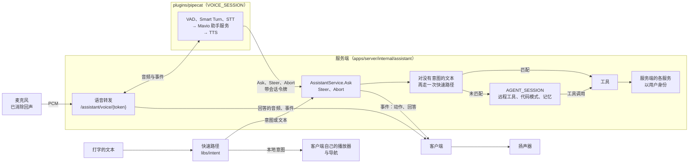

# Mavio 助手

> [English](assistant.md) | 简体中文

> Mavio 各客户端的助手：以说话或打字提出的请求，如“播放《人生切割术》的下一集”“字幕提前两秒”“我没看完的诺兰电影，评分高的在前，放到客厅电视上”，以用户的身份执行。简单命令由各平台与服务端上的语法理解，不需要 AI 模型；其余请求经由 AI 网关交给模型，使用服务端的工具。说出的请求是语音会话：客户端把麦克风的音频以流式发给服务端，服务端将其转发给 `plugins/pipecat`——一条 Pipecat 管线，它检测轮次、识别、询问助手并朗读回答，包括打断。相关文档：[架构](architecture.zh-CN.md) · [插件](plugins.zh-CN.md) · [客户端](clients.zh-CN.md) · [电视端](tv.zh-CN.md) · [路线图](roadmap.zh-CN.md)

## 1. 原则

* **两条路径，一套动作。** 快速路径（语法，§4）与 AI 路径（模型，§6）最终都落到同一套工具（§5），这些工具在服务端只实现一次；语法理解的命令与模型执行同一命令的效果完全相同。
* **没有 AI 也好用。** 没有 AI 网关插件的服务端，或不能使用 AI 路径的用户，仍能用语音控制播放、查找并播放作品、切换字幕与音轨、导航。快速路径作为独立的产品功能设计，而不是模型前面的缓存。
* **一条语音管线，经由服务端。** 语音的识别、轮次检测与回答的朗读都由同一条管线 `plugins/pipecat`（§8）完成，从不使用设备的识别器与语音，使每个客户端听与说都一样，轮次、打断与回声处理只实现一次。客户端只经由服务端到达它，由服务端认证、转发与记录；客户端不使用 Pipecat 的任何客户端 SDK。语法仍在设备上为打字的请求运行，其余请求则在服务端运行。
* **服务端决策与执行；客户端负责采集、播放与显示。** 媒体库查询、其他设备、权限与会话属于服务端；麦克风、扬声器、屏幕与客户端自己的播放器属于客户端。
* **以用户身份，绝不越权。** 每个工具都以说话的用户身份运行，受该用户的媒体库访问、家长限制与权限约束；助手触及不到用户在界面上触及不到的东西。
* **只在用户打开的会话中收听。** 语音会话以助手按钮或按键开始，在用户关闭它或保持沉默时结束；没有唤醒词，也不在后台收听。
* **语音是可选的。** 没有 `plugins/pipecat` 的服务端提供打字的助手；语音助手只需要这个插件，别无其他。
* **只记住服务端不知道的东西。** 观看历史、评分、收藏与音轨字幕偏好在需要时通过工具读取；记忆（§7.2）只保存用户关于自己说过的话。

## 2. 概览



| 部分 | 位置 | 内容 |
| :--- | :--- | :--- |
| 意图解析器 | `libs/intent`（Rust） | 各语言的语法，数字、时长与序数的规范化，对话状态；原生客户端链接它，服务端在 wazero 上运行其 WASM 模块（§4.3） |
| 助手服务 | `apps/server/internal/assistant`，`mavio.assistant.v1.AssistantService` | 请求及其引导与中止、服务端的快速路径、槽位解析、工具、会话、语音会话及其转发、保留的语音 |
| AI 路径 | `AGENT_SESSION`（[插件 §8.15](plugins.zh-CN.md#815-ai-网关与智能体会话)），`plugins/agent` | 以服务端工具为远程工具的模型、代码模式、记忆 |
| 语音 | `VOICE_SESSION`（[插件 §8.16](plugins.zh-CN.md#816-语音会话与转写)），`plugins/pipecat` | 基于 Pipecat 的语音管线：语音活动、轮次检测、识别与合成服务、打断，以及作为其智能体的助手（§8） |
| 转写 | `SPEECH_TO_TEXT`（[插件 §8.16](plugins.zh-CN.md#816-语音会话与转写)），`plugins/pipecat` | 从视频音频转写的带时间戳的字幕（[架构 §14.5](architecture.zh-CN.md#145-翻译与转写)），独立于语音管线 |
| 客户端 | 每个客户端（[客户端](clients.zh-CN.md)） | 语音会话的采集与播放（使用平台的回声消除）、助手的光球与卡片、客户端动作、系统助手（§9） |

## 3. 一次请求

1. **输入**：用户在语音会话中说话（§8），或在 Apple TV 上听写（§9.3）。在语音会话中，管线检测用户这一轮的结束并识别它——部分文本随到随显示——然后以用户的身份、通过会话的令牌（§8.4）用这一轮的文本询问助手。听写的文本与系统助手的请求（§9.6）先走客户端的快速路径。
2. **客户端的快速路径**，仅用于打字的文本：文本由 `libs/intent` 结合客户端的对话状态（§4.2）解析。关于客户端自身的意图——它的播放器（暂停、跳转、字幕、音量），或无需解析目标的导航——立即执行，不发请求。
3. **`Ask`**：其余请求连同文本、语法匹配时的意图以及上下文发往 `AssistantService.Ask`。上下文包括设备的会话、它正在播放什么以及播放到哪里、当前屏幕与显示或选中的条目、界面语言。语音会话的各轮带有客户端在该会话中最后发送的上下文。
4. **服务端的快速路径**：没有意图的文本由同一个模块在服务端解析。匹配到的意图解析槽位（§4.4）后成为一次工具调用（§5）。
5. **AI 路径**：语法未匹配的文本，或要求只有模型才能做的事的意图，在该用户可使用 AI 路径时（§10）进入用户的会话（§7.1），否则服务端以建议作答（§4.5）。
6. **事件**：`Ask` 以流式传送发生的一切：理解到的意图、每个运行中的工具及简短摘要、客户端动作（§5.2）、需要询问的确认（§5.3）、逐步增长的回答文本，以及带会话 ID 的结束事件。
7. **回答**：客户端执行客户端动作，显示回答与结果；在语音会话中，管线随回答文本的增长朗读它，由客户端播放（§8.5）。
8. **记录**：请求及其回答加入用户的会话，快速路径的也一样，使后续请求可以引用它们（“它是谁导演的？”）。

## 4. 快速路径（`libs/intent`）

### 4.1 意图
| 类别 | 示例 | 工具 |
| :--- | :--- | :--- |
| 播放控制 | 暂停、继续、停止、“后退 30 秒”、“跳到 1:20:00”、“跳过片头”、上一集与下一集、从头播放、快一点与慢一点、音量调大、调小或调到某值、静音 | 在本设备或指名的设备上执行 `control`（“卧室的暂停”） |
| 音轨与字幕 | 打开或关闭字幕、“中文字幕”、“原声”、“日语配音英文字幕”、“字幕提前两秒” | `set_streams` |
| 播放 | “播放星际穿越”、“播放人生切割术第二季第三集”、“继续看人生切割术”、“放一部我收藏的”、“随便放一部 90 年代的喜剧”、“播放专辑 Blue”、“在客厅电视上播放星际穿越”、“把这个放到卧室” | `play` |
| 搜索与导航 | “搜索诺兰”、“打开星际穿越”、“打开电影库”、“回主页”、“返回”、“看看我的下载” | `search_library`、客户端动作 |
| 模板化问答 | “这是什么”、“谁演的”、“还剩多久”、“几点放完”、“这是第几集” | `get_now_playing`、`get_item` |
| 用户数据 | 标记已看或未看、加入收藏、“加到稍后观看” | `set_user_data`、`add_to_playlist` |
| 求片 | “求片沙丘第三部”、“下载人生切割术的新一季” | `request_title` |
| 对话 | 是、不、取消、“第二个”、“最后一个”、“更多” | 待确认的动作或上次的结果 |

### 4.2 语法
* **数据而非代码**：每种语言的语法是一个文件，由带类型槽位（`title`、`person`、`genre`、`year`、`duration`、`position`、`ordinal`、`language`、`device`、`season`、`episode`、`number`）的模式与同义词列表组成，在构建模块时编译进去。现有中文（简体与繁体）、英文、日文、韩文、德文、法文与西班牙文的语法；增加一种语言就是增加它的文件与用例。
* **匹配前的规范化**：全角与半角、繁体与简体中文、标点与语气词、中英文数字（“三十秒”“一分半”“two and a half minutes”“第二季第三集”）、时刻与位置（“一小时二十分”）以及序数。
* **匹配**使用请求语言的全部模式，再加上英文的（混合语言的请求常用英文片名）；最佳匹配是覆盖文本最多、自由槽位最少的那个。自由槽位（`title`、`person`）吸收剩余文本，由服务端解析（§4.4）；类型槽位必须能解析。
* **对话状态**随每次解析一起给出：是否有待确认的动作、上次显示了多少个结果、正在播放什么。对话模式只在其状态成立时匹配：“是”只在有待确认的动作时有意义，“第二个”只在显示过结果之后有意义。
* **结果**：一个带槽位与置信度的意图；整段文本都匹配时为 `full`，某个模式匹配但剩余文本时为 `partial`，否则为空。
* **回复与示例**：每种语言的语法还包含快速路径在该语言下的回答（“正在播放沙丘。”“已暂停。”），可填入参数并用该语言读出时长，以及 §4.5 给出的示例，因此各处运行环境都用请求的语言回答，而无需自带字符串。

### 4.3 一份实现，三处运行
* `libs/intent` 是一个不依赖 I/O 的 Rust crate。原生客户端经由 `libs/client-rust` 链接它（UniFFI 与 C ABI 暴露 `parse_intent`）。
* 它还构建为一个没有导入项的 WASM 模块（`wasm32-unknown-unknown`），导出其内存、内存分配、`intent_parse`、`intent_reply`、`intent_examples` 与 `intent_languages`，请求与回答都是 `mavio.intent.v1` 的 protobuf 消息（`ParseIntentRequest`、`Intent`）；每次调用把回答的地址与长度打包在一个 64 位整数中返回。服务端像运行 WASM 插件那样在 wazero 上运行它，因此语法永远不会有第二份实现；`libs/client-ts`（`Grammar`）在其测试中实例化它。
* 模块由 Nx 构建（`intent:wasm`），不提交到仓库；服务端的 `build` 嵌入它，就像服务端嵌入 Web UI 一样。

### 4.4 服务端的槽位
* **作品与人物**在用户的媒体库中解析：按名称、原名、别名与排序名匹配，容忍识别错误；中文名称还按拼音匹配，使识别器选错同音字时仍能找到作品。有季的作品按其编号解析季与集（[领域模型 §4.3](domain.zh-CN.md#43-层级)）。
* **歧义**：只有一个明确匹配就直接执行；多个相近的作为结果返回供选择（“第二个”）；没有匹配时退回到对文本的搜索，AI 路径可用时则交给 AI 路径。
* **设备**按名称在用户的在线设备与插件的远程设备（[插件 §7](plugins.zh-CN.md#7-远程设备)）中解析；“这里”指发出请求的设备。
* **上下文**：“这个”“它”“他”指正在播放的条目，否则指显示或选中的条目，再否则指会话中最后一个条目。

### 4.5 没有 AI 时
AI 路径不可用时，未匹配的请求按作品或人物搜索，因此只说一个名字也能找到；部分匹配在槽位能解析时执行，否则回答列出助手能理解的说法，并附上用户语言的示例。建议来自语法本身，因此不会建议快速路径做不到的事。

### 4.6 测试
每种语言的用例（`libs/intent/testdata/cases/<language>.yaml`：文本、对话状态、期望的意图）由 crate 自己的测试运行，由服务端在 wazero 上对 WASM 模块运行，也由 `libs/client-ts` 在 Node 中对同一模块运行，以此检查三处运行结果一致。

## 5. 工具与动作

### 5.1 工具
服务端的工具是 `apps/server/internal/assistant` 中的 Go 函数，每个都有名称、给模型看的描述，以及参数与结果的 JSON Schema，代码模式（§6.2）据此把它们声明给脚本。

| 工具 | 作用 |
| :--- | :--- |
| `search_library` | 按文本、类型、流派、年份范围、人物、制片公司、评分、已看与收藏状态查找用户媒体库中的条目，可指定排序与数量 |
| `get_item` | 条目详情：名称、简介、人物、编号、时长、流、用户数据 |
| `list_next_up`、`list_resume` | 用户正在看的：下一集、进行中的条目 |
| `get_now_playing` | 设备正在播放的：条目、位置、流、速度 |
| `list_devices` | 用户的在线设备与远程设备，以及各自正在播放的内容 |
| `read_subtitles` | 条目字幕在某个位置附近的文本，绝不超过用户已看到的位置，使关于剧情的问题不会剧透 |
| `play` | 在某设备上播放条目或查询结果，可随机，从续播位置、开头或某个时间开始 |
| `control` | 在某设备上暂停、继续、停止、跳转、跳过媒体片段、上一个或下一个、速度、音量、静音 |
| `set_streams` | 按语言或索引选择音轨与字幕、关闭字幕、字幕偏移 |
| `set_user_data` | 已看状态、收藏、评分 |
| `add_to_playlist` | 把条目加入播放列表，不存在时创建 |
| `request_title` | 在用户的求片权限下，从发现中请求一部作品（[架构 §13.7](architecture.zh-CN.md#137-发现请求与问题)） |
| `navigate` | 仅为客户端动作：打开某个屏幕 |

### 5.2 客户端动作
作用于发出请求的设备的工具返回客户端动作，而不是向它发送命令：`play`（条目、位置、流）、`control`、`navigate`（条目、媒体库、搜索、设置分区、主页、返回）与 `show_items`（供选择的结果）。其他设备通过 `SessionService.SendCommand` 控制，与远程控制相同（[插件 §7](plugins.zh-CN.md#7-远程设备)）。客户端无法执行某个动作时，在下一个请求中说明，服务端改以它能做的作答。

### 5.3 确认
工具可以要求确认。此时调用不执行，而是返回一个待确认的动作，附一句说明将发生什么；客户端显示它与“确认”“取消”按钮并朗读它，回答以对话意图（“是”“取消”）或按钮自己发出的 `Ask` 返回，不经过模型。调用会一直等待——在模型的会话中也持久地等待（§6.1）——直到被确认、取消或会话结束。哪些工具需要确认，在工具的定义中设定。

### 5.4 以用户身份
每次调用都以请求的用户身份运行；作用于发出请求的设备的动作，还以该设备身份运行。媒体库访问、家长限制、转码与求片权限以及播放限制与界面上一样生效；动作以该用户的名义记入活动日志，并注明经由助手。

## 6. AI 路径

### 6.1 服务端的工具作为远程工具
模型在 `AGENT_SESSION` 插件中运行，工具在服务端运行（[插件 §8.15](plugins.zh-CN.md#815-ai-网关与智能体会话)）：
* 服务端创建每个会话时附上其工具的声明。插件把它们注册为 pi-durable 工具，执行时把调用交给服务端并等待结果。
* 服务端为每个插件保持一条 `WatchAgentToolCalls` 流，先列出正在等待的调用，再列出每个新调用：调用 ID、会话、工具与参数。服务端以会话所属用户的身份运行调用，并用 `SubmitAgentToolResult` 回答：给模型的文本、结构化结果，以及是否失败。
* 调用在两端都是持久的。pi-durable 在调用运行前提交它，并把远程工具声明为可安全重放，因此插件重启后会以同一个 ID 再次交出同一个调用；服务端按调用 ID 把已运行调用的结果保留一天，对重复的调用直接用保留的结果回答，不再运行。服务端重启后，这条流会再次列出仍在等待的调用。
* 回答随生成以流式传给客户端（`StreamAgentMessage`）；服务端把模型的文本与工具调用转换为 `Ask` 的事件。

### 6.2 代码模式
对擅长写代码的模型，会话还提供 pi-durable 的代码模式：模型编写调用工具的 JavaScript（`await tools.search_library(…)`），在 QuickJS 沙箱中运行，只有脚本的输出返回给模型。需要多步的请求——搜索、过滤、排序、播放——只需一段脚本，而不必每一步都与模型往返一次；大量结果在沙箱中过滤，不会填满模型的上下文。脚本中的每次调用都是远程工具的嵌套调用，因此和普通调用一样到达服务端；因重启而中断的脚本恢复后，不会重新运行已完成的调用。代码模式按模型在助手设置（§10）中设定；工具仍会同时直接提供，供单步请求使用。

### 6.3 模型看到的内容
* **指令**保持稳定，使提供商的提示缓存有效：助手的角色与规则（通过工具行动、有歧义时询问、绝不剧透、为朗读而简短作答）、服务端名称、用户名称与语言、工具，以及用户的记忆（§7.2）。
* **每个请求的上下文**——设备、它正在播放什么以及播放到哪里、屏幕、时间——随请求的消息一起提供，而不放在指令中，否则指令会随每个请求变化。
* **回答**简短且适合朗读：做了什么，或问题的答案；细节作为结果显示，而不朗读。

## 7. 会话与记忆

### 7.1 滚动会话
* 每个用户有一个当前会话，跨越其所有设备。会话空闲超过设置的空闲时间（30 分钟），或按服务端时区已到另一天时，下一个请求开始新会话。
* 快速路径的请求以一条消息及其回答的形式加入会话，不询问模型（`AddAgentMessages`），使下一个请求需要时模型知道之前做了什么。
* 服务端记录每个会话的用户、第一个设备、开始时间与最后变化时间；§4.2 的对话状态（待确认的动作、上次的结果、最后一个条目）为当前会话保存在内存中。
* 长会话由 pi-durable 压缩。用户可以列出、阅读与删除自己的会话；超过设置保留期（30 天）的会话被删除，删除会话会从插件的数据库中清除它（[插件 §8.15](plugins.zh-CN.md#815-ai-网关与智能体会话)）。没有 AI 路径时不保存会话，只保存对话状态。

### 7.2 记忆
* **记住什么**：用户说起的、服务端没有保存的关于自己的事——“我不看恐怖片”“我女儿叫小米”“我们周六看烘焙大赛”“我喜欢原声”。服务端已保存的（历史、评分、收藏）通过工具读取；服务端有对应设置的偏好（字幕与音轨语言）则通过工具设置到那里，使快速路径与每个客户端也都遵循它。
* **存在哪里**：插件数据库中的一个 pi-durable 文档族，以服务端的用户 ID 为键，每条记忆有其文本、学到它的时间与会话，以及最后使用时间。
* **学习**：用户要求时，或用户说出某件长期成立的事时，模型调用插件自己的工具 `remember` 与 `forget`；会话结束时，插件在后台任务中整理它：模型阅读会话与用户的记忆，提出新增、修正与删除，使重复的记忆合并、被推翻的记忆删除。
* **使用**：记忆在预算（2,000 个 token）以内时放进指令；超出时，指令中只放最常用的，其余用 `recall` 找到，它以 pi-durable 的 BM25 搜索检索记忆。
* **控制**：用户在客户端设置中列出、编辑与删除自己的记忆，也可以关闭记忆；删除用户会删除其记忆与会话。受管用户有自己的记忆，只有其本人与管理它的管理员可见。

## 8. 语音

### 8.1 语音会话
* **语音会话**是一个设备上的用户与助手之间的一次口语交流，有一轮或多轮。`AssistantService.StartVoiceSession` 以设备的会话、语言、模式（§8.3）、客户端播放的音频（§8.5）与客户端的上下文打开一个语音会话；没有就绪的 `VOICE_SESSION` 插件时以 `failed_precondition` 失败。它返回服务端上的一个 WebSocket URL `/assistant/voice/{token}`，客户端需在一分钟内连接。
* 随后服务端在插件中打开该会话（[插件 §8.16](plugins.zh-CN.md#816-语音会话与转写)），附上管线所需的一切：该语言的识别器与语音（§10）、轮次设置、用户的提示（正在看的作品、最近添加的作品、人物、用户的设备）以及会话令牌（§8.4）。服务端把客户端的 WebSocket 与插件的 WebSocket 双向原样转发；插件只由服务端在其套接字上访问。
* 会话在以下情况结束：客户端关闭它；用户在最后一个回答之后保持沉默达到设置的空闲时间（8 秒）；满一小时；或插件停止。随后服务端吊销其令牌。一个设备最多有一个语音会话；新的会话会结束旧的。

### 8.2 管线（`plugins/pipecat`）
插件为每个会话构建一条 Pipecat 管线：

```text
WebSocket 输入（16 kHz PCM、事件）
 → Silero VAD
 → 识别器的 STT 服务
 → 用户轮次处理器：开始与结束策略（§8.3）
 → Mavio 助手服务：Ask、Steer、Abort（§8.4）
 → 句子聚合器
 → 语音的 TTS 服务
 → WebSocket 输出（PCM、事件）
```

* **传输**：Pipecat 的 FastAPI WebSocket 传输，配以 Mavio 协议（§8.6）的序列化器，而不是 RTVI。它的输出像实时设备那样按节奏送出回答的音频，使 Pipecat 在用户打断时知道已经说到哪里。
* **服务**：识别器与语音对应的 Pipecat 服务，在插件的设置中配置（§8.7）；分段式识别器，如 Whisper 或 OpenAI 转写 API，接收 VAD 划分出的每段话，流式识别器则随到随收音频。
* **朗读的内容**：语音的 TTS 服务收到的是去掉表情符号与图形符号的回答文字——任何 TTS 服务都读不出它们——只有这些符号的句子则不送出；显示与保存的回答文字不变。
* **计时**：插件为每个会话记录日志，从会话开始算起：第一段音频何时到达及其第一秒中最响的采样（据此区分无声的麦克风与小声的麦克风）、VAD 何时听到语音与静音、用户的一轮何时开始与结束、助手何时开口。
* **没有 LLM 服务。** 管线的智能体就是助手本身，通过 `Ask` 到达，使快速路径、工具、权限、会话与记忆仍归服务端，说出与打字的请求走同样的路径。不使用 Pipecat 的 LLM 服务、上下文聚合器与语音到语音模型。

### 8.3 轮次
* **开始**：Silero VAD（0.2 秒的语音）开始用户的一轮。助手说话时，至少识别出两个词才开始一轮（包括中间转写，每个中文或日文字算一个词），使咳嗽、“嗯”或助手自己的回声不会打断它。VAD 只在音量超过阈值时才听到语音；Pipecat 在 400 毫秒的窗口上测量音量，窗口填满前读数为零，并从零开始平滑；插件的 VAD 改为从会话的第一段音频起就测量音量，使用户在会话打开时说的话也能被听到。
* **结束**：静音 0.2 秒后，Smart Turn v3——一个 8 MB 的模型，在 CPU 上运行 10–65 毫秒，随 Pipecat 附带，支持包括中文在内的 23 种语言——读取这一轮最后 8 秒的音频，判断用户是否说完。说完的一轮立即结束；没说完的则等到用户再次开口，或等到设置的最长停顿（3 秒）。
* **模式**：`conversation` 为默认模式，在回答之间免手持收听并支持打断，直到会话结束（§8.1）；`push_to_talk` 在按住按钮或按键时收听，客户端发送 `ptt_start` 与 `ptt_end`（§8.6），松开即结束这一轮，用于电视遥控器与嘈杂的房间；`dictation` 只发送各轮的最终转写文本，不询问也不朗读，用于用户口述输入的文本框（[客户端 §6.3.26](clients.zh-CN.md#6326-ai-对话)）。
* **打断**：助手说话时开始的一轮会打断它：管线停止朗读，客户端丢弃它持有的音频（`interrupt`），回答的运行被中止（§8.4）。

### 8.4 助手作为管线的智能体
Mavio 助手服务是一个仿照 Pipecat 的 OpenClaw 网关实现的 Pipecat `AIService`：它只处理自己的帧，由管线的其余部分决定文本如何变成语音。
* **运行**：每个结束的一轮把其文本作为一次运行发给 `AssistantService.Ask`，每个会话同一时间只有一次运行。运行的事件以帧的形式返回：开始、逐步增长的回答文本、客户端动作、确认，以及恰好一个结束——完成、取消或失败。
* **会话令牌**：服务端为每个会话给插件一个令牌，在会话结束之前，它仅对该会话的 `Ask`、`SteerAsk` 与 `AbortAsk`，以会话的用户身份、在会话的设备上生效。插件用该令牌在宿主 API 上调用它们，不需要代表用户行事的权限。
* **引导**：用户在一轮结束后、回答朗读之前继续说话，并不是打断，而是停顿了一下。新一轮的文本引导这次运行（`SteerAsk`）：快速路径的运行用拼接后的文本重新解析，AI 路径的运行则把它作为引导消息收到，由 pi-durable 放在运行的下一个边界处（[插件 §8.15](plugins.zh-CN.md#815-ai-网关与智能体会话)）。用户再次说话时到达的回答先暂存，不压过用户朗读：若这一轮带着文字结束，运行已经回答、无法再引导，它的回答便未被听到而丢弃，运行以取消结束，这一轮的文本开始下一次运行，已回答的请求留在会话中、在它之前；没有文字的一轮则让暂存的回答朗读出来。一次运行或引导只带用户在上一次之后说的话：已问过的内容已在会话中，不论其回答是否被听到。一次运行取代另一次仍在朗读回答的运行时，先打断那段语音，使下一个回答不接在它后面，转发也不把它当作下一次运行的语音保留（§8.8）。
* **暂缓的效果**：会改变某些东西的工具与客户端动作——`play`、`control`、`set_streams`、`set_user_data`、`add_to_playlist`、`request_title`、导航——要等这一轮在用户沉默的情况下保持到设置的提交延迟（0.7 秒）后才执行；只读取的工具立即运行。被引导的运行丢弃它暂缓的效果并重新调用，因此“播放星际穿越……不，盗梦空间”只会播放盗梦空间。
* **中止**：回答开始后的打断或会话结束会中止运行（`AbortAsk`）：快速路径停止，AI 路径在 pi-durable 中中止其会话的运行，运行以取消结束。已做的保持已做；打断的那一轮是一次新的运行。
* **确认**（§5.3）：管线朗读那句话，用户的下一轮回答它，就像语法的对话意图（“是”“取消”）或确认卡片的按钮那样。

### 8.5 音频与回声
* **上行**：16 kHz 单声道 16 位 PCM，以 20 毫秒的二进制帧发送。客户端开启平台的回声消除、降噪与自动增益采集它，使助手听不到自己；插件自身不需要回声消除，也不需要 WebRTC。
* **下行**：回答的语音，以 16 位 PCM 的二进制帧发送，采样率由会话的 `ready` 事件给出（24 kHz）。
* **各平台**（§9）：浏览器 `getUserMedia` 的约束 `echoCancellation`、`noiseSuppression` 与 `autoGainControl`；Apple 上，输入节点开启语音处理的 `AVAudioEngine`，它消除引擎自己播放内容的回声；Android 上，来自 `VOICE_COMMUNICATION` 的 `AudioRecord`，搭配 `AcousticEchoCanceler` 与 `NoiseSuppressor`，通过 `USAGE_VOICE_COMMUNICATION` 的 `AudioTrack` 播放；没有听筒的设备（如电视）改用 `USAGE_ASSISTANT`，以跟随媒体音量。

### 8.6 协议
WebSocket 承载二进制音频帧（§8.5）与 JSON 事件 `{"type": …}`，客户端与服务端之间、服务端与插件之间相同：

| 方向 | 事件 |
| :--- | :--- |
| 客户端 → | `ptt_start`、`ptt_end`（按住说话）；`context`（屏幕、显示的条目、正在播放的内容，在其变化时）；`text`（会话中打字的一轮）；`played`（`interrupt` 之后，客户端已播放的回答音频，按回答 ID）；`close` |
| → 客户端 | `ready`（会话 ID、音频的采样率）；`user_started`、`user_stopped`；`transcript`（部分或最终文本、语言）；`interrupt`（丢弃持有的音频）；`run`（运行 ID）、`intent`、`tool`、`action`（客户端动作，§5.2）、`confirm`、`answer`（逐步增长的回答文本，带其 ID）；`bot_started`、`bot_stopped`；`end`（完成、取消或失败，带会话 ID）；`error` |

转发只读取 `answer`、`end` 与回答的音频，用于保留语音（§8.8）。

### 8.7 识别与合成服务
* 插件的设置从它附带的 Pipecat 服务中配置**识别器**与**语音**，每个都有服务端生成的 ID、其服务、管理员起的名称、是否启用，以及其服务的设置——密钥（机密）、模型、音色、区域或地址——插件只声明 Mavio 需要的设置，而不是服务的每个参数。同一服务可以配置多次，如两台 OpenAI 兼容服务器。
* **附带的**是 Pipecat 团队维护、其依赖在插件发布的每个平台上都能以 wheel 安装且不需要 PyTorch 的服务：运行在插件的容器依赖 speaches 上的 Whisper，容器引擎提供 NVIDIA GPU 时使用 GPU；在服务端 CPU 上运行的 Kokoro 与 Piper；以及云服务，如 OpenAI 与 OpenAI 兼容服务器（speaches、Groq）、Deepgram、AssemblyAI、Google Cloud、ElevenLabs、Cartesia、Soniox 与 Speechmatics。社区包，以及需要 PyTorch 或采用自有许可证的厂商 SDK 的服务，不予附带。
* **本地模型**——Whisper 的经由 speaches 的模型 API 从 Hugging Face 下载到其容器的卷中，Kokoro 与 Piper 的经服务端的代理从其发布下载到插件的数据目录——在管理员选用时由插件任务下载，并按已完成的模型数及已知大小者的字节数显示进度；模型缺失的识别器或语音未就绪。Whisper 的大小从 tiny（75 MB）到 large-v3（3 GB），中间有 large-v3-turbo（1.6 GB）。
* **多种语言的语音**：一个 Kokoro 或 Piper 语音列出其一个或多个声音，每个声音说其名称表明的语言（`zf_xiaobei` 为普通话，`en_US-lessac-medium` 为美式英语）；该语音说其各声音的语言，会话使用第一个说其语言的声音，先按完整标签，再按主语言匹配。Kokoro 的默认值为其每种语言各列一个声音，全都在它的同一个模型中；列出的每个 Piper 声音都会被下载。
* **提示**交给接受它们的服务：Deepgram、AssemblyAI 与 Cartesia 的 ink-2 模型的关键词，Soniox 的上下文术语，Speechmatics 的附加词汇，Google 的短语集，以及 Whisper 与 OpenAI 转写 API 的提示。
* **就绪**：`ListVoiceServices` 列出各服务、已配置的识别器与语音及其语言，以及各自是否就绪，供助手设置选用（§10）。

### 8.8 保留的语音
服务端把助手朗读的内容随回答保存在其会话中：它在转发时收集每个回答的音频，在客户端被打断处截断，回答结束时用 ffmpeg 编码为 Opus，存为语音目录（`speech-dir`，即服务端主目录中的 `speech/`）中的文件：每个会话一个目录，其中每个回答一个文件。`GetAssistantConversation` 以 URL 列出每个回答的语音，只向会话的用户提供，请求时以 `formats` 查询参数列出客户端能播放的编码——`opus`（Ogg 封装）、`aac`（ADTS 封装）、`mp3`、`flac` 与 `wav`；保存的语音不是其中任何一种编码时，由 ffmpeg 转换为其中最均衡的一种：Opus 优先，其次 AAC、MP3，最后是无损编码，并把该编码也保存下来。会话被删除时（由用户删除或超过保留期），其语音一并删除。用户所说的话从不保存。

### 8.9 字幕
字幕转写不是语音会话：Pipecat 的识别服务会拼接一段话的各个片段并丢弃其时间。`plugins/pipecat` 以自己的**转写器**提供 `SPEECH_TO_TEXT`（[架构 §14.5](architecture.zh-CN.md#145-翻译与转写)）：经由 speaches 转写 API 的 Whisper，带片段、语言检测与其 VAD 过滤，使用语音管线同样使用的模型；以及以 `verbose_json` 作答的 OpenAI 兼容转写 API。转写在 Whisper 的容器中运行，一次一个视频，使转写一部电影时插件的语音会话仍保持其延迟。服务端的字幕来源 `transcription` 提供名为 `transcription/<transcriber>` 的提供者的字幕。

## 9. 客户端

### 9.1 各客户端共有
* **光球与卡片**（[组件：助手](../libs/design/components.zh-CN.md#助手)）显示在任何屏幕之上，包括播放器，页面保持原样：独立悬浮的光球按会话的事件显示语音会话的状态——开启中、聆听、用户说话或停顿、思考、说话、被打断、未聆听、错误——旁边的卡片显示逐步增长的用户的话、随朗读逐词点亮的回答、运行的工具、供选择的结果，以及带“确认”“取消”的待确认动作。没有文本框：助手是用来说话的。会话结束后，或回答之后没有待选择或确认的内容时，几秒后自动消失；点击或轻点它们以外的地方、按 Esc 或返回键也会关闭。
* **语音会话**（§8）：轻点助手按钮开始对话，按住则在按住期间说话（按住说话）；再次轻点结束会话。客户端以平台的回声消除采集与播放（§8.5），在收到 `interrupt` 时丢弃持有的音频，并像执行 `Ask` 的客户端动作那样执行 `action` 事件。没有就绪的 `VOICE_SESSION` 插件或没有麦克风时，按钮显示一张说明原因的卡片。
* **设置**：记忆及其列表，以及会话，缺少时说明原因：服务器未开启助手，或记忆需要助手的 AI 而用户没有；没有 `VOICE_SESSION` 插件运行时，服务器的语音设置链接到“插件”；服务端的助手设置位于管理员的 AI 设置中（[客户端 §6.3.13](clients.zh-CN.md#6313-ai)）。
* **客户端的快速路径**在 `Ask` 之前为打字的请求运行（§3），使播放器命令无需请求、无需网络即可生效。

### 9.2 Web（`apps/web`），最先实现
* **麦克风**：`getUserMedia`，浏览器只允许安全页面使用——服务端的 HTTPS 地址（其 `s.mavio.fyi` 证书，见[账户](accounts.zh-CN.md)）、app.mavio.dev 或 `localhost`。通过普通 HTTP 访问时，助手的卡片说明它为何无法聆听。
* **采集与播放**：`AudioWorklet` 把已消除回声的麦克风音频重采样为 16 kHz PCM 发往 WebSocket；回答的 PCM 通过同一个 `AudioContext` 播放，浏览器的回声消除去除的正是它的输出。保留的语音以 `canPlayType` 表明浏览器能播放的编码播放。
* **打开**：按下时即创建 `AudioContext`（因此它可以播放），并在麦克风打开的同时加载 worklet。会话的 WebSocket 要等插件创建好会话的服务才打开，在此之前用户说的话会被保留，打开后再发送。光球旁的胶囊在麦克风第一段非数字静音的音频到达前显示正在加载（通常几百毫秒，偶尔一两秒），此后显示正在聆听，因为在此之前说的话不会被采集。麦克风若连续两秒只给出数字静音（如被静音的输入或回环设备等虚拟输入；不论系统选择什么，浏览器都可能一直把它给某个网站），会换成另一个麦克风，系统默认的优先，之后听到声音的那个在以后的会话中被精确请求，因为浏览器会把自己的选择排在理想值之上；若都听不到声音，错误会请用户换一个麦克风。“助手”设置可选择此浏览器中的麦克风（系统默认排在首位），前提是浏览器给出了麦克风的名称，这需要先获得一次麦克风权限；浏览器若列出代表系统麦克风的项目，选择系统默认时就请求该项。
* **输入**：助手按钮位于侧边栏（其标题栏，或收起时搜索之后）、紧凑标题栏、电视的顶栏与播放器控制器中，在服务端的助手开启时显示；在文本框之外按住 V 说话；手机上的入口是紧凑标题栏与播放器中的按钮。按下光球本身也会开始或结束会话，按住说话与按钮相同。电视模式下，该按钮和其他按钮一样可获得焦点，返回键先关闭助手再返回。

### 9.3 Apple（`apps/ios`、`apps/macos`、`apps/tvos`）
* **iPhone、iPad 与 Mac**：语音会话由一个开启语音处理的 `AVAudioEngine` 采集与播放，音频会话的模式为 `voiceChat`；以及 App Intents，使 Siri、快捷指令与聚焦搜索经由 `Ask` 在 Mavio 中播放作品与控制播放。
* **Mac 上的麦克风**：语音处理只聆听系统默认输入，因此助手设置中的麦克风以“系统默认”居首，默认输入以语音处理采集；在那里选择的其他麦克风由一个设为该设备、不开启语音处理的单独 `AVAudioEngine` 采集，回答仍经由前一个播放。
* **iPhone 与 iPad 的入口**：标题栏与播放器控制中的助手按钮，按 §9.1 轻点或按住；以及一个 App Shortcut“与 Mavio 对话”，打开应用并开始语音会话，使操作按钮、控制中心与锁定屏幕的控件以及 Siri 都能开始会话。
* **Apple TV**：Siri Remote 的麦克风属于系统。有应用可以采集的麦克风——连接到 Apple TV 的 iPhone 或 iPad，或耳机的麦克风——时，助手按钮像在 iPhone 上一样开始语音会话，再次按下结束；没有时，它直接打开系统键盘，不显示页面自己的输入框，在其中用 Siri Remote 的麦克风听写，听写返回的内容作为一个请求发给 `Ask`，并像语音会话一样以光球与卡片显示。光球位于页面与播放器的右上角，待选的结果与待确认的操作出现时获得焦点，返回键关闭助手；tvOS 提供 App Intents 的地方，由 App Intents 响应 Siri。

### 9.4 Android（`apps/android`、`apps/android-tv`）
* **手机与平板**：语音会话由来自 `VOICE_COMMUNICATION` 的 `AudioRecord` 采集，搭配 `AcousticEchoCanceler` 与 `NoiseSuppressor`，由 `USAGE_VOICE_COMMUNICATION` 的 `AudioTrack` 播放。
* **手机与平板的入口**：标题栏与播放器控制中的助手按钮，按 §9.1 轻点或按住；长按应用图标的启动器快捷方式“与 Mavio 对话”，以及一个快速设置磁贴，都会打开应用并开始语音会话；系统的返回键先关闭助手再返回。
* **Android TV 与 Google TV**：以遥控器的麦克风按住说话，应用在前台且按住遥控器的搜索键或助手键时由 `AudioRecord` 采集，`VOICE_COMMUNICATION` 没有麦克风时改用 `VOICE_RECOGNITION` 或普通麦克风。遥控器的麦克风只在按住它自己的键时才给出音频：起初没有音频的麦克风会被提示，有音频后撤回提示；间隙以静音发送，使会话能结束这一轮；停止的麦克风（如被电视自带的助手占用）会重新打开；系统未映射的遥控器麦克风键（如小米遥控器的）会开始一次对话；系统的语音搜索通过应用的搜索 intent 与 `MediaSession` 的按搜索播放到达应用，并经由 `Ask` 处理。

### 9.5 桌面（`apps/desktop`）
* **macOS**：语音会话由 AudioToolbox 的语音处理 I/O 单元采集与播放，它消除回答语音的回声，经 purego 加载，不用 CGO；在助手设置中选择的非系统默认麦克风由其自己的 HAL 单元采集，不经该处理，语音由默认输出播放。应用通过 `AVCaptureDevice` 请求麦克风权限。
* **入口**：标题栏、电视导航栏与播放器控件中的助手按钮，以及光球，按 §9.1 轻点或按住；轻点 V 键开始或结束对话。光球与卡片同 Web UI，光球由 Kage 着色器绘制。
* **Windows 与 Linux**：尚无采集；那里的助手是接受文字请求的面板。

### 9.6 系统助手
来自 Siri、快捷指令、Android 语音搜索与按搜索播放的请求以文本或待播放作品的形式到达应用；应用像发送自己的请求一样把它们发给 `Ask`，使它们走同样的路径。

## 10. 设置与隐私

* **服务端的助手设置**：是否开启助手、使用的模型（`ai/<provider>/<model>`）以及是否与之搭配代码模式、哪些用户可以使用 AI 路径、会话的空闲时间与保留期、是否开启记忆；语音方面，各语言的识别器与语音（`<plugin>/<recognizer>`、`<plugin>/<voice>`）、识别器是否接收用户的提示、一轮的最长停顿、提交延迟与会话的空闲时间（§8.3、§8.4、§8.1）。
* **隐私**：用户所说的话从不保存；它只为管理员配置的识别服务离开服务端，而该服务在服务端运行时（如在其容器中的 Whisper）则根本不离开。请求与回答只保存在会话中，连同回答的语音（§8.8），在保留期后或由用户删除；记忆对用户可见，并随用户一起删除。AI 路径的 token 用量与费用按会话统计，并随会话显示。

## 11. 测试

* 快速路径的用例在三处运行（§4.6）；槽位解析针对预置的媒体库测试，包括被识别成同音字的名称。
* 通过 `Ask` 用假设备测试工具，与远程控制的测试相同；确认、取消与过期；`SteerAsk` 及其暂缓效果的丢弃，以及 `AbortAsk`。
* 使用构建好的 `plugins/agent` 与回环接口上的假 OpenAI 兼容 API 提供的模型做端到端测试：语法未匹配的请求变成以用户身份运行的工具调用，其中一次经由代码模式，一次运行被引导，一次运行被中止；重启插件时被中断的工具调用只被回答一次。
* `plugins/pipecat` 的管线在 pytest 下用 Pipecat 的测试工具测试，其识别与合成服务为假的：在 Smart Turn 与最长停顿处结束的轮次、提交延迟内的引导、用户继续说话时暂存后丢弃或朗读的回答、中止运行的打断、按住说话，以及协议的序列化器；Smart Turn 与 Silero 针对录制的语音测试素材测试（[测试](testing.zh-CN.md)）。
* 用假插件测试转发：令牌、会话的结束与吊销、在打断处截断的保留语音；字幕转写的测试见[架构 §14.5](architecture.zh-CN.md#145-翻译与转写)。
* 各客户端的助手光球与卡片纳入其快照测试（[客户端 §6.8](clients.zh-CN.md#68-组件画廊与视觉评审)）。
