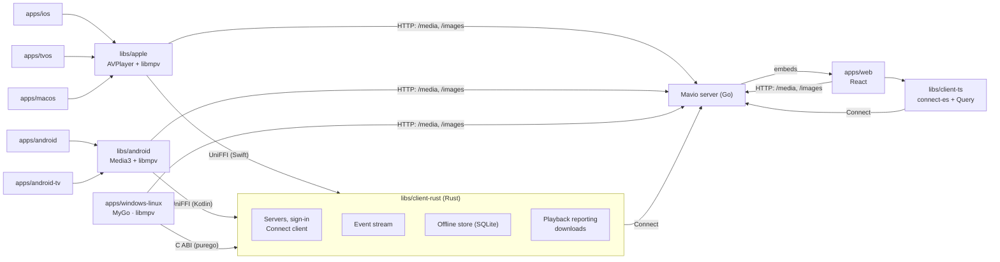

# Mavio Clients

> English | [简体中文](clients.zh-CN.md)

> Related: [Architecture](architecture.md) · [Domain Model](domain.md) · [Roadmap](roadmap.md) · [Development](development.md) · [AGENTS.md](../AGENTS.md)

> Mavio's clients are a web UI embedded in the server binary and a native app for each way people watch: iPhone and iPad, Apple TV, Mac, Android phones and tablets, Android TV, and Windows and Linux desktops. The server makes the decisions; the clients declare what they can play, play it, and keep what they need offline. A shared Rust core gives every native app one implementation of the connection, event, offline and playback-reporting logic. The clients are built in phase P21 of the [Roadmap](roadmap.md).

---

## 1. Overview

Each app is built for one interaction model — touch, the television remote, the pointer and keyboard of a desktop — rather than stretched across several. What does not depend on the interaction model is shared below the apps.

| App | Technology | Devices |
| :--- | :--- | :--- |
| `apps/web` | React + Vite + TanStack Router / Query + Tailwind CSS, embedded in the server with `//go:embed` | Browsers |
| `apps/ios` | Swift, SwiftUI (UIKit where SwiftUI falls short) | iPhone and iPad, one universal app |
| `apps/tvos` | Swift, SwiftUI and UIKit | Apple TV |
| `apps/macos` | Swift, AppKit (SwiftUI where it fits) | Mac |
| `apps/android` | Kotlin, Jetpack Compose | Android phones, tablets and foldables |
| `apps/android-tv` | Kotlin, Compose for TV | Android TV and Google TV |
| `apps/windows-linux` | Go, [MyGo](https://github.com/egoist/mygo) native UI, libmpv | Windows and Linux |

| Library | Contents | Used by |
| :--- | :--- | :--- |
| `libs/client-ts` | TypeScript: Connect client (`connect-es`) and TanStack Query hooks | `apps/web` |
| `libs/client-rust` | Rust: servers, sign-in, events, offline store, playback reporting, downloads | Every native app: through UniFFI from Swift and Kotlin, through a C ABI from Go |
| `libs/apple` | Swift packages: the core's Swift API and app services, the player, shared SwiftUI components | `apps/ios`, `apps/tvos`, `apps/macos` |
| `libs/android` | Kotlin modules: the core's Kotlin API and app services, the player, shared Compose components | `apps/android`, `apps/android-tv` |
| `libs/design` | Design tokens (DTCG JSON), icons, component specifications and strings, compiled for every client | Every client |

---

## 2. Architecture



---

## 3. Server and Clients

The server owns every decision that depends on the library, the user or other devices; the clients own what depends on the device.

| Concern | Where | How |
| :--- | :--- | :--- |
| Playback decision | Server | `PlaybackService` decides direct play, remux or transcode from the client's `ClientCapabilities` with `libs/media/decision`, together with the user's stream preferences, bitrate cap, transcoding permission and playback limits ([Architecture §11](architecture.md#11-api-and-authentication-appsserver)) |
| Capabilities | Client | Probed with the platform's own APIs: AVFoundation and VideoToolbox, `MediaCodecList` and `Display.HdrCapabilities`, the browser's `MediaCapabilities` and `MediaSource.isTypeSupported`, and the decoders of the bundled libmpv. A client playing with two engines declares what either plays, so that the server processes media only when neither can (§4.2) |
| Progress | Client reports, server records | Reported through `PlaybackService` every 10 seconds while playing and on pause, seek and stop; the server ends a playback five minutes after its last report |
| Live updates | Server pushes | One `EventService` stream per device: item and library changes, user data, sessions, remote-control commands and SyncPlay. Clients reconnect with backoff and do not poll |
| Media and images | Plain HTTP | `/media/{playback}/…` and `/images/…`; the IDs are the credentials, so players need no headers |
| Sign-in | Server | Bearer tokens; television apps sign in with Quick Connect |
| Finding servers | Client | UDP discovery on port 7359 on the local network, or an address typed in |
| Acquisition, discovery and requests | Server | The server's own services; clients call nothing else |

---

## 4. Platforms

### 4.1 Web (`apps/web`)
* **Role**: every feature — browsing, playback, requests, administration and the first-run setup — with no installation.
* **Serving**: Vite builds into `apps/server/internal/webui/dist`, which the server embeds with `//go:embed` and serves at `/`, with the SPA's routes falling back to `index.html`. The directory holds only a `.gitkeep` in the repository; a server built without the web UI serves a page saying so. Nx makes the server's `build` depend on the web's. The API reference stays at `/api`.
* **API**: `libs/client-ts`, on `connect-es` v2 and `protobuf-es` v2 with the code generated from `libs/proto`, and TanStack Query for caching and invalidation, driven by the event stream.
* **Playback**: hls.js on browsers with Media Source Extensions, the native HLS player on Safari; capabilities from `MediaCapabilities.decodingInfo`. ASS subtitles keep their styling with JASSUB (libass in WebAssembly). For what a browser cannot play without a transcode, the player offers to open the playback URL in an external player (mpv, VLC, IINA).

### 4.2 Apple (`apps/ios`, `apps/tvos`, `apps/macos`, `libs/apple`)
* **One app per interaction model.** iPhone and iPad are one universal app, as the App Store expects, with layouts of their own on iPad: sidebars and multiple columns, several windows, Stage Manager, the pointer and hardware keyboards. Apple TV is its own app, built around the focus engine and the remote at ten feet, with the Top Shelf. The Mac is its own app in AppKit, the toolkit that gives a player full control of windows, the menu bar, full screen, the trackpad and several players at once.
* **`libs/apple`**, Swift packages shared by the three apps:
  * `MavioKit`: the core's Swift API with the app services above it — accounts, capability probing, downloads with a background `URLSession`, Now Playing (`MPNowPlayingInfoCenter`, `MPRemoteCommandCenter`);
  * `MavioPlayer`: one player interface with two engines, and Picture in Picture;
  * `MavioUI`: SwiftUI components each app composes in its own way (artwork, posters, rows), and the design tokens.
* **Player engines**, in order of preference: AVPlayer, then libmpv, then the server's processing.
  * **Capabilities**: the app declares in `direct_play` the profiles AVPlayer plays and those libmpv plays. The server therefore plays a source directly whenever either engine can, and remuxes or transcodes it only when neither can.
  * **Choice**: a source played directly goes to AVPlayer when AVPlayer plays it as it is, else to libmpv; what the server remuxes or transcodes is HLS, which goes to AVPlayer.
  * **Dolby Vision**: the libmpv profiles exclude Dolby Vision video, which libmpv shows only as HDR10, so the server remuxes such a source in Matroska into HLS, copying the video, and AVPlayer plays it in Dolby Vision.
  * **AirPlay**: while AirPlay is in use, the app declares AVPlayer's profiles alone, libmpv having no AirPlay.
  * **AVPlayer**, the first engine, plays what AVFoundation plays — MP4 and MOV with H.264, HEVC, AV1 where the hardware decodes it, Dolby Vision and HDR10, AAC, AC-3 and E-AC-3 with Atmos — and every HLS stream the server makes. It brings system Picture in Picture, AirPlay, `AVPlayerViewController` on iOS and tvOS, and frame rate and dynamic range matching on tvOS (`AVDisplayCriteria`).
  * **libmpv**, the second, direct plays what AVFoundation does not, such as Matroska with styled ASS subtitles, DTS and TrueHD, sparing the server a transcode. It renders as IINA does: mpv's render API (whose back ends are OpenGL and software) into a `CAOpenGLLayer`, and for HDR the layer is switched to EDR (`wantsExtendedDynamicRangeContent`, `RGBA16Float` contents, a PQ color space) with mpv's `target-trc=pq` and `target-peak` taken from the screen; on iOS and tvOS the OpenGL ES back end is used.
* **Picture in Picture**: `AVPictureInPictureController` only, which is public and allowed in the App Store. AVPlayer gives it directly; libmpv playback feeds it through its `AVSampleBufferDisplayLayer` content source, with frames rendered into IOSurface-backed pixel buffers.

### 4.3 Android (`apps/android`, `apps/android-tv`, `libs/android`)
* **One app per interaction model.** Phones, tablets and foldables share an app in Compose with adaptive layouts; Android TV and Google TV have their own in Compose for TV, built around D-pad focus, with Watch Next and channels on the home screen. They are published as one Play listing, the TV app for the TV form factor.
* **`libs/android`**, Gradle modules shared by both apps, which include it as a composite build:
  * `core`: the core's Kotlin API with the app services above it — accounts, capability probing, downloads with WorkManager;
  * `player`: one player interface with two engines, behind a `MediaSessionService` for background playback and system controls, and Picture in Picture, which on Android takes any `SurfaceView`;
  * `ui`: shared Compose components and the design tokens.
* **Player engines**, in order of preference as on Apple platforms: Media3, then libmpv, then the server's processing.
  * **Capabilities**: the app declares in `direct_play` the profiles Media3 plays on the device and those libmpv plays, so that the server remuxes or transcodes a source only when neither can.
  * **Choice**: a source played directly goes to Media3 when Media3 plays it as it is, else to libmpv; what the server remuxes or transcodes goes to Media3.
  * **Dolby Vision and HDR**: the libmpv profiles exclude Dolby Vision video and, on devices with HDR output, HDR video, which Media3 plays to the display and libmpv only tone maps.
  * **Media3** ExoPlayer, the first engine, plays Matroska and MP4 in the formats the device decodes, the audio formats the platform lacks (DTS, TrueHD and the like) through its FFmpeg decoder extension, and PGS subtitles and SSA without its styling. It renders to a `SurfaceView` for HDR and low power, with tunneled playback where the TV supports it and frame rate matching with `Surface.setFrameRate`.
  * **libmpv**, the second, as mpv-android builds it, direct plays what Media3 does not, such as styled ASS subtitles and codecs without a hardware decoder, rendering with OpenGL ES into its own `SurfaceView` and decoding with MediaCodec where it can. A Media3 `SimpleBasePlayer` adapts it, so that the media session and the controller treat both engines alike.

### 4.4 Windows and Linux (`apps/windows-linux`)
* **Structure**: a Go app on MyGo, all of its windows native UI that MyGo draws on the GPU (Direct3D 11 on Windows, OpenGL on Linux); no web view. It builds with `CGO_ENABLED=0` like the server and ships with two shared libraries, libmpv and the core.
* **Core**: `libs/client-rust` through its C ABI, loaded at run time as MyGo loads native APIs — purego on Linux, the `syscall` package on Windows. Requests, results and events cross it as protobuf messages of the core's API, generated for Go.
* **Player**: libmpv, loaded the same way and driven through its client API (commands, properties, and events read by a goroutine). mpv draws the video itself, in a native surface of its own placed under the surface MyGo draws the UI in. A video element of MyGo's native UI places that surface: it makes a hole through what the window paints where the video shows, so that the on-screen controller (§6.5), menus and dialogs, drawn by MyGo, show over the video, and the pointer reaches MyGo wherever it draws something.
  * **Windows**: mpv renders into a child window (`wid`) with Direct3D 11 and `gpu-next`, outputting HDR10 with `target-colorspace-hint`; MyGo's frames are in the window's topmost DirectComposition target, above it.
  * **Linux**: mpv's OpenGL render API draws into a `GtkGLArea` under MyGo's surface in its `GtkOverlay`, on X11 and Wayland alike; HDR is tone mapped to SDR.
* **System integration**: System Media Transport Controls on Windows and MPRIS on Linux, which also bring the media keys; MyGo's power API keeps the display awake during playback.
* **Packaging and updates**: MyGo's — Windows installers, Debian packages and a Linux install script, code signing, and signed automatic updates with delta updates.

---

## 5. Shared Core (`libs/client-rust`)

### 5.1 Responsibilities
* **Servers and sign-in**: several servers per app, discovery, sign-in with a password or Quick Connect, and the access token, kept by the app in the platform's secure storage (Keychain, Android Keystore, Windows Credential Manager, the Secret Service) through an interface the app implements.
* **Connect client**: [connect-rust](https://github.com/connectrpc/connect-rust) over HTTP/1.1 and HTTP/2, with the messages and clients generated from `libs/proto` into `libs/proto/gen/rust` and included by the crate `mavio-api`.
* **Event stream**: one `EventService` stream per server, reconnected with backoff, its events dispatched to the app.
* **Offline store**: SQLite (`rusqlite`, bundled SQLite) with the items last browsed, so that the app starts on cached content, the downloaded items, and the progress reports made offline, sent once the server is reachable.
* **Playback reporting**: starting playbacks, the periodic and final progress reports, and the replay of offline ones.
* **Downloads**: the queue, its state, and the items downloaded; the apps move the bytes with the platform's background transfer.
* **Screen state**: a view model for every screen of §6.3 — the data it shows, its loading, empty and error states, and the actions it offers — observed by the apps, which only draw it; the screens therefore behave alike on every platform. `libs/client-ts` gives the web UI the same view models as hooks.

### 5.2 Boundaries
* No GUI, graphics or decoding: the view models hold state, not layout; the core never touches a video surface or a decoder, and never probes capabilities; the apps pass their `ClientCapabilities` in.
* An async API on Tokio; every call can be cancelled.
* Targets: `aarch64-apple-ios`, `aarch64-apple-ios-sim`, `aarch64-apple-tvos`, `aarch64-apple-darwin`, `x86_64-apple-darwin`, `aarch64-linux-android`, `armv7-linux-androideabi` (many Android TV devices run 32-bit), `x86_64-linux-android`, `x86_64-pc-windows-msvc`, `aarch64-pc-windows-msvc`, `x86_64-unknown-linux-gnu`, `aarch64-unknown-linux-gnu`.

### 5.3 Bindings
* **Swift**: UniFFI generates the Swift API, packaged with the static libraries as an XCFramework that `MavioKit` depends on.
* **Kotlin**: UniFFI generates the Kotlin API, packaged with the shared libraries in the `core` module of `libs/android`.
* **Go**: a C ABI of a few functions taking and returning byte buffers, which hold protobuf messages of the core's API, defined in `libs/client-rust/proto`; results and events come back through one callback, so that purego creates a single callback for the process. The Go API is generated from those messages.

---

## 6. Design System

The clients share one identity and one structure, and each looks native on its platform. Three layers divide the design:

| Layer | Rule | Contents |
| :--- | :--- | :--- |
| Shared | Defined once, the same everywhere | Tokens, content icons, the screens and their navigation, components, the on-screen controller, copy |
| Mapped | One concept, expressed the platform's way | The navigation container, the menu of more actions, the controls of settings |
| Platform | The platform's own | Window chrome, the menu bar, materials, system fonts, the back gesture, television focus, accessibility, system icons |

### 6.1 Design Tokens
Colors, typography, spacing, radii, elevation and motion are defined once in `libs/design/tokens` in the W3C Design Tokens (DTCG) format. Style Dictionary resolves them and `pnpm nx run design:generate` compiles them, with the icons and strings, into `libs/design/gen/{ts,swift,kotlin,go}`. The generated code is committed and CI checks that it is current, as with `libs/proto/gen`.
* **Color**: a dark theme first, which suits artwork and dim rooms, and a light theme; both meet WCAG AA contrast, which the generator checks for every pair of text and background.
* **Typography**: the type scale (sizes, weights, line heights) is shared; the family is the platform's system font — SF Pro on Apple platforms, Roboto on Android, Segoe UI Variable on Windows, and Inter, shipped with the app, on Linux and the web — so that Dynamic Type and font scaling apply. The brand typeface appears only in the logo and display titles.
* **Sizes per form factor**: the tokens have phone, tablet, desktop and television values (television sized for 10-foot viewing and overscan-safe margins).

### 6.2 Icons
Content and brand icons are [Phosphor](https://phosphoricons.com/) (MIT), pinned in `libs/design/icons/icons.json`, which maps semantic names to Phosphor names; the generator copies their SVG sources into `libs/design/icons/svg` and compiles them into path data for the web UI and for MyGo, which draws them itself, asset catalog images and Android vector drawables. Regular and Fill weights mark inactive and active states (favorite, mute, loop, subtitles) without shifting the layout. System controls use the platform's icons — SF Symbols on Apple platforms (share, AirPlay, Picture in Picture, menus) and Material Symbols on Android — where users expect them.

### 6.3 Information Architecture
Every client has the same screens with the same names, reached the same way:
* **Top-level destinations**: Home (continue watching, next up, latest per library), the libraries, Search, Downloads (the apps), and the profile with settings.
* **Screens below them**: a library (grid with sort and filters), an item's details (movie, series, season, person, collection), the player, and settings.
* **Navigation container**, mapped per platform: a tab bar on iPhone, a sidebar on iPad, Mac, Windows, Linux and wide web windows, a navigation bar or rail on Android by window size class, a top tab bar on Apple TV, and a side menu on Android TV.

### 6.4 Components
The core components are specified once in `libs/design/components.md` — their anatomy, their states (default, focused, pressed, loading, watched progress, played), their sizes per form factor and their tokens — and implemented natively on each platform; the specification is shared, not the code. They are the poster and thumbnail cards, the shelf row, the details header, the episode row, the person card, the track and subtitle pickers, and the empty, error and offline states. Television adds the focused state (scale and shadow) to every card.

### 6.5 On-Screen Controller
Every player follows one layout and state machine:
* **Top bar**: title, season and episode, and the cast or AirPlay action.
* **Center**: play and pause; on touch screens double tap to seek, vertical swipes for brightness and volume, long press for double speed.
* **Bottom bar**: elapsed and remaining time, a seek bar with chapter marks and trickplay thumbnails, audio and subtitle selection with subtitle offset, playback speed, and full screen and Picture in Picture.
* **Hiding**: the controls fade out after 3 seconds without input during playback.
* **Input**: keyboard shortcuts on desktops and the web (space, arrows, `f`, `m`, `j`/`l`); the D-pad and remote on television, where the controller follows the platform's focus (the tvOS focus engine, Compose for TV focus) and stays up while it has focus.

### 6.6 Copy and Localization
The strings of every client are defined once in `libs/design/strings` in ICU MessageFormat, with English the source language, and compiled into the web UI's message catalogs, String Catalogs (`.xcstrings`) for Apple platforms, `strings.xml` for Android and a Go package for Windows and Linux. The same term names the same thing everywhere, plurals follow CLDR rules, and each string is translated once. Strings only one platform uses carry that platform's tag.

### 6.7 Platform Conventions
Consistency of brand does not override the platforms:
* **Window chrome**: traffic lights on the left on macOS; caption buttons on the right on Windows and Linux.
* **Menus**: the macOS menu bar; context menus and popovers elsewhere; the menu of more actions is a menu on Apple platforms and desktops and a bottom sheet on Android phones.
* **Materials**: vibrancy on Apple platforms, Mica on Windows 11.
* **Touch**: targets of at least 44 × 44 pt, and safe areas respected.
* **Navigation**: the platform's back gesture and button; settings use the platform's controls (switches, pickers, lists).
* **Accessibility**: VoiceOver, TalkBack and screen readers, Dynamic Type and font scaling, Reduce Motion, and contrast meeting WCAG AA.

### 6.8 Galleries and Visual Review
* **Component galleries**: every platform browses its components in every state with fixed data — Storybook on the web, SwiftUI previews on Apple platforms, Compose previews on Android and a gallery window on Windows and Linux.
* **Snapshot tests**: every client renders the same set of screens with fixed data in snapshot tests — Playwright on the web, swift-snapshot-testing on Apple platforms, Roborazzi on Android and MyGo's offscreen rendering on Windows and Linux. CI compares them with the committed references and builds one page placing each screen's platforms side by side, which a pull request that changes the UI links for review.
* **Feature parity**: `libs/design/parity.md` lists every feature with its state on each client (shipped, planned, not applicable), so that a client lacks a feature only by decision; a pull request adding a feature to one client updates it.

---

## 7. Dependency Direction and Tooling

* `apps/web` → `libs/client-ts` → `libs/proto` (TypeScript); every client → `libs/design`.
* `apps/ios`, `apps/tvos`, `apps/macos` → `libs/apple` → `libs/client-rust` (Swift bindings).
* `apps/android`, `apps/android-tv` → `libs/android` → `libs/client-rust` (Kotlin bindings).
* `apps/windows-linux` → `libs/client-rust` (C ABI) and `libs/proto` (Go). It is a Go module like the server's and follows the repository's Go conventions; the depguard rules let it depend on no server library.
* `libs/client-rust` → `libs/proto` (Rust).
* No app depends on another app. The server depends on `apps/web` only for the files it embeds.
* Nx runs every client: `tools/nx-go` infers `apps/windows-linux` as it does every Go module, Vite and TypeScript run through their Nx plugins, Gradle through `@nx/gradle`, and Cargo and `xcodebuild` through targets of their own. The Apple and Android jobs in CI run only when they are affected, macOS runners being costly.

---

## 8. Directory Layout

```text
mavio/
├── apps/
│   ├── server/                  # [Go] Server; internal/webui embeds the web UI
│   ├── web/                     # [TS] Web UI (React + Vite)
│   ├── ios/                     # [Swift] iPhone and iPad
│   ├── tvos/                    # [Swift] Apple TV
│   ├── macos/                   # [Swift] Mac (AppKit)
│   ├── android/                 # [Kotlin] Phones, tablets, foldables
│   ├── android-tv/              # [Kotlin] Android TV, Google TV
│   └── windows-linux/           # [Go] Windows and Linux (MyGo, libmpv)
│
├── libs/
│   ├── proto/                   # Contracts; gen/go, gen/ts, gen/rust
│   ├── client-ts/               # [TS] connect-es client and Query hooks
│   ├── client-rust/             # [Rust] Cargo workspace of the shared core
│   │   ├── api/                 # Generated messages and Connect clients (mavio-api)
│   │   ├── core/                # Servers, events, offline store, reporting, downloads
│   │   ├── uniffi/              # UniFFI exports for Swift and Kotlin
│   │   ├── capi/                # C ABI for Go
│   │   └── proto/               # Messages of the C ABI
│   ├── apple/                   # [Swift] MavioKit, MavioPlayer, MavioUI
│   ├── android/                 # [Kotlin] core, player, ui
│   └── design/                  # Tokens, icons, components, strings; gen/{ts,swift,kotlin,go}
```
