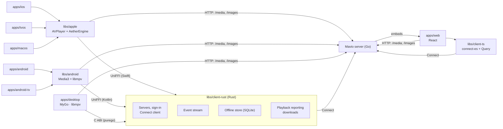

# Mavio Clients

> English | [简体中文](clients.zh-CN.md)

> Related: [Architecture](architecture.md) · [Domain Model](domain.md) · [Roadmap](roadmap.md) · [Development](development.md) · [AGENTS.md](../AGENTS.md)

> Mavio's clients are a web UI embedded in the server binary and a native app for each way people watch: iPhone and iPad, Apple TV, Mac, Android phones and tablets, Android TV, and desktops on macOS, Windows and Linux. The server makes the decisions; the clients declare what they can play, play it, and keep what they need offline. A shared Rust core gives every native app one implementation of the connection, event, offline and playback-reporting logic. The clients are built in phase P21 of the [Roadmap](roadmap.md).

---

## 1. Overview

Each app is built for one interaction model — touch, the television remote, the pointer and keyboard of a desktop — rather than stretched across several. What does not depend on the interaction model is shared below the apps.

| App | Technology | Devices |
| :--- | :--- | :--- |
| `apps/web` | React + Vite + TanStack Router / Query + Base UI + Tailwind CSS, embedded in the server with `//go:embed` | Browsers |
| `apps/ios` | Swift, SwiftUI (UIKit where SwiftUI falls short) | iPhone and iPad, one universal app |
| `apps/tvos` | Swift, SwiftUI and UIKit | Apple TV |
| `apps/macos` | Swift, AppKit (SwiftUI where it fits) | Mac |
| `apps/android` | Kotlin, Jetpack Compose | Android phones, tablets and foldables |
| `apps/android-tv` | Kotlin, Compose for TV | Android TV and Google TV |
| `apps/desktop` | Go, [MyGo](https://github.com/egoist/mygo) native UI, libmpv | macOS, Windows and Linux |

| Library | Contents | Used by |
| :--- | :--- | :--- |
| `libs/client-ts` | TypeScript: Connect client (`connect-es`) and TanStack Query hooks | `apps/web` |
| `libs/client-rust` | Rust: servers, sign-in, events, offline store, playback reporting, downloads | Every native app: through UniFFI from Swift and Kotlin, through a C ABI from Go |
| `libs/apple` | Swift packages: the core's Swift API and app services, the player, shared SwiftUI components | `apps/ios`, `apps/tvos`, `apps/macos` |
| `libs/android` | Kotlin modules: the core's Kotlin API and app services, the player, shared Compose components | `apps/android`, `apps/android-tv` |
| `libs/design` | Design tokens (DTCG JSON), icons, the logo, component specifications and strings, compiled for every client | Every client |

---

## 2. Architecture



---

## 3. Server and Clients

The server owns every decision that depends on the library, the user or other devices; the clients own what depends on the device.

| Concern | Where | How |
| :--- | :--- | :--- |
| Playback decision | Server | `PlaybackService` decides direct play, remux or transcode from the client's `ClientCapabilities` with `libs/media/decision`, together with the user's stream preferences, bitrate cap, transcoding permission and playback limits ([Architecture §11](architecture.md#11-api-and-authentication-appsserver)) |
| Capabilities | Client | Probed with the platform's own APIs: AVFoundation and VideoToolbox, `MediaCodecList` and `Display.HdrCapabilities`, the browser's `MediaSource.isTypeSupported` and `canPlayType`, and the decoders of the bundled second engines (AetherEngine, libmpv). A client playing with two engines declares what either plays, so that the server processes media only when neither can (§4.2) |
| Progress | Client reports, server records | Reported through `PlaybackService` every 10 seconds while playing and on pause, seek and stop; the server ends a playback five minutes after its last report |
| Live updates | Server pushes | One `EventService` stream per device: item and library changes, user data, sessions, remote-control commands and SyncPlay. Clients reconnect with backoff and do not poll |
| Media and images | Plain HTTP | The URLs the server signs for the session ([Accounts §5.4](accounts.md#54-media-urls)), so players need no headers |
| Sign-in | Server | Sessions bound to the device key, with short-lived bearer tokens; televisions sign in Mavio accounts with a code at mavio.dev/link, and standalone servers' users with Quick Connect |
| Home | Server builds, client merges | Each server builds its hubs for the user with `HubService` ([Architecture §11](architecture.md#11-api-and-authentication-appsserver)); the client merges the hubs of every server it is signed in to (§5.4) |
| Finding servers | Client | UDP discovery on port 7359 on the local network, or an address typed in |
| Acquisition, discovery and requests | Server | The server's own services; clients call nothing else |

---

## 4. Platforms

### 4.1 Web (`apps/web`)
* **Role**: every feature — browsing, playback, requests, administration and the first-run setup — with no installation.
* **Serving**: Vite builds into `apps/server/internal/webui/dist`, which the server embeds with `//go:embed` and serves at `/`, with the SPA's routes falling back to `index.html`. The directory holds only a `.gitkeep` in the repository; a server built without the web UI serves a page saying so. Nx makes the server's `build` depend on the web's. The API reference stays at `/api`. Built with `VITE_MAVIO_DEV_URL`, the base URL of mavio.dev's API, the same web UI is app.mavio.dev, which no server serves and which signs in Mavio accounts alone.
* **Servers**: a standalone server's web UI reaches that server alone. A Mavio account's web UI, a server's or app.mavio.dev, reaches every server of the account (§5.4): it signs in to each at the first of the URLs the server published that answers, over HTTPS only from a page served over HTTPS, and calls them cross-origin; servers allow any origin on every route, which take bearer tokens and signed media URLs and never cookies. The device key is a non-extractable WebCrypto Ed25519 key in IndexedDB, and the sessions and the user's order of servers are kept in the browser's local storage; the transport refreshes an access token before it expires, or once the server rejects it, and signs a Mavio account in again where a server no longer refreshes its session.
* **Signing in** ([Accounts §6](accounts.md#6-signing-in)): a new server opens `/setup`, which chooses its mode ([Accounts §2](accounts.md#2-server-modes)) and then signs a Mavio account in, which claims the server, or creates its administrator (`?step=admin`); on a television it shows the server's address to open on a computer or phone. `/sign-in` signs in the way the server does. In mavio.dev mode it signs in the server's administrator through mavio.dev's authorization page and points everyone else to app.mavio.dev; mavio.dev comes back to `/auth/callback`, which returns to where the sign-in started. A standalone server signs in with a password, then the code of the user's authenticator app (`?step=totp`), a passkey of the serving server's host, or Quick Connect (`?step=quick`); the user menu switches between its users with their PINs, and settings manage the user's passkeys, authenticator app and PIN. A television signs a Mavio account in with a code to enter at mavio.dev/link. Each step has its own address, so that the browser's Back, Escape and a remote's Back return to the step before. The steps lie on a wall of posters drawn from gradients, tilted and blurred under a veil that is dark or light with the theme: in a card on a wide window and a television, across the whole screen on a phone. Signing out ends every session of the sign-in.
* **Screens**: the layout follows the window's width (§6.3), and television mode is a setting of the browser. Settings are in sections — Appearance, Playback, Subtitles & Audio, Servers, Account, Devices and Issues — beside their own sidebar, or listed first on a phone; those of the browser (appearance, the UI's language, television mode, the sidebar and its width, the highest quality and playing the next episode) are kept in its local storage, and the audio and subtitle languages in the user's preferences on each server. The sidebar and the settings' sidebar share one width, the layout's by default, dragged by their edge between 200 and 400 px and restored by double-clicking it. The UI's language, under Appearance, follows the browser's languages by default, and the page reloads in the language chosen; discovered titles are named in it too. In television mode the arrow keys move focus to the nearest element in their direction, and Escape and Backspace go back.
* **Controls**: every control is drawn by the web UI itself, the same in every browser and operating system: [Base UI](https://base-ui.com) gives selects, menus, dialogs, alerts, tooltips, switches, checkboxes, sliders, number fields, fields with suggestions, radio groups, tabs, toggles, progress bars and disclosures their behavior and accessibility (focus kept in and returned, the arrow keys, typing to an item, Escape, a press outside), and Tailwind CSS draws them with the design tokens; `src/controls` wraps them for the screens, which use no control of the browser's own look. Popups are portaled above the page, and on a television menus are frosted glass with larger items that open on the item chosen, and Back closes a popup as Escape does.
* **API**: `libs/client-ts`, on `connect-es` v2 and `protobuf-es` v2 with the code generated from `libs/proto`, and TanStack Query for caching and invalidation, driven by the event stream.
* **Playback**: hls.js on browsers with Media Source Extensions, the native HLS player on Safari; capabilities from `MediaSource.isTypeSupported` and `canPlayType`. ASS subtitles keep their styling with JASSUB (libass in WebAssembly). For what a browser cannot play without a transcode, the player offers to open the playback URL in an external player (mpv, VLC, IINA).

### 4.2 Apple (`apps/ios`, `apps/tvos`, `apps/macos`, `libs/apple`)
* **One app per interaction model.** iPhone and iPad are one universal app, as the App Store expects, with layouts of their own on iPad: sidebars and multiple columns, several windows, Stage Manager, the pointer and hardware keyboards. Apple TV is its own app, built around the focus engine and the remote at ten feet, with the Top Shelf. The Mac is its own app in AppKit, the toolkit that gives a player full control of windows, the menu bar, full screen, the trackpad and several players at once.
* **`libs/apple`**, Swift packages shared by the three apps:
  * `MavioKit`: the core's Swift API with the app services above it — accounts, capability probing, downloads with a background `URLSession`, Now Playing (`MPNowPlayingInfoCenter`, `MPRemoteCommandCenter`);
  * `MavioPlayer`: one player interface with two engines, and Picture in Picture;
  * `MavioUI`: SwiftUI components each app composes in its own way (artwork, posters, rows), and the design tokens.
* **Player engines**, in order of preference: AVPlayer, then AetherEngine, then the server's processing.
  * **Capabilities**: the app declares in `direct_play` the profiles AVPlayer plays and those AetherEngine plays. The server therefore plays a source directly whenever either engine can, and remuxes or transcodes it only when neither can.
  * **Choice**: a source played directly goes to AVPlayer when AVPlayer plays it as it is, else to AetherEngine; what the server remuxes or transcodes is HLS, which goes to AVPlayer.
  * **AirPlay**: while AirPlay is in use, the app declares AVPlayer's profiles alone.
  * **AVPlayer**, the first engine, plays what AVFoundation plays — MP4 and MOV with H.264, HEVC, AV1 where the hardware decodes it, Dolby Vision and HDR10, AAC, AC-3 and E-AC-3 with Atmos — and every HLS stream the server makes. It brings system Picture in Picture, AirPlay, `AVPlayerViewController` on iOS and tvOS, and frame rate and dynamic range matching on tvOS (`AVDisplayCriteria`).
  * **[AetherEngine](https://github.com/superuser404notfound/AetherEngine)**, the second, a Swift package pinned to an exact version, direct plays what AVFoundation does not, such as Matroska with styled ASS and PGS subtitles, VP9, DTS and TrueHD, sparing the server a transcode. FFmpeg demuxes and VideoToolbox decodes (dav1d and libavcodec where the hardware cannot), and frames reach Apple's own display stack — an `AVPlayerLayer` on its native path, an `AVSampleBufferDisplayLayer` on its software path — with no renderer of its own: HDR10, HDR10+, HLG and Dolby Vision (profiles 5, 7 as 8.1, and 8) go to the display as they are, through EDR on the Mac and iPad and with display criteria on tvOS. DTS and TrueHD are converted to E-AC-3 5.1 and E-AC-3 with Atmos is passed through. Subtitles arrive as cues that `MavioPlayer` draws over the picture: styled text runs and bitmaps, and for ASS the raw event lines, the script header and the embedded fonts, which [libass](https://github.com/libass/libass), built for the three platforms, renders with their authored styling: `ASSRenderer` takes the fonts the server lists as the item's attachments and finds the rest with Core Text, and draws each frame's subtitles into an image over the picture. Its FFmpeg is embedded as dynamic LGPL frameworks, the only FFmpeg in the app.
* **Accounts and downloads**: the device key and each server's session are kept in the Keychain, and the core's database holds the rest. A download is the source file fetched with a background `URLSession`, so it continues while the app is suspended; a downloaded item plays from the device with no server, and the progress made offline is replayed to its server when the server answers again (§5.1).
* **Subtitles**: an HLS stream carries text subtitles as WebVTT renditions, which AVPlayer shows itself. With AetherEngine, `MavioPlayer` lays the cues out inside the picture rather than the screen, so they stay over the video at any aspect ratio and orientation.
* **Picture in Picture**: `AVPictureInPictureController` only, which is public and allowed in the App Store. AVPlayer gives it directly, and AetherEngine through its `AVPlayerLayer` or its `AVSampleBufferDisplayLayer` content source. tvOS shows no Picture in Picture of a sample buffer display layer, so entering it while AetherEngine plays on its software path starts the playback again on AVPlayer, the server processing the source.

### 4.3 Android (`apps/android`, `apps/android-tv`, `libs/android`)
* **One app per interaction model.** Phones, tablets and foldables share an app in Compose with adaptive layouts; Android TV and Google TV have their own in Compose for TV, built around D-pad focus, with Watch Next and channels on the home screen. They are published as one Play listing under one application ID, `dev.mavio.app`, the TV app for the TV form factor; both run on Android 8.0 (API 26) and later.
* **`libs/android`**, Gradle modules shared by both apps, which include it as a composite build:
  * `core`: the core's Kotlin API with the app services above it — accounts, capability probing, downloads with WorkManager. It declares the `INTERNET` permission and `ACCESS_LOCAL_NETWORK`, which Android 17 requires to reach an address on the local network, where most servers are; the apps request the latter before discovery or sign-in, and allow cleartext HTTP (`usesCleartextTraffic`), which Media3 otherwise refuses, as servers on the local network serve their media over plain HTTP;
  * `player`: one player interface with two engines, behind a `MediaSessionService` for background playback and system controls, and Picture in Picture, which on Android takes any `SurfaceView`;
  * `ui`: shared Compose components and the design tokens.
* **Player engines**, in order of preference as on Apple platforms: Media3, then libmpv, then the server's processing.
  * **Capabilities**: the app declares in `direct_play` the profiles Media3 plays on the device and those libmpv plays, so that the server remuxes or transcodes a source only when neither can.
  * **Choice**: a source played directly goes to Media3 when Media3 plays it as it is, else to libmpv; what the server remuxes or transcodes goes to Media3.
  * **Dolby Vision and HDR**: the libmpv profiles exclude Dolby Vision video and, on devices with HDR output, HDR video, which Media3 plays to the display and libmpv only tone maps.
  * **Media3** ExoPlayer, the first engine, plays Matroska and MP4 in the formats the device decodes, the audio formats the platform lacks (DTS, TrueHD and the like) through its FFmpeg decoder extension, built from source with FFmpeg's audio decoders as LGPL (in mavio-deps), and PGS subtitles and SSA without its styling. It renders to a `SurfaceView` for HDR and low power, with tunneled playback where the TV supports it and frame rate matching with `Surface.setFrameRate`.
  * **libmpv**, the second, as mpv-android builds it, direct plays what Media3 does not, such as styled ASS subtitles and codecs without a hardware decoder, rendering with OpenGL ES into its own `SurfaceView` and decoding with MediaCodec where it can. A Media3 `SimpleBasePlayer` adapts it (`MpvPlayer`), so that the media session and the controller treat both engines alike. It is built from source with mpv-android's build scripts and its JNI layer (`is.xyz.mpv.MPVLib`) at pinned versions in mavio-deps, FFmpeg and mpv as GPL-3.0; libass draws with the system's fonts where a file embeds none.

### 4.4 Desktop (`apps/desktop`)
* **Structure**: a Go app on MyGo for macOS, Windows and Linux, all of its windows native UI that MyGo draws on the GPU (Metal on macOS, Direct3D 11 on Windows, OpenGL on Linux); no web view. It builds with `CGO_ENABLED=0` like the server and ships with two shared libraries, libmpv and the core.
* **On the Mac**: a second Mac app beside `apps/macos`, which stays the Mac app built on the system's player and toolkit. The desktop app shares one code base with Windows and Linux, so that it is built and tried on a Mac; it is distributed as a notarized disk image outside the App Store, under an ID of its own (`dev.mavio.desktop`).
* **Core**: `libs/client-rust` through its C ABI, loaded at run time as MyGo loads native APIs — purego on macOS and Linux, the `syscall` package on Windows. Requests, results and events cross it as protobuf messages of the core's API, generated for Go.
* **Player**: libmpv, loaded the same way and driven through its client API (commands, properties, and events read by a goroutine). mpv draws the video itself, in a native surface of its own placed under the surface MyGo draws the UI in. MyGo's video element places that surface: `Window.NewVideoView` makes a video view, whose native handle mpv takes as `wid`, and `ui.Video` shows it, making a hole through what the window paints where the video shows, so that the on-screen controller (§6.5), menus and dialogs, drawn by MyGo, show over the video; the pointer and the keyboard stay MyGo's over it. MyGo is used at the branch `v0.4.5-mavio` of its fork [mavioai/mygo](https://github.com/mavioai/mygo), which adds the video element to its release 0.4.5, pinned to a commit. mpv's video output is shut down off the main thread, as it waits for the main thread to finish.
  * **macOS**: mpv renders with `gpu-next` on Vulkan through MoltenVK (`gpu-context=macvk`) into a view of its own inside the video view, under MyGo's layer-backed view, decoding with VideoToolbox and outputting HDR through EDR (`target-colorspace-hint`). mpv's macOS output opens a window of its own; a patch of Mavio's, built into libmpv for macOS in mavio-deps (`mpv-macos`, a universal library for macOS 13 and later beside MoltenVK's), embeds it in the view `wid` names instead.
  * **Windows**: mpv renders into a child window (`wid`) with Direct3D 11 and `gpu-next`, outputting HDR10 with `target-colorspace-hint`; MyGo's frames are in the window's topmost DirectComposition target, above it.
  * **Linux**: mpv's OpenGL render API draws into a `GtkGLArea` under MyGo's surface in its `GtkOverlay`, on X11 and Wayland alike; HDR is tone mapped to SDR.
* **System integration**: Now Playing and the remote commands on macOS, System Media Transport Controls on Windows and MPRIS on Linux, which also bring the media keys; MyGo's power API keeps the display awake during playback.
* **Packaging and updates**: MyGo's — app bundles and notarized disk images, Windows installers, Debian packages and a Linux install script, code signing, and signed automatic updates with delta updates.

---

## 5. Shared Core (`libs/client-rust`)

### 5.1 Responsibilities
* **Servers and sign-in**: several servers signed in at once (§5.4), discovery, sign-in with a password or Quick Connect, and the sessions ([Accounts §5.2–§5.3](accounts.md#5-keys-and-tokens)): the device key and each server's session (its ID, access token and expiry) are kept by the app in the platform's secure storage (Keychain, Android Keystore, Windows Credential Manager, the Secret Service) through an interface the app implements, and the core's transport refreshes an access token by signing the server's nonce before it expires, or once the server rejects it.
* **Connect client**: [connect-rust](https://github.com/connectrpc/connect-rust) over HTTP/1.1 and HTTP/2, with the messages and clients generated from `libs/proto` into `libs/proto/gen/rust` and included by the crate `mavio-api`.
* **Event stream**: one `EventService` stream per server, reconnected with backoff, its events dispatched to the app.
* **Offline store**: SQLite (`rusqlite`, bundled SQLite) with the items last browsed, so that the app starts on cached content, the downloaded items, and the progress reports made offline, sent once the server is reachable.
* **Playback reporting**: starting playbacks, the periodic and final progress reports, and the replay of offline ones.
* **Downloads**: the queue, its state, and the items downloaded; the core asks the server for the file to keep, and the apps move its bytes with the platform's background transfer and report how far they got.
* **Screen state**: for every screen of §6.3 the data it shows — cards, rows, details, libraries and their grids, search results and downloads, as plain records with image URLs resolved — whether it came from the offline store, its errors, and the actions it offers. Home arrives through a listener as each server answers (§5.4). The apps keep each screen's loading state in their own observable model and only draw; the screens therefore behave alike on every platform. `libs/client-ts` gives the web UI the same data as hooks.

### 5.2 Boundaries
* No GUI, graphics or decoding: the view models hold state, not layout; the core never touches a video surface or a decoder, and never probes capabilities; the apps pass their `ClientCapabilities` in.
* An async API on Tokio; every call can be cancelled.
* Targets: `aarch64-apple-ios`, `aarch64-apple-ios-sim`, `aarch64-apple-tvos`, `aarch64-apple-tvos-sim`, `aarch64-apple-darwin`, `x86_64-apple-darwin`, `aarch64-linux-android`, `armv7-linux-androideabi` (many Android TV devices run 32-bit), `x86_64-linux-android`, `x86_64-pc-windows-msvc`, `aarch64-pc-windows-msvc`, `x86_64-unknown-linux-gnu`, `aarch64-unknown-linux-gnu`.

### 5.3 Bindings
* **The UniFFI API** (`mavio-uniffi`): the object `Client`, whose async functions run on one Tokio runtime of the process and are cancelled when the app drops their future; the interfaces the app implements: `SecureTokens` for the device key and the sessions, `CoreListener` for the streams' states and events, `HomeListener` for Home; and the client's capabilities as typed records, converted to `ClientCapabilities`.
* **Swift**: UniFFI generates the Swift API, packaged with the shared libraries as an XCFramework of dynamic frameworks that `MavioKit` depends on.
* **Kotlin**: UniFFI generates the Kotlin API, packaged with the shared libraries in the `core` module of `libs/android`.
* **Go**: a C ABI of three functions (`mavio-capi`, the library `maviocore`): `mavio_open` opens a client with the process's one callback and a context of the app's, `mavio_call` sends it a request with a call number of the app's choosing, and `mavio_close` closes it. Requests and answers are protobuf messages of `mavio.capi.v1`, defined in `libs/client-rust/proto`, in byte buffers; each answer, and every event of the servers under call number zero, comes back through the callback on the core's threads, so that purego creates a single callback for the process. The core keeps no secrets of its own: the app gives it the device key and the sessions it keeps in the system's secure storage when it opens it, and stores the new and forgotten ones events tell it of. The Go binding is the Go module in `libs/client-rust/capi`, next to the C ABI: package `capi` loads the library without cgo, with purego on Linux and macOS and the `syscall` package on Windows, and turns each call into a function returning the answer; its messages are generated for Go into `capi/gen`.

### 5.4 Several Servers
A client is signed in at once to every server of its sign-in ([Accounts §7](accounts.md#7-clients)) — a Mavio account's servers, its own and those of friends and family, or one standalone server — each with its own user and session. The servers do not know each other; the client alone puts them together, in the user's order of servers.
* **What spans servers**: Home, Search and Downloads. A library, an item's details and the player belong to one server, whose name the item shows when more than one server is signed in.
* **Home**, as Plex builds it: the hubs of every server (§6.3), merged:
  * **Continue Watching** is one hub across servers: the items being watched and the next episodes, by last activity;
  * **the same title on several servers**, matched by TMDB, TVDB or IMDb IDs, appears once: from the server where the user played it last, else the first in the user's order; its details offer the other servers' versions;
  * **the other hubs** follow server by server in the user's order, each server's in the order of its pinned libraries;
  * **Trending** from discovery appears once, from the first server that discovers, its titles marked available when any server has them; requests go to that server.
* **Search** asks every server at once and lists the results by server. A search runs when it is confirmed: the field of the sidebar, or of the Search page where no sidebar shows it, searches when Return is pressed, and typing alone does not leave the page. On the television, Search is a page of its own, with an on-screen keyboard beside the results ([Television §6.4](tv.md#64-search)).
* **Progressive and offline**: each server's hubs are drawn as they arrive, in their fixed places, so that a slow server holds back no other; an unreachable server's hubs come from the offline store, marked offline.
* **Played state** stays on each server: the same title played on one server is not marked played on another.

---

## 6. Design System

The clients share one identity and one structure, and each looks native on its platform. Three layers divide the design:

| Layer | Rule | Contents |
| :--- | :--- | :--- |
| Shared | Defined once, the same everywhere | Tokens, content icons, the screens and their navigation, components, the on-screen controller, copy |
| Mapped | One concept, expressed the platform's way | The navigation container, the menu of more actions, the controls of settings |
| Platform | The platform's own | Window chrome, the menu bar, materials, system fonts, the back gesture, television focus, accessibility, system icons |

### 6.1 Design Tokens
Colors, typography, spacing, radii, elevation and motion are defined once in `libs/design/tokens` in the W3C Design Tokens (DTCG) format. Style Dictionary resolves them and `pnpm nx run design:generate` compiles them, with the icons and strings, into `libs/design/gen/{ts,swift,kotlin,go}`. The generated code is committed and CI checks that it is current, as with `libs/proto/gen`.
* **Color**: a dark theme, which suits artwork and dim rooms, and a light theme, both after Apple's system colors; both meet WCAG AA contrast, which the generator checks for every pair of text and background. The appearance follows the system unless the user chooses light or dark in settings; television starts dark, and the player is always dark. The primary button is filled with the label color; the accent, an orange taken from the logo, marks only progress, selection, links and switches.
* **Typography**: the type scale (sizes, weights, line heights) is shared; the family is the platform's system font — SF Pro on Apple platforms, Roboto on Android, Segoe UI Variable on Windows, and Inter, shipped with the app, on Linux and the web — so that Dynamic Type and font scaling apply. There is no brand typeface: titles, including those over artwork, are the system font in bold, white over a dark scrim on artwork; the logo is drawn rather than set (§6.2.1).
* **Sizes per form factor**: the tokens have phone, tablet, desktop and television values (television sized for 10-foot viewing and overscan-safe margins).

### 6.2 Icons
Content and brand icons are [Phosphor](https://phosphoricons.com/) (MIT), pinned in `libs/design/icons/icons.json`, which maps semantic names to Phosphor names; the generator copies their SVG sources into `libs/design/icons/svg` and compiles them into path data for the web UI and for MyGo, which draws them itself, asset catalog images and Android vector drawables. Regular and Fill weights mark inactive and active states (favorite, mute, loop, subtitles) without shifting the layout. System controls use the platform's icons — SF Symbols on Apple platforms (share, AirPlay, Picture in Picture, menus) and Material Symbols on Android — where users expect them.

#### 6.2.1 Logo
The logo has two forms, kept as SVG sources in `libs/design/brand`, and the two never appear together:
* **Mark**: an uppercase M folded like a ribbon — two stems behind, and two diagonals in front that shade the stems where they cross them — drawn on a grid of 64 units with stems and diagonals 16 wide (`mark.svg`). It is the app icon, on a white background (`app-icon-light.svg`) or a black one (`app-icon-dark.svg`), and replaces the wordmark where that would be narrower than 64 px.
* **Wordmark**: "Mavio" drawn from straight strokes 12 wide and 45° cuts, with a cap height of 64 and an x-height of 44 (`wordmark.svg`); in a single color, white or black, only where a gradient cannot be drawn (`wordmark-white.svg`, `wordmark-black.svg`).
* **Color**: a gradient from yellow `#FFD34E` through orange `#FF9A2E` to red `#F0412F`, running from the top left to the bottom right.

### 6.3 Information Architecture
Every client has the same screens with the same names, reached the same way:
* **Top-level destinations**: Home (§6.3.1), the libraries, Discover (§6.3.2), Search, Downloads (the apps), and the profile with settings.
* **Screens below them**: a library (grid with sort and filters, narrowed to a genre, keyword or studio when opened from an item's details), an item's details (movie, series, season, collection) and its whole cast and crew, a person (§6.3.19), a discovered title and a catalog (§6.3.2), the player, and settings, in three groups: This Device; the Account, with the servers in their order; and the Server, the settings of one server — the devices signed in to it as the user and, for its administrators, its overview (§6.3.6), general settings (§6.3.8), libraries (§6.3.4), users (§6.3.5), transcoding (§6.3.9), storage (§6.3.10), acquisition (§6.3.11), wanted (§6.3.16), downloads (§6.3.17), subtitles (§6.3.12), AI (§6.3.13), plugins (§6.3.3), tasks (§6.3.7), backups and logs (§6.3.14), and API keys (§6.3.15). With a Mavio account a picker above the Server group chooses among the servers signed in to, the server serving the web UI marked; a standalone server's user, signed in to one server, has none.
* **Navigation container**: three layouts, chosen by the form factor rather than the platform, so that each is the same on every platform that uses it. Between the phone and desktop layouts the width of the window decides, with the breakpoints of Android's window size classes, the same in the apps and the web UI: compact (under 600), medium (600 to 840) and expanded (840 and over):
  * **Phone**: in compact width — iPhone, Android phones, tablets in split screen and the web UI in a phone's browser — a tab bar at the bottom with Home, the libraries, Discover, Search and, in the apps, Downloads; the avatar at the top right opens the profile and settings.
  * **Desktop**: in medium and expanded width — the web UI, the Mac, desktops, and iPad and Android tablets — a sidebar on the left with Search, Home, Discover, Downloads (in the apps) and the libraries, which collapses to a rail of icons; in medium width, such as a tablet in portrait, it starts collapsed and opens over the content. Its foot holds the signed-in user's avatar and name, which open a menu: the appearance (system, light or dark) beside the name, switching users ([Accounts](accounts.md) §3.6, §4.4), settings, switching to television mode, sign-ins, managing the account on mavio.dev or the server, and signing out. Where a keyboard is at hand — the web UI on a computer, the Mac and the desktop app — the menu shows the shortcuts of its items, each platform's own: the settings with ⌘, (Ctrl+, elsewhere), television mode with ⌃⌘T (Shift+F11), and full screen with the browser's and the Mac's keys, ⌃⌘F (F11); phones, tablets and televisions show none, having no keyboard to press them.
  * **Television**: on Apple TV, Android TV and Google TV, and in the television mode of the web UI, the Mac and the desktop app (a setting under Appearance, for a computer connected to a TV): a navigation bar at the top with Home, the libraries, Discover and Search, a button of three dots at the right for the same menu, and focus moved by the remote alone. It is specified in [Television](tv.md).

#### 6.3.1 Home
Home is a column of hubs, after Plex's: rows of items, each a reason to watch something.
* **Hubs**: Continue Watching and the requests that became available first, then for each pinned library its hubs — Recently Added, Recently Released, Recently Aired (episodes), Top Rated, Top Unplayed, Start Watching (series not begun), Rediscover (played long ago), Because You Watched, Because You Like, More in a genre, Starring, Directed by, and the collections an administrator promoted — and Trending, the titles discovery offers that no server has, to request.
* **Who chooses**: administrators choose for each library which hubs appear on its Recommended tab and which on Home; each user pins and orders libraries, which orders their hubs, and hides hubs. Continue Watching cannot be hidden.
* **Rotation**: the hubs seeded by an item, a genre or a person (Because You Watched, More in, Starring, Directed by) draw their seeds from what the user played recently, chosen anew each day, so that Home changes from day to day and stays put during a day.
* **Library tabs**: a library opens on its Recommended tab, its hubs, beside the grid of all its items.
* **Hero**: Home opens with up to five of the latest films and shows with backdrops, one after another, each with its facts and the buttons to play it and open its details.

#### 6.3.2 Discover
Discover finds films and shows to request, after Seerr, from the discovery catalogs of the server's metadata providers ([Plugins](plugins.md)).
* **Where**: Discover asks the first signed-in server whose providers offer catalogs; it is a destination only where one does.
* **Rows**: Trending, then Popular, Upcoming and Top Rated, each of movies and of series, and the lists the providers offer; each row opens its catalog, a grid loaded page by page. Titles and overviews come in the language of the client.
* **Cards**: a title's card marks it once available on the server and while requested or being acquired.
* **A title**, in the client's language as the catalogs: laid out as Seerr's page: its backdrop and poster, under its name the year, rating, runtime and genres, with Trailer opening its trailer on the web; then beside each other its tagline, overview, the six leading crew with View Full Crew opening the Credits Screen with the crew alone, and its keywords, and a movie's collection opening the collection's page, its Rotten Tomatoes critics' and audience scores, fresh or rotten, IMDb rating and TMDB score, each opening its page, original title when in another language, production status, theatrical, digital and physical releases, first, last and next air dates, runtime, revenue and budget, original language, countries with their flags, studios or networks, the services streaming it in the server's country, and, as Seerr's, the logos linking it on TMDB, TVDB (series), IMDb, Rotten Tomatoes, Trakt, Simkl and Letterboxd (movies), after Mavio's opening its item when the server has it; a genre, keyword, language, studio or network opens the popular titles of it; below its seasons the first twenty of its cast; Watch opens the item when the server has it, and Request asks for it, for a series with the seasons to request, all of those not requested yet by default. A series lists its seasons as Seerr does, each in its own bordered box, the latest first and specials last, with what the server has of each, a season expanding to its episodes with their names, air dates, overviews and stills; Recommendations and Similar follow. Home's Trending opens a title no server has here. As on Seerr, administrators approve or decline its pending requests in place and see how far its downloads have come by its status, and Manage opens its requests, downloads and open issues, blocklists it when nothing of it is requested or had, and takes it off the blocklist; Report Issue reports a problem with what the library has of it.
* **A person**, opened from the cast and crew of a title when they are not of the server, as Seerr's: their photo, birth and death, place of birth, other names, the logos linking them on TMDB and IMDb and biography, then the movies and series they play in and work on as title cards with their roles and what the server has of each, the most voted first and the department they are known for first, all, movies or series.
* **A collection**, as Seerr's: its backdrop, poster, number of movies, what the server has of them and overview; Request Collection chooses the movies to request, all those not requested yet by default, and administrators blocklist its movies or take them off the blocklist; then its movies in release order as title cards.
* **Requests**: opened from Discover's title, the server's requests, newest first and page by page, all or those pending, approved, available, failed or declined — the user's own, with what is left of their quotas, or everyone's for its administrators. A request shows its title's poster, its kind and seasons, who asked and when, its status and why it failed. Administrators approve and decline pending requests and retry failed ones; the seasons of a pending series request are changed in the dialog that requested them; pending requests are deleted by their user, and any by administrators, after confirming.

#### 6.3.3 Plugins
Plugins, in the settings' Server group, shown to the administrators of the server chosen, follow Jellyfin's plugin pages ([Plugins](plugins.md)).
* **List**: two tabs of cards, Available, every plugin the server's catalogs offer, installed or not, and Installed; a card shows the plugin's category, name, description and its version or state, and marks an update. Beside the tabs a picker shows one category, among those of the tab's plugins, and Manage Catalogs opens the catalogs. A catalog that cannot be reached is reported on Available.
* **A plugin**: opened from its card, with a link back to the list as it was left: its description; its state, version, the newest version, category, author, license, website, catalog and the hosts it may reach; Install, or Update to the newest version, a switch enabling and disabling it, and Uninstall, which asks to confirm first; and the versions its catalog offers, each with its release date and changes, to install another.
* **Configuration**: on an installed plugin's page, a form built from its manifest's schema — text, secrets with a button revealing them, numbers, switches, choices, lists one item per line, optional groups behind a switch, and lists of groups to add and remove — saved with the server's validation reported; a plugin with its own settings page also links to it.
* **Catalogs**: the addresses of the plugin catalogs, to add and remove, with a link back to the list.

#### 6.3.4 Libraries
Libraries, in the settings' Server group, shown to the administrators of the server chosen, list the server's libraries, those of collections and playlists aside.
* **List**: each library with its kind, the number of its folders and Scan, which reports whether a scan started or one was already waiting; Add Library opens an empty library's page.
* **A library**: its name and kind; its folders, added by path, `rclone:<remote>:<path>` included, or chosen by walking the server's folders, each with its storage class, Automatic showing the one detected; the language and country of its metadata, named in the UI's language, or the server's; saving metadata beside the media and, by kind, collections of movies and lyrics; scanning automatically, never or every hour, 6 or 12 hours, day or week, and by kind seek thumbnails, chapter images and loudness; for shows, the missing episodes listed, aired or upcoming, with specials, kept a number of days; Save, Scan, and Delete, which asks to confirm first. What the page does not show of a library, its providers and hubs, is kept as it is.

#### 6.3.5 Users
Users, in the settings' Server group, shown to the administrators of the server chosen, list the server's users, the administrator first, each with its badges (administrator, managed, disabled) and when it last signed in.
* **Adding**: a member with a name and a password, or a managed user with a name, an optional four-digit PIN and a restriction profile ([Accounts](accounts.md) §4.1).
* **A user**: its name, whether it is disabled and, for a managed user, its restriction profile; its access — all libraries or those checked, the highest rating, named by the age it stands for, hiding unrated items, the labels it may only see and those hidden, and downloads; its playback — transcoding, a streaming limit and the number of simultaneous streams; what it may request, approved at once or not, with its own quotas or the server's, and reporting issues; Save, and Delete, which asks to confirm first. Its sign-ins below take effect at once: setting a password, which makes a managed user a member; a managed user's PIN; a link that converts a managed user, valid for 7 days; turning off its authenticator; and deleting its passkeys.
* **Invitation links**: making a link with a number of uses (1 to 100), the days it is valid (1 to 30) and the access it gives, shown once with a button to copy it, and the links not used up, to revoke, those of managed users apart. A link is the address of the server's web UI `/invite#<token>`: the token is in the fragment, so it is never sent in a request. Opening it shows the invitation screen, which takes a name, unless the link converts a managed user, and a password or a passkey, and signs in as the member made; a link expired, used up or revoked says so.
* **mavio.dev mode**: the users are the Mavio accounts with access to the server. Their names, access and whether they are disabled are mavio.dev's and shown read-only; only playback and requests are the server's; there is no adding, no invitations and no sign-ins, and a user can be deleted only once its access was revoked.

#### 6.3.6 Overview
Overview, first in the settings' Server group, shown to the administrators of the server chosen:
* **Server**: whether it serves, its version, the operating system and architecture it runs on, its database, its FFmpeg and how long it has been running.
* **Now playing**: every device playing, refreshed every few seconds — the item, the user, the device and client, whether it plays directly, streams directly or transcodes, and how far it is, paused or not.
* **Activity**: what happened on the server, newest first, each with its severity and when, shown all or only warnings and errors or only errors, with more on request.

#### 6.3.7 Tasks
Tasks, last in the settings' Server group, shown to the administrators of the server chosen:
* **Tasks**: the server's recurring tasks and, apart, its plugins', each with its description, how its last run went and when, how often it runs or that it runs on demand, when it runs next and the error of a failed run; Run queues a run now, saying whether one was already queued, and a running task says so, refreshed every few seconds while it runs.
* **Jobs**: the jobs of the server's queue, newest first, all or only those waiting and running, failed or succeeded, each with its kind, state, when it runs or ran, its attempt when retried and its error, with more on request.

#### 6.3.8 General
General, in the settings' Server group, shown to the administrators of the server chosen: the server's name, which clients take at once, empty for the computer's; the language and country of metadata for libraries without their own, requests and Discover; how many days a device stays signed in unused; on a standalone server, the plugin that sends the PINs of forgotten passwords, among those able to, or none; and the network — the base URL behind a reverse proxy, the HTTPS port with the paths of a PEM certificate and key, or in mavio.dev mode the server's mavio.site certificate, discovery on the local network and, in mavio.dev mode, the relay. Save applies them at once.

#### 6.3.9 Transcoding
Transcoding, in the settings' Server group, shown to the administrators of the server chosen: the hardware acceleration, among those the server's FFmpeg supports, and hardware encoding; the encoder's preset, by the source or chosen, the quality of H.264 and HEVC as CRF and the number of threads; tone mapping of HDR with its algorithm, range, desaturation and peak, deinterlacing with its filter and double frame rate, and cropping black borders; the boost of audio downmixed to stereo; and the folder of running transcodes. Save applies them at once.

#### 6.3.10 Storage
Storage, in the settings' Server group, shown to the administrators of the server chosen: whether the server reaches rclone, its version, and whether the server runs it or reaches one run elsewhere; the remotes, each with its kind; and the offline download clients. Adding a remote takes its name, its kind among rclone's backends and the kind's settings — those its provider takes, the rarely changed behind a switch, each with rclone's help, a choice where rclone lists the values and a hidden field for secrets — and then asks the questions its configuration has left, such as the token of authorizing a cloud drive, one at a time until none is left or the administrator stops. A remote's page changes its settings, secrets left empty keeping theirs, walks its folders, which shows that the server reaches it, and deletes it. An offline download client is a cloud drive downloading magnet links itself, edited in place: its name, its folder on a remote, its tags and priority, whether it is on, and whether imported and failed downloads leave the drive's list. The libraries' folder picker (§6.3.4) lists the remotes beside the server's disks and walks their folders.

#### 6.3.11 Acquisition
Acquisition, in the settings' Server group, shown to the administrators of the server chosen: the indexers and the download clients the server's plugins have configured, each with its plugin, protocol and priority, whether it is off or left out after failures and until when, and a link to its plugin's settings (§6.3.3); the quality profiles of movies and of series; and pages for the rest of what decides which releases are grabbed. A quality profile has its name, whether upgrades are allowed and the quality where they stop, the language a movie's release must have, its qualities best first, each turned on or off and moved up or down, the score of each custom format, and the lowest score, the score where upgrades stop and the least an upgrade must add; a new profile starts from the kind's qualities. The quality definitions page sets each quality's sizes per kind. A custom format is a name and its conditions — a release title or group pattern, a source, resolution, modifier, language, indexer flag or release type chosen from those the server knows, a size or year range — each negated or required. Delay profiles are listed in the order they apply, the default last, each with its protocols, the one preferred, the delay of each and its tags, and are moved up and down; release profiles require or ignore words or patterns, for an indexer or all of them and the titles of their tags; remote path mappings turn a download client host's folder into the server's.

#### 6.3.12 Subtitles
Subtitles, in the settings' Server group, shown to the administrators of the server chosen: the providers of the subtitle provider plugins, each with its plugin, whether it serves movies or episodes, and whether it is off or paused after failures and until when; the translators of the subtitle translator plugins; both linking to their plugin's settings (§6.3.3); the subtitle profiles; each library with the profile assigned to it, chosen in place; and the pages of the settings. A subtitle profile has its name, its languages — each with whether hearing-impaired subtitles are accepted, required or excluded, whether only forced subtitles are wanted, and whether the language is wanted only when the audio has it or not when it does — the language whose subtitles end the search, whether subtitles keep their provider's format, the tag that assigns it, and the words subtitle names must and must not contain. Searching and saving holds the minimum scores, how often wanted subtitles are searched and whether failing ones are searched less often, release names and hashing, the embedded streams counted and the languages of streams without one, upgrades, where subtitles are saved and how they are named, the fixes applied to downloads, the languages counted as others and whether tags assign profiles. Synchronization holds whether downloads are aligned with the audio, below which scores, and the bounds of the alignment. Translation holds the translator — a plugin's or a model of a signed-in AI provider (§6.3.13) — and its fallbacks in order, the score and credit of translations, how cues are formatted, the context, batches and prompts of AI models, retries, the validation of subtitles before translating, and the automatic translation of subtitles still missing, from the source languages in order.

#### 6.3.13 AI

AI, in the settings' Server group, shown to the administrators of the server chosen: the providers of the AI gateway plugin, those that can be used first, each with where its credential comes from — an API key, an account signed in, or one the plugin found in its environment — and its number of models; without an AI gateway plugin, a link to Plugins (§6.3.3) instead. A provider's page holds its sign-in with an account, its API key and its models. A sign-in runs on the server and is followed as it goes: the pages to open, the codes to enter, its progress and the questions it asks — a choice, a text, a secret, or the address a sign-in page redirected to — each answered in place, until it succeeds, fails or is canceled. A sign-in with a subscription meant for the provider's own apps carries a warning that using it from a server may break the provider's terms, and the choice is left to the administrator. An API key is stored and never shown again; a stored key or account is removed after confirming. Each model shows its context window, whether it reasons and reads images, and its cost per million tokens.

#### 6.3.14 Backups and logs

Backups and Logs, in the settings' Server group, shown to the administrators of the server chosen. Backups makes a backup of the server now and lists its backups, newest first, each with when it was made, its size and the server version that made it, downloaded or deleted after confirming; a backup is downloaded with the session's access token, which a link cannot send, so its file is read whole before it is saved, and it is restored by starting a new server with it. Logs shows the server's recent log records, newest first, each with its time, level, message and attributes, from a minimum level, over the last hour, the last day or all those kept, filtered by words and refreshed on demand.

#### 6.3.15 API keys

API Keys, in the settings' Server group, shown to the administrators of the server chosen: the keys scripts and other integrations call the server's API with, each with its name, the administrator it acts as, when it was made and last used, revoked after confirming. A key is made with a name; its token is shown once, to copy, and hidden when the key is revoked.
#### 6.3.16 Wanted
Wanted, in the settings' Server group, shown to the administrators of the server chosen: the monitored movies or episodes missing a file, or whose file is below their quality profile's cutoff, each linking to its details with what it shows — the quality of its file, an episode's air date and absolute number, whether a movie is not yet available — searched for or unmonitored in place; a search of everything listed, and an RSS sync of the indexers' recent releases.

#### 6.3.17 Downloads
Downloads, in the settings' Server group, shown to the administrators of the server chosen, in four tabs. The queue holds the downloads tracked, finished ones on request, each with its item, state, progress, time left and the client's messages, removed — from its client too, blocklisting its release and searching for another — or imported by hand file by file with an import mode. The history holds the acquisition's events by type, a grab's download marked failed in place, which blocklists its release and searches again. The blocklist holds the releases not to grab again, each removed in place. The manual import lists the video files of a folder on the server and imports those matched to a wanted movie.
#### 6.3.18 An item's acquisition
On the details of a movie, series, season or episode, the administrators of its server find its acquisition below its details. A wanted movie or series has whether it is monitored, its quality profile, when it was last searched for, an automatic search and an interactive one; a season or an episode has whether it is monitored and the two searches; a movie not wanted has only the interactive search. The interactive search lists the releases the indexers have of the item, the rejected last, each with its quality, languages, size, age, seeders and peers or Usenet, indexer, custom formats and score, and rejections, grabbed in place; the indexers that failed are named above them. The item's downloads and latest events follow, as in Downloads (§6.3.17).
#### 6.3.19 Person
A person's page, opened from the cast and crew on an item's details: their photo, or their initials without one, their name, birth date and age, birthplace and death date, their biography shortened until asked for more, and the links of their external IDs; under them the movies, series and episodes of the server crediting them, newest first.
#### 6.3.20 Playlists and collections
An item's actions end with More, a menu adding the item to one of the user's playlists or a new one — a series, season or album adding its playable items — and, for the server's administrators, to a collection or a new one; on a playlist, and on a collection for administrators, it renames or deletes it, the deletion returning to its library. A playlist's details list its entries in order, the same item possibly several times, each played, moved up or down, or removed in place. A collection's details show its members in the order they were added, which its administrators remove after Edit.

#### 6.3.21 An item's subtitles
A movie's or episode's details show its server's administrators its subtitles after its acquisition: the subtitle profile it uses and the languages it lacks, and the subtitles it has, each labelled with its language — forced or for the hearing impaired — and its file or embedded stream, and marked when the profile does not count it. A subtitle file is synchronized against the audio or another subtitle, showing the offset and speed ratio applied, modified with the subtitle settings' modifications, translated into a language by the default translator, a plugin translator or an AI model, the translation running as a job, or deleted after confirmation; an embedded subtitle is extracted into a file or translated. Search opens a dialog listing the providers' subtitles in the languages the profile lacks, or in a chosen language — the user's own when nothing is lacking — each with its release names, match and unmatched properties, provider, uploader and format, and downloaded in place; providers that failed are named. Upload sends an SRT, ASS, SSA, VTT or SUB file in a chosen language, forced or for the hearing impaired.

#### 6.3.22 An item's metadata
For the server's administrators, an item's More menu (§6.3.20) also edits its metadata, identifies it, refreshes it and edits its images; a playlist has none of them, a collection is not refreshed, and only the kinds the providers know — movies, series, music artists, albums and videos, books and audiobooks — are identified. Edit Metadata opens a form of the fields the item's kind has — its names, overview and tagline, numbers, dates, series status, runtime, ratings, artists, genres, tags, studios and production locations, the latter several separated by commas — its external IDs, one for each kind of ID its kind carries, and its locks: all of its metadata, or names, overview, genres, tags, studios, production locations, parental rating, runtime and cast one by one; saving sends only the fields changed. Identify searches the providers by a name and year, the item's at first, and lists their results with image, year, provider, external IDs and overview; identifying as one replaces the item's external IDs and its metadata and images with the providers'. Refresh reads the item's files and the providers again, keeping what it has, or replaces all of its metadata. Edit Images shows the item's images of a kind — primary, backdrop, logo, thumbnail, banner, art or disc — each deleted after confirmation, and the providers' images of the kind with their size and language, one chosen to replace the first; an image file is uploaded instead.

#### 6.3.23 Remote control
A playable item's More menu begins with Play On, listing the user's other online devices — their own sessions and the plugins' remote devices, each with what it plays — and playing the item on the chosen one from its resume position, then controlling it. The Devices settings open the same control for any online device other than the browser itself. The control shows what the device plays with its position, seeks by the slider or ten seconds back and forward, plays and pauses, goes to the previous or next item, stops, mutes or sets the volume, and sends a message to show. The browser follows its servers' events and carries out the commands sent to it: Play opens the player on the first item at its position, a message shows over any screen until dismissed or for its timeout, and the player pauses, resumes, stops, seeks, goes to the next or previous item and sets its volume.


#### 6.3.24 SyncPlay
A playable item's More menu also opens Watch Together: outside a group it lists the server's groups the user may join, with their members, and creates one, named after the user at first; in a group it shows what the group does — nothing, playing or paused, or the members it waits for — and its members, plays the item in the group from its resume position, returns to the group's playback, and leaves the group. While the browser is in a group, the screens show its indicator, opening the same dialog. When the group waits for the browser — it set a queue, moved to another entry, seeked, or the browser joined while it played — the browser opens the player on the group's entry at its position. There the player follows the group: it waits paused at the group's position and reports when it can play, carries out the group's commands at their time by the server's clock, which it measures as in NTP every half minute along with the round trip it reports, catches up when the command's time has passed, and keeps up with the group by playing up to ten percent faster or slower, or skipping when more than two seconds away; buffering while the group plays makes the group wait. Its play, pause, seek, next and remote controls ask the group instead, its speed is fixed, its chip names the group or the members it waits for, and at the end of an entry the group's first member moves the group on to the next entry, or stops it after the last.

#### 6.3.25 Issues
Users allowed to report issues, and administrators, report a problem with a movie, series, season or episode from its More menu: its kind — video, audio, subtitles or other — for a series the season and episode, 0 for all, and what is wrong, after which the issue opens. An item's details list its open issues the user may see after its subtitles. The settings' Issues of a server list them, open ones at first, or resolved ones or all, last changed first and page by page: the user's own, or everyone's for its administrators, each with its item, kind, season and episode, first comment, reporter and when it last changed. An issue opens in a dialog with its status, item, reporter and comments, the commenters named for administrators and the user's own name otherwise; it is commented on, resolved or reopened, and deleted after confirmation.

#### 6.3.26 AI conversations
The settings' AI Conversations of a server, for its administrators, keep their conversations with the models of the AI providers, shared by them and kept by the plugin with the `AGENT_SESSION` capability; without one they link to Plugins. A conversation starts with a model of the providers that can be used, optional instructions it follows throughout, and its first message, which titles it. The conversations are listed newest first with their model, when they last changed, and the tokens and cost they used. A conversation shows its messages, the user's on the right and the model's on the left, and sends a message with Enter, Shift+Enter starting a new line; the answer shows as the model writes it. A message the model did not answer stays in the conversation with the error and can be sent again, as a new message. A conversation is deleted after confirmation.

#### 6.3.27 Lyrics
The player shows a track's lyrics, read from the lyric file beside it, over the picture; the Lyrics button hides and shows them. Synced lyrics follow the song: the line sung stays in the middle, bright, and with its words' times it fills word by word; a line seeks to it. Other lyrics scroll as text.

#### 6.3.28 Discover's Filters and Search
A catalog's page has Filters, which shows the number of filters set, for the order and the filters the catalog takes: genres and streaming services to pick from, those of the country chosen, the United States by default; studios (movies only) and keywords searched by name; the networks of series, set from a title's page; the original language; and ranges of release years and runtime, and a minimum rating and number of votes. The filters are kept in the page's address, so a filtered catalog can be shared and reloaded, and a catalog with no title matching offers to reset them. Recommendations and similar titles take none. Search lists, after the libraries' results, the titles the server that discovers finds, to open and request.

### 6.4 Components
The core components are specified once in `libs/design/components.md` — their anatomy, their states (default, focused, pressed, loading, watched progress, played), their sizes per form factor and their tokens — and implemented natively on each platform; the specification is shared, not the code. They are the poster and thumbnail cards, the shelf row, the details header and screen, the episode card and row, the person card, the track and subtitle pickers, and the empty, error and offline states. Television adds the focused state (scale and shadow) to every card. The controls follow each platform's own: SwiftUI's and Compose's on the native apps, and on the web those `src/controls` draws (§4.1) in the shapes of Apple's — popups of glass, green switches, segmented controls.

### 6.5 On-Screen Controller
Every player follows one layout and state machine:
* **Top bar**: title, season and episode, and the cast or AirPlay action.
* **Center**: play and pause; on touch screens double tap to seek, vertical swipes for brightness and volume, long press for double speed.
* **Bottom bar**: elapsed and remaining time, a seek bar with chapter marks and trickplay thumbnails, audio and subtitle selection with subtitle offset, playback speed, and full screen and Picture in Picture. The audio, subtitles, quality and how the item plays are in a side panel. An episode offers the next one, which starts at its end when the user plays episodes in a row.
* **Hiding**: the controls fade out after 3 seconds without input during playback.
* **Input**: keyboard shortcuts on desktops and the web (space, arrows, `f`, `m`, `j`/`l`); the D-pad and remote on television, where the controller follows the platform's focus (the tvOS focus engine, Compose for TV focus) and stays up while it has focus.

### 6.6 Copy and Localization
The strings of every client are defined once in `libs/design/strings` in ICU MessageFormat, with English the source language, and compiled into the web UI's message catalogs, String Catalogs (`.xcstrings`) for Apple platforms, `strings.xml` for Android and a Go package for the desktop app. The same term names the same thing everywhere, plurals follow CLDR rules, and each string is translated once. Strings only one platform uses carry that platform's tag.

### 6.7 Platform Conventions
Consistency of brand does not override the platforms:
* **Window chrome**: traffic lights on the left on macOS; caption buttons on the right on Windows and Linux.
* **Menus**: the macOS menu bar; context menus and popovers elsewhere; the menu of more actions is a menu on Apple platforms and desktops and a bottom sheet on Android phones.
* **Materials**: vibrancy on Apple platforms, Mica on Windows 11.
* **Touch**: targets of at least 44 × 44 pt, and safe areas respected.
* **Navigation**: the platform's back gesture and button; settings use the platform's controls (switches, pickers, lists).
* **Accessibility**: VoiceOver, TalkBack and screen readers, Dynamic Type and font scaling, Reduce Motion, and contrast meeting WCAG AA.

### 6.8 Galleries and Visual Review
* **Component galleries**: every platform browses its components in every state with fixed data — Storybook on the web, SwiftUI previews on Apple platforms, Compose previews on Android and a gallery window in the desktop app.
* **Snapshot tests**: every client renders the same set of screens with fixed data in snapshot tests — Playwright on the web, swift-snapshot-testing on Apple platforms, Roborazzi on Android and MyGo's tester (`ui.NewTester`), which draws frames in memory, in the desktop app. CI compares them with the committed references and builds one page placing each screen's platforms side by side, which a pull request that changes the UI links for review.
  * `libs/design/snapshots/screens.json` names the screens, the sizes of the form factors (phone, tablet, desktop, TV) and the fixed data they are drawn with, a made-up library; each client maps the data into its own models, and a snapshot is named `<screen>-<size>.png`.
  * The web UI's tests (`apps/web/snapshots`) serve the built UI, the server's answers from the fixed data and generated artwork to the browser at `http://mavio.test`, with the clock fixed and Inter shipped with the UI, so that nothing comes from the network or the machine's fonts. The browser runs in Playwright's container image, the same on every machine, and the tests connect to it; the references are in `apps/web/snapshots/references`.
  * The Apple tests (`libs/apple/Tests/MavioUITests`) draw the screens with `MavioUI` on an iOS simulator in English, and are skipped on the Mac; the references are in `libs/apple/snapshots`.
  * The Android tests are unit tests of `libs/android/ui`, drawn by Robolectric's native graphics on the JVM, so that no emulator is needed; the references are in `libs/android/ui/snapshots`.
  * Each client's `snapshot` target compares and `snapshot-record` records the references. While the UI changes, the references are left as they are: they are recorded, compared and committed once before pushing, unless asked for sooner; on Android, `test` compares. `design:gallery` gathers the references into `dist/snapshots/gallery`, the page placing the platforms side by side.
* **Feature parity**: `libs/design/parity.md` lists every feature with its state on each client (shipped, planned, not applicable), so that a client lacks a feature only by decision; a pull request adding a feature to one client updates it.

---

## 7. Dependency Direction and Tooling

* `apps/web` → `libs/client-ts` → `libs/proto` (TypeScript); every client → `libs/design`.
* `apps/ios`, `apps/tvos`, `apps/macos` → `libs/apple` → `libs/client-rust` (Swift bindings).
* `apps/android`, `apps/android-tv` → `libs/android` → `libs/client-rust` (Kotlin bindings).
* `apps/desktop` → `libs/client-rust` (the C ABI, through its Go binding `libs/client-rust/capi`) and `libs/proto` (Go). It is a Go module like the server's and follows the repository's Go conventions; the depguard rules let it depend on no server library.
* `libs/client-rust` → `libs/proto` (Rust).
* No app depends on another app. The server depends on `apps/web` only for the files it embeds.
* Nx runs every client: `tools/nx-go` infers `apps/desktop` as it does every Go module, Vite and TypeScript run through their Nx plugins, and Cargo, Gradle and `xcodebuild` through targets of their own. The Apple and Android jobs in CI run only when they are affected, macOS runners being costly.

---

## 8. Directory Layout

```text
mavio/
├── apps/
│   ├── server/                  # [Go] Server; internal/webui embeds the web UI
│   ├── web/                     # [TS] Web UI (React + Vite)
│   ├── ios/                     # [Swift] iPhone and iPad
│   ├── tvos/                    # [Swift] Apple TV
│   ├── macos/                   # [Swift] Mac (AppKit)
│   ├── android/                 # [Kotlin] Phones, tablets, foldables
│   ├── android-tv/              # [Kotlin] Android TV, Google TV
│   └── desktop/                 # [Go] macOS, Windows and Linux (MyGo, libmpv)
│
├── libs/
│   ├── proto/                   # Contracts; gen/go, gen/ts, gen/rust
│   ├── client-ts/               # [TS] connect-es client and Query hooks
│   ├── client-rust/             # [Rust] Cargo workspace of the shared core
│   │   ├── api/                 # Generated messages and Connect clients (mavio-api)
│   │   ├── core/                # Servers, events, offline store, reporting, downloads
│   │   ├── uniffi/              # UniFFI exports for Swift and Kotlin
│   │   ├── capi/                # C ABI for Go, and its Go binding (a Go module)
│   │   └── proto/               # Messages of the C ABI (mavio.capi.v1)
│   ├── apple/                   # [Swift] MavioKit, MavioPlayer, MavioUI
│   ├── android/                 # [Kotlin] core, player, ui
│   └── design/                  # Tokens, icons, components, strings; gen/{ts,swift,kotlin,go}
```
