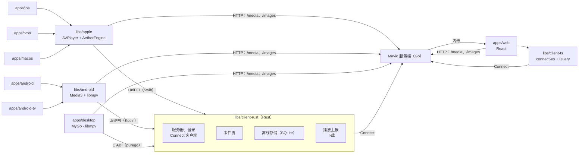

# Mavio 客户端

> [English](clients.md) | 简体中文

> 相关文档：[系统架构](architecture.zh-CN.md) · [领域模型](domain.zh-CN.md) · [路线图](roadmap.zh-CN.md) · [开发指南](development.zh-CN.md) · [AGENTS.zh-CN.md](../AGENTS.zh-CN.md)

> Mavio 的客户端包括内嵌于服务端二进制的 Web UI，以及面向每种观看方式的原生应用：iPhone 与 iPad、Apple TV、Mac、Android 手机与平板、Android TV，以及 macOS、Windows 与 Linux 桌面。决策由服务端做出；客户端声明自己能播放什么、负责播放，并离线保留所需内容。共享的 Rust 核心让所有原生应用的连接、事件、离线与播放上报逻辑只有一份实现。客户端在[路线图](roadmap.zh-CN.md)的 P21 阶段构建。

---

## 1. 概述

每个应用只为一种交互模型而构建——触控、电视遥控器、桌面的指针与键盘——而不是在多种模型之间拉伸。不取决于交互模型的部分在应用之下共享。

| 应用 | 技术 | 设备 |
| :--- | :--- | :--- |
| `apps/web` | React + Vite + TanStack Router / Query + Tailwind CSS，以 `//go:embed` 内嵌进服务端 | 浏览器 |
| `apps/ios` | Swift、SwiftUI（SwiftUI 不足处用 UIKit） | iPhone 与 iPad，一个通用应用 |
| `apps/tvos` | Swift、SwiftUI 与 UIKit | Apple TV |
| `apps/macos` | Swift、AppKit（合适处用 SwiftUI） | Mac |
| `apps/android` | Kotlin、Jetpack Compose | Android 手机、平板与折叠屏 |
| `apps/android-tv` | Kotlin、Compose for TV | Android TV 与 Google TV |
| `apps/desktop` | Go、[MyGo](https://github.com/egoist/mygo) 原生 UI、libmpv | macOS、Windows 与 Linux |

| 库 | 内容 | 使用者 |
| :--- | :--- | :--- |
| `libs/client-ts` | TypeScript：Connect 客户端（`connect-es`）与 TanStack Query hooks | `apps/web` |
| `libs/client-rust` | Rust：服务器、登录、事件、离线存储、播放上报、下载 | 所有原生应用：Swift 与 Kotlin 经 UniFFI，Go 经 C ABI |
| `libs/apple` | Swift 包：核心的 Swift API 与应用服务、播放器、共享的 SwiftUI 组件 | `apps/ios`、`apps/tvos`、`apps/macos` |
| `libs/android` | Kotlin 模块：核心的 Kotlin API 与应用服务、播放器、共享的 Compose 组件 | `apps/android`、`apps/android-tv` |
| `libs/design` | 设计 tokens（DTCG JSON）、图标、标志、组件规范与字符串，为每个客户端编译 | 所有客户端 |

---

## 2. 架构



---

## 3. 服务端与客户端

凡取决于媒体库、用户或其他设备的决策都归服务端；取决于设备本身的归客户端。

| 关注点 | 归属 | 方式 |
| :--- | :--- | :--- |
| 播放决策 | 服务端 | `PlaybackService` 依据客户端的 `ClientCapabilities`，以 `libs/media/decision` 决定直接播放、重封装或转码，并结合用户的流偏好、码率上限、转码权限与播放数限制（[架构 §11](architecture.zh-CN.md#11-api-与认证appsserver)） |
| 能力 | 客户端 | 用平台自身的 API 探测：AVFoundation 与 VideoToolbox、`MediaCodecList` 与 `Display.HdrCapabilities`、浏览器的 `MediaSource.isTypeSupported` 与 `canPlayType`，以及随附的第二引擎（AetherEngine、libmpv）的解码器。以两个引擎播放的客户端，声明两者任一能播放的内容，使服务端只在两者都不能播放时才处理媒体（§4.2） |
| 进度 | 客户端上报，服务端记录 | 通过 `PlaybackService` 在播放时每 10 秒上报一次，并在暂停、跳转与停止时上报；服务端在最后一次上报五分钟后结束该播放 |
| 实时更新 | 服务端推送 | 每台设备一条 `EventService` 流：条目与媒体库变更、用户数据、会话、远程控制命令与 SyncPlay。客户端以退避重连，不轮询 |
| 媒体与图片 | 普通 HTTP | 服务端为会话签名的 URL（[账户 §5.4](accounts.zh-CN.md#54-媒体-url)），播放器无需附加请求头 |
| 登录 | 服务端 | 绑定设备密钥的会话与短期 Bearer 令牌；电视用 mavio.dev/link 的代码登录 Mavio 账户，用 Quick Connect 登录独立服务器的用户 |
| 首页 | 服务端生成，客户端合并 | 每台服务器用 `HomeService` 为用户生成其推荐行（[架构 §11](architecture.zh-CN.md#11-api-与认证appsserver)）；客户端合并它所登录的每台服务器的推荐行（§5.4） |
| 发现服务器 | 客户端 | 局域网内 UDP 7359 端口的发现，或手动输入地址 |
| 资源获取、发现与请求 | 服务端 | 服务端自己的服务；客户端不调用其他任何服务 |

---

## 4. 各平台

### 4.1 Web（`apps/web`）
* **定位**：全部功能——浏览、播放、请求、管理与首次运行设置——无需安装。
* **提供方式**：Vite 构建到 `apps/server/internal/webui/dist`，服务端以 `//go:embed` 内嵌并在 `/` 提供，SPA 的路由回退到 `index.html`。仓库中该目录只有一个 `.gitkeep`；未带 Web UI 构建的服务端会提供一个说明此情况的页面。Nx 让服务端的 `build` 依赖 Web 的 `build`。API 参考保留在 `/api`。以 `VITE_MAVIO_DEV_URL`（mavio.dev API 的基础 URL）构建时，同一个 Web UI 就是 app.mavio.dev，它不由服务器提供，只登录 Mavio 账户。
* **服务器**：独立服务器的 Web UI 只访问这台服务器。Mavio 账户的 Web UI（服务器提供的或 app.mavio.dev）访问账户的每台服务器（§5.4）：依次尝试服务器发布的 URL，在第一个有应答的地址登录（从 HTTPS 页面只尝试 HTTPS），并以跨域方式调用它们；服务器的所有路由允许任何来源，它们接受 Bearer 令牌与签名的媒体 URL，从不使用 Cookie。设备密钥是保存在 IndexedDB 中不可导出的 WebCrypto Ed25519 密钥，会话与用户的服务器顺序保存在浏览器的本地存储中；传输层在访问令牌过期前或被服务端拒绝后为其续期，服务器不再为其续期的会话会让 Mavio 账户重新登录该服务器。
* **登录**（[账户 §6](accounts.zh-CN.md#6-登录)）：新服务器打开 `/setup`，选择其模式（[账户 §2](accounts.zh-CN.md#2-服务端模式)），然后登录 Mavio 账户，由此认领服务器，或创建其管理员（`?step=admin`）；电视上则显示服务器的地址，请用户在电脑或手机上打开。`/sign-in` 按服务器的方式登录。mavio.dev 模式下，它通过 mavio.dev 的授权页面登录服务器的管理员，并把其他人引导到 app.mavio.dev；mavio.dev 返回 `/auth/callback`，再回到发起登录的页面。独立服务器用密码登录，随后是用户身份验证器应用的验证码（`?step=totp`），或用提供页面的服务器主机上的通行密钥，或 Quick Connect（`?step=quick`）；用户菜单凭 PIN 在其用户之间切换，设置管理用户的通行密钥、身份验证器应用和 PIN。电视用在 mavio.dev/link 输入的代码登录 Mavio 账户。每一步都有自己的地址，因此浏览器的后退、Escape 与遥控器的返回键都回到上一步。各步骤位于一面由渐变绘成的海报墙上，海报墙倾斜、模糊，覆有随主题深浅变化的蒙层：宽窗口和电视上是一张卡片，手机上占满整个屏幕。退出登录会结束该登录身份的所有会话。
* **界面**：布局随窗口宽度而定（§6.3），电视模式是浏览器的一项设置。设置分为外观、播放、字幕与音频、服务器、账户和设备几部分，位于其自己的侧边栏旁，手机上则先列出它们；浏览器的设置（外观、电视模式、侧边栏、最高画质与连续播放下一集）保存在它的本地存储中，语言保存在各服务器上用户的偏好中。电视模式下方向键把焦点移到该方向上最近的元素，Escape 与 Backspace 返回。
* **API**：`libs/client-ts`，基于 `connect-es` v2 与 `protobuf-es` v2 以及从 `libs/proto` 生成的代码，用 TanStack Query 做缓存与失效，由事件流驱动。
* **播放**：支持 Media Source Extensions 的浏览器用 hls.js，Safari 用原生 HLS 播放器；能力来自 `MediaSource.isTypeSupported` 与 `canPlayType`。ASS 字幕借助 JASSUB（WebAssembly 版 libass）保留样式。对浏览器不转码就无法播放的内容，播放器提供在外部播放器（mpv、VLC、IINA）中打开播放 URL。

### 4.2 Apple（`apps/ios`、`apps/tvos`、`apps/macos`、`libs/apple`）
* **每种交互模型一个应用。** iPhone 与 iPad 按 App Store 的惯例是一个通用应用，iPad 上有自己的布局：侧边栏与多栏、多窗口、台前调度、指针与硬件键盘。Apple TV 是独立应用，围绕焦点引擎与十英尺距离的遥控器构建，并提供 Top Shelf。Mac 是以 AppKit 编写的独立应用，AppKit 让播放器能完全掌控窗口、菜单栏、全屏、触控板以及同时打开多个播放器。
* **`libs/apple`**，三个应用共享的 Swift 包：
  * `MavioKit`：核心的 Swift API 及其上的应用服务——账户、能力探测、以后台 `URLSession` 下载、正在播放（`MPNowPlayingInfoCenter`、`MPRemoteCommandCenter`）；
  * `MavioPlayer`：一个播放器接口、两个引擎，以及画中画；
  * `MavioUI`：各应用以各自方式组合的 SwiftUI 组件（图片、海报、行），以及设计 tokens。
* **播放引擎**，优先顺序为：AVPlayer，其次 AetherEngine，最后由服务端处理。
  * **能力**：应用在 `direct_play` 中声明 AVPlayer 能播放的配置与 AetherEngine 能播放的配置。因此只要任一引擎能播放，服务端就直接播放该源；两者都不能播放时才重封装或转码。
  * **选择**：直接播放的源，AVPlayer 能原样播放时交给 AVPlayer，否则交给 AetherEngine；服务端重封装或转码的结果是 HLS，交给 AVPlayer。
  * **AirPlay**：使用 AirPlay 时，应用只声明 AVPlayer 的配置。
  * **AVPlayer** 是首选引擎，播放 AVFoundation 能播放的内容——H.264、HEVC、硬件可解码时的 AV1、杜比视界与 HDR10 的 MP4 与 MOV，AAC、AC-3 及带 Atmos 的 E-AC-3——以及服务端产生的所有 HLS 流。它带来系统画中画、AirPlay、iOS 与 tvOS 上的 `AVPlayerViewController`，以及 tvOS 上的帧率与动态范围匹配（`AVDisplayCriteria`）。
  * **[AetherEngine](https://github.com/superuser404notfound/AetherEngine)** 是第二引擎，以 Swift 包引入并固定到确切版本，直接播放 AVFoundation 不能播放的内容，如带样式 ASS 与 PGS 字幕的 Matroska、VP9、DTS 与 TrueHD，免去服务端转码。FFmpeg 解封装，VideoToolbox 解码（硬件不支持时用 dav1d 与 libavcodec），帧交给 Apple 自身的显示栈——原生路径上是 `AVPlayerLayer`，软件路径上是 `AVSampleBufferDisplayLayer`——没有自己的渲染器：HDR10、HDR10+、HLG 与杜比视界（配置 5、作为 8.1 的 7，以及 8）原样输出到显示器，在 Mac 与 iPad 上经由 EDR，在 tvOS 上配合显示条件。DTS 与 TrueHD 转换为 E-AC-3 5.1，带 Atmos 的 E-AC-3 直通。字幕以 cue 送达，由 `MavioPlayer` 绘制在画面之上：带样式的文本片段与位图；ASS 则是原始事件行、脚本头与内嵌字体，由为三个平台构建的 [libass](https://github.com/libass/libass) 按其原有样式渲染：`ASSRenderer` 接收服务端列为条目附件的字体，其余字体经 Core Text 查找，并把每一帧的字幕绘制为叠在画面上的图像。其 FFmpeg 以 LGPL 动态框架嵌入，是应用中唯一的 FFmpeg。
* **账户与下载**：设备密钥与每个服务端的会话保存在钥匙串中，其余内容由核心的数据库保存。下载是以后台 `URLSession` 获取的源文件，应用挂起时仍会继续；已下载的条目无需服务端即可从设备播放，离线产生的进度在服务端重新响应时补报给它（§5.1）。
* **字幕**：HLS 流以 WebVTT rendition 承载文本字幕，由 AVPlayer 自行显示。使用 AetherEngine 时，`MavioPlayer` 在画面而不是屏幕的范围内排布 cue，使字幕在任何宽高比与方向下都位于视频之上。
* **画中画**：只用公开且被 App Store 允许的 `AVPictureInPictureController`。AVPlayer 直接支持，AetherEngine 经由其 `AVPlayerLayer` 或 `AVSampleBufferDisplayLayer` 内容源接入。tvOS 不显示样本缓冲显示层的画中画，因此 AetherEngine 在软件路径上播放时进入画中画，改由 AVPlayer 重新开始播放，由服务端处理该源。

### 4.3 Android（`apps/android`、`apps/android-tv`、`libs/android`）
* **每种交互模型一个应用。** 手机、平板与折叠屏共用一个以 Compose 编写、采用自适应布局的应用；Android TV 与 Google TV 有自己的 Compose for TV 应用，围绕方向键焦点构建，并提供主屏上的 Watch Next 与频道。两者以同一应用 ID `dev.mavio.app` 作为同一个 Play 商店条目发布，TV 应用面向 TV 设备类型；两者都支持 Android 8.0（API 26）及以上。
* **`libs/android`**，两个应用以复合构建（composite build）引入的共享 Gradle 模块：
  * `core`：核心的 Kotlin API 及其上的应用服务——账户、能力探测、以 WorkManager 下载。它声明 `INTERNET` 权限与 `ACCESS_LOCAL_NETWORK`，后者是 Android 17 访问局域网地址所必需的，而大多数服务器都在局域网中；应用在发现或登录之前申请后者，并允许明文 HTTP（`usesCleartextTraffic`），否则 Media3 会拒绝，而局域网中的服务器以普通 HTTP 提供媒体；
  * `player`：一个播放器接口、两个引擎，其上是提供后台播放与系统控制的 `MediaSessionService`，以及画中画（Android 的画中画可用于任何 `SurfaceView`）；
  * `ui`：共享的 Compose 组件与设计 tokens。
* **播放引擎**，与 Apple 平台相同的优先顺序：Media3，其次 libmpv，最后由服务端处理。
  * **能力**：应用在 `direct_play` 中声明 Media3 在该设备上能播放的配置与 libmpv 能播放的配置，使服务端只在两者都不能播放时才重封装或转码。
  * **选择**：直接播放的源，Media3 能原样播放时交给 Media3，否则交给 libmpv；服务端重封装或转码的结果交给 Media3。
  * **杜比视界与 HDR**：libmpv 的配置排除杜比视界视频，在有 HDR 输出的设备上还排除 HDR 视频——Media3 能把它们输出到显示器，libmpv 只能做色调映射。
  * **Media3** ExoPlayer 是首选引擎，播放 Matroska 与 MP4 中设备能解码的格式，借助其 FFmpeg 解码扩展（以 FFmpeg 的音频解码器按 LGPL 从源码构建，在 mavio-deps 中）播放平台缺少的音频格式（DTS、TrueHD 等），并支持 PGS 字幕与不带样式的 SSA。它渲染到 `SurfaceView` 以支持 HDR 并降低功耗，电视支持时使用隧道播放，并以 `Surface.setFrameRate` 匹配帧率。
  * **libmpv** 是第二引擎，按 mpv-android 的方式构建，直接播放 Media3 不能播放的内容，如带样式的 ASS 字幕与没有硬件解码器的编码；以 OpenGL ES 渲染到它自己的 `SurfaceView`，能用 MediaCodec 时以其解码。它由一个 Media3 `SimpleBasePlayer` 适配（`MpvPlayer`），使媒体会话与控制器同等对待两个引擎。它以 mpv-android 的构建脚本及其 JNI 层（`is.xyz.mpv.MPVLib`）在 mavio-deps 中按锁定的版本从源码构建，FFmpeg 与 mpv 按 GPL-3.0 构建；文件未内嵌字体时，libass 以系统字体绘制。

### 4.4 桌面（`apps/desktop`）
* **结构**：基于 MyGo 的 Go 应用，面向 macOS、Windows 与 Linux，所有窗口都是 MyGo 在 GPU 上绘制的原生 UI（macOS 上为 Metal，Windows 上为 Direct3D 11，Linux 上为 OpenGL）；不使用 Web 视图。它与服务端一样以 `CGO_ENABLED=0` 构建，随附两个共享库：libmpv 与核心。
* **在 Mac 上**：它是 `apps/macos` 之外的第二个 Mac 应用；`apps/macos` 仍是基于系统播放器与工具包的 Mac 应用。桌面应用与 Windows、Linux 共用一份代码，因此可在 Mac 上构建与试用；它以经过公证的磁盘映像在 App Store 之外分发，使用自己的 ID（`dev.mavio.desktop`）。
* **核心**：通过 C ABI 使用 `libs/client-rust`，与 MyGo 加载原生 API 的方式相同，在运行时加载——macOS 与 Linux 上用 purego，Windows 上用 `syscall` 包。请求、结果与事件以核心 API 的 protobuf 消息跨越该接口，并为 Go 生成代码。
* **播放器**：libmpv，以同样方式加载，通过其 client API 驱动（命令、属性，以及由一个 goroutine 读取的事件）。视频由 mpv 自己绘制，位于它自己的原生表面中，该表面放在 MyGo 绘制 UI 的表面之下。MyGo 的视频元素负责放置该表面：`Window.NewVideoView` 创建视频视图，mpv 以其原生句柄为 `wid`；`ui.Video` 显示它，在视频显示处于窗口绘制的内容上打出一个洞，使 MyGo 绘制的屏幕控制器（§6.5）、菜单与对话框显示在视频之上；视频之上的指针与键盘仍归 MyGo。MyGo 使用其分叉 [mavioai/mygo](https://github.com/mavioai/mygo) 的 `v0.4.5-mavio` 分支，它在 0.4.5 版之上加入视频元素，并固定到某一提交。mpv 的视频输出在主线程之外关闭，因为它要等待主线程完成。
  * **macOS**：mpv 以 `gpu-next` 经 MoltenVK 在 Vulkan 上（`gpu-context=macvk`）渲染到视频视图内、它自己的视图中，位于 MyGo 以 layer 为后备的视图之下，以 VideoToolbox 解码，经 EDR 输出 HDR（`target-colorspace-hint`）。mpv 的 macOS 输出会打开自己的窗口；Mavio 的一个补丁改为把它嵌入 `wid` 所指的视图中，该补丁构建进 mavio-deps 中的 macOS 版 libmpv（`mpv-macos`，适用于 macOS 13 及以上的通用库，与 MoltenVK 的库并列）。
  * **Windows**：mpv 以 Direct3D 11 与 `gpu-next` 渲染到子窗口（`wid`），并以 `target-colorspace-hint` 输出 HDR10；MyGo 的帧位于窗口最顶层的 DirectComposition 目标中，处于其上方。
  * **Linux**：mpv 的 OpenGL render API 绘制到 MyGo 表面之下、位于其 `GtkOverlay` 中的 `GtkGLArea`，X11 与 Wayland 相同；HDR 色调映射为 SDR。
* **系统集成**：macOS 上的「正在播放」与远程命令、Windows 上的 System Media Transport Controls 与 Linux 上的 MPRIS，同时提供媒体键；播放期间由 MyGo 的电源 API 保持屏幕常亮。
* **打包与更新**：使用 MyGo 提供的能力——应用包与经过公证的磁盘映像、Windows 安装程序、Debian 包与 Linux 安装脚本、代码签名，以及带增量更新的签名自动更新。

---

## 5. 共享核心（`libs/client-rust`）

### 5.1 职责
* **服务器与登录**：同时登录多台服务器（§5.4），支持发现、以密码或 Quick Connect 登录，以及会话（[账户 §5.2–§5.3](accounts.zh-CN.md#5-密钥与令牌)）：设备密钥与每个服务端的会话（其 ID、访问令牌与过期时间）由应用通过它实现的接口保存在平台的安全存储中（Keychain、Android Keystore、Windows 凭据管理器、Secret Service），核心的传输层在访问令牌过期前或被服务端拒绝后，以签名服务端的随机数为其续期。
* **Connect 客户端**：[connect-rust](https://github.com/connectrpc/connect-rust)，基于 HTTP/1.1 与 HTTP/2，消息与客户端从 `libs/proto` 生成到 `libs/proto/gen/rust`，由 crate `mavio-api` 包含。
* **事件流**：每台服务器一条 `EventService` 流，以退避重连，事件分发给应用。
* **离线存储**：SQLite（`rusqlite`，内置 SQLite），保存最近浏览的条目以便应用以缓存内容启动、已下载的条目，以及离线时产生的进度上报，待服务器可达后发送。
* **播放上报**：开始播放、周期与最终进度上报，以及离线上报的补发。
* **下载**：队列、其状态与已下载的条目；核心向服务器请求要保存的文件，应用借助平台的后台传输搬运其字节并上报进度。
* **页面状态**：§6.3 中每个页面显示的数据——卡片、行、详情、媒体库及其网格、搜索结果与下载，均为图片 URL 已解析的普通记录——它是否来自离线存储、它的错误，以及它提供的操作。首页在每台服务器应答时经由监听器到达（§5.4）。应用把每个页面的加载状态保存在自己的可观察模型中，只负责绘制；因此各页面在所有平台上行为一致。`libs/client-ts` 以 hooks 形式为 Web UI 提供相同的数据。

### 5.2 边界
* 不含 GUI、图形与解码：视图模型只含状态，不含布局；核心从不接触视频表面或解码器，也不探测能力；应用把自己的 `ClientCapabilities` 传入。
* 基于 Tokio 的异步 API；每个调用都可取消。
* 目标平台：`aarch64-apple-ios`、`aarch64-apple-ios-sim`、`aarch64-apple-tvos`、`aarch64-apple-tvos-sim`、`aarch64-apple-darwin`、`x86_64-apple-darwin`、`aarch64-linux-android`、`armv7-linux-androideabi`（许多 Android TV 设备运行 32 位系统）、`x86_64-linux-android`、`x86_64-pc-windows-msvc`、`aarch64-pc-windows-msvc`、`x86_64-unknown-linux-gnu`、`aarch64-unknown-linux-gnu`。

### 5.3 绑定
* **UniFFI API**（`mavio-uniffi`）：对象 `Client`，其异步函数运行在进程唯一的 Tokio 运行时上，应用丢弃其 future 时即被取消；应用实现的接口：保存设备密钥与会话的 `SecureTokens`、接收流状态与事件的 `CoreListener`、接收首页的 `HomeListener`；客户端能力以类型化记录表示，转换为 `ClientCapabilities`。
* **Swift**：UniFFI 生成 Swift API，与共享库一起打包为 `MavioKit` 所依赖的、由动态 framework 组成的 XCFramework。
* **Kotlin**：UniFFI 生成 Kotlin API，与共享库一起打包在 `libs/android` 的 `core` 模块中。
* **Go**：一个由三个函数组成的 C ABI（`mavio-capi`，库名 `maviocore`）：`mavio_open` 以进程唯一的回调和应用自己的上下文打开一个客户端，`mavio_call` 以应用自选的调用编号向它发送请求，`mavio_close` 关闭它。请求与应答是 `mavio.capi.v1` 的 protobuf 消息（定义在 `libs/client-rust/proto`），放在字节缓冲区中；每个应答，以及调用编号为零的各服务器事件，都在核心的线程上经回调返回，因此 purego 在整个进程中只需创建一个回调。核心自己不保存机密：应用打开核心时交给它保存在系统安全存储中的设备密钥与会话，并按事件告知保存新的、删除被遗忘的。Go 绑定是 `libs/client-rust/capi` 中与 C ABI 并列的 Go 模块：`capi` 包不经 cgo 加载该库——Linux 与 macOS 上用 purego，Windows 上用 `syscall` 包——并把每次调用变为返回其应答的函数；其消息的 Go 代码生成到 `capi/gen`。

### 5.4 多台服务器
客户端同时登录其登录身份（[账户 §7](accounts.zh-CN.md#7-客户端)）中的每台服务器——Mavio 账户的服务器，包括用户自己的以及亲友的，或一台独立服务器——每台都有各自的用户与会话。服务器彼此不知道对方；只有客户端按用户的服务器顺序把它们组合起来。
* **跨服务器的部分**：首页、搜索与下载。媒体库、条目详情与播放器属于某一台服务器；登录多台服务器时，条目会显示其服务器名称。
* **首页**，按 Plex 的方式构建：合并每台服务器的推荐行（§6.3）：
  * **继续观看**是跨服务器的一行：正在观看的条目与下一集，按最近活动排序；
  * **多台服务器上的同一作品**按 TMDB、TVDB 或 IMDb ID 匹配，只出现一次：取自用户最近播放它的服务器，否则取用户顺序中的第一台；其详情页提供其他服务器上的版本；
  * **其他推荐行**按用户的服务器顺序逐台排列，每台服务器内按其置顶媒体库的顺序；
  * **热门**来自发现功能，只出现一次，取自第一台提供发现的服务器；任一服务器已有的作品标为可用；请求发往该服务器。
* **搜索**同时查询每台服务器，并按服务器列出结果。搜索在确认时才执行：侧边栏的输入框，或在没有侧边栏输入框时搜索页的输入框，按回车键才搜索，只输入不会离开当前页面。电视上，搜索是一个独立的页面，屏幕键盘位于结果旁边（[电视端 §6.4](tv.zh-CN.md#64-搜索)）。
* **渐进与离线**：每台服务器的推荐行到达即绘制，位置固定，因此慢的服务器不会拖住其他服务器；无法连接的服务器的推荐行取自离线存储，并标为离线。
* **播放状态**保留在各自的服务器上：在一台服务器上看过的作品，不会在另一台上标为已看。

---

## 6. 设计系统

各客户端共享同一套品牌识别与结构，同时在各自平台上保持原生观感。设计分为三层：

| 层 | 原则 | 内容 |
| :--- | :--- | :--- |
| 一致层 | 定义一次，处处相同 | tokens、内容图标、页面及其导航、组件、屏幕控制器、文案 |
| 映射层 | 概念相同，以平台的方式表达 | 导航容器、更多操作菜单、设置中的控件 |
| 平台层 | 遵循平台本身 | 窗口边框、菜单栏、材质、系统字体、返回手势、电视焦点、无障碍、系统图标 |

### 6.1 设计 tokens
颜色、字体、间距、圆角、层级与动效在 `libs/design/tokens` 中以 W3C Design Tokens（DTCG）格式一次定义。由 Style Dictionary 解析，`pnpm nx run design:generate` 将其与图标、字符串一起编译到 `libs/design/gen/{ts,swift,kotlin,go}`。生成的代码提交入库，CI 检查其是否最新，与 `libs/proto/gen` 相同。
* **颜色**：深色主题适合海报图与暗光环境，另有浅色主题，两者都参照 Apple 的系统颜色；两者对比度均达到 WCAG AA，由生成器检查每一组文字与背景。外观跟随系统，除非用户在设置中选择浅色或深色；电视默认深色，播放器始终为深色。主按钮以文字颜色填充；强调色是取自标志的橙色，只用于进度、选中、链接与开关。
* **字体**：字号层级（字号、字重、行高）共享；字体族用平台的系统字体——Apple 平台用 SF Pro，Android 用 Roboto，Windows 用 Segoe UI Variable，Linux 与 Web 用随应用附带的 Inter——以便 Dynamic Type 与字体缩放生效。不使用品牌字体：标题（包括叠在海报图上的标题）用系统字体的粗体，在海报图上为白色并垫暗色渐变；标志是画出来的，不用字体排出（§6.2.1）。
* **按设备形态取值**：tokens 有手机、平板、桌面与电视四档取值（电视按 3 米观看距离设计，并留出防过扫描边距）。

### 6.2 图标
内容与品牌图标使用 [Phosphor](https://phosphoricons.com/)（MIT），固定版本，`libs/design/icons/icons.json` 将语义名称映射到 Phosphor 名称；生成器把其 SVG 源复制到 `libs/design/icons/svg`，并编译为供 Web UI 与 MyGo（自行绘制）使用的路径数据、资源目录图像与 Android 矢量图。Regular 与 Fill 两种字重标示未激活与激活状态（收藏、静音、循环、字幕），不引起布局偏移。用户期待系统图标之处，系统控件使用平台图标——Apple 平台用 SF Symbols（分享、AirPlay、画中画、菜单），Android 用 Material Symbols。

#### 6.2.1 标志
标志有两种形态，以 SVG 源文件保存在 `libs/design/brand`，两者从不同时出现：
* **符号**：一个像缎带一样折叠的大写 M——两根立柱在后，两道斜笔在前，压过立柱处在立柱上投下阴影——画在 64 单位的方格上，立柱与斜笔宽 16（`mark.svg`）。它就是应用图标，放在白底（`app-icon-light.svg`）或黑底（`app-icon-dark.svg`）上；字标宽度不足 64 px 之处改用符号。
* **字标**：“Mavio”由 12 宽的直线笔画与 45° 切角画成，大写高 64，x 高度 44（`wordmark.svg`）；只在无法绘制渐变之处使用白色或黑色单色版（`wordmark-white.svg`、`wordmark-black.svg`）。
* **颜色**：从黄 `#FFD34E` 经橙 `#FF9A2E` 到红 `#F0412F` 的渐变，由左上到右下。

### 6.3 信息架构
所有客户端拥有相同的页面、相同的名称与相同的到达路径：
* **一级目的地**：首页（§6.3.1）、各媒体库、发现（§6.3.2）、搜索、下载（仅应用），以及含设置的个人资料。
* **下级页面**：媒体库（带排序与筛选的网格）、条目详情（电影、剧集、季、合集）、人物（§6.3.19）、发现的作品与目录（§6.3.2）、播放器与设置；设置分三组：这台设备；账户，含按顺序排列的服务器；服务器，即一台服务器的设置——以用户身份登录它的设备，以及对其管理员显示的概览（§6.3.6）、通用设置（§6.3.8）、媒体库（§6.3.4）、用户（§6.3.5）、转码（§6.3.9）、存储（§6.3.10）、获取（§6.3.11）、想要（§6.3.16）、下载（§6.3.17）、字幕（§6.3.12）、AI（§6.3.13）、插件（§6.3.3）、任务（§6.3.7）、备份与日志（§6.3.14），以及 API 密钥（§6.3.15）。使用 Mavio 账户时，“服务器”分组上方的选择器在已登录的服务器中选择，提供 Web UI 的服务器带有标记；独立服务器的用户只登录一台服务器，没有选择器。
* **导航容器**：三种布局，按设备形态而非平台选择，因此每种布局在使用它的所有平台上都相同。手机与桌面布局之间由窗口宽度决定，断点取 Android 窗口尺寸类别的断点，应用与 Web UI 相同：紧凑（小于 600）、中等（600 至 840）与展开（840 及以上）：
  * **手机**：紧凑宽度——iPhone、Android 手机、分屏中的平板，以及手机浏览器中的 Web UI——底部标签栏含首页、各媒体库、发现、搜索，应用中还有下载；右上角的头像打开个人资料与设置。
  * **桌面**：中等与展开宽度——Web UI、Mac、桌面，以及 iPad 与 Android 平板——左侧边栏含搜索、首页、发现、下载（仅应用）与各媒体库，可收起为图标栏；中等宽度（如竖屏的平板）时默认收起，展开时浮于内容之上。侧边栏底部是已登录用户的头像与名称，点开为菜单：名称旁的外观选择（跟随系统、浅色或深色）、切换用户（[账户](accounts.zh-CN.md) §3.6、§4.4）、设置、切换到电视模式、登录方式、在 mavio.dev 或服务器上管理账户，以及退出登录。有键盘可用之处——电脑上的 Web UI、Mac 与桌面应用——菜单显示各项的快捷键，各取所在平台的习惯：设置为 ⌘,（其他平台为 Ctrl+,），电视模式为 ⌃⌘T（Shift+F11），全屏沿用浏览器与 Mac 的按键 ⌃⌘F（F11）；手机、平板与电视没有可按的键盘，不显示快捷键。
  * **电视**：Apple TV、Android TV 与 Google TV，以及 Web UI、Mac 与桌面应用的电视模式（外观设置中的一项，供连接电视的电脑使用）：顶部导航栏含首页、各媒体库、发现与搜索，右侧的三点按钮打开同一菜单，只靠遥控器移动焦点。它在[电视端](tv.zh-CN.md)中规定。

#### 6.3.1 首页
首页是一列推荐行，仿照 Plex：每一行条目都是观看某些内容的一个理由。
* **推荐行**：首先是继续观看与已可观看的请求，然后是每个置顶媒体库的推荐行——最近添加、最近上映、最近播出（单集）、评分最高、未看的高分作品、开始观看（尚未开始的剧集）、重温（很久以前看过的）、因为你看过、因为你喜欢、更多某类型、主演、导演，以及管理员推荐的合集——最后是热门：发现功能提供、但没有服务器拥有的作品，可供请求。
* **由谁选择**：管理员为每个媒体库选择哪些推荐行出现在其"推荐"标签页、哪些出现在首页；每个用户置顶并排序媒体库（这决定其推荐行的顺序），并可隐藏推荐行。继续观看不可隐藏。
* **轮换**：以某个条目、类型或人物为种子的推荐行（因为你看过、更多某类型、主演、导演）从用户最近播放的内容中选取种子，每天重新选择，因此首页每天不同，而一天之内保持不变。
* **媒体库标签页**：媒体库打开时显示其"推荐"标签页（即其推荐行），旁边是全部条目的网格。
* **头图**：首页以至多五部带背景图的最新电影与剧集开场，依次轮换，每部带有其信息以及播放和打开详情的按钮。

#### 6.3.2 发现
发现页仿照 Seerr，从服务器元数据提供者的发现目录（[插件](plugins.zh-CN.md)）中找出可请求的电影与剧集。
* **向谁询问**：发现页询问第一台其提供者提供目录的已登录服务器；只有存在这样的服务器时，它才是一级目的地。
* **行**：热门趋势，然后是热门、即将上映与高分，电影与剧集各一行，以及提供者提供的片单；每行可打开其目录，即逐页加载的网格。名称与简介使用客户端的语言。
* **卡片**：作品卡片在服务器上已可观看时、以及已请求或正在获取时带有标记。
* **作品页**：与条目详情一样显示背景图、海报、信息与简介；服务器已有时"观看"打开该条目，"请求"请求该作品，剧集还要选择请求哪些季，默认是尚未请求的全部季。剧集列出各季及服务器拥有的情况；其后是推荐与相似作品。首页的热门趋势中没有服务器拥有的作品在此打开。
* **请求**：从发现页标题旁打开，按从新到旧逐页列出服务器上的请求，可看全部或待审批、已批准、可观看、失败与已拒绝的请求——普通用户看到自己的请求及其配额剩余，管理员看到所有人的请求。每个请求显示其作品的海报、类型与季、请求者与时间、状态以及失败原因。管理员批准或拒绝待审批的请求，并重试失败的请求；待审批剧集请求的季可在请求时的对话框中更改；待审批的请求可由其用户删除，任何请求都可由管理员删除，删除前需确认。

#### 6.3.3 插件
“插件”位于设置的“服务器”分组，向所选服务器的管理员显示，仿照 Jellyfin 的插件页面（[插件](plugins.zh-CN.md)）。
* **列表**：两个以卡片展示的选项卡：“可用”是服务器的插件目录提供的全部插件，无论是否已安装；“已安装”是已安装的插件。卡片显示插件的分类、名称、简介及其版本或状态，并标记可用的更新。选项卡旁的选择器只显示一个分类（取自该选项卡中插件的分类），“管理插件目录”打开插件目录。无法访问的目录在“可用”中报告。
* **插件详情**：从卡片打开，带有返回离开时列表的链接：简介；状态、版本、最新版本、分类、作者、许可证、网站、所在目录与可访问的主机；“安装”或“更新到”最新版本、启用与停用的开关，以及先请求确认的“卸载”；目录提供的各个版本及其发布日期与变更，可安装其他版本。
* **配置**：已安装插件的页面中，按其清单的 schema 生成的表单——文本、可点按显示的密钥、数字、开关、选项、每行一项的列表、由开关决定是否设置的可选分组，以及可添加与移除的分组列表——保存时报告服务器的校验结果；带有自己设置页面的插件另有链接指向该页面。
* **插件目录**：插件目录的地址，可添加与移除，带有返回列表的链接。

#### 6.3.4 媒体库
“媒体库”位于设置的“服务器”分组，向所选服务器的管理员显示，列出服务器的媒体库，合集与播放列表的媒体库除外。
* **列表**：每个媒体库及其类型、文件夹数与“扫描”，后者报告扫描已开始或已有扫描在等待；“添加媒体库”打开空白媒体库的页面。
* **媒体库详情**：名称与类型；文件夹，按路径添加（包括 `rclone:<远程>:<路径>`），或浏览服务器的文件夹选择，各带存储类型，“自动”显示检测到的类型；元数据的语言与国家/地区，以界面语言命名，或用服务器的设置；把元数据保存在媒体旁，以及按类型的电影合集与歌词；自动扫描，从不或每小时、6 或 12 小时、每天或每周，以及按类型的拖动预览图、章节图片与响度；剧集的缺失单集，已播出或即将播出，包括特别篇，并保留若干天；“保存”“扫描”，以及先请求确认的“删除”。页面不显示的部分——提供者与首页行——保持原样。

#### 6.3.5 用户
“用户”位于设置的“服务器”分组，向所选服务器的管理员显示，列出服务器的用户，管理员在前，各带其标记（管理员、托管、已停用）与上次登录时间。
* **添加**：带用户名与密码的成员，或带用户名、可选的四位 PIN 与内容限制的托管用户（[账户](accounts.zh-CN.md) §4.1）。
* **用户详情**：用户名、是否停用，托管用户还有其内容限制；访问权限——所有媒体库或勾选的媒体库、以所代表年龄命名的最高分级、隐藏未分级内容、仅限的标签与隐藏的标签，以及下载；播放——转码、串流上限与同时串流数；可请求的内容，是否自动批准，使用单独配额或服务器的配额，以及报告问题；“保存”，以及先请求确认的“删除”。下方的登录方式即时生效：设置密码（使托管用户成为成员）；托管用户的 PIN；转换托管用户的链接，7 天内有效；关闭其身份验证器；删除其通行密钥。
* **邀请链接**：创建链接，设定可用次数（1 至 100）、有效天数（1 至 30）与给予的访问权限，仅显示一次并带复制按钮；列出未用完的链接以便撤销，托管用户的链接单独列出。链接是服务器 Web UI 的地址 `/invite#<令牌>`：令牌在片段中，因此不会随请求发送。打开它显示邀请页面，填写用户名（转换托管用户的链接除外）以及密码或通行密钥，并以创建的成员身份登录；已过期、已用完或已撤销的链接会如实说明。
* **mavio.dev 模式**：用户是有权访问此服务器的 Mavio 账户。其用户名、访问权限与是否停用属于 mavio.dev，只读显示；只有播放与请求属于服务器；不能添加用户，没有邀请与登录方式，用户只有在访问权限被撤销后才能删除。

#### 6.3.6 概览
“概览”位于设置“服务器”分组的首位，向所选服务器的管理员显示：
* **服务器**：是否正在服务、版本、运行的操作系统与架构、数据库、FFmpeg，以及已运行的时长。
* **正在播放**：每台正在播放的设备，每隔几秒刷新——条目、用户、设备与客户端、直接播放、直接串流还是转码，以及播放进度与是否暂停。
* **活动**：服务器上发生的事，最新的在前，各带严重程度与时间，可显示全部、仅警告与错误或仅错误，并可加载更多。

#### 6.3.7 任务
“任务”位于设置“服务器”分组的末位，向所选服务器的管理员显示：
* **任务**：服务器的周期任务，以及单独列出的插件任务，各带其说明、上次运行的结果与时间、运行间隔或按需运行、下次运行的时间，以及失败运行的错误；“运行”立即排队运行一次，并说明是否已在队列中；正在运行的任务如实显示，运行期间每隔几秒刷新。
* **作业**：服务器队列中的作业，最新的在前，可显示全部、仅等待与运行中、失败或已成功的作业，各带类型、状态、运行或已运行的时间、重试时的尝试次数及其错误，并可加载更多。

#### 6.3.8 通用
“通用”位于设置的“服务器”分组，向所选服务器的管理员显示：服务器名称，客户端立即采用，留空则使用计算机名称；用于未单独设置的媒体库、请求与发现的元数据语言与国家/地区；设备未使用时保持登录的天数；独立服务器上发送忘记密码所需 PIN 的插件，从能发送的插件中选择，或关闭；以及网络——反向代理下的基础 URL，HTTPS 端口及 PEM 证书与私钥的路径（mavio.dev 模式下也可使用服务器的 mavio.site 证书），本地网络中的发现，以及 mavio.dev 模式下的中继。“保存”后立即生效。

#### 6.3.9 转码
“转码”位于设置的“服务器”分组，向所选服务器的管理员显示：硬件加速（从服务器的 FFmpeg 支持的方式中选择）与硬件编码；编码器预设（按来源或手动选择）、H.264 与 HEVC 的 CRF 质量以及线程数；HDR 的色调映射及其算法、范围、去饱和与峰值，去隔行及其滤镜与双倍帧率，以及裁剪黑边；音频缩混为立体声时的增益；以及进行中转码的文件夹。“保存”后立即生效。

#### 6.3.10 存储
“存储”位于设置的“服务器”分组，向所选服务器的管理员显示：服务器能否访问 rclone、其版本，以及由服务器运行还是访问在别处运行的 rclone；远端及各自的类型；以及离线下载客户端。添加远端需填写名称、从 rclone 后端中选择类型并填写该类型的设置——只显示其提供商适用的设置，不常改的放在开关后，每项附 rclone 的帮助，rclone 列出可选值时为选择框，密钥为隐藏输入——随后逐个询问其配置余下的问题，例如授权云盘的令牌，直到问题答完或管理员中止。远端页面可修改其设置（密钥留空则保持不变）、浏览其文件夹以确认服务器能访问它，以及删除它。离线下载客户端是能自行下载磁力链接的云盘，就地编辑：名称、远端上的文件夹、标签与优先级、是否启用，以及已导入和失败的下载是否从云盘列表中移除。媒体库的文件夹选择器（§6.3.4）在服务器磁盘旁列出远端并可浏览其文件夹。

#### 6.3.11 获取
“获取”位于设置的“服务器”分组，向所选服务器的管理员显示：服务器的插件配置的索引器与下载客户端，各附其插件、协议与优先级、是否停用或因失败而被排除及排除到何时，并链接到其插件的设置（§6.3.3）；电影与剧集的质量配置；以及其余决定抓取哪些发布的设置页面。质量配置包括名称、是否允许升级及升级截止的质量、电影的发布必须具有的语言、按优劣排列的质量（每项可启用或停用、上移或下移）、每个自定义格式的分数，以及最低分数、升级截止分数与每次升级至少提高的分数；新配置从该类型的质量开始。质量定义页面按类型设置每种质量的大小。自定义格式由名称与条件组成——发布标题或发布组的模式，从服务器已知的值中选择的来源、分辨率、修饰、语言、索引器标志或发布类型，大小或年份范围——每个条件可取反或设为必需。延迟配置按生效顺序列出，默认配置在最后，各附其协议、优先的协议、各协议的延迟与标签，可上移下移；发布配置要求或忽略词语或模式，适用于一个或全部索引器及带其标签的作品；远程路径映射把下载客户端主机上的文件夹转换为服务器上的文件夹。

#### 6.3.12 字幕
“字幕”位于设置的“服务器”分组，向所选服务器的管理员显示：字幕提供商插件的提供商，各附其插件、是否提供电影或剧集字幕，以及是否停用或因失败而暂停及暂停到何时；字幕翻译插件的翻译器；两者都链接到其插件的设置（§6.3.3）；字幕配置；每个媒体库及分配给它的配置，可就地选择；以及各设置页面。字幕配置包括名称、语言——每种语言可设置接受、要求或排除听障字幕，是否仅需强制字幕，以及是否仅在音频有该语言时需要或在音频有该语言时不需要——找到其字幕即停止搜索的语言、字幕是否保留提供商的格式、分配该配置的标签，以及字幕名称必须包含和不得包含的词语。“搜索与保存”包括最低分数、搜索所需字幕的频率及是否降低对屡次失败字幕的搜索频率、发布名称与哈希、计入的内嵌字幕流及无语言流的语言、升级、字幕的保存位置与命名、应用于下载的修正、视为其他语言的语言，以及标签是否分配配置。“同步”包括是否将下载的字幕与音频对齐、低于哪些分数时对齐，以及对齐的范围。“翻译”包括翻译器——插件的翻译器或已登录 AI 提供商的模型（§6.3.13）——及按顺序的备用翻译器、译文的分数与署名、字幕的格式处理、AI 模型的上下文、批量与提示词、重试、翻译前对字幕的校验，以及按源语言顺序自动翻译仍缺少的字幕。

#### 6.3.13 AI

“AI”位于设置的“服务器”分组，向所选服务器的管理员显示：AI 网关插件的提供商，可用的排在前面，各附其凭据的来源——API 密钥、已登录的账号，或插件在其环境中找到的凭据——及其模型数量；没有 AI 网关插件时，改为显示指向“插件”（§6.3.3）的链接。提供商页面包括用账号登录、API 密钥及其模型。登录在服务器上进行，并随其进展跟随显示：要打开的页面、要输入的代码、进度以及它提出的问题——选项、文本、密钥，或登录页面跳转到的地址——均就地回答，直到成功、失败或取消。用面向提供商自家应用的订阅登录时会附带警告：从服务器使用可能违反提供商的条款，是否使用由管理员决定。API 密钥保存后不再显示；已保存的密钥或账号在确认后移除。每个模型显示其上下文窗口、是否推理与读取图像，以及每百万 token 的费用。

#### 6.3.14 备份与日志

“备份”与“日志”位于设置的“服务器”分组，向所选服务器的管理员显示。“备份”立即为服务器创建备份，并按从新到旧列出其备份，各附创建时间、大小与创建它的服务器版本，可下载，或在确认后删除；下载备份需要会话的访问令牌，而链接无法携带，因此先完整读取文件再保存；用备份启动新的服务器即可恢复。“日志”按从新到旧显示服务器最近的日志记录，各附时间、级别、消息与属性，可选最低级别、最近一小时、最近一天或全部保留的记录，按词筛选并可手动刷新。

#### 6.3.15 API 密钥

“API 密钥”位于设置的“服务器”分组，向所选服务器的管理员显示：脚本与其他集成调用服务器 API 时使用的密钥，各附其名称、它代表的管理员、创建与最近使用的时间，确认后可撤销。创建密钥需要名称；其令牌只显示一次以供复制，密钥被撤销后即隐藏。
#### 6.3.16 想要
“想要”位于设置的“服务器”分组，向所选服务器的管理员显示：受监控但没有文件、或文件未达到其质量配置截止质量的电影或剧集分集，每项链接到其详情并显示其文件的质量、分集的播出日期与绝对集数、电影是否尚未上映，可就地搜索或取消监控；以及对所列全部内容的搜索，和对索引器近期发布的 RSS 同步。

#### 6.3.17 下载
“下载”位于设置的“服务器”分组，向所选服务器的管理员显示，分四个标签页。队列包含跟踪的下载，可选含已完成的，每项附其条目、状态、进度、剩余时间和客户端的消息，可移除——同时从其客户端移除、将其发布加入黑名单并搜索其他发布——或按文件以某种导入方式手动导入。历史按类型列出获取的事件，可就地将一次抓取的下载标记为失败，这会将其发布加入黑名单并重新搜索。黑名单包含不再抓取的发布，每项可就地移除。手动导入列出服务器上某个文件夹的视频文件，并导入与想要的电影匹配的文件。
#### 6.3.18 条目的获取
在电影、剧集、季或分集的详情中，其服务器的管理员会在详细信息下方看到它的获取。想要的电影或剧集显示是否受监控、质量配置、上次搜索时间，以及自动搜索与交互式搜索；季或分集显示是否受监控与这两种搜索；不在想要中的电影只有交互式搜索。交互式搜索列出索引器中该条目的发布，被拒绝的排在最后，每项附其质量、语言、大小、发布时间、做种与节点数或 Usenet、索引器、自定义格式与分数以及拒绝原因，可就地抓取；失败的索引器列在上方。随后是该条目的下载与最近事件，与“下载”（§6.3.17）相同。
#### 6.3.19 人物
人物页面从条目详情的演职人员打开：其照片，没有照片时显示姓名首字母；姓名、出生日期与年龄、出生地和逝世日期；默认缩短、可展开的简介；其外部 ID 的链接；下方是这台服务器上署名此人的电影、剧集与分集，最新的在前。
#### 6.3.20 播放列表与合集
条目操作的最后是“更多”菜单：将条目添加到用户的某个播放列表或新建的播放列表——剧集、季或专辑会添加其可播放的条目——服务器的管理员还可将其添加到某个合集或新建的合集；在播放列表上，以及管理员在合集上，该菜单可重命名或删除它，删除后回到其媒体库。播放列表的详情按顺序列出其条目，同一条目可出现多次，每项可就地播放、上移、下移或移除。合集的详情按添加顺序显示其成员，管理员点“编辑”后可移除成员。

### 6.4 组件
核心组件在 `libs/design/components.md` 中一次规定——结构、状态（默认、获得焦点、按下、加载、观看进度、已看完）、各设备形态的尺寸与所用 tokens——再在各平台原生实现；共享的是规范，不是代码。它们包括海报与缩略图卡片、横向列表、详情页头部与详情页、剧集卡片与剧集行、人物卡片、音轨与字幕选择器，以及空、错误与离线状态。电视为每张卡片增加获得焦点状态（放大与阴影）。

### 6.5 屏幕控制器（OSC）
所有播放器遵循同一布局与状态机：
* **顶栏**：标题、季与集，以及投屏或 AirPlay 操作。
* **中央**：播放与暂停；触屏上双击跳转、纵向滑动调节亮度与音量、长按倍速。
* **底栏**：已播放与剩余时间、带章节标记与 trickplay 缩略图的进度条、音轨与字幕选择及字幕偏移、播放速度，以及全屏与画中画。音轨、字幕、画质与播放方式位于侧面板中。单集提供下一集，用户连续播放时在结尾开始播放它。
* **隐藏**：播放中 3 秒无输入后控件淡出。
* **输入**：桌面与 Web 上的键盘快捷键（空格、方向键、`f`、`m`、`j`/`l`）；电视上的方向键与遥控器，控制器遵循平台的焦点机制（tvOS 焦点引擎、Compose for TV 焦点），获得焦点时保持显示。

### 6.6 文案与本地化
所有客户端的字符串在 `libs/design/strings` 中以 ICU MessageFormat 一次定义，以英文为源语言，编译为 Web UI 的消息包、Apple 平台的 String Catalog（`.xcstrings`）、Android 的 `strings.xml`，以及供桌面应用使用的 Go 包。同一事物在各处使用同一术语，复数遵循 CLDR 规则，每个字符串只翻译一次。仅某一平台使用的字符串带有该平台的标签。

### 6.7 平台惯例
品牌一致不凌驾于平台之上：
* **窗口边框**：macOS 红绿灯在左；Windows 与 Linux 标题栏按钮在右。
* **菜单**：macOS 菜单栏；其他平台用上下文菜单与弹出层；更多操作在 Apple 平台与桌面上是菜单，在 Android 手机上是底部面板。
* **材质**：Apple 平台用 vibrancy，Windows 11 用 Mica。
* **触控**：点击目标至少 44 × 44 pt，并遵守安全区域。
* **导航**：使用平台的返回手势与返回键；设置使用平台的控件（开关、选择器、列表）。
* **无障碍**：VoiceOver、TalkBack 与屏幕阅读器，Dynamic Type 与字体缩放，减少动态效果，对比度达到 WCAG AA。

### 6.8 组件画廊与视觉评审
* **组件画廊**：每个平台以固定数据浏览所有组件的所有状态——Web 用 Storybook，Apple 平台用 SwiftUI 预览，Android 用 Compose 预览，桌面应用用一个画廊窗口。
* **快照测试**：每个客户端在快照测试中以固定数据渲染同一组页面——Web 用 Playwright，Apple 平台用 swift-snapshot-testing，Android 用 Roborazzi，桌面应用用 MyGo 的测试器（`ui.NewTester`，在内存中绘制帧）。CI 将其与入库的参考图比对，并生成一个把每个页面的各平台并排展示的页面，修改 UI 的 PR 附上该页面的链接以供评审。
  * `libs/design/snapshots/screens.json` 列出各页面、各形态（手机、平板、桌面、电视）的尺寸，以及绘制它们所用的固定数据——一个虚构的媒体库；每个客户端把数据映射到自己的模型，快照命名为 `<screen>-<size>.png`。
  * Web UI 的测试（`apps/web/snapshots`）在 `http://mavio.test` 向浏览器提供构建好的 UI、由固定数据生成的服务端应答以及生成的图片，固定时钟，Inter 字体随 UI 一同发布，因此不依赖网络与本机字体。浏览器运行在 Playwright 的容器镜像中，在每台机器上都相同，测试连接到它；参考图位于 `apps/web/snapshots/references`。
  * Apple 的测试（`libs/apple/Tests/MavioUITests`）在 iOS 模拟器上以英文用 `MavioUI` 绘制各页面，在 Mac 上跳过；参考图位于 `libs/apple/snapshots`。
  * Android 的测试是 `libs/android/ui` 的单元测试，在 JVM 上由 Robolectric 的原生图形绘制，无需模拟器；参考图位于 `libs/android/ui/snapshots`。
  * 每个客户端的 `snapshot` 目标负责比对，`snapshot-record` 录制参考图。UI 变动期间参考图保持不变：除非另有要求，在推送之前统一录制、比对并提交一次；在 Android 上由 `test` 比对。`design:gallery` 把参考图汇集到 `dist/snapshots/gallery`，即把各平台并排展示的页面。
* **功能对齐**：`libs/design/parity.md` 列出每个功能在各客户端的状态（已上线、计划中、不适用），使客户端缺少某功能只能出于决定；为某个客户端增加功能的 PR 同时更新它。

---

## 7. 依赖方向与工具

* `apps/web` → `libs/client-ts` → `libs/proto`（TypeScript）；所有客户端 → `libs/design`。
* `apps/ios`、`apps/tvos`、`apps/macos` → `libs/apple` → `libs/client-rust`（Swift 绑定）。
* `apps/android`、`apps/android-tv` → `libs/android` → `libs/client-rust`（Kotlin 绑定）。
* `apps/desktop` → `libs/client-rust`（C ABI，经其 Go 绑定 `libs/client-rust/capi`）与 `libs/proto`（Go）。它与服务端的模块一样是 Go 模块，遵循仓库的 Go 约定；depguard 规则不允许它依赖任何服务端库。
* `libs/client-rust` → `libs/proto`（Rust）。
* 应用之间互不依赖。服务端只为内嵌的文件依赖 `apps/web`。
* 所有客户端由 Nx 编排：`tools/nx-go` 像推断其他 Go 模块一样推断 `apps/desktop`，Vite 与 TypeScript 用其 Nx 插件，Cargo、Gradle 与 `xcodebuild` 用各自的目标。macOS runner 成本高，CI 中的 Apple 与 Android 任务只在受影响时运行。

---

## 8. 目录结构

```text
mavio/
├── apps/
│   ├── server/                  # [Go] 服务端；internal/webui 内嵌 Web UI
│   ├── web/                     # [TS] Web UI（React + Vite）
│   ├── ios/                     # [Swift] iPhone 与 iPad
│   ├── tvos/                    # [Swift] Apple TV
│   ├── macos/                   # [Swift] Mac（AppKit）
│   ├── android/                 # [Kotlin] 手机、平板、折叠屏
│   ├── android-tv/              # [Kotlin] Android TV、Google TV
│   └── desktop/                 # [Go] macOS、Windows 与 Linux（MyGo、libmpv）
│
├── libs/
│   ├── proto/                   # 契约；gen/go、gen/ts、gen/rust
│   ├── client-ts/               # [TS] connect-es 客户端与 Query hooks
│   ├── client-rust/             # [Rust] 共享核心的 Cargo workspace
│   │   ├── api/                 # 生成的消息与 Connect 客户端（mavio-api）
│   │   ├── core/                # 服务器、事件、离线存储、上报、下载
│   │   ├── uniffi/              # 面向 Swift 与 Kotlin 的 UniFFI 导出
│   │   ├── capi/                # 面向 Go 的 C ABI 及其 Go 绑定（Go 模块）
│   │   └── proto/               # C ABI 的消息（mavio.capi.v1）
│   ├── apple/                   # [Swift] MavioKit、MavioPlayer、MavioUI
│   ├── android/                 # [Kotlin] core、player、ui
│   └── design/                  # tokens、图标、组件、字符串；gen/{ts,swift,kotlin,go}
```
