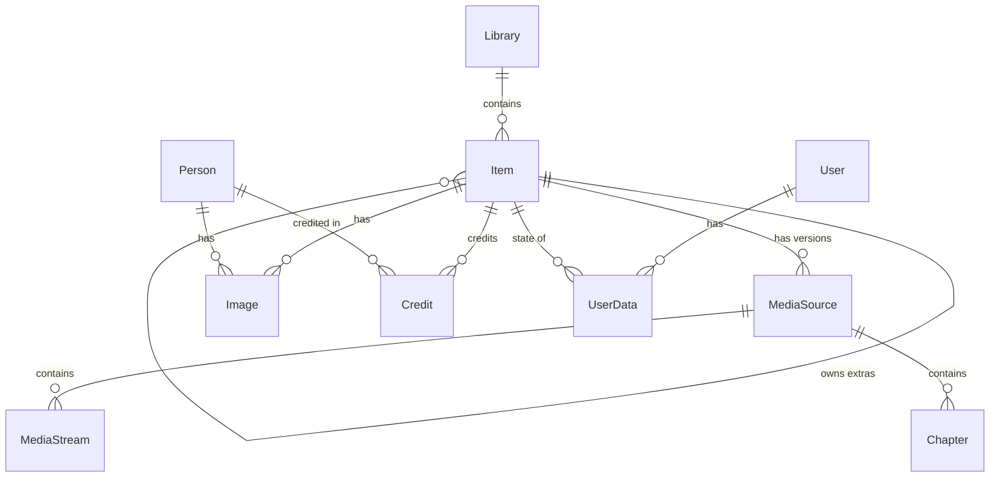

# Mavio Domain Model

> English | [简体中文](domain.zh-CN.md)

> Related: [Architecture](architecture.md) · [Development](development.md) · [Testing](testing.md) · [Roadmap](roadmap.md)

The domain model is defined in `libs/core` (Go package `core`). It depends only on the standard library; storage, the media pipeline, the scanner and the API all work in terms of these types and the repository ports in §9.

---

## 1. Overview

| Entity | Meaning |
| :--- | :--- |
| `Library` | A named set of root folders scanned as one collection |
| `Item` | A node in a library: a playable item, a container (series, album, …) or a curated collection/playlist |
| `MediaSource` | One playable version of an item: a file with its container facts, streams and chapters |
| `MediaStream` | One elementary stream (video, audio, subtitle, …) or a sidecar subtitle file |
| `Image` | An artwork file of an item or person |
| `Person` / `Credit` | Someone credited on items, and the link with role and billing order |
| `User` / `UserPolicy` / `UserPreferences` | An account, what it may access, and its playback defaults |
| `UserData` | One user's state for one item: played, resume position, favorite, … |
| `Job` | A durable unit of background work |
| `PluginConfig` | The configuration an administrator gave a plugin |
| `DisplayPreferences` | A user's settings for how one client shows one view |
| `ServerSettings` | What administrators change while the server runs: transcoding, network, plugin catalogs, the password reset plugin, how long sessions last unused |
| `AccountSettings` | How the server signs people in: its mode, chosen at setup |
| `APIKey` | A token an integration calls the API with, as the administrator who created it |
| `Activity` | Something that happened on the server, kept in the activity log |
| `QualityDefinition`, `QualityProfile`, `CustomFormat`, `DelayProfile`, `ReleaseProfile` | What releases are wanted and how they rank (§13) |
| `Wanted` | How a monitored movie or series is acquired: its quality profile, minimum availability, new item monitoring, season folder flag and tags |
| `EpisodeState` | What acquisition keeps of an episode of a series by its season and number: its scene numbering and last search time |
| `Download` / `HistoryEvent` / `BlocklistEntry` / `PendingRelease` | A tracked download, an acquisition event, a release not to grab again, a release kept to grab later |
| `ExtraFile` | A subtitle or other extra file imported with a movie or episode file |
| `RemotePathMapping` | How a download client's paths map to the server's |
| `Request` / `SeasonRequest` | A user's request of a movie or of seasons of a series (§13.6) |
| `Issue` / `IssueComment` | A problem a user reports with an item, and its thread (§13.7) |
| `SubtitleProfile` / `SubtitleProfileAssignment` | The subtitles movies and episodes want, and the libraries, movies and series they are assigned to (§14) |
| `SubtitleHistoryEvent` / `SubtitleBlocklistEntry` / `SubtitleSearchAttempt` | What happened to a subtitle, a subtitle not to download again, the failed searches of a language (§14) |
| `SubtitleWanted` | The subtitles a movie or an episode is missing, kept for the wanted lists (§14) |

---

## 2. Identifiers

* Every entity is identified by `core.ID`, a **UUIDv7** (RFC 9562). IDs sort by creation time, which keeps database indexes append-friendly; IDs created by one process are strictly increasing, even within a millisecond.
* The text form is the canonical `xxxxxxxx-xxxx-7xxx-xxxx-xxxxxxxxxxxx`; `ID` implements `encoding.TextMarshaler`, so it appears as a string in JSON.
* The zero value `NilID` means "none" (e.g. a top-level item's `ParentID`).

---

## 3. Enumerations

All enumerations are string types with stable lowercase values (`DisplayOrder` keeps Jellyfin's camel case), used unchanged in the database and in JSON. Each has a list of all values and a `Valid()` method.

| Type | Values |
| :--- | :--- |
| `LibraryKind` | `movies`, `shows`, `music`, `music_videos`, `home_videos`, `books`, `photos`, `mixed`, `collections`, `playlists` |
| `StorageClass` | `""` (auto), `local`, `network`, `cloud` |
| `ItemKind` | `movie`, `series`, `season`, `episode`, `video`, `music_artist`, `music_album`, `track`, `music_video`, `audiobook`, `book`, `photo_album`, `photo`, `folder`, `collection`, `playlist` |
| `ExtraKind` | `trailer`, `clip`, `behind_the_scenes`, `deleted_scene`, `interview`, `scene`, `sample`, `featurette`, `short`, `theme_song`, `theme_video`, `other` |
| `StreamKind` | `video`, `audio`, `subtitle`, `attachment`, `image`, `data` |
| `VideoRange` | `sdr`, `hdr` |
| `VideoRangeType` | `sdr`, `hdr10`, `hdr10plus`, `hlg`, `dovi`, `dovi_hdr10`, `dovi_hlg`, `dovi_sdr`, `dovi_el`, `dovi_hdr10plus`, `dovi_el_hdr10plus`, `dovi_invalid` |
| `AudioSpatialFormat` | `""` (none), `dolby_atmos`, `dtsx` |
| `ImageKind` | `primary`, `backdrop`, `logo`, `thumb`, `banner`, `art`, `disc`, `screenshot` |
| `CreditKind` | `actor`, `guest_star`, `director`, `writer`, `producer`, `creator`, `composer`, `conductor`, `lyricist`, `artist`, `author`, `narrator`, `other` |
| `SeriesStatus` | `continuing`, `ended`, `unreleased` |
| `SeriesType` | `""` (standard: by season and episode), `daily` (by air date), `anime` (by absolute number), as Sonarr's series types |
| `DisplayOrder` | `""` (aired), `originalAirDate`, `absolute`, `dvd`, `digital`, `storyArc`, `production`, `tv`: Jellyfin's values, each but the aired order a type of TMDB's episode groups; `ParseDisplayOrder` reads them case-insensitively, and Kodi's `aired` |
| `Video3DFormat` | `half_sbs`, `full_sbs`, `half_tab`, `full_tab`, `mvc` |
| `MetadataField` | `cast`, `genres`, `production_locations`, `studios`, `tags`, `name`, `overview`, `runtime`, `official_rating` |
| `SubtitleMode` | `""` (follow stream flags), `always`, `foreign`, `forced`, `none`, `smart` |
| `SortField` | `name`, `date_added`, `premiere_date`, `production_year`, `community_rating`, `runtime`, `index`, `random`, `last_played`, `play_count`, `list_order` |
| `JobState` | `pending`, `running`, `succeeded`, `failed` |
| `Protocol` | `usenet`, `torrent` |
| `CustomFormatSpecKind` | `release_title`, `edition`, `language`, `indexer_flag`, `source`, `resolution`, `quality_modifier`, `size`, `release_group`, `year`, `release_type` |
| `MovieAvailability` | `announced`, `in_cinemas`, `released` |
| `DownloadState` | `downloading`, `import_blocked`, `import_pending`, `importing`, `imported`, `failed_pending`, `failed`, `ignored` |
| `HistoryEventType` | `grabbed`, `imported`, `download_failed`, `file_deleted`, `file_renamed`, `ignored` |
| `PendingReason` | `delay`, `client_unavailable`, `fallback` |
| `ProperDownload` | `prefer_and_upgrade`, `do_not_upgrade`, `do_not_prefer` |
| `ColonReplacement` | `delete`, `dash`, `space_dash`, `space_dash_space`, `smart` |
| `MultiEpisodeStyle` | `extend`, `duplicate`, `repeat`, `scene`, `range`, `prefixed_range` |
| `EpisodeTitleRequired` | `always`, `bulk_season_releases`, `never` |
| `Provider` | `tmdb`, `tmdb_collection`, `imdb`, `tvdb`, `tvmaze`, `anidb`, `anilist`, `anisearch` (anime databases, one entry per season), `musicbrainz_artist`, `musicbrainz_album_artist`, `musicbrainz_album`, `musicbrainz_release_group`, `musicbrainz_track` (well-known; plugins may add others) |

---

## 4. Libraries and Items

### 4.1 Library
* `Kind` decides how the scanner interprets the folders; `Paths` are root folders: absolute paths of the server's file system, or `rclone:<remote>:<path>` for a folder below the root of an rclone remote (`core.RemoteScheme`). The paths of items and media files below a library path are the library path, a slash and the file's slash-separated name in it (`core.StoragePath`, `core.StorageName`); paths are matched against library paths with `/` and `\` as one separator (`core.InFolder`, `core.StorageName`), as a Windows library path is followed by slash-separated names. A path belongs to at most one library: a library's paths may not equal, contain or lie inside another library's paths (`ErrConflict`). The curated kinds (`LibraryKind.Curated`), `collections` and `playlists`, hold the collections and playlists users curate instead of scanned folders: they have no paths, are never scanned, and there is at most one library of each (`ErrConflict`), which the server creates when first needed.
* `StorageClasses` sets the `StorageClass` of some of the paths, by path, for storage the server would misclassify; each key must be one of `Paths` and each value a class other than auto (`ErrInvalid`). The other paths are auto: classified by the device holding them. The class tells what reading a file costs: `local` (a disk of the server), `network` (a share on the local network) or `cloud` (a cloud drive, whose reads count against quotas and rate limits), and decides what the server reads of the media on its own ([optimization §2](optimization.md)). `Library.StorageClassOf` returns the class set for the longest path holding a file or folder.
* `ScanInterval` is the period of scheduled reconciliation scans (zero disables them); `PreferredLanguage` (ISO 639-1) and `MetadataCountry` (ISO 3166-1 alpha-2) steer metadata providers.
* `SaveLocalMetadata` writes each item's NFO file and the artwork chosen or downloaded for it next to its media, where scans read them back; `AutoCollections` puts movies into collections named after the providers' collections (movie sets), found by their `tmdb_collection` ID, else by name, and created when first needed.
* `ExtractTrickplay` and `ExtractChapterImages` make thumbnail sheets of videos and an image of each chapter; `AnalyzeLoudness` measures the loudness of tracks.
* `Providers` (`ProviderOrder`) names, per capability (metadata, images, subtitles, lyrics, segments, episode listers), the providers the library uses by plugin ID, in order: a nil list uses every provider in its default order, an empty one none; a list naming a provider twice or an empty ID is `ErrInvalid`. `DownloadLyrics` has refreshes download lyrics for tracks without a lyric file from the library's lyrics providers.
* `VirtualEpisodes` chooses the episodes refreshes add to series as virtual items (§4.8): `Missing` those that have aired, `Unaired` those airing today or later, `Specials` those of season 0 too; `GraceDays` (not negative) keeps virtual episodes that many days after they air when `Missing` is off, for their files to arrive.
* `Hubs` (`LibraryHubs`) are the hubs, rows of items each a reason to watch something, that the library shows on Home and on its Recommended tab, as lists of `HubKind` in order; a nil list keeps the defaults of the library's kind and an empty one shows none. `LibraryKind.HubKinds` lists the kinds a library offers, its tab's default order: movies offer continue watching, recently added, recently released, top rated, top unplayed, because you watched, because you like, more in genre, starring, directed by and rediscover; shows the same with recently aired and start watching in place of recently released and top unplayed and without directed by; music videos, home videos and mixed libraries continue watching, recently added, recently released and top rated; music, books and photos recently added and recently released. Home shows by default recently added, because you watched and top unplayed of movies, recently added and start watching of shows, and recently added of the others. A kind the library does not offer, one listed twice, or continue watching among the Home hubs, which on Home spans the libraries, is `ErrInvalid`. Available requests and trending span the libraries (`HubKind.Global`) and belong to no library.

### 4.2 Item
There is a single `Item` type for every kind; `Kind` selects which fields are meaningful. This maps directly onto one items table and avoids a type hierarchy.

| Field group | Fields |
| :--- | :--- |
| Identity and hierarchy | `ID`, `LibraryID`, `ParentID`, `Kind`, `Path`, `UserID` (the user a playlist belongs to), `Virtual` (§4.8) |
| Titles and text | `Name`, `SortName`, `OriginalTitle`, `Overview`, `Tagline` |
| Numbering | `IndexNumber`, `ParentIndexNumber`, `IndexNumberEnd`, `AbsoluteNumber` (an episode's number across seasons, as anime releases number it) |
| Dates and ratings | `ProductionYear`, `PremiereDate`, `EndDate`, `Runtime`, `OfficialRating`, `CustomRating`, `ParentalRating`, `InheritedRating`, `CommunityRating` (0–10), `CriticRating` (0–100) |
| Classification | `Genres`, `Tags`, `Studios`, `ExternalIDs` (by `Provider`), `ProductionLocations` (countries), `RemoteTrailers` (URLs) |
| Movie and video | `CollectionName` (movie set), `AspectRatio`, `Video3DFormat`; for acquisition `OriginalLanguage` (ISO 639-1, which profiles wanting `Original` take), `DigitalReleaseDate` and `PhysicalReleaseDate` (which minimum availability uses besides `PremiereDate`, the release in cinemas), `AlternativeTitles`, `TranslatedTitles` and `SecondaryYear` (by which releases are matched to the movie) |
| Music | `Artists`, `AlbumArtists`, `Album` |
| Series | `SeriesStatus`, `AirDays`, `AirTime`, `DisplayOrder`, `SeriesType` |
| Episode | `AirsBeforeSeasonNumber`, `AirsAfterSeasonNumber`, `AirsBeforeEpisodeNumber` (where a special airs) |
| Extras | `Extra` (`ExtraKind`), `OwnerID` |
| Metadata control | `MetadataLanguage`, `MetadataCountry` (override the library's), `Locked`, `LockedFields` (`MetadataField`) |
| Audio | `Loudness`, the integrated loudness of a track, or of an album's tracks together weighted by duration, in LUFS (EBU R128); `NormalizationGain` is the gain to −18 LUFS |
| Acquisition | `Monitored`: a movie, series, season or episode is wanted, its file to be acquired when missing and upgraded |
| Bookkeeping | `DateAdded`, `FileModified`, `MetadataRefreshedAt`, `ScanGeneration` (the scan that last saw the item), `MissingSince` (see §4.7) |

The model follows Jellyfin's and grows with the roadmap: fields are added when a phase needs them. `SortName` is the user's sort name (Jellyfin's `ForcedSortName`); the computed sort form is a storage key. An episode's series and season are its ancestors, not copied names. A locked item, or a locked field group, is not changed by metadata providers; the item's own NFO file, which records the locks, still applies. Administrators' edits set fields directly, locked or not.

### 4.3 Hierarchies
Hierarchies use `ParentID`; numbering uses `IndexNumber` / `ParentIndexNumber`:

| Library kind | Hierarchy | Numbering |
| :--- | :--- | :--- |
| `shows` | `series` → `season` → `episode` | season: `IndexNumber` = season number; episode: `ParentIndexNumber` = season, `IndexNumber` = episode, `IndexNumberEnd` = last episode of a multi-episode file |
| `music` | `music_artist` → `music_album` → `track` | track: `ParentIndexNumber` = disc, `IndexNumber` = track |
| `movies`, `music_videos`, `home_videos`, `books` | top-level items, optionally inside `folder` items | — |
| `photos` | `photo_album` → `photo` | — |

`collection` and `playlist` items (`ItemKind.IsCurated`) are user-curated containers without a `Path`, in the `collections` and `playlists` libraries. They do not have children: items are linked into them as ordered entries (`Link`: an entry `ID`, the `ContainerID` and the `ItemID`), so an item can be in several collections and playlists, and a playlist can hold an item several times. A collection is shared; a playlist belongs to its `UserID`, which only playlists have and which they require. Deleting an item removes its entries; deleting a user, their playlists.

* `ItemKind.IsContainer()` is true for kinds that group other items (series, season, artist, album, photo album, folder, collection, playlist).
* `ItemKind.HasMedia()` is true for kinds backed by a playable file (movie, episode, video, track, music video, audiobook); these have media sources.

### 4.4 Extras
Trailers, featurettes, theme songs and other extras are ordinary items with `Extra` set and `OwnerID` pointing to the item they belong to. Queries exclude extras unless `ItemQuery.IncludeExtras` is set.

### 4.5 Rules (`Item.Validate`)
* `ID`, `LibraryID`, a valid `Kind` and a non-empty `Name` are required; an item cannot be its own parent.
* An item with `Extra` set must use a valid `ExtraKind` and have an `OwnerID`.
* `CommunityRating` is within 0–10, `CriticRating` within 0–100, and `ParentalRating` is not negative.
* `Video3DFormat`, `DisplayOrder`, `SeriesType` and `LockedFields` use known values; `AirDays` are weekdays.
* Only movies, seasons and episodes can be `Virtual`, and a virtual item has no `Path` and is not an extra.

### 4.6 Ratings
`OfficialRating` is the content rating as published (e.g. "PG-13"); `CustomRating`, set by the user, takes precedence over it; `ParentalRating` is the score of the rating (the custom one, else the official one) in the rating system of the item's metadata country (else its library's, else the US): the minimum age it stands for, from zero for content for all ages, 1000 and above for adult content, and nil for unrated content and ratings no rating system knows. Metadata refreshes compute it with `metadata.RatingScore`, Jellyfin's lookup over its rating systems: the country's system first, then the US system and the others; "Rated" and country prefixes ("DE:", "IT-") removed; plain ages ("16", "18+", "-12") taken as they are; lists separated by "/" taken by their first entry that resolves. Jellyfin's sub-scores (e.g. "TV-PG" versus "TV-PG-V") are not kept. `InheritedRating` is the score rating filters compare: the item's `ParentalRating`, or for an unrated item its nearest rated ancestor's, so the unrated episodes of a series rated above a user's limit are hidden as the series is, as in Jellyfin. The store derives it on every write, also for the descendants of a written item; values passed to `Upsert` are ignored. Rating filters (`ItemQuery.MaxRating`, `UserPolicy.MaxParentalRating`) compare these scores.

---

### 4.7 Missing Items
Every library scan has a generation, one more than the last. A scan stamps the items it sees with its generation; items with a path that a complete scan did not see are marked missing (`MissingSince`) rather than deleted, so a temporarily unavailable mount point loses nothing. Folders a scan could not read keep their items as they were: present items stay present, missing ones missing. Missing items are hidden from queries unless `ItemQuery.IncludeMissing` is set, come back when their file reappears, and are purged after a grace period. `MarkMissing` returns the items it marked, so that the episodes of wanted series whose files went missing can be unmonitored (§13.2).

### 4.8 Virtual Items
A virtual item is a movie, series, season or episode known from metadata whose file or folder the library does not have, as Jellyfin's virtual items (a virtual series is one added to be acquired, §13.2); unlike a missing item (§4.7), the library never had it. Virtual items are hidden from queries unless `ItemQuery.IncludeVirtual` or `OnlyVirtual` is set.

* Refreshing a series asks the library's episode listers (`ProviderOrder.Episodes`) in order; the first that knows the series lists its seasons and episodes, numbered in the series' `DisplayOrder`. As Jellyfin's TMDB missing episode provider, the refresh then creates a virtual episode for each listed episode that no episode of the series holds and the library's `VirtualEpisodes` wants, in its season, creating a virtual season when the series has no season of that number; it updates the virtual episodes it made before, moves them into the season of their number, and deletes them once an episode file holds them, they age out of `GraceDays`, or they are no longer wanted. Virtual seasons left empty are deleted.
* A virtual item belongs to the lister whose provider has an external ID on it; virtual items of other listers are left alone.
* A monitored series lists every episode, aired or not, and keeps them; its specials follow `Specials`. Monitoring a series, or changing its display order, queues its refresh at once.
* A scan that finds the file of a virtual season or episode, by its numbers, turns that item into a physical one, keeping its ID, metadata and user data; a multi-episode file deletes the other virtual episodes it holds. The item of a multi-episode file is named by the titles of its episodes joined by ` / `, as Jellyfin's NFO parser and episode providers name it, so that the titles of the episodes without items of their own stay known, for naming their file again.

## 5. Media Sources, Streams and Chapters

* A `MediaSource` is one playable version of an item; an item can have several (e.g. 4K and 1080p versions), distinguished by `Name`. It records `Path` (a DVD or Blu-ray folder when `Disc` is set) with further stacked `Parts`, `Container` (ffprobe's format name with Matroska as `mkv` and MPEG-TS as `ts`), `Size` and `Modified` (which tell a scan whether the file changed), `Duration`, `Bitrate`, its `Streams` and `Chapters`, the video `Keyframes` used to cut HLS segments (nil until extracted, empty for files without any), `ProbedAt`, and the file's OpenSubtitles hash `FileHash`, computed when subtitles are first searched for it, so that a file unchanged since is not read again.
* A `MediaStream` is one elementary stream, or a sidecar subtitle file with `ExternalPath` set and a synthetic `Index` after the embedded streams. Codec names follow ffprobe (`hevc`, `eac3`, `subrip`, …); `CodecTag` keeps the container tag (`hvc1` vs `hev1`), which matters for direct-play decisions; `Language` is ISO 639-2/B, or a tag with a script or region where a sidecar file's name gives one (`zh-Hans`, `zh-Hant`, `pt-BR`).
* Video streams carry `Crop`, the black borders found by sampling the frames (nil until looked for, zero when there are none). `IsDolbyVisionEnhancement` tells a separate Dolby Vision enhancement-layer track, one whose configuration has an enhancement but no base layer; it depends on its base layer and is never chosen as the video to play.
* All streams carry codec, profile, level, bitrate (zero when unknown), language, title, comment, time bases and the default, forced, hearing-impaired and original flags.
* Video streams carry dimensions, the average `FrameRate` and `RealFrameRate` (`Rational`, e.g. 24000/1001), pixel format and bit depth, color description (range, primaries, transfer, space), the Dolby Vision configuration record (`DolbyVision`: version, profile, level, base-layer compatibility ID, RPU / EL / BL presence), the HDR10+ flag, interlacing, rotation, sample and display aspect ratios, anamorphism, reference frames, and for H.264 whether it is length-prefixed (`AVC`, `NALLengthSize`).
* Derived, as in Jellyfin: `VideoRange()` and `VideoRangeType()` from the color transfer, Dolby Vision record, codec tag and HDR10+ flag; `SpatialFormat()` (Dolby Atmos, DTS:X) from an audio profile; `IsTextSubtitle()`, `IsPGSSubtitle()`, `IsVobSubSubtitle()` from a subtitle codec (bitmap subtitles can only be burned in).
* Audio streams carry channels, channel layout, sample rate and bit depth.
* A `Chapter` is a named start position with an optional extracted image (`ImagePath`).
* Files attached to a container, such as the fonts of ASS subtitles, are streams of kind `attachment`, with their file name as `Title` and their `MimeType`.
* `Trickplay` describes an item's thumbnail sheets at one width: thumbnails of `Width` × `Height` taken every `Interval`, `TileWidth` across and `TileHeight` down a sheet, `ThumbnailCount` in all (`Sheets` of them), and the `Bandwidth` they take while playing. An item has at most one per width.
* A `MediaSegment` is a stretch of an item clients may offer to skip: an `intro`, `outro`, `recap`, `preview` or `commercial` from `Start` to `End`, with the segment provider that found it.
* Rules: a source needs `ID`, `ItemID` and `Path`, and non-negative size, duration and bitrate; every stream needs a valid `Kind`, a non-negative index, non-negative dimensions and channel count.

---

## 6. Images, People and Credits

* An `Image` belongs to an item or a person (`OwnerID`) and has a `Kind`; several images of one kind are ordered by `Index` (e.g. multiple backdrops). It records the local `Path` and/or the `RemoteURL` it came from, its dimensions, and `Blurhash` / `Thumbhash` placeholders. An image needs at least a path or a remote URL.
* A `Person` has a name, biography, birth/death data and `ExternalIDs`.
* A `Credit` links a person to an item with a `CreditKind`, an optional `Role` (the character played or a more specific job) and a billing `Order`.

---

## 7. Users

* A `User` has a unique, case-insensitive `Name` and a `Kind` ([Accounts §4.1](accounts.md#41-users)): `administrator` (exactly one per server, kept by a unique index; `IsAdmin` tells it), `member`, or `managed`, a user without credentials reached only by switching. A user signs in with its own credentials, or through a plugin named by `AuthProvider`; managed users have no `AuthProvider`. `Disabled` keeps a user from signing in.
* A managed user may have a `RestrictionProfile`, which other users may not: `younger_child`, `older_child` or `teen`, allowing rating scores up to 6, 12 and 16 (G and TV-G; PG and TV-PG; PG-13 and TV-14) and no unrated items. `User.Access` gives the effective policy: `Policy` with the profile's limit applied when it is lower, and `BlockUnrated` set.
* A `Credential` is a user's secret in standalone mode, kept apart from the user: a `password` or a four-digit `pin`, whose `Secret` is a PHC-format hash such as `$argon2id$…`, with `CreatedAt` and `LastUsedAt`. A user has at most one credential of each kind; deleting a user deletes its credentials. A PIN guards switching to the user and never signs in.
* `UserPolicy`:
  * `Libraries` limits access to listed libraries (nil means all); `CanAccessLibrary` applies it.
  * `MaxParentalRating` is the highest allowed rating score (content ratings such as "PG-13" map to scores per country rating system; nil means unrestricted, zero allows only content for all ages); `BlockUnrated` hides unrated items when a maximum is set.
  * `AllowTranscoding`, `AllowDownload`, `MaxStreamingBitrate` (bits per second, zero means unlimited) and `MaxSessions` (zero means unlimited).
  * `Requests` (`RequestPermissions`): whether the user may request movies and series, whether their requests of each are approved automatically, and whether they may report issues; `MovieQuota` and `SeriesQuota` are their own quotas (§13.6), nil for the server's. Administrators may do all of it, without quotas.
* `UserPolicy.CanAccess` allows an item when its library is allowed and, under a maximum rating, its rating score (`ParentalRating`, else `InheritedRating`) is within it; unrated items pass unless `BlockUnrated` is set, as rating filters on item queries do. `User.CanAccess` allows a user their own playlists and nobody else's, whatever the library policy, and applies `User.Access` to other items.
* `UserPreferences`: preferred audio and subtitle languages (ISO 639-2/B, in order), `SubtitleMode`, and whether to prefer the default audio track over the preferred language.
* `UserData` is one user's state for one item: `Played`, `PlayCount`, resume `Position`, the last selected audio/subtitle streams (subtitle `-1` means off), `Favorite`, an optional 0–10 `Rating`, and timestamps. Missing state means "never interacted".
* Playing an item updates its `UserData` (`RecordPosition`) as Jellyfin does. A position in the first 5% of the runtime is not kept; past 90% or within a second of the end the item is played and its position cleared; items shorter than five minutes are played once past the first 5%. Audiobooks use five minutes from the start and from the end instead. Items without a runtime are played by any playback. Only videos, audiobooks and books keep a resume position; tracks are only marked played; other kinds neither. `PlayCount` grows once per playback played to completion.
* **Next up** (`NextEpisode`), as in Jellyfin: the next episode of a series is its first unplayed regular episode after the last played one by season and episode number (an episode follows it when it is in a later season, or later in the same season), or the first of all when none was played. Specials (season 0) are left out unless placed with `AirsBeforeSeasonNumber` or `AirsAfterSeasonNumber`; those come in between in aired order and are skipped once played. An episode with a resume position is not offered unless asked: it belongs to continue watching.
* **Aired order** (`CompareAiredOrder`), Jellyfin's: regular episodes by season and episode number, then premiere date; a special by the season it airs before or after and the episode it airs before (`AirsBeforeEpisodeNumber`), before that episode or before the season when no episode is given; specials among themselves by that placement and their own number; other items after episodes.
* An `AuthSession` is a signed-in client: the session of one device (`DeviceID`, `DeviceName`, `Client`, `ClientVersion`) of a user, bound to the device's 32-byte Ed25519 public key (`DeviceKey`), with `CreatedAt` and `LastSeenAt`. Its access tokens are not stored. Signing in again from the same device replaces that device's session; deleting a user deletes its sessions.

---

## 8. Background Jobs

A `Job` is durable background work stored in the database (scans, metadata refreshes, image extraction, …).

* `Kind` names the work (e.g. `library.scan`); `Payload` is its kind-specific argument, typically JSON.
* `UniqueKey` deduplicates: enqueueing while a pending job has the same key does nothing (e.g. `library.scan:<library id>`). A job running with the key does not: the new job is queued and leased only once the running one is done (or its expired lease is taken over and finished), so that work asked for while it runs, after it read its input, is not lost, and two jobs with one key never run at once.
* Workers **lease** due jobs by priority (then by `RunAt`); a lease expires at `LeaseExpiresAt` unless extended, after which the job becomes available again, so a crashed worker never loses work. `Attempts` counts leases, so an attempt cut short by a crash counts too.
* `Extend`, `Complete` and `Fail` require the lease owner; a worker whose lease has expired and been taken over gets `ErrConflict`.
* A failed attempt is retried after `RetryDelay(attempts)` — 30 s, then doubling (1 min, 2 min, …) up to one hour — until `MaxAttempts` is reached; then the job is `failed`. A job queued with the same key while it ran stands for its retry, so it is `failed` at once.
* States: `pending` → `running` → `succeeded` / back to `pending` for a retry / `failed`.
* `JobQuery` lists jobs by kind and state, most recently created first; finished jobs are purged after a week by the `jobs.cleanup` job, which runs daily and also removes the folders in the metadata folder of items that no longer exist (left a day after they last changed).

---

## 9. Repository Ports

`core.Store` is the single entry point to storage; `libs/store` implements it for SQLite and PostgreSQL. Everything else depends only on these interfaces.

| Port | Responsibilities |
| :--- | :--- |
| `LibraryRepository` | CRUD; deleting a library deletes all its items |
| `ItemRepository` | `Get`, `GetByPath`, `Query` (paged), `Walk` (streams all matches in ID order as `iter.Seq2`), batch `Upsert` by ID (a path is unique per library: `ErrConflict`), `Delete` (cascades to descendants, extras, media sources, images, credits and user data), `MarkSeen`, `Touch`, `MarkMissing` and `PurgeMissing` for scans (see §4.7), `Values` (distinct genres, tags, studios, artists or production years with item counts, see §9.2) |
| `MediaSourceRepository` | List and `Replace` an item's media sources |
| `ImageRepository` | `Get` an image; list an owner's images, or several owners' at once (`ListForOwners`), and `Replace` them |
| `PersonRepository` | `Get`, case-insensitive `FindByName`, batch `Upsert`, `Search` (credited people with item counts, see §9.2), list and `Replace` an item's credits |
| `UserRepository` | CRUD and case-insensitive `GetByName` |
| `CredentialRepository` | A user's credentials: `List`, `Get` of a kind, `Put` (replacing the user's credential of its kind), `Delete` of a kind |
| `UserDataRepository` | `Get` (`ErrNotFound` when absent), `GetMany` for a list of items, `Put` |
| `AuthSessionRepository` | `Create` (replacing the user's session on the same device), `Get`, `ListForUser` (most recently seen first), `Touch`, `Delete`, `PurgeIdle` (the sessions last seen before a time) |
| `JobQueue` | `Enqueue` (reports whether added), `Lease`, `Extend`, `Complete`, `Fail`, `List` (paged, see §8), `Purge` of jobs finished before a time |
| `ScanRepository` | `NextGeneration` of a library's scans; the `FolderState` of each scanned folder (`ModTime`, `FileID`, `Entries`), recorded with `PutFolders` and removed with `DeleteFolders` when gone |
| `ItemRepository` (curated) | `Links` lists a collection's or playlist's entries in order; `ReplaceLinks` sets them, keeping the IDs given and assigning new ones |
| `PluginConfigRepository` | `Get` a plugin's configuration (`ErrNotFound` when never configured), `Put` it, replacing the earlier one, `Delete` it |
| `StorageJobRepository` | `Get` a storage job by kind and key (`ErrNotFound` when not stored), `List` those of a kind (oldest first), `Put` (replacing the job of the same kind and key, keeping when it was created), `Delete` |
| `DisplayPreferencesRepository` | `Get` a user's preferences for a client's view (`ErrNotFound` when never set), `Put` them, replacing the earlier ones |
| `SettingsRepository` | `Get` the server settings (the defaults until stored), `Put` them after `Validate`; `ServerID`, created on the first call, tells the server apart from others to clients; `Accounts` (zero until stored) and `PutAccounts` the account settings |
| `APIKeyRepository` | `Create`, `GetByTokenHash`, `List` (newest first), `Touch`, `Delete`; deleting the user deletes their keys |
| `ActivityRepository` | `Add`, `List` (paged, newest first, by time, user, types and least severity), `Purge` of activities before a time |
| `TrickplayRepository` | `Put` an item's sheets at a width (replacing the earlier), `List` an item's (narrowest first), `Delete` them |
| `MediaSegmentRepository` | `List` an item's segments by start, `Replace` them |
| `QualityDefinitionRepository` | `List` a kind's definitions (none until stored), `Replace` them |
| `QualityProfileRepository`, `CustomFormatRepository`, `DelayProfileRepository`, `ReleaseProfileRepository` | `Get`, `List`, `Put` (insert or replace by ID), `Delete`; see §13 for their constraints |
| `WantedRepository` | `Get` (`ErrNotFound` when never wanted), `List` some items' or all, `Put`, `Delete`; deleting the item deletes it |
| `EpisodeStateRepository` | `List` a series' states by season and episode, `PutSceneNumbering` (replacing the scene numbering of a series' episodes, keeping their search times), `Searched` (recording when episodes were searched for); deleting the series deletes them |
| `DownloadRepository` | `Get`, `GetByDownloadID` (by plugin, client and the client's ID), `List` (paged, by item and state, most recently grabbed first), `Put`, `Delete` |
| `HistoryRepository` | `Add`, `List` (paged, newest first, by items or their series, types, download ID and time), `Purge` of events before a time, `MoveItems` (giving the events of items to the item taking their place) |
| `BlocklistRepository` | `Add`, `List` (paged, newest first, an item's or all), `Delete` |
| `PendingReleaseRepository` | `List` an item's or all (oldest first), `Add`, `Delete` |
| `ExtraFileRepository` | `List` an item's (by path), `Put` (insert or replace), `Delete` |
| `RemotePathMappingRepository` | `List`, `Put`, `Delete` |
| `RequestRepository` | `Get`, `List` (paged, by user, statuses, kind, TMDB ID and item, newest or most recently modified first), `Put` (insert or replace by ID), `Delete`, `QuotaUsed` (see §13.6); deleting the user deletes their requests |
| `IssueRepository` | `Get` and `List` (paged, with their comments), `Put`, `AddComment`, `Delete`; deleting the item or the user deletes their issues |
| `SubtitleProfileRepository` | `Get`, `List` (by name), `Put` (insert or replace by ID; names are unique: `ErrConflict`), `Delete` (deleting its assignments) |
| `SubtitleProfileAssignmentRepository` | `Get` a target's (`ErrNotFound` when none), `List` some targets' or all, `Put` (replacing the target's; `ErrNotFound` for an unknown target or profile), `Delete`; deleting the library or item deletes it |
| `SubtitleHistoryRepository` | `Add`, `List` (paged, newest first, by items or their series, actions and time), `SetTranslation` (an event's translation record), `Purge` of events before a time |
| `SubtitleBlocklistRepository` | `Add`, `List` (paged, newest first, an item's or all), `Delete`, `Clear` |
| `SubtitleSearchAttemptRepository` | `List` an item's by language, `Record` a failed search (keeping the first time, replacing the latest) |
| `SubtitleWantedRepository` | `Put` an item's row (deleting it when nothing is missing), `Delete`, `List` the movies' or episodes' of present items by library and path |
| `BlockedTitleRepository` | `Get` by kind and TMDB ID, `List` (paged, newest first, searched by title, of the titles blocklisted by hand or by tags), `Add` (`ErrConflict` when blocklisted already), `Delete`, `DeleteTagged` (the titles blocklisted by tags); deleting the user who blocklisted a title keeps it |

* **Transactions**: `Store.InTx` runs a function with a `Store` bound to one transaction; returning an error rolls it back.
* **Replace semantics**: `Replace*` methods set the complete set for an owner, removing anything not in the new set — scans and metadata refreshes always write whole sets.
* **Errors**: implementations wrap `ErrNotFound`, `ErrConflict` (unique-key or state conflicts) and `ErrInvalid` (domain rule violations); callers test them with `errors.Is`.
* **Storage**: `core.Storage` holds the files of one library path, named slash-separated and relative to it: `Stat`, `ReadDir`, `Open` (a `core.File`, readable at offsets), `WriteFile` (small files, written aside and renamed in where renames are atomic), `Create` (large files, `fs.ErrExist` when present), `MkdirAll`, `Rename`, `Copy` and `Link` (`ErrUnsupported` where the storage cannot), `Remove`, `Chtimes`, `MediaURL` (the input ffmpeg and ffprobe read: a `file:` URL or an HTTP URL) and `Capabilities` (`core.StorageCapabilities`: local, server-side copy, hard links, atomic renames, folder modification times). `core.StorageTransfers` moves and copies files from other paths of the same backend; `core.FileIDer` gives a file's identity across renames; `core.StorageFS` adapts a storage to `fs.FS`. `core.ReadIntent`, carried in the context of `Open` and `MediaURL` (`core.WithReadIntent`, `core.ReadIntentOf`), tells a storage read over the network what the file is read for, so that it reads ahead to suit: `ReadProbe` (the head and tail, as ffprobe reads them), `ReadPlayback` (on ahead of a player, by the media's `Bitrate` where known), `ReadBackground` (a background job, without read-ahead) or `ReadAny`. A `core.File` of storage that keeps what it reads is a `core.Prefetcher`: `Prefetch` has a range fetched without waiting for it and marks where the file is read, so that what lies behind is evicted first. `libs/library` implements it for local folders over `os.Root`, and `libs/rclone` for folders of rclone remotes. `core.StorageJob` is a long operation of a storage backend the server follows, kept so that it is found again after the server or the backend restarted: a transfer an rcd runs within its remotes (`StorageJobTransfer`, keyed by method, source and target, with the rcd run's `ExecuteID` and the `JobID` within it, since an rcd numbers its jobs from 1 again when it restarts), or an offline download a cloud drive runs (`StorageJobOffline`, keyed by download client and info hash). Its `Remote` is the rclone remote it runs on, and `Data` what its owner keeps of it, such as an offline download's task ID, title, category and last seen status.

### 9.1 Item Queries
`ItemQuery` filters with zero values meaning "no filter":

* Scope: `LibraryIDs` (callers apply the user's library policy here), `ParentID` with optional `Recursive` (all descendants), `MemberOf` (the items linked into a collection or playlist, each once), or `TopLevel` (items without a parent), `Kinds`, `IncludeExtras`, `IncludeMissing`, `IncludeVirtual` or `OnlyVirtual` (§4.8).
* Content: `Search` (see §9.2); `Monitored` (nil meaning either); `IndexNumber` and `ParentIndexNumber` (e.g. an episode of a season); `Genres`, `Tags`, `Studios` (match any, compared in clean form, see §9.2); `PersonID`; `ExternalIDs` (any of them, the same title as another server's); `YearFrom`–`YearTo`; `MaxRating`, compared with `InheritedRating`, nil meaning unrestricted (items without a rating are included unless `SkipUnrated`).
* Names sort by sort name the way Jellyfin sorts them: case- and accent-insensitive, leading, inner and trailing articles ("the", "a", "an") ignored, the punctuation `,&-{}'` removed and `.+%` treated as spaces, numbers in numeric order ("Rocky 2" before "Rocky 10"), and non-Latin text transliterated (Chinese sorts by pinyin). Undated items sort last by premiere date, and items never played sort last by last-played time.
* Per user (require `UserID`): `Played`, `Favorite`, `Resumable`, `Started` (whether the user played the item at all), `PlayedAfter` and `PlayedBefore` (the item last played within the range, both exclusive), and the `last_played` / `play_count` sorts. For `Started`, `PlayedAfter` and `PlayedBefore`, a series or season counts the plays of its episodes. With a `UserID`, other users' playlists are left out.
* Similarity: `SimilarTo` keeps the items sharing genres, tags, studios or people with an item, the item excepted, and orders them by similarity before the sort specs, scored as Jellyfin scores similar movies: 10 for each genre shared, 5 for each tag and each studio, and for each person credited on both, 50 when the item credits them as director and 15 as actor or guest star.
* `list_order` sorts by position in the `MemberOf` collection or playlist, an item listed twice by its first entry.
* Ordering: a list of `SortSpec`; results are always tie-broken by ID, so paging is stable.
* Paging: `Limit` (0 means the maximum, `MaxPageSize` = 1000) and `Offset`; `Page.Total` is the count across all pages.
* `Validate` rejects inconsistent queries: out-of-range limits, negative offsets, `Recursive` without a parent, `TopLevel` within a parent or collection, an empty year range, unknown kinds or sort fields, and user filters or sorts without a user.

### 9.2 Search
Item search (`ItemQuery.Search`), person search (`PersonRepository.Search`, by name) and value lists (`ItemRepository.Values` with `ValueQuery`) follow Jellyfin's built-in search provider:

* **Clean form**: names and terms are compared in their clean form: diacritics removed, lower case, every character that is not a letter or digit turned into a space, whitespace collapsed (so "Spider-Man" is "spider man"). Full-width forms are also folded to half-width. A term whose clean form is empty does not filter.
* **Matching**: a result matches when any of these holds: its clean name contains the clean term; its original title (items only; lower case, no diacritics) matches the trimmed term as a pattern, in which `%` matches any run of characters and `_` one character; or its sort name (§9.1) matches the sort form of the term as such a pattern. The sort form finds "Spider-Man" from "spiderman", a person sorted as "Hanks, Tom" from "hanks tom", and Chinese titles from pinyin.
* **Relevance**: results are ranked by their clean name before any other ordering: an exact match first, then names starting with the term, then names containing the term followed by a space, then the rest. Ties follow `Sort` and then the sort name (items), the sort name (people) or the value's sort name (value lists).
* **Value lists**: `ValueQuery` lists the distinct values of one `ValueKind` (`genre`, `tag`, `studio`, `artist`, which includes album artists, or `year`, the production years in decimal, oldest first and not searchable) across the items its `ItemFilter` selects: present items that are not extras, optionally of some libraries and item kinds and within a rating (`MaxRating`, `SkipUnrated`, as for item queries). Each value comes with the number of those items having it (`ValueCount`). Values with the same clean form are one value, shown in the spelling that sorts first by code point, as they are for the `Genres`, `Tags` and `Studios` filters.
* **Person lists**: `PersonQuery` lists the people credited on the items its `ItemFilter` selects, optionally only in some `CreditKinds`, each with the number of those items (`PersonCount`); people without such a credit are not listed.
* **Paging**: value and person lists take `Limit` and `Offset`.

---

## 10. Plugin Configuration

A `PluginConfig` is the configuration an administrator gave a plugin: a JSON document (`JSON`) matching the configuration schema in the plugin's manifest, with `UpdatedAt`.

* It is kept by `PluginID`, the ID in the manifest, not by the installed files, so it survives upgrades of the plugin; uninstalling the plugin deletes it.
* `Validate` requires a plugin ID and well-formed JSON; conformance to the schema is checked by the server, which knows the manifest, before the configuration is stored.

---

## 11. Display Preferences

`DisplayPreferences` are a user's settings for how one client application (`Client`, e.g. "mavio-web") shows one view (`View`, e.g. "home" or a library ID): a map of `Values` whose names and contents the client chooses, such as a sort order or the sections of the home screen, with `UpdatedAt`. The server keeps them, so they follow the user across devices.

* They are kept per user, client and view; putting them again replaces all values. Deleting the user deletes them.
* `Validate` requires the user, a client and a view name of up to 200 bytes, at most 200 values with non-empty names of up to 200 bytes, and values of up to 8 KiB.

---

## 12. Administration

### 12.1 Server Settings
`ServerSettings` are what administrators change while the server runs; command-line flags give only the first values of some. One set is stored, read back with the defaults for settings added later (`DefaultServerSettings`).

* `Transcoding`: the `HardwareAcceleration` (`auto` uses what the server's ffmpeg and hardware support, `none`, or `videotoolbox`), whether hardware encoders may be used, the software encoders' `EncoderPreset` (empty picks one by the source), `H264CRF` and `H265CRF` (0–51), `Threads`, tone mapping (`TonemapAlgorithm`, `TonemapRange`, `TonemapDesat`, `TonemapPeak`), deinterlacing (`yadif` or `bwdif`, optionally at double rate), the stereo `DownmixBoost` (0.5–3), `CropBlackBorders`, and the `TranscodeDir` (an absolute folder; empty keeps the one the server started with).
* `Network`: the `ServerName` shown to clients (empty means the host name), the `BaseURL` a reverse proxy serves the server under (a clean path such as `/mavio`), an `HTTPSPort` with its PEM `CertificatePath` and `KeyPath`, and `LocalDiscovery`.
* `PluginCatalogs`: the http or https URLs of the catalogs plugins are installed from.
* `PasswordResetPlugin`: the ID of the plugin that delivers the PINs resetting forgotten passwords; empty when users cannot reset them.
* `SessionIdleDays`: how many days a session lasts unused, 1–3650, 90 by default.
* `Acquisition`: how releases are chosen, downloaded and imported (§13.4).
* `Requests`: the permissions new users get, the default quotas, and where approved requests go (§13.6).
* `Metadata` (`MetadataSettings`): the server's `PreferredLanguage` (ISO 639-1) and `Country` (ISO 3166-1) of metadata, as Jellyfin's `PreferredMetadataLanguage` and `MetadataCountryCode`; requests and discovery name titles in the language and rate them in the country. The defaults are `en` and `US`.
* `Subtitles`: how subtitles are searched, chosen, saved and synchronized (§14.3).
* `Validate` checks the known values and ranges.

`AccountSettings` are kept apart from them, under the settings key `accounts`: the `Mode` the server signs people in with, `standalone` or `mavio.dev` ([Accounts §2](accounts.md#2-server-modes)), empty until the server's setup chooses it.

### 12.2 API Keys
An `APIKey` lets an integration call the API without signing in: its token, shown once, acts as the administrator who created it, while that user stays an enabled administrator. Only its SHA-256 hash (`TokenHash`) is stored, with a `Name`, `CreatedAt` and `LastUsedAt`, recorded at most once a minute.

### 12.3 Activity Log
An `Activity` is something that happened: a dotted `Type`, a `Severity` (`info`, `warning`, `error`), a `Title` and `Message`, the `UserID` and `ItemID` it concerns and type-specific `Attributes`. The log keeps sign-ins (`user.login`) and failed ones (`user.login_failed`, a warning), API keys created and revoked (`apikey.created`, `apikey.revoked`), requests and issues (§13.6, §13.7), account changes (`user.created`, `user.updated`, `user.deleted`, `user.password_changed`), plugins installed, updated, configured, uninstalled and failing to start (`plugin.installed`, `plugin.updated`, `plugin.configured`, `plugin.uninstalled`, `plugin.failed`), settings changes (`settings.updated`), AI credentials changed and logins started (`ai.credential_changed`, `ai.login_started`), backups (`backup.created`), playbacks starting and stopping (`playback.started`, `playback.stopped`), and failed task runs and subtitle downloads (`task.failed`, `subtitle.download_failed`). It keeps them for 90 days; users list those concerning them, their notifications; and they are sent to notification plugins as events; event-consuming plugins also get the events left out of the log (see [Plugins §4](plugins.md#4-events)).

---

## 13. Acquisition

The server keeps what `libs/acquire` decides with and what happens to the releases it grabs. Qualities are Radarr's quality IDs, for series too; languages are the names `libs/release` gives them ("English", "Portuguese (Brazil)"); tags are free-form labels, shared by movies, series and the profiles that apply to them; indexers are named `<plugin ID>/<indexer ID>`.

### 13.1 Profiles and Formats
* A `QualityDefinition` bounds the size of a quality, for movies or for series, in megabytes per minute of runtime (`MinSize`, `MaxSize`, `PreferredSize`, 0 for none). None are stored until the server stores the defaults of `libs/acquire`.
* A `QualityProfile`, for movies or for series, ranks its `Items`, qualities and groups of qualities (group IDs from 1000), lowest first, allowing some; `Cutoff` names the quality or group at which upgrades stop, `UpgradeAllowed` whether they happen at all. `FormatScores` score custom formats; releases need `MinFormatScore`, upgrades stop at `CutoffFormatScore` and must gain `MinUpgradeFormatScore`. Scores are of formats that exist, each format at most once; a format without a score scores 0, and `MinFormatScore` must be reachable. `Language` is the language movie releases need: a name, `Original`, `Unknown` for releases whose language is not known, or empty (`Any`) for any. Names are unique per kind; a profile wanted items use cannot be deleted.
* A `CustomFormat` is a named set of `Specifications`, each matching a kind of fact (release title, edition, language, indexer flag, source, resolution, quality modifier, size, release group, year, release type), negated or required. Names are unique; deleting a format removes its scores from profiles, and deleting the last one resets their format scores (minimum and cutoff 0, minimum upgrade 1).
* A `DelayProfile` enables protocols, prefers one, and delays releases of each protocol, unless they are of the profile's best quality or score enough, for the items sharing one of its `Tags`; the `Default` profile has no tags, comes last and cannot be deleted.
* A `ReleaseProfile` requires or ignores terms (plain or `/regex/flags`) in release titles, for the items sharing one of its tags (all when none) and the releases of one indexer (all when none).

### 13.2 Wanted Items
A monitored movie or series (`Item.Monitored`) is acquired as its `Wanted` says: its `QualityProfileID`, a movie's `MinimumAvailability` (`announced`, `in_cinemas`, `released`), a series' `MonitorNewItems` (`all`, the default when empty, or `none`: whether seasons and episodes a refresh or a scan adds are monitored, as Sonarr's `NewItemMonitorTypes`; a new episode is monitored as its season, but not an episode 0 outside season 1, and a new season of specials is not) and `SeasonFolder` (whether its episodes are imported into season folders), its `Tags`, `AddedAt` and `LastSearchedAt`. A wanted movie without a file, or a wanted series without a folder, is a virtual item (§4.8).

An `EpisodeState` keeps, apart from the episode's item, which a scan may replace, what Sonarr keeps on its `Episode` for an episode of a series, by its TVDB season and number (`EpisodeNumber`): how the scene numbers it (`SceneSeason`, `SceneEpisode`, `SceneAbsolute`, nil when as TVDB does, and `UnverifiedSceneNumbering` when the numbering is extrapolated from that of other episodes rather than confirmed) and when it was last searched for (`LastSearchedAt`). Episodes without either have no state.

### 13.3 Downloads, History and the Blocklist
* A `Download` is a grabbed release, tracked from the grab until it is imported, fails or is ignored: its download client (`PluginID`, `ClientID`) and the client's `DownloadID`, its item and episodes, title, indexer, protocol, quality, languages and size, and its `State` (`downloading`, `import_blocked`, `import_pending`, `importing`, `imported`, `failed_pending`, `failed`, `ignored`) with `Messages`. A client's download is tracked once.
* A `HistoryEvent` records a grab, an import from a download folder, a failed or ignored download, or a file deleted or renamed, for a movie or an episode (with its series as `ParentID`): the release's `SourceTitle`, quality and languages, the `DownloadID` and type-specific `Data`. When the item of a multi-episode file takes the place of the items of the episodes it covers, imported or found by a scan, it takes their events too.
* A `BlocklistEntry` is a release not to grab again for an item: its title, quality, languages, size, protocol, indexer and flags, publish date, torrent hash and why it was blocklisted.
* A `PendingRelease` is a release kept to grab later: held by a delay profile, waiting for a download client, or kept as a fallback should better releases fail. `Release` is the release as `libs/acquire` encodes it.
* An `ExtraFile` is a file imported with a movie or episode file, as Radarr's and Sonarr's extra file tables: the movie, or the episode holding the episode file (`ItemID`), its `Kind` (`subtitle`, as Radarr's SubtitleFile, or `other`, as its OtherExtraFile), its absolute `Path`, `Extension`, a subtitle's `Language` and `LanguageTags`, and when it was `Added` and `LastUpdated`. An upgrade recycles the extra files recorded with the file it replaces; files not recorded stay.
* Deleting an item deletes its wanted state, episode states, downloads, history, blocklist entries, pending releases and extra files.

### 13.4 Settings
`AcquisitionSettings`, part of the server settings, are Radarr's: how propers and repacks are treated (`prefer_and_upgrade`, `do_not_upgrade`, `do_not_prefer`), whether indexer flags are preferred, completed download handling and new searches after failures (for releases grabbed from an interactive search only when also allowed), the maximum release size, the minimum age and retention of usenet releases, hardcoded subtitles allowed or whitelisted, the free space an import must leave, the delay after which movies count as available, the RSS sync interval (10–120 minutes, 0 disabling it) and the download check interval, the recycle bin and its cleanup, hard links, extra files and empty folders, and `Naming`: whether movie files are renamed, illegal characters replaced, colons replaced (`delete`, `dash`, `space_dash`, `space_dash_space`, `smart`), and the movie folder and file templates. Sonarr's settings join them: whether the episodes of wanted series whose files go missing are unmonitored, when an episode imported under a name showing its title must have one (`EpisodeTitleRequired`), the download client working folders whose files are not imported (`DownloadClientWorkingFolders`, prefixes separated by `|`, `_UNPACK_|_FAILED_` when empty), and in `Naming` whether episode files are renamed, the templates of standard, daily and anime episode files and of series, season and specials folders, and the `MultiEpisodeStyle`; an empty template or style means Sonarr's default.

### 13.5 Remote Path Mappings
A `RemotePathMapping` maps a folder a download client on `Host` reports (`RemotePath`) to the absolute folder the server sees (`LocalPath`). A host's remote path is mapped once.

### 13.6 Requests
* A `Request` is a user's request of a movie or a series by TMDB ID (`Kind`, `TmdbID`, and a series' `TvdbID` once known), with its `Title` and `Year`, the `ItemID` of the item it made wanted, the `RequestedBy` and `ModifiedBy` users, `IgnoreQuota`, a `Message` (why it failed) and its times. A series request lists its `Seasons` (`SeasonRequest`: a number, at least one, each once, and a status); a movie request has none.
* `RequestStatus`: `pending` (waiting for an administrator), `approved` (its title made wanted), `declined`, `failed` (making it wanted failed; it may be retried) and `completed` (available). Pending, approved and failed requests are active: they stand in the way of other requests of their title or seasons. A season completes when its aired episodes all have files; a series request when all its seasons have.
* A `Quota` allows `Limit` requests of movies, or seasons of series, in the last `Days` days (all time when 0); a limit of 0 is unlimited. `QuotaUsed` counts a user's requests of a kind since a time, seasons for series, leaving out declined requests and those ignoring quotas, as Seerr's `User.getQuota`.
* `RequestSettings`, part of the server settings: the `DefaultPermissions` new users get, the default `MovieQuota` and `SeriesQuota`, the movie library, quality profile and minimum availability approved movies are added with, the show library, quality profile, season folder flag and new item monitoring of approved series, the `AnimeLibraryID` and `AnimeQualityProfileID` approved anime series are added with instead (unset, those of series apply; anime series are added as `anime` either way), and whether specials (season 0) may be requested, and Seerr's `BlocklistedTags` (keywords of discovery providers as `<plugin>/<keyword>`) with `BlocklistedTagsLimit`, the pages of each order of a keyword's titles the blocklisted tags job reads (0–250, 0 for 50).
* A `BlockedTitle` is a movie or series administrators blocked from being requested, as Seerr's blocklist: its `Kind` (movie or series) and `TmdbID`, once each, its `Title` when it was blocklisted, the `UserID` of the administrator, the `Tags` the blocklisted tags job blocklisted it for (empty when blocklisted by hand, which the job never tags), and its `CreatedAt`.

### 13.7 Issues
An `Issue` is a problem a user reports with an item: its `Type` (`video`, `audio`, `subtitles`, `other`), `Status` (`open`, `resolved`), an optional `SeasonNumber` and `EpisodeNumber`, `CreatedBy`, `ModifiedBy` and its times. Its `Comments` (`IssueComment`: a user, a message and times) are its thread, oldest first; the first is the report's message.

## 14. Subtitle Acquisition

The server keeps what `libs/acquire/subtitles` decides with and what happens to the subtitles it downloads, as Bazarr keeps its language profiles, history, blacklist and failed attempts. Subtitle languages are BCP 47 tags (`en`, `pt-BR`, `zh-Hant`); a `SubtitleLanguage` is a tag with whether the subtitles are `Forced` or `HearingImpaired`, never both, written as Bazarr writes it (`en`, `en:forced`, `en:hi`). Providers are named `<plugin ID>/<provider>`.

### 14.1 Profiles
* A `SubtitleProfile` is Bazarr's language profile: its unique `Name`, its `Items`, the languages it wants, each with an `ID` (from 1) unique in the profile, whether it wants `Forced` subtitles, its hearing-impaired mode `HI` (`""`: normal subtitles, hearing-impaired ones taken in their place; `required`; `excluded`), and whether it is not wanted when an audio stream has the language (`AudioExclude`) or wanted only then (`AudioOnlyInclude`). `Cutoff` is the item whose subtitles end the search for the others, `SubtitleCutoffAny` (65535) for any item's, or 0 for none. `MustContain` and `MustNotContain` are words subtitle release names must and must not contain; `OriginalFormat` keeps subtitles in their provider's format instead of converting them to SubRip; `Tag` assigns the profile to movies and series with the tag, when the settings allow it. An item wanting the same language and kind twice, a forced hearing-impaired item, or a cutoff naming no item is `ErrInvalid`.
* A `SubtitleProfileAssignment` assigns a profile to a library, a movie or a series (`TargetID`); a zero `ProfileID` assigns none, so that nothing is wanted. A movie's or series' profile is, where the settings let tags assign profiles as Bazarr's sync does, none when it has one of the settings' `NoProfileTags`, else that of the first profile by name whose tag it has; else its own assignment, else its library's. Deleting a profile deletes its assignments; deleting the library, movie or series deletes its assignment.

### 14.2 History, Blocklist and Failed Attempts
* A `SubtitleHistoryEvent` records a subtitle of a movie or an episode (with its series as `ParentID`) `deleted`, `downloaded`, downloaded from a `manual` search, `upgraded`, `uploaded`, `synced`, `extracted` or `translated`, as Bazarr's history actions: its language, `Provider` and the provider's `SubtitleID`, its `Score` out of `MaxScore` (0 when not scored), the subtitle's and the video's `Path` and `VideoPath`, a `Description`, the properties of the video it `Matched` and did not (`NotMatched`), for an upgrade the event of the download it replaced (`UpgradedFrom`), and for a translation its `Translation` record: the subtitle file or embedded stream it was translated from and its language, the translators that translated it (the first, then the fallbacks used), its cues and characters, the tokens and cost of the AI models, and whether it was proofread and how many cues were revised.
* A `SubtitleBlocklistEntry` is a subtitle not to download again for a movie or an episode: its provider, subtitle ID, language and why it was blocklisted.
* A `SubtitleSearchAttempt` keeps, for a movie or an episode and a language, the `First` and `Last` failed searches, as Bazarr's `failedAttempts`, for adaptive searching.
* A `SubtitleWanted` keeps what a movie or an episode is missing (`Missing`), with its kind, library, series (`ParentID`), video path and when it was found (`Updated`), as Bazarr's `missing_subtitles` columns; deleting the item deletes it.
* Deleting an item deletes its subtitle history, blocklist entries and failed attempts.

### 14.3 Settings
`SubtitleSettings`, part of the server settings, are Bazarr's general and synchronization settings, with Bazarr's defaults (`DefaultSubtitleSettings`): the minimum scores of episodes' and movies' subtitles (percentages of the maximum, 90 and 70), whether videos are described by the release names their files came from, whether embedded subtitle streams count as present (but not PGS, VobSub or ASS ones when ignored), UTF-8 conversion, the `Mods` applied to downloads, the hearing-impaired suffix (`hi`, `cc` or `sdh`), names without languages (`SingleLanguage`), the `Folder` subtitles are saved in (`current`, beside the video; `relative`, a folder of the video's folder, named by a single folder name; `metadata`, the item's folder within the server's metadata folder) with the `CustomFolder` of `relative`, upgrades (whether, every `UpgradeInterval`, for the subtitles of the last `UpgradeDays` (0–30), including those downloaded by hand or not), adaptive searching (`AdaptiveDelay` after the first failure, then once per `AdaptiveDelta`; three weeks and one week), the intervals of the wanted searches of episodes and movies (at least an hour, 0 for never), the languages of audio and embedded subtitle streams without one, whether hashes are skipped, `LanguageEquals` (subtitles in one language counting as another), whether movies and series take profiles from their tags and the `NoProfileTags`, and `Sync`: whether downloads are synchronized, only below the episode and movie thresholds or always, against the audio even when another subtitle could serve, against the audio stream in the original language, the providers and languages excluded, the maximum offset (60 s), frame rate fixing, the golden-section search, and the quality bounds applied when frame rates are fixed (minimum score, maximum offset 30 s, scale deviation 0.1); and `Translation`, Lingarr's settings with Lingarr's defaults: the `Translator` used when a translation names none (`<plugin>/<translator>` or an AI model `ai/<provider>/<model>`, empty for the first enabled plugin translator) and the `FallbackTranslators` tried in turn, the `DefaultScore` translations are recorded with as a percentage of the maximum score (50), whether SubRip translations `Credit` their translator in a first cue, the AI's system and user `Prompt` and `UserPrompt` and those of proofreading (`ProofreadPrompt`, `ProofreadUserPrompt`), with placeholders such as `{sourceLanguage}` and `{lineToTranslate}`, the cues of context before and after a cue (`ContextBefore`, `ContextAfter`, 0–50, 2 each) and whether they come with their translations (`TranslatedContext`), whether AI models translate a `Batch` of cues at once, up to `MaxBatchSize` (0 for the whole subtitle), whether languages are named by their codes rather than English names (`LanguageCodes`), the `MaxRetries` of a rate-limited or unavailable request (5) after `RetryDelay` (1 s) multiplied by `RetryMultiplier` (2) each time, the `RequestTimeout` (5 min), `StripFormatting`, `PreserveLineBreaks`, `FixOverlaps`, the `Validation` of translations (whether, the maximum file size of 1 MiB, the cue lengths 2–500 characters and durations 500 ms–10 s), and the `Automation` (whether, every `Interval` of at least an hour (24 h), translating up to `MaxPerRun` (10) movies' and episodes' missing subtitles from those in the `SourceLanguages`, once their files are older than `MovieAge` and `EpisodeAge`).
