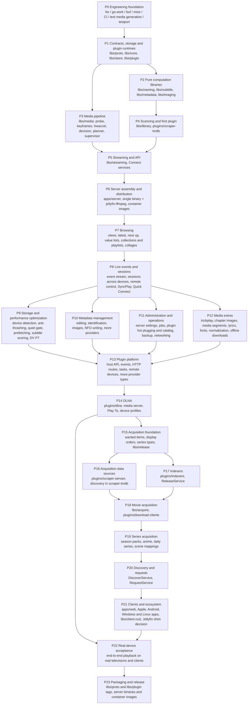

# Mavio Roadmap

> English | [简体中文](roadmap.zh-CN.md)

> Related: [Architecture](architecture.md) · [Domain Model](domain.md) · [Development](development.md) · [Testing](testing.md) · [Optimization](optimization.md) · [AGENTS.md](../AGENTS.md)

---

## 1. Principles

* **Bottom-up**: build the low-level libraries with no business dependencies first, then assemble layer by layer; each layer depends only on completed layers below it.
* **Definition of done**: a phase is complete when its libraries pass their tests, including all ported test cases (or cases explicitly marked skip with a reason), see [Testing §2](testing.md#2-porting-test-cases).
* **Server first**: P7 to P12 complete the server, by comparing it with Jellyfin's server (its API controllers and providers); P13 and P14 bring plugins level with Jellyfin's and add DLNA; P15 to P20 add acquisition, what Seerr, Radarr, Sonarr and Prowlarr do beside Jellyfin ([Architecture §13](architecture.md#13-acquisition-libsacquire)); the clients follow in P21, whose foundation is built alongside P19 and P20 on the browsing and playback API already finished; P22 verifies playback end to end on real devices; P23 packages and publishes the releases.
* **Integration smoke tests**: starting from P1, the end of each phase adds an integration test in `apps/server/internal/smoke` that wires the completed libraries together. It is not an MVP; it only exposes interface drift early, reducing the bottom-up approach's risk of "discovering problems only at final integration".

---

## 2. Phase Overview

| Phase | Theme | Status |
| :--- | :--- | :--- |
| P0 | Engineering foundation | ✅ Done |
| P1 | Contracts, storage and plugin runtimes | ✅ Done |
| P2 | Pure computation libraries | ✅ Done |
| P3 | Media pipeline | ✅ Done |
| P4 | Scanning and first plugin | ✅ Done |
| P5 | Streaming and API | ✅ Done |
| P6 | Server assembly and distribution | In progress |
| P7 | Browsing | ✅ Done |
| P8 | Live events and sessions | ✅ Done |
| P9 | Storage and performance optimization | ✅ Done |
| P10 | Metadata management | ✅ Done |
| P11 | Administration and operations | ✅ Done |
| P12 | Media extras | ✅ Done |
| P13 | Plugin platform | ✅ Done |
| P14 | DLNA | ✅ Done |
| P15 | Acquisition foundation | ✅ Done |
| P16 | Acquisition data sources | In progress |
| P17 | Indexers | ✅ Done |
| P18 | Movie acquisition | ✅ Done |
| P19 | Series acquisition | ✅ Done |
| P20 | Discovery and requests | ✅ Done |
| P21 | Clients and ecosystem | In progress |
| P22 | Real-device acceptance | Not started |
| P23 | Packaging and release | Not started |

---

## 3. Phase Details

### P0 Engineering Foundation
**Scope**: repository skeleton, mise, Nx, go.work, buf, golangci-lint + depguard; CI matrix (linux amd64/arm64, macOS, Windows); `tools/fixtures`, `tools/testport`.

**Done when**: `nx affected` works; `tidy-check` (`GOWORK=off`) passes.

**Progress**:
- [x] Go module skeleton and `go.work`; Nx with the local plugin `tools/nx-go` (infers projects and the dependency graph)
- [x] Toolchain versions pinned with mise
- [x] buf and the first contract `mavio.system.v1.SystemService`; `apps/server` serves a Connect health check
- [x] golangci-lint and depguard dependency-direction rules
- [x] CI workflow: affected-project checks, generated-code check, `buf breaking`, multi-platform test matrix
- [x] `tools/fixtures`: test media generation
- [x] `tools/testport`: Jellyfin test case extraction

### P1 Contracts, Storage and Plugin Runtimes
**Scope**: first version of the `proto` contracts; `core` domain model; `store` (ent + Atlas + sqlc, both dialects) and the job queue; `plugin` with both runtimes and the handshake.

**Done when**: repository conformance tests pass on both SQLite and PostgreSQL; a crashing plugin does not affect the host and is restarted automatically.

**Progress**:
- [x] `libs/core`: domain model and repository ports ([Domain Model](domain.md))
- [x] `libs/proto`: first version of the contracts (library, user, system, plugin)
- [x] `libs/store`: SQLite and PostgreSQL implementation of the ports, including the job queue
- [x] `libs/plugin`: WASM and child-process runtimes
- [x] Smoke test `apps/server/internal/smoke`: a queued metadata refresh fetched from a plugin (both runtimes), stored with its credits and found by search

### P2 Pure Computation Libraries
**Scope**: `naming`, `subtitle`, `metadata` (NFO), `imaging`.

**Done when**: all corresponding ported cases pass.

**Progress**:
- [x] `libs/naming`: Jellyfin's naming rules for movies, episodes, seasons, series, stacks, versions, extras, music, audiobooks, books and external files; all ported cases pass or are skipped with a reason
- [x] `libs/subtitle`: SRT / SSA / ASS / WebVTT parsing, conversion to SRT / SSA / ASS / WebVTT / TTML / JSON, time-window filtering and character set detection
- [x] `libs/metadata`: NFO reading for movies, videos, music videos, series, seasons, episodes (including multi-episode files), albums and artists; provider IDs in URLs; movie NFO locations. Writing NFO files is left to the phase that saves metadata.
- [x] `libs/imaging`: Jellyfin's size rules, resizing with sharpening on downscale, image formats and SVG safety checks. WebP encoding and placeholders (blurhash / thumbhash) come with the image API in P5, collages with browsing in P7.
- [x] Smoke test `apps/server/internal/smoke`: an episode's files are named, read from NFO, stored with their credits and found again; its subtitle is converted to WebVTT and its poster resized

### P3 Media Pipeline
**Scope**: `probe`, `keyframes`, `hwaccel`, `decision`, `planner`, `supervisor`.

**Done when**: all ported StreamBuilder and EncodingHelper cases pass; real transcode smoke tests pass on the hardware available: the maintainers' own machines and the GitHub-hosted CI runners. Vendor paths without such hardware are covered by the ported argument-derivation cases only.

**Progress**:
- [x] `probe`: ffprobe output normalized as Jellyfin does, including Dolby Vision, HDR10+ and range types; all ported cases pass
- [x] `keyframes`: keyframe times from ffprobe packet flags
- [x] `hwaccel`: version checks, codec, filter and option listings, VideoToolbox trial encodes, VA-API driver checks
- [x] `decision`: StreamBuilder with `ClientCapabilities` in place of `DeviceProfile`, and stream selection; all 307 StreamBuilder cases pass
- [x] `planner`: filter graph IR, CMAF HLS and progressive commands; software and VideoToolbox strategies; all ported EncodingHelper cases pass
- [x] `supervisor`: lifecycle, idle reaping, throttling, progress, served segments
- [x] Smoke test `apps/server/internal/smoke`: an HDR10 HEVC file is probed, direct played by a capable client and transcoded to H.264 HLS from a seek position for a web client, under supervision
- [x] Real transcodes on the GitHub-hosted runners (CI job `media`, Linux and macOS)

### P4 Scanning and First Plugin
**Scope**: `library` scanner (full reconciliation, see [Architecture §9](architecture.md#9-library-scanning-and-change-detection-libslibrary)), resolver chain, job scheduling; `plugins/scraper-tmdb` (WASM).

**Done when**: ported library resolver cases pass; scan results are identical on both databases; reconciliation converges to the correct state for additions / deletions / renames / content changes / temporarily unavailable mount points.

**Progress**:
- [x] Resolver chain, one folder at a time: movies, shows, music, books, home videos and photos, extras, `.ignore` files; ported resolver cases pass
- [x] Scanner: scan generations, missing items kept and purged after a grace period, folders pruned by modification time and file ID, unreadable folders keep their items
- [x] Jobs: scans, probes and metadata refreshes on the job queue, with leases and scheduled scans
- [x] `plugins/scraper-tmdb`: movies, series, seasons and episodes from TMDB; ported `TmdbUtils` cases pass, missing-episode cases skipped until virtual episodes are in the domain model
- [x] Adapters in `apps/server`: metadata plugins as providers, ffprobe as prober
- [x] Smoke test `apps/server/internal/smoke`: a film and a shows library are scanned as jobs with a WASM plugin as provider; additions, deletions, renames, rewritten files and an unavailable library folder converge to the same state on SQLite and PostgreSQL

### P5 Streaming and API
**Scope**: `streaming` (CMAF HLS, on-demand segmenting, seeking, segment cache); Connect services (library, playback, user, system).

**Done when**: ported HLS cases pass; playback verified on real hls.js and AVFoundation clients. Media3 is verified in P21, with the Android client.

**Progress**:
- [x] `libs/streaming`: playlists of the whole media source, RFC 6381 codec strings, segments generated on demand with restarts on seek, segments of copied video joined from one file per group of pictures; ported HLS cases pass
- [x] Authentication: first administrator, sign-in per device with hashed access tokens, argon2id passwords, `mavio.auth.v1.AuthService`, bearer-token and request-validation interceptors
- [x] Playback: `mavio.playback.v1.PlaybackService` and media endpoints for direct play and HLS remuxes and transcodes, remembered and preferred streams, resume positions and played state; verified end to end with real ffmpeg
- [x] Subtitle delivery: text subtitles as converted files, from external files or extracted with ffmpeg, and as HLS renditions
- [x] Library, item and user Connect services; the server runs the library jobs
- [x] Image endpoint: local and provider artwork, resized with Jellyfin's size rules and cached
- [x] WebP encoding (`gen2brain/vpx`) negotiated with clients; blurhash / thumbhash placeholders computed in the library jobs
- [x] Playback verified with the development player on hls.js in Chromium: direct stream, transcodes, seeking with restarts, an HLS subtitle rendition in sync, progress and stop
- [x] Playback verified with the development player on Safari's native HLS, which is AVFoundation's: direct stream, transcodes, seeking with restarts, an HLS subtitle rendition in sync. HLS subtitle renditions are WebVTT segmented along the video without `X-TIMESTAMP-MAP`; if a player misplaces them, add one derived from the video's timestamps

### P6 Server Assembly and Distribution
**Scope**: `apps/server` assembly; `CGO_ENABLED=0` cross-compilation; container images bundling jellyfin-ffmpeg's portable build, the one `mise.toml` pins. Publishing them is part of P23.

**Done when**: end-to-end smoke test: scan → scrape → playback decision → HLS playback.

**Progress**:
- [x] Assembly in `apps/server/internal/server`, which `cmd/mavio` runs with its flags
- [x] Plugins started from the plugin folder (`--plugin-dir`); their configurations stored, validated against the manifest's schema and applied through `SystemService` without a restart; metadata plugins take part in library refreshes once ready
- [x] End-to-end test of the assembled server through its API with real ffmpeg and a WASM metadata plugin: an administrator configures the plugin, a library is scanned, its film scraped and played as an HLS direct stream
- [x] `CGO_ENABLED=0` cross-compilation to Linux, macOS and Windows on amd64 and arm64 (`server:dist`), checked in CI
- [x] Container images for linux/amd64 and linux/arm64 bundling jellyfin-ffmpeg's portable build, built and run in CI

### P7 Browsing
**Scope**: what a client lists and opens.

- The user's library views; latest items per library; continue watching and next up for series
- Series, seasons and episodes; albums and artists
- Genres, studios, people and years with item counts, which `libs/store` already queries
- Collections and playlists: create, edit, reorder and delete; the domain model already has both
- Library and collection collages
- Display preferences per user and client, kept by the server so they follow the user across devices
- Inherited parental ratings

**Done when**: an end-to-end test through the API browses a scanned film and shows library through the views, latest items, next up and genres, builds a playlist, and does not show the episodes of a series rated above the user's limit.

**Progress**:
- [x] Inherited parental ratings: an unrated item takes its nearest rated ancestor's score, derived by the store on every write and backfilled for existing databases; rating filters and access checks use it
- [x] Rating scores: metadata refreshes map content ratings to scores with Jellyfin's rating systems (`metadata.RatingScore`, its ported cases pass); unrated is nil rather than zero, in items and in policies' maximum ratings
- [x] Genres, tags, studios, artists, years and people with item counts (`ItemService.ListValues`, `ListPeople`), limited to the items the user may access
- [x] Latest items (`ListLatestItems`) grouped into series, seasons and albums as in Jellyfin, and next up (`ListNextUp`) with specials in aired order; item responses name an episode's series and season and a track's album. Continue watching is `ListItems` with `resumable`, sorted by last played
- [x] Collections (`CollectionService`, administrators) and playlists (`PlaylistService`, each user their own, with entries that can repeat items and move) in curated libraries the server creates; their items listed through `ListItems` with them as parent
- [x] Display preferences per user, client and view (`DisplayPreferencesService`), with names and values the client chooses
- [x] Collages of libraries, collections and playlists (`/images/collages/{id}`, `imaging.Collage`), drawn without text
- [x] Scans refresh the metadata of new items without media (series, seasons, albums), which only media files' probes did before
- [x] End-to-end test of the assembled server through its API (`internal/server`, `TestBrowsing`): films and shows scanned with their NFO files and browsed through the views, latest items, next up and genres; a user limited to PG builds a playlist and sees no episode of a TV-14 series

### P8 Live Events and Sessions
**Scope**: what a client learns without asking, and what one device does to another.

- Events: a stream per signed-in device carrying library changes, played state and progress from the user's other devices, job progress and plugin states
- Sessions: what is playing on each device; remote control of one device from another (play, pause, seek, stop, messages)
- Synchronized playback (SyncPlay): groups sharing one play state, waiting for members that buffer
- Signing in a new device from a signed-in one (Quick Connect)

**Done when**: an end-to-end test through the API: a device receives a library change after a scan and another device's progress, and controls that device's playback; two devices in a SyncPlay group stay at the same position. Timing logic is tested with `testing/synctest`.

**Progress**:
- [x] Event streams (`EventService`): library changes, item states, sessions, commands, scans and plugins, each device getting what its user may see; the store is observed so that writes reach the streams once committed
- [x] Sessions (`SessionService`): devices online while streaming, what each plays, remote commands
- [x] Quick Connect (`AuthService`): a new device signed in by entering its code on a signed-in one
- [x] SyncPlay (`SyncPlayService`): groups of devices playing one queue at one position, waiting for buffering members, as in Jellyfin; timing tested with `testing/synctest`
- [x] End-to-end test of the assembled server through its API (`internal/server`, `TestLiveEvents`): a TV learns of the film a scan found and of a phone's playback and state, pauses the phone, and both are told to start a SyncPlay group at the same time and position

### P9 Storage and Performance Optimization
**Scope**: end-to-end I/O latency mitigation and speculative warming ([Optimization](optimization.md)); language/dialect-aware subtitle scoring; high-fidelity video pipeline enhancements; zero-fuzz release verification.

- Multi-dimensional storage medium and protocol identification: native detection of local SSDs, rotational HDDs, remote network shares (SMB/NFS), and cloud mounts across Linux, Windows, and macOS
- Anti-thrashing physical drive serialization (`VolumeLedger`): single-flight queues for rotational media, eliminating head contention during scans and probes
- Foreground streaming quiet gate (`QuietGate`): automatic yielding and throttling of background library scans and disk maintenance while client playback sessions are active
- In-progress write detection (`GrowthPolicy`): write-window and size-stability checks to avoid scanning partially downloaded or actively growing files
- Speculative index and metadata prefetching (`PrefetchHeadTail`): targeted warming of container headers and index atoms via `posix_fadvise` and sequential fallback
- Subtitle scoring and dialect normalization: language scoring matrix, Chinese variant normalization (Traditional/Simplified/regional dialects), and hearing-impaired downranking
- High-fidelity video pipeline adaptations: Dolby Vision Profile 7 EL extraction and fallback tone-mapping; black border detection (`cropdetect`)
- Security and release invariants: pinned dependency verification and fail-closed privacy checks

**Done when**: cross-platform unit and integration tests pass for storage detection, concurrency serialization, quiet gates, and prefetching on Linux, Windows, and macOS; rotational disks remain sequential during scans; playback startup cleanly interrupts background I/O; subtitle scoring correctly matches Chinese regional dialects.

**Progress**:
- [x] Multi-dimensional device and protocol identification: `libs/library/storage` with native Linux (`sysfs`/`st_dev`), macOS (`statfs`/`fsid`), and Windows (`GetDriveType`/`IOCTL_STORAGE_QUERY_PROPERTY`) implementations
- [x] Anti-thrashing volume serialization: `VolumeLedger`, one first-come-first-served slot per volume
- [x] Foreground streaming quiet gate: `QuietGate`, a quiet deadline that foreground activity extends and background reads wait out
- [x] In-progress write detection: `GrowthPolicy` leaves out files with download suffixes or modified within the write window and defers them; `Scanner.RunDeferred` rescans a library once its deferred files settle or go away
- [x] Speculative prefetch scheduler: `PrefetchHeadTail` with `posix_fadvise(WILLNEED)` on Linux and sequential chunk warming fallback
- [x] Integration of `libs/library/storage` into the scanner and probes: devices detected once per folder (`storage.Detector`); only drives with a seek penalty and remote or cloud volumes are serialized, the walker reading one folder at a time on them and each folder listing and probe holding the device; a probe of several versions on one disk no longer waits for itself
- [x] `QuietGate` and prefetching in playback: starting a playback and every media request extend the quiet window, as khuaplayer's foreground storage gate does, instead of holding background I/O for whole playbacks
- [x] Subtitle scoring and Chinese alias normalization: sidecar subtitle files attached to their videos by scans, with languages from their names (Chinese variants included) and ordered by the scoring model; playback selection matches preferred languages by the normalized aliases
- [x] Dolby Vision Profile 7: separate enhancement-layer tracks, recognized only from their configuration, are never chosen as the video; HDR10 clients get the Base Layer without Dolby Vision metadata
- [x] Black border cropping: borders found by sampling frames (`libs/media/borders`, job `media.borders`), kept on the video stream and cropped by the planner when it re-encodes
- [x] Pinned dependencies: jellyfin-ffmpeg's SHA-256 per platform in `mise.toml`, checked against the Dockerfile's by a test
- [x] Keeping volumes awake: uncached heartbeat reads (`VolumeHeartbeat`) by `storage.Keeper` for the volumes of playbacks in progress and of present users' continue-watching media (`internal/warming`), and a wake when a client opens an item
- [x] Resume latency: playback starts at the keyframe or segment start up to 5 seconds before the requested position (`StartPlaybackResponse.start_position`), HLS starts ffmpeg there when the playback starts, and the media around it is read ahead
- [x] Implementation index of every storage mechanism, with its departures from Jellyfin ([Optimization §1.9](optimization.md))

### P10 Metadata Management
**Scope**: correcting and completing what the library scans find.

- Edit an item and lock its fields; identify an item again against the providers; refresh one item
- List a provider's images; choose, upload and delete images
- Write NFO files and images next to the media (`libs/metadata` only reads NFO files today)
- Providers as plugins: music and books (MusicBrainz, TheAudioDB), more artwork (fanart.tv), subtitle downloads
- Movie collections created from the providers' collections

**Done when**: an end-to-end test through the API: an administrator identifies a misidentified film again and edits it, the locked fields survive a refresh, and the chosen poster is written next to the file and read back by a new scan.

**Progress**:
- [x] `MetadataService`: edit items with an update mask, locks included; refresh one item, optionally replacing its metadata; search the providers and identify an item again
- [x] Images: list the providers' images; choose one by URL or upload it; delete images with their files; chosen artwork beside the media or in the metadata folder (`--metadata-dir`)
- [x] Local metadata: `metadata.WriteNFO`, which `ParseNFO` reads back; libraries saving local metadata write NFO files and save provider images under Jellyfin's local image names
- [x] Provider plugins: `scraper-musicbrainz` (artists, albums, tracks, Cover Art Archive), `scraper-theaudiodb`, `scraper-openlibrary` (books and audiobooks), `scraper-fanart`; subtitle provider contract (`SubtitleProviderService`) with `subtitles-opensubtitles`, downloads saved beside the video
- [x] Automatic movie collections from the providers' collections (`AutoCollections`)
- [x] End-to-end test (`apps/server/internal/server/metadata_test.go`)

### P11 Administration and Operations
**Scope**: running a server without restarting it or editing its flags.

- Server settings stored in the database and set through `SystemService`, taking over from the command-line flags what an administrator changes at run time; first the transcoding settings (hardware acceleration chosen by the administrator, encoder presets, tone mapping, transcode folder)
- Browsing the server's folders to choose library paths
- Jobs: list the scheduled jobs with their last runs, run one now
- Plugin hot plugging: installing, upgrading and uninstalling plugins without restarting the server, as [Architecture §7.3](architecture.md#73-child-process-runtime) states. Today the plugin folder is read at startup only, and only configuration changes apply without a restart
- A plugin catalog to install and upgrade from; authentication and notification plugins, whose contracts (`AuthProvider`, `Notifier`) already exist, used by the server
- API keys for integrations, activity log, server logs, backup and restore, localization data (countries, languages, rating systems)
- Networking: HTTPS with configured certificates, a base URL behind reverse proxies, discovery of servers on the local network

**Done when**: an end-to-end test through the API: an administrator changes a transcoding setting and the next transcode uses it; a plugin is installed from a catalog, upgraded and uninstalled while the server keeps serving; a backup is restored into a new server.

**Progress**:
- [x] Server settings in the database, applied at once and rolled back when a part rejects them: transcoding (hardware acceleration, encoder preset and quality, tone mapping, deinterlacing, downmix, cropping, transcode folder), network, plugin catalogs
- [x] Folder browsing; tasks with their last and next runs, run now; the job queue; daily cleanup of finished jobs
- [x] Plugin hot plugging from catalogs: install, upgrade with rollback, uninstall; authentication and notification plugins used by the server
- [x] API keys; activity log sent to notification plugins; recent server logs
- [x] Backup and restore (`store.Dump` and `store.Restore` on both databases, artwork and plugins)
- [x] Localization data: countries, languages, rating systems; the ported Jellyfin localization cases pass, translations excepted
- [x] Networking: base URL, HTTPS with configured certificates, local discovery
- [x] End-to-end test (`apps/server/internal/server/admin_test.go`)

### P12 Media Extras
**Scope**: media features beyond playing a stream.

- Trickplay thumbnail sheets ([Architecture §6.1](architecture.md#61-requirements-and-implementation)) and chapter images
- Media segments (intros, credits) from segment provider plugins
- Lyrics; attached fonts for ASS subtitles rendered by clients; audio normalization
- Progressive transcoding and offline downloads (§4)

**Done when**: tests with real ffmpeg produce trickplay sheets and chapter images, and a progressive transcode is downloaded and played; ported cases pass where Jellyfin has them.

**Progress**:
- [x] Trickplay sheets and chapter images (`libs/media/thumbnails`, jobs `media.trickplay` and `media.chapters`), cropped by the borders found, with a failure circuit breaker; served from the metadata folder
- [x] Media segments from segment provider plugins (`MediaSegmentProviderService`, job `media.segments`)
- [x] Lyrics (`metadata.ParseLyrics`; Jellyfin's ELRC case passes) through `ItemService.GetLyrics`; font attachments served to clients; loudness of tracks and albums (`media.loudness`) as normalization gains
- [x] Progressive remuxes and transcodes; downloads, the file itself or a progressive transcode
- [x] End-to-end test with real ffmpeg (`apps/server/internal/server/extras_test.go`)

### P13 Plugin Platform
**Scope**: what Jellyfin's plugins can do, apart from channels and live TV, for Mavio's plugins in both runtimes ([Plugins](plugins.md)): the host API with scopes and acting as users; events to consumers and every activity to notifiers; HTTP routes; tasks and a data folder; remote devices; image, lyrics, local metadata, saver, processor, resolver, intro, image generator, media source and password reset providers; external ID declarations; provider order per library.

**Done when**: the test plugin, built for both runtimes, exercises every capability through an assembled server in an end-to-end test; the contracts and SDK are documented.

**Progress**:
- [x] Host API: scopes, acting as users, transport for both runtimes
- [x] Data folder; tasks
- [x] Events: the event types of [Plugins §4](plugins.md#4-events), event consumers, notifiers
- [x] HTTP routes
- [x] Remote devices; acting as devices
- [x] Image, lyrics, local metadata, saver and processor providers; external IDs
- [x] Resolvers, intro providers, image generators, media source providers, password reset
- [x] Provider order per library
- [x] End-to-end test (`apps/server/internal/server/capabilities_test.go` with real ffmpeg, `plugins_test.go`), in both runtimes

### P14 DLNA
**Scope**: `plugins/dlna`, a first-party process plugin ([Plugins §10](plugins.md#10-dlna-pluginsdlna)): media server (SSDP, ContentDirectory, ConnectionManager, media with DLNA headers), Play To (renderer discovery, AVTransport and RenderingControl), device profiles; built for every server platform, packaged for a catalog and bundled in the container image.

**Done when**: an end-to-end test with a simulated control point and renderer on the loopback interface discovers the server, browses a library, plays a file with range requests, and drives a renderer through play, pause, seek and stop with progress reported. Playback on a real television is verified in P22.

**Progress**:
- [x] SSDP and device description
- [x] ContentDirectory and ConnectionManager
- [x] Media with DLNA headers and device profiles
- [x] Play To
- [x] Builds, catalog packages and container image (seeded plugin folder)
- [x] End-to-end test (`apps/server/internal/server/dlna_test.go`)

### P15 Acquisition Foundation
**Scope**: what the server needs before it can want media it does not have ([Architecture §13](architecture.md#13-acquisition-libsacquire)).

- Wanted items: movies and episodes known from metadata but without files, kept apart from the missing items of §4.7 of the [Domain Model](domain.md); monitored state per movie, series, season and episode
- Series: TVDB ID, series type (standard, daily, anime) and display order, Jellyfin's `DisplayOrder` with TMDB episode groups
- `libs/release`: release title parsing (title, year, season and episode, absolute and daily numbers, quality, source, resolution, codecs, languages, edition, release group), with Radarr's and Sonarr's parser rules in their .NET syntax on `regexp2`
- `tools/testport` reads NUnit test cases, so that Radarr's and Sonarr's parser cases are ported as Jellyfin's are

**Done when**: the ported parser cases pass or are skipped with a reason; the missing-episode cases of `scraper-tmdb` skipped in P4 pass; a series' episodes are listed in its display order.

**Progress**:
- [x] Virtual and monitored items ([Domain Model §4.8](domain.md#48-virtual-items)); episode list providers (`EPISODE_LIST_PROVIDER`, [Plugins §8.12](plugins.md#812-acquisition-providers)); the missing-episode cases pass in `libs/library`
- [x] Series types, display orders and absolute numbers; `scraper-tmdb` numbers seasons and episodes by the series' TMDB episode group
- [x] `libs/release` with Radarr's and Sonarr's parser cases
- [x] `tools/testport` reads NUnit test cases
- [x] Monitoring a series or changing its display order refreshes it at once; end-to-end test (`apps/server/internal/server/episodes_test.go`)

### P16 Acquisition Data Sources
**Scope**: the metadata acquisition needs, without keys by default.

- `plugins/scraper-servarr` (WASM): Radarr's movie metadata and lists, Sonarr's SkyHook series and episodes in TVDB order, scene mappings, daily series, XEM
- `scraper-tmdb`: Radarr's TMDB read access token unless an administrator sets a key, and Mavio's own key when TMDB rejects the token; `DISCOVERY_PROVIDER` (trending, popular, upcoming, by genre, studio, network, keyword and watch provider, recommendations and similar titles); episode groups

**Done when**: with no key configured, a movie and a series are identified and refreshed, also when TMDB rejects Radarr's token, the series' wanted episodes are numbered as TVDB numbers them, and TMDB's episode metadata is attached to them by their TVDB IDs, also where TMDB numbers them otherwise.

**Progress**:
- [x] `scraper-tmdb` without a key: Radarr's token, Mavio's key once TMDB rejects it (built in from `MAVIO_TMDB_KEY`)
- [ ] Mavio's own TMDB API key registered and set as `MAVIO_TMDB_KEY` in release builds (needs the project's TMDB account)
- [x] `DISCOVERY_PROVIDER` in `scraper-tmdb`
- [x] `plugins/scraper-servarr`: Radarr's movie metadata and lists, SkyHook's series and episodes, scene mappings, daily series, XEM
- [x] End-to-end test (`apps/server/internal/server/sources_test.go`)

### P17 Indexers
**Scope**: `plugins/indexers`, a first-party process plugin porting Prowlarr: Newznab, Torznab, the Cardigann engine with the definitions of `indexers.prowlarr.com`, every site Prowlarr implements in code, categories and capabilities, rate limits and backoff, indexer proxies (HTTP, SOCKS, FlareSolverr). The capability `INDEXER_PROVIDER`; `ReleaseService` searches the configured indexers and parses what they return with `libs/release`.

**Done when**: Prowlarr's ported cases pass; recorded responses of Newznab, Torznab, Cardigann definitions and the sites implemented in code are searched and parsed into releases through the assembled server.

**Progress**:
- [x] The `INDEXER_PROVIDER` contract (`mavio/plugin/v1/indexer.proto`) and its host client
- [x] Prowlarr's cases and recorded responses ported into `plugins/indexers/testdata`
- [x] Number, size and date parsing (`internal/parse`)
- [x] Categories, capabilities and search criteria (`internal/indexer`)
- [x] Newznab and Torznab (`internal/sites/newznab`, `internal/sites/torznab`)
  - [x] The age and size limits of searches (`minage`, `maxage`, `minsize`, `maxsize`): queries carry them, Newznab and Torznab send them, and the plugin drops releases outside them; the interactive `SearchReleases` takes them, as Prowlarr's searches do
  - [x] Capabilities kept across restarts in the plugin's data folder, read again only when the indexer's URL or API key changes or after a week
- [x] The Cardigann engine (`internal/sites/cardigann`): definitions read from a directory and its `Custom` directory, templates, filters, HTML, XML and JSON selectors, logins, searches and downloads
  - [x] Fetching and updating the definitions of `indexers.prowlarr.com`, which the plugin's wiring does
  - [ ] Captchas solved by hand: an image captcha fails automatic logins, as no UI shows it yet
  - [x] Cookies of the `cookie` setting replace those responses set, as Prowlarr's GetCookies does
- [x] The sites Prowlarr implements in code, but those it marks obsolete
  - [x] Gazelle (`internal/sites/gazelle`): AlphaRatio, BrokenStones, DesiGaane, DICMusic, GreatPosterWall, Secret Cinema; with an API key, Orpheus and Redacted
  - [x] AvistaZ (`internal/sites/avistaz`): AnimeZ, AvistaZ, CinemaZ, ExoticaZ, PrivateHD
  - [x] SpeedApp (`internal/sites/speedapp`): RetroFlix, SpeedApp.io
  - [x] BroadcasTheNet (`internal/sites/broadcasthenet`), with the API's 150 calls an hour as its definition's default limits
    - [x] The origin, source, container, codec and resolution of its releases, as Prowlarr's TorrentInfo keeps them
  - [x] FileList (`internal/sites/filelist`)
  - [x] HDBits (`internal/sites/hdbits`)
  - [x] PassThePopcorn (`internal/sites/passthepopcorn`)
  - [x] GazelleGames (`internal/sites/gazellegames`), asking for the passkey on testing or on the first download
    - [x] Its size limits (`sizesmall`, `sizeslarge`), sent from the queries' `minsize` and `maxsize`
  - [x] IPTorrents (`internal/sites/iptorrents`), scraping its pages with the cookie and User-Agent of a browser
  - [x] BitHDTV, HD-Torrents, ImmortalSeed, Libble, NorBits and PiXELHD (`internal/sites/<name>`), scraping their pages
  - [x] Headphones, Knaben, NzbIndex, RuTracker, TorrentPotato and TorrentsCSV (`internal/sites/<name>`)
    - [x] Downloaded NZBs checked before they are sent on, as Prowlarr's NzbValidationService does, for every Usenet indexer
    - [ ] RuTracker's login captcha, which fails automatic logins as no UI shows it yet
  - [x] BeyondHD, M-Team TP, MyAnonamouse, Nebulance, Shazbat and TorrentDay (`internal/sites/<name>`)
    - [x] MyAnonamouse's size limits (`tor[minSize]`, `tor[maxSize]`), sent from the queries' `minsize` and `maxsize`
    - [x] MyAnonamouse's cookies cleared before a test, as Prowlarr does
  - [x] PreToMe, RevolutionTT, SceneHD, SpeedCD, TorrentBytes, TorrentSyndikat, Uniotaku and XSpeeds (`internal/sites/<name>`)
  - [x] AnimeBytes, Anidex, Anidub, BakaBT, SubsPlease and Toloka.to (`internal/sites/<name>`)
    - [x] AnimeBytes' results kept for three minutes, as Prowlarr caches them
    - [x] Anidub's resolution, read from each torrent's quality block (Prowlarr reads it from the wrong element and finds none)
  - [x] The API tokens of AvistaZ and SpeedApp sites kept across restarts in the plugin's data folder, as Prowlarr keeps them in the settings
  - [x] The seeding settings of torrent indexers: the minimum seeders the decisions check, and the seed ratio, seed time and season pack seed time download clients are given with grabs, as Radarr's and Sonarr's SeedConfigProvider
- [x] Rate limits, backoff and indexer proxies (HTTP, SOCKS, FlareSolverr)
- [x] `ReleaseService` (`mavio/acquisition/v1/release.proto`, `apps/server/internal/releases`): lists the indexers of every ready provider; searches them for a movie, season or episode of the library tier by tier as Radarr's and Sonarr's FetchReleases do (the IDs each indexer takes, then its titles), or for text; parses the releases with `libs/release`
  - [x] Seasons of anime searched episode by episode, each aired episode by its absolute number, as Sonarr's SearchAnimeSeason
  - [x] Newznab's `title` parameter, sent with the raw titles to indexers taking it, as Sonarr does
  - [x] Scene titles and mappings (XEM) of series searched besides their titles, with P19
  - [x] Indexers and their capabilities kept by the server for an hour, until their plugin restarts or is configured again, so that searches need not list the indexers first
- [x] End-to-end test (`apps/server/internal/server/releases_test.go`): Newznab, Torznab, a Cardigann definition fetched as `indexers.prowlarr.com` serves them and NzbIndex, searched through the assembled server

### P18 Movie Acquisition
**Scope**: `libs/acquire` with its `movie` package, porting Radarr; `plugins/download-clients`, a first-party process plugin with every download client Radarr and Sonarr support.

- Quality definitions and profiles, a profile per monitored movie, series and season; custom formats, delay and release profiles
- Decisions: the specifications of Radarr's decision engine; ranking
- RSS sync and searches as jobs; the queue of tracked downloads; remote path mappings
- Import: completed downloads verified with ffprobe, hard linked or moved into the library under a naming template, a scan of their folder; upgrades until the cutoff, replaced files to a recycle folder, blocklist and a new search when a download fails
- History

**Done when**: an end-to-end test with a simulated indexer and download client on the loopback interface: a wanted movie is found, sent, tracked, imported and played, then upgraded by a better release; a failed download is blocklisted and replaced.

**Progress**:
- [x] The `DOWNLOAD_CLIENT_PROVIDER` contract (`mavio/plugin/v1/download_client.proto`) and its host client
- [x] `plugins/download-clients`: the download clients of Radarr and Sonarr, with their cases ported (`internal/clients/<name>`: Aria2, Torrent and Usenet Blackhole, Deluge, Download Station, Flood, Freebox, Hadouken, NZBGet, NzbVortex, Pneumatic, qBittorrent, rqbit, rTorrent, SABnzbd, Transmission, uTorrent, Vuze)
  - [x] Seed limits given with grabs kept in the plugin's data folder (`seeds.json`) across restarts, as Radarr keeps its seed configuration
  - [x] Download client tags (`tags`), so that a movie or series only uses the clients that share one of its tags, else those without tags
  - [x] Flood's additional tags (title slug, quality, languages, release group, year, indexer, studio or network, collection), from the details grabs carry
  - [x] Sonarr's refusal of full seasons by Pneumatic, which grabs tell
  - [x] Torrents whose hash the release did not give refused when their hash is blocklisted, for indexers set to reject them and releases not from an interactive search, as Radarr's TorrentClientBase.EnsureReleaseIsNotBlocklisted; the hash the client learnt is recorded with the grab
  - [x] Helpers the clients share instead of each keeping its own: remote path joining, .NET version parsing, JSON-RPC and XML-RPC, URL base validation, a free-form tag field, "release rejected" and "release blocked" errors, warnings from tests, NZB validity checks, a configurable history limit (`history_limit`), IDs kept in the case clients give them, and `::1` counted as localhost
- [x] `libs/acquire`: qualities and their definitions, quality profiles, custom formats, delay profiles, release profiles
- [x] Decisions: the specifications of Radarr's decision engine and its ranking, with its cases ported (`libs/acquire`)
  - [x] Indexers found by name when their ID finds none, as Radarr's AggregateLanguages
  - [ ] Languages kept apart as unknown and any; an unknown language counts as any
  - [x] Tags of indexers, which the indexer tag specification checks
- [x] Domain and storage: profiles, custom formats, the queue of tracked downloads, history, the blocklist, remote path mappings, naming (`libs/core/acquisition.go`, `libs/store`)
  - [ ] The format scores of quality profiles checked against the custom formats that exist
- [x] Adding a wanted movie to a library by its TMDB ID, with a quality profile and minimum availability (`WantedService`, `apps/server/internal/acquisition`)
  - [ ] Digital and physical release dates of movies, which availability needs; until then a movie is released 90 days after its premiere, as Radarr assumes without them
  - [ ] The original language of movies, which profiles wanting "Original" need; until then they accept any language
  - [ ] A movie whose identification fails is kept under its placeholder name ("TMDB <id>")
- [x] Movie searches and RSS sync as jobs; grabs through `DownloadService`; decisions in `SearchReleases`
  - [ ] Releases matched to movies by their alternative titles, translations and secondary years
  - [x] Tags, required flags, minimum seeders and MULTi languages of indexers, which the indexer plugin reports from its configuration
  - [x] Download client tags and round robin among the clients of the first priority, as Radarr's DownloadClientProvider.GetDownloadClient
  - [ ] An indexer's own download client, which Radarr always sends the indexer's releases to
  - [ ] When every client of a protocol is left out after failing, a grab that is not of a pending release still tries one, as Radarr does; until then the release waits pending
  - [x] Failed releases grabbed from an interactive search searched for again only with `AutoRedownloadFailedFromInteractiveSearch`, as Radarr's RedownloadFailedDownloadService
- [x] The queue: tracked downloads polled from the clients
  - [x] The downloads of a client that fails to answer, or is left out after failing, keep their last state rather than being flagged
- [x] Import, upgrades and the recycle folder
  - [ ] Qualities aggregated from the media info of files, and the media info tokens of file names
  - [ ] Extra files named by their language, and the old extras deleted on upgrades
  - [ ] Manual import of a download's files
  - [ ] Free space checked on the volume an import writes to rather than the library folder
  - [ ] Download folders left empty by imports deleted
  - [ ] A scan of the imported file only, rather than of its library
- [x] Failed downloads: the blocklist and a new search
- [x] The acquisition jobs (RSS sync, the queue check, the recycle bin cleanup) listed and run on demand among the tasks of `TaskService`
- [x] End-to-end test (`apps/server/internal/server/acquisition_test.go`): a Newznab indexer and SABnzbd simulated on the loopback interface, through the indexer and download client plugins; a wanted movie is searched, grabbed, tracked, imported under Radarr's naming and played, upgraded by a release found by RSS sync with the old file in the recycle bin, and a failed download is blocklisted and replaced by a new search
  - [ ] A torrent client, and imports by hard link or copy rather than the moves SABnzbd's downloads get
  - [ ] Remote path mappings in the end-to-end test; unit tests cover them

### P19 Series Acquisition
**Scope**: `libs/acquire/series`, porting Sonarr: episode, season and series searches, season packs, multi-episode files, anime with absolute numbers, daily series by air date, scene mappings and XEM, monitoring of new seasons and episodes.

**Done when**: the end-to-end test of P18 for a series: wanted episodes are found singly and as a season pack, an anime and a daily series are matched through their numbering, and each episode becomes playable once imported.

**Progress**:
- [x] Decisions: the specifications of Sonarr's decision engine and its ranking, with its cases ported (`libs/acquire/series`)
  - [x] Indexers found by name when their ID finds none, as Sonarr's AggregateLanguages
- [x] Episode file names, series and season folders named as Sonarr names them (`libs/acquire/organize`)
- [x] Wanted series and episodes: series added by TVDB ID, with a quality profile, monitoring of new seasons and episodes (`WantedService.AddSeries`, `apps/server/internal/acquisition`)
  - [x] Seasons and episodes scans find on disk monitored as Sonarr's GetMonitoredStatus: an episode as its season, but not an episode 0 outside season 1; a season as the series' new seasons, but not the specials
  - [x] Sonarr's `AutoUnmonitorPreviouslyDownloadedEpisodes`: episodes of wanted series whose files a scan finds missing are unmonitored, and RSS syncs skip them until then
  - [x] Each episode's own last search time (`EpisodeState.LastSearchedAt`), set when an indexer was searched for it and ordering the bulk searches of missing episodes
- [x] Episode, season and series searches and RSS sync as jobs; releases matched to episodes through scene mappings, XEM, absolute numbers and air dates (`libs/acquire/series`, job `acquisition.episode_search`, scene mappings refreshed by `acquisition.scene_mappings`)
  - [x] Scene numbering kept on episodes (`EpisodeState`), extrapolated and marked unverified as Sonarr's `XemService` does, refreshed when a series is added and with the scene mappings
  - [x] Anime searched by season and episode, and anime season packs by season, of indexers set to (`anime_standard_format_search`, Sonarr's `AnimeStandardFormatSearch`); scene mappings searched by both IDs and title
  - [ ] Interactive searches of a whole series
  - [x] The series and movie engines log with the server's logger rather than the default one
- [x] Import of episodes, season packs and multi-episode files; upgrades
  - [x] Series naming settings: whether episodes are renamed, the episode file formats, the series, season and specials folder formats and the multi-episode style, with Sonarr's defaults when empty
  - [x] Sonarr's import specifications for episode titles (with the `EpisodeTitleRequired` setting), unpacking, unverified scene numbering, absolute numbers and matching folders, and its scene name calculation
    - [ ] The download client working folders as a setting; Sonarr's default `_UNPACK_|_FAILED_` applies
  - [x] The qualities of episode files aggregated as Sonarr's AggregateQuality: from the names of the file, the download's folder, the download and the grabbed release, and the frame size of the file's video
    - [ ] The source the title tag of a file's container tells, as Sonarr's AugmentQualityFromMediaInfo reads it; probes do not keep that tag
  - [x] The history of the episodes a multi-episode file covers kept by the file's item, on import and on scans
- [x] End-to-end test (`apps/server/internal/server/series_acquisition_test.go`): a season pack and a single episode of a standard series, an anime release named by a scene mapping title and an absolute number, and a daily series' release named by air date are found, imported under Sonarr's naming and played
  - [ ] RSS syncs of series, multi-episode files and upgrades of episodes in the end-to-end test
  - [ ] XEM's scene numbering in the end-to-end test
  - [ ] Failed episode downloads, the blocklist and the searches replacing them in the end-to-end test
  - [x] `RunTask` answers with the queued or running job when it does not queue another

### P20 Discovery and Requests
**Scope**: porting Seerr. `DiscoverService` lists what the discovery providers offer, marked as available, wanted or requested; `RequestService`: requests of movies and seasons, approval by administrators or automatic, quotas per user, users' limits on ratings applied to what they may request, notifications of the requester; reporting problems with an item.

**Done when**: an end-to-end test: a user limited to PG finds a film and a series through discovery, cannot request one rated above the limit, requests the others; an administrator approves; they are acquired and the user is notified that they are available.

**Progress**:
- [x] Domain and storage: requests with their seasons, issues and their comments, users' request permissions and quotas, the server's request settings (`libs/core/request.go`, `libs/store`)
- [x] `DiscoverService`: the catalogs of the discovery providers, their titles marked as available, wanted or requested, and the user's rating limit applied (`apps/server/internal/requests`)
  - [x] Text search in discovery (`DiscoverService.SearchTitles`), through the `SearchTitles` of discovery providers; scraper-tmdb searches as Seerr does, with its `tmdb:`, `imdb:`, `tvdb:` and `year:` prefixes
  - [x] Totals of pages that leave titles out: `hidden_results` counts the titles left out of a page, `total_results` is the provider's total less them, exact on a single page and otherwise an upper bound
  - [x] Unrated titles kept by certification filters unless the user's policy blocks them: certifications go to the provider only when the caller asks for some or blocks unrated titles; otherwise the server rates the titles itself
  - [x] Details of a title with the status of each of its seasons (`DiscoverService.GetTitle`), as Seerr's movie and series details
- [x] `RequestService`: requests of movies and seasons checked as Seerr checks them (permissions, rating limit, quotas, duplicates), approved automatically or by an administrator, acquired through `WantedService`, completed when their items become available (`requests.availability`)
  - [x] A quality profile and library of their own for anime requested (`RequestSettings.AnimeQualityProfileID`, `AnimeLibraryID`), added as anime series, as Seerr's anime settings
  - [x] Seerr's blocklisted and deleted statuses of titles: the blocklist (`BlockTitle`, `UnblockTitle`, `ListBlockedTitles`, `core.BlockedTitle`) refuses requests of its titles; a title whose completed request's files are gone is deleted and may be requested again
    - [ ] Seerr's blocklisted tags, blocklisting the titles of keywords automatically, and blocklisting a collection
  - [x] The country and language of a server-wide metadata setting (`ServerSettings.Metadata`) for ratings and names, rather than the destination library's
  - [x] The availability job listed among the tasks (`TaskService`, "Sync request availability")
- [x] `IssueService`: problems with an item reported, commented on, resolved and reopened
- [x] Notifications: activities of the user concerned, read through `ActivityService.ListMyActivities` and delivered by notifier plugins
  - [x] An event pushed to the sessions of the user concerned, and of administrators for the requests and issues awaiting them (`NotificationReceived`)
- [x] End-to-end test (`apps/server/internal/server/requests_test.go`): a user limited to PG discovers a film and a series through scraper-tmdb, is refused an R-rated film, requests the others; an administrator approves; they are grabbed, imported and played, and the user is notified that they are available; an issue the user reports is resolved
  - [ ] Declined requests, exhausted quotas and retried failed requests in the end-to-end test
  - [ ] Changed seasons of pending requests and requests of every season in the end-to-end test
  - [ ] Unrated titles hidden from users whose policy blocks them in the end-to-end test

### P21 Clients and Ecosystem
**Scope**: the [clients](clients.md), built on the finished server API: the web UI embedded in the server (`apps/web`, served at `/`), the Apple apps for iPhone and iPad, Apple TV and the Mac (`apps/ios`, `apps/tvos`, `apps/macos`), the Android apps for phones and tablets and for Android TV (`apps/android`, `apps/android-tv`), the Windows and Linux app on MyGo (`apps/windows-linux`), and the libraries they share (`libs/client-ts`, `libs/client-rust`, `libs/apple`, `libs/android`, `libs/design`); the decision on a Jellyfin API compatibility shim ([evaluation](jellyfin-compat.md)). Its foundation does not wait for P20: the toolchains and build targets, the TypeScript and Rust code generated from `libs/proto`, `libs/design`, the prototypes the open items of §4 name for clients, and the skeletons of the apps and libraries. Only the discovery and request screens wait for P20. The clients then come in this order, each proving the shared core and the design system before the next platform builds on them: the web UI with `libs/client-ts` and `libs/design`; the iPhone and iPad app with `libs/client-rust` and `libs/apple`; the Android phone and tablet app with `libs/android`; the Apple TV and Android TV apps; the Mac app; the Windows and Linux app.

**Done when**: every client signs in to two servers at once and shows one Home merging their hubs, with a title both servers have shown once; browses a library, searches both servers, opens an item and plays it — direct play, and a transcode where the client needs one — with audio and subtitle selection, its progress reported and resumed on another client; requests a title from Trending, which is approved, acquired and then shown as available; the native apps start offline on cached content, and those with downloads play a downloaded item offline. Each client's screens pass their snapshot tests, and `libs/design/parity.md` has no feature left planned.

**Progress**:
- [x] Toolchains and build targets: Rust in `libs/client-rust` with `tools/nx-cargo`; Go, Node.js and pnpm updated
- [x] TypeScript and Rust generated from `libs/proto` (`@mavio/proto`, `mavio-api`)
- [x] `libs/design`: tokens, icons, strings, component specifications and the feature parity table, compiled for every client
- [x] Server: `HomeService` with the hubs of Home and of the library tabs (`apps/server/internal/home`), chosen per library by `Library.Hubs`
  - [ ] A hub of the collections an administrator promoted to Home
  - [ ] Several seeds per seeded hub kind, as Plex shows several Because You Watched rows
- [x] Server: `ItemService.ListSimilarItems`, scored by `ItemQuery.SimilarTo` (`libs/store/items.go`)
  - [ ] The discovery providers' similar titles that the libraries have, after the local ones, as Jellyfin's remote similar items providers add them
- [x] Server: cross-origin requests on every route (`apps/server/internal/httpserver/cors.go`)
- [ ] Prototypes:
  - [x] Rust on tvOS: on `nightly-2026-10-10` with `-Zbuild-std`, `mavio-api` and its `events` example build for `aarch64-apple-tvos` and `aarch64-apple-tvos-sim`, the example runs in the tvOS simulator, and TLS (rustls with aws-lc-rs) builds
  - [x] connect-rust streams with `EventService`: `libs/client-rust/api/examples/events.rs` signs in and prints the device's events, on macOS and in the tvOS simulator
  - [x] AetherEngine 7.34.0 on macOS, iOS and tvOS: on the Mac an HDR10 Matroska source plays on AVPlayer through the engine's remux, decoded by VideoToolbox, and raises the display's EDR headroom; Picture in Picture starts on its `AVPlayerLayer` and, for VP9, AV1 and MPEG-2 on its software path, on its `AVSampleBufferDisplayLayer`; an ASS track arrives as raw event lines with its script header. The iPad and Apple TV simulators play the same sources on the software path, and the iPad one enters Picture in Picture on the sample buffer display layer when the app goes to the background
    - [ ] On the user's devices: the picture inside Picture in Picture on an iPhone or iPad, HDR10 and display criteria on an Apple TV, and a Dolby Vision source
  - [ ] MyGo's video element, with HDR10 on Windows: deferred until a Windows machine is available, before the Windows and Linux app starts
- [ ] Skeletons of the apps and libraries
  - [x] `libs/client-rust`: `mavio-core`, and `mavio-uniffi`, whose `uniffi-bindgen` generates the Swift module `MavioCore` and the Kotlin package `dev.mavio.core`; the C ABI and its messages (`capi`, `proto`) come with the Windows and Linux app, their only user
  - [x] Web: `apps/web` (React, Vite, TanStack Router and Query, Tailwind CSS on the design tokens) and `libs/client-ts`; the server embeds the build (`apps/server/internal/webui`) and serves it at `/`, its container image building it first
  - [x] Apple: `libs/apple` (`MavioKit` over the core's XCFramework, `MavioPlayer` with AetherEngine, `MavioUI` over `MavioDesign`, the Swift package of `libs/design`) and the apps `apps/ios`, `apps/tvos` and `apps/macos`, each showing the core's version on the simulator and the Mac
  - [x] Android: `libs/android` (`core` with the core's Kotlin API and libraries, `player` with Media3, `ui` with the design tokens, icons and strings) and the apps `apps/android` and `apps/android-tv`, which build and pass Android lint
  - [ ] Windows and Linux: `apps/windows-linux` with the core's C ABI (`capi`, `proto`); deferred with MyGo's video element until a Windows machine is available
- [ ] `libs/client-rust`: servers and sign-in, the event stream, the offline store, playback reporting, downloads, screen state, the merging of several servers; the Swift, Kotlin and Go bindings
- [ ] Web UI (`apps/web`, `libs/client-ts`)
- [ ] iPhone and iPad app (`apps/ios`, `libs/apple`)
- [ ] Android phone and tablet app (`apps/android`, `libs/android`)
- [ ] Apple TV and Android TV apps
- [ ] Mac app
- [ ] Windows and Linux app
- [ ] The decision on a Jellyfin API compatibility shim

### P22 Real-Device Acceptance
**Scope**: end-to-end playback on real devices, after the clients exist: DLNA media server and Play To on real televisions, with the profiles adjusted to what they do.

**Done when**: a real television browses and plays a library through the media server, and is driven through Play To with progress reported.

**Progress**:
- [ ] DLNA on a real television

### P23 Packaging and Release
**Scope**: the first releases ([Development §7](development.md#7-releases-and-versioning)): `libs/proto` and `libs/plugin` tagged in that order; the server's release binaries and container images published; the official plugin catalog published with the DLNA plugin.

**Done when**: a plugin outside the repository builds against the tagged `libs/proto` and `libs/plugin` with `GOWORK=off` and no `replace`; the release binaries and images of a version are published and the images start.

**Progress**:
- [ ] Tag `libs/proto` and `libs/plugin` releases
- [ ] Publish the server's release binaries and container images
- [ ] Publish the official plugin catalog

---

## 4. Risks and Open Items

| Item | Description | When |
| :--- | :--- | :--- |
| Platforms on the wazero interpreter | SQLite and WASM codec performance degrades on armv7 / riscv64 | Measure in P1; enable pure-Go fallback build tags for those platforms if needed |
| Cost of dual-dialect sqlc | Hot queries need two copies of the SQL | Keep the ≤ 30-query budget; rely on conformance tests |
| Pure-Go image resizing performance | Large images may resize too slowly | Resize large images with ffmpeg ([Architecture §6.2](architecture.md#62-performance-strategy)) |
| SVG rasterization | Pure-Go options are incomplete | Decided in P2: SVGs are checked and served as-is, not rasterized |
| Hardware test coverage | Only the maintainers' machines and GitHub-hosted runners are available; other vendors' encoders are untested on real hardware | Real transcode tests run where the hardware exists and skip elsewhere; other vendor paths rely on the ported EncodingHelper cases |
| Go modules split too finely | Friction in dependency upgrades and tidying | Keep watching; merge modules when needed |
| Image subtitles | PGS and VobSub are only burned in, which forces a video transcode | When a client renders PGS itself (P21); then serve the stream as `.sup` |
| Negative audio decode times in fMP4 | HLS outputs keep negative timestamps, so audio that starts before zero (AAC encoder priming) is written with a negative `tfdt`, a field the format defines as unsigned. hls.js and Safari play it, and Jellyfin writes the same for its fMP4 clients; players outside that set are unverified | If a player misplaces or drops the audio: shift only the audio to zero, keeping the video at the source's timestamps |
| Servarr's services | Acquisition uses the services Radarr, Sonarr and Prowlarr use, and Radarr's TMDB token, without keys of its own; their operators may change or withdraw them | Requests carry the User-Agent of the application whose service it is; an administrator can set their own TMDB key, Mavio's own key stands in when Radarr's token is rejected, and `scraper-servarr` follows the services in its releases |
| Series numbering | Releases and files follow TVDB's numbering, TMDB's metadata may number the same episodes otherwise, anime in particular | Display orders with TMDB episode groups and episode TVDB IDs in P15 and P16; scene mappings and XEM in P19 |
| Indexer churn | Sites change their pages and APIs | Cardigann definitions are fetched at run time; the indexers plugin is upgraded from the catalog without a server release |
| Live TV, DVR and channels | Large parts of Jellyfin that Mavio has neither adopted nor ruled out; the plugin platform leaves out their provider types | Decide before P21 |
| Client licensing and app stores | The clients would be GPL-3.0 like the rest of the repository, whose terms conflict with the App Store's; LGPL builds of FFmpeg (AetherEngine's frameworks on Apple platforms) and of libmpv also oblige letting users relink them | Decide before the first App Store release: a separate license for the clients, a contributor agreement, or no App Store distribution |
| AetherEngine | The second engine of the Apple apps is a young package, mostly by one maintainer, releasing often in 7.x | Prototype first in P21: EDR output of an HDR10 Matroska source, Dolby Vision, styled ASS subtitles and Picture in Picture on macOS, iOS and tvOS; pin the version and follow its releases |
| libmpv on Android | libmpv is the second engine of the Android apps; its OpenGL ES rendering may be slow on the weak GPUs of Android TV devices, many of them 32-bit, and it outputs no HDR | Measure on low-end Android TV devices in P21; where libmpv cannot keep up, the app leaves it out of its capabilities and the server processes the source |
| Rust on tvOS | `aarch64-apple-tvos` is a tier 3 Rust target: no prebuilt standard library, built with `-Zbuild-std` on nightly | Prototyped in P21: the core's dependencies build and run on `nightly-2026-10-10` ([Development §1](development.md#1-toolchain-and-setup)); move the pin forward deliberately |
| connect-rust before 1.0 | `libs/client-rust` uses connect-rust, which is still in 0.x and may change its API | Pin the version; follow its releases |
| HDR on Linux | The Linux app draws video with OpenGL in a GTK 3 `GtkGLArea`, which presents SDR only, so HDR is tone mapped | Revisit when MyGo's Linux backend can present HDR surfaces |
| MyGo | `apps/windows-linux` builds on MyGo, started in September 2026 and still in 0.x, mostly by one maintainer. It has no element yet that places a native surface drawn by another renderer under its native UI, which the player needs for mpv's video (a child window on Windows, a `GtkGLArea` on Linux); the way it places its own web views is the model | Prototype first in P21: the video element, contributed to MyGo, with HDR10 on Windows; pin the MyGo version |
