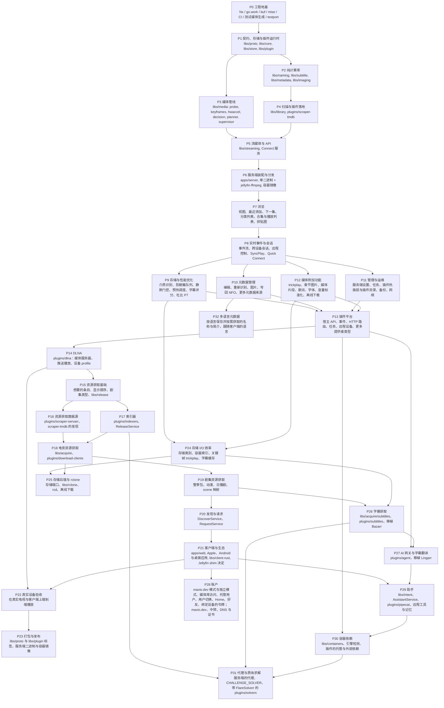

# Mavio 路线图

> [English](roadmap.md) | 简体中文

> 相关文档：[架构](architecture.zh-CN.md) · [领域模型](domain.zh-CN.md) · [开发指南](development.zh-CN.md) · [测试策略](testing.zh-CN.md) · [存储与性能优化](optimization.zh-CN.md) · [AGENTS.zh-CN.md](../AGENTS.zh-CN.md)

---

## 1. 推进原则

* **自底向上**：先实现零业务依赖的底层库，再逐层向上组装；每一层只依赖已完成的下层。
* **完成标准**：一个阶段的库通过各自的测试即为完成，包括全部移植的测试用例（或有明确标记、写明原因的 skip），见[测试策略 §2](testing.zh-CN.md#2-移植测试用例)。
* **服务端优先**：P7 至 P12 对照 Jellyfin 服务端（其 API 控制器与元数据提供者）补全服务端；P13 与 P14 让插件能力与 Jellyfin 对齐并加入 DLNA；P15 至 P20 加入资源获取，即 Seerr、Radarr、Sonarr 与 Prowlarr 在 Jellyfin 旁所做的事（[架构 §13](architecture.zh-CN.md#13-资源获取libsacquire)）；客户端在 P21 构建，其基础部分基于已完成的浏览与播放 API，与 P19、P20 并行；P22 在真实设备上端到端验证播放；P23 打包并发布版本。
* **集成冒烟**：从 P1 起，每个阶段结束时在 `apps/server/internal/smoke` 增加一个把已完成的库串起来的集成测试。它不是 MVP，只用来尽早暴露接口漂移，降低自底向上方式"后期集成才发现问题"的风险。

---

## 2. 阶段总览

| 阶段 | 主题 | 状态 |
| :--- | :--- | :--- |
| P0 | 工程地基 | ✅ 已完成 |
| P1 | 契约、存储与插件运行时 | ✅ 已完成 |
| P2 | 纯计算库 | ✅ 已完成 |
| P3 | 媒体管线 | ✅ 已完成 |
| P4 | 扫描与插件落地 | ✅ 已完成 |
| P5 | 流媒体与 API | ✅ 完成 |
| P6 | 服务端装配与分发 | 进行中 |
| P7 | 浏览 | ✅ 已完成 |
| P8 | 实时事件与会话 | ✅ 已完成 |
| P9 | 存储与性能优化 | ✅ 已完成 |
| P10 | 元数据管理 | ✅ 完成 |
| P11 | 管理与运维 | ✅ 完成 |
| P12 | 媒体附加功能 | ✅ 完成 |
| P13 | 插件平台 | ✅ 完成 |
| P14 | DLNA | ✅ 完成 |
| P15 | 资源获取基础 | ✅ 完成 |
| P16 | 资源获取数据源 | 进行中 |
| P17 | 索引器 | ✅ 完成 |
| P18 | 电影资源获取 | ✅ 完成 |
| P19 | 剧集资源获取 | ✅ 完成 |
| P20 | 发现与请求 | ✅ 完成 |
| P21 | 客户端与生态 | 进行中 |
| P22 | 真实设备验收 | 未开始 |
| P23 | 打包与发布 | 未开始 |
| P24 | 存储 I/O 效率 | ✅ 完成 |
| P25 | 存储后端与 rclone | 进行中 |
| P26 | 字幕获取 | ✅ 完成 |
| P27 | AI 网关与字幕翻译 | 进行中 |
| P28 | 账户 | 进行中 |
| P29 | 助手 | 进行中 |
| P30 | 容器依赖 | 进行中 |
| P31 | 代理与质询求解 | 进行中 |
| P32 | 多语言元数据 | 进行中 |

---

## 3. 阶段详情

### P0 工程地基
**范围**：仓库骨架、mise、Nx、go.work、buf、golangci-lint + depguard；CI 矩阵（linux amd64/arm64、macOS、Windows）；`tools/fixtures`、`tools/testport`。

**完成标准**：`nx affected` 可用；`tidy-check`（`GOWORK=off`）通过。

**进度**：
- [x] Go 模块骨架与 `go.work`；Nx 及本地插件 `tools/nx-go`（自动推断项目与依赖图）
- [x] mise 锁定工具链版本
- [x] buf 与首个契约 `mavio.system.v1.SystemService`；`apps/server` 提供 Connect 健康检查接口
- [x] golangci-lint 与 depguard 依赖方向规则
- [x] CI 工作流：受影响项目检查、生成代码一致性检查、`buf breaking`、多平台测试矩阵
- [x] `tools/fixtures`：测试媒体生成
- [x] `tools/testport`：Jellyfin 测试用例提取

### P1 契约、存储与插件运行时
**范围**：`proto` 契约初版；`core` 领域模型；`store`（ent + Atlas + sqlc，双方言）与任务队列；`plugin` 两种运行时与握手。

**完成标准**：仓储一致性测试在 SQLite 与 PostgreSQL 上均通过；插件崩溃不影响宿主，并能自动重启。

**进度**：
- [x] `libs/core`：领域模型与仓储端口（[领域模型](domain.zh-CN.md)）
- [x] `libs/proto`：第一版契约（library、user、system、plugin）
- [x] `libs/store`：仓储端口的 SQLite 与 PostgreSQL 实现，包括任务队列
- [x] `libs/plugin`：WASM 与子进程两种运行时
- [x] 冒烟测试 `apps/server/internal/smoke`：排队的元数据刷新任务从插件（两种运行时）取得元数据，连同署名一起写入存储，并能被搜索到

### P2 纯计算库
**范围**：`naming`、`subtitle`、`metadata`（NFO）、`imaging`。

**完成标准**：对应的移植用例全部通过。

**进展**：
- [x] `libs/naming`：Jellyfin 的命名规则，覆盖电影、剧集、季、剧集系列、分段、多版本、附加内容、音乐、有声书、图书与外部文件；移植用例全部通过或带原因跳过
- [x] `libs/subtitle`：SRT / SSA / ASS / WebVTT 解析，转换为 SRT / SSA / ASS / WebVTT / TTML / JSON，按时间窗口过滤，以及字符集检测
- [x] `libs/metadata`：读取电影、视频、音乐视频、剧集、季、单集（含多集文件）、专辑与艺人的 NFO；从 URL 中识别提供者 ID；电影 NFO 的位置。写入 NFO 留到保存元数据的阶段。
- [x] `libs/imaging`：Jellyfin 的尺寸规则、缩小时带锐化的缩放、图片格式与 SVG 安全检查。WebP 编码与占位图（blurhash / thumbhash）随 P5 的图片 API 实现，拼贴图随 P7 的浏览实现。
- [x] 冒烟测试 `apps/server/internal/smoke`：解析一集的文件名，读取 NFO，连同署名写入存储并能查到；字幕转换为 WebVTT，海报缩放

### P3 媒体管线
**范围**：`probe`、`keyframes`、`hwaccel`、`decision`、`planner`、`supervisor`。

**完成标准**：StreamBuilder 与 EncodingHelper 的移植用例全部通过；在现有硬件（维护者自己的机器与 GitHub 托管的 CI runner）上的真实转码冒烟测试通过；没有对应硬件的厂商路径只由移植的参数推导用例覆盖。

**进展**：
- [x] `probe`：按 Jellyfin 的方式规范化 ffprobe 输出，包括杜比视界、HDR10+ 与范围类型；移植用例全部通过
- [x] `keyframes`：从 ffprobe 数据包标志得到关键帧时间
- [x] `hwaccel`：版本检查，编解码器、滤镜与选项清单，VideoToolbox 试编码，VA-API 驱动检查
- [x] `decision`：用 `ClientCapabilities` 替代 `DeviceProfile` 的 StreamBuilder 与流选择；StreamBuilder 的 307 个用例全部通过
- [x] `planner`：滤镜图 IR，CMAF HLS 与渐进式命令；软件与 VideoToolbox 策略；EncodingHelper 的移植用例全部通过
- [x] `supervisor`：生命周期、空闲回收、节流、进度、已提供分片
- [x] 冒烟测试 `apps/server/internal/smoke`：一个 HDR10 HEVC 文件经过探测，被有能力的客户端直放，并在监管下为网页客户端从拖动位置转码为 H.264 HLS
- [x] 在 GitHub 托管 runner 上的真实转码（CI 任务 `media`，Linux 与 macOS）

### P4 扫描与插件落地
**范围**：`library` 扫描器（全量对账，见[架构 §9](architecture.zh-CN.md#9-媒体库扫描与变更检测libslibrary)）、解析器链、任务调度；`plugins/scraper-tmdb`（WASM）。

**完成标准**：库解析器移植用例通过；扫描结果在两种数据库上一致；新增 / 删除 / 重命名 / 内容修改 / 挂载点暂时不可用等场景下，对账都收敛到正确状态。

**进展**：
- [x] 逐文件夹的解析器链：电影、剧集、音乐、图书、家庭视频与照片、附加内容、`.ignore` 文件；解析器移植用例通过
- [x] 扫描器：扫描世代，缺失条目保留并在宽限期后清除，按修改时间与文件 ID 剪枝文件夹，无法读取的文件夹保留其条目
- [x] 任务：扫描、探测与元数据刷新在任务队列上运行，带租约与定时扫描
- [x] `plugins/scraper-tmdb`：从 TMDB 获取电影、剧集、季与集；`TmdbUtils` 移植用例通过，缺失剧集用例在虚拟剧集进入领域模型前跳过
- [x] `apps/server` 中的适配器：元数据插件作为提供者，ffprobe 作为探测器
- [x] 冒烟测试 `apps/server/internal/smoke`：以 WASM 插件为提供者，把一个电影库和一个剧集库作为任务扫描；新增、删除、重命名、重写文件与媒体库文件夹不可用的情况下，SQLite 与 PostgreSQL 上收敛到相同状态

### P5 流媒体与 API
**范围**：`streaming`（CMAF HLS、按需分片、seek、分片缓存）；Connect 服务（库、播放、用户、系统）。

**完成标准**：HLS 移植用例通过；hls.js 与 AVFoundation 实机播放验证。Media3 在 P21 中随 Android 客户端验证。

**进度**：
- [x] `libs/streaming`：覆盖整个媒体源的播放列表、RFC 6381 编解码器字符串、按需生成分片并在拖动时重启、直接复制视频的分片由每个图像组一个文件拼接而成；HLS 移植用例通过
- [x] 认证：首个管理员、按设备登录并以散列保存访问令牌、argon2id 密码、`mavio.auth.v1.AuthService`、Bearer 令牌与请求校验拦截器
- [x] 播放：`mavio.playback.v1.PlaybackService` 及直接播放与 HLS 转封装、转码的媒体端点，记住的与偏好的流，续播位置与已播放状态；用真实 ffmpeg 端到端验证
- [x] 字幕交付：文本字幕以转换后的文件交付（来自外挂文件或由 ffmpeg 提取），以及 HLS 字幕轨
- [x] 媒体库、条目与用户的 Connect 服务；服务端运行媒体库任务
- [x] 图片端点：本地与提供者的图片，按 Jellyfin 的尺寸规则缩放并缓存
- [x] 与客户端协商的 WebP 编码（`gen2brain/vpx`）；在媒体库任务中计算 blurhash / thumbhash 占位图
- [x] 通过开发用播放器在 Chromium 的 hls.js 上验证播放：直接串流、转码、拖动并重启转码、同步的 HLS 字幕轨、进度与停止
- [x] 通过开发用播放器在 Safari 的原生 HLS（即 AVFoundation）上验证播放：直接串流、转码、拖动并重启转码、同步的 HLS 字幕轨。HLS 字幕轨是按视频分片切分、不带 `X-TIMESTAMP-MAP` 的 WebVTT；若有播放器错位，则按视频的时间戳推算并加上该头

### P6 服务端装配与分发
**范围**：`apps/server` 装配；`CGO_ENABLED=0` 交叉编译；容器镜像内置 jellyfin-ffmpeg 的便携版，即 `mise.toml` 锁定的那一份。镜像发布属于 P23。

**完成标准**：端到端冒烟测试：扫描 → 刮削 → 播放决策 → HLS 播放。

**进度**：
- [x] 装配位于 `apps/server/internal/server`，`cmd/mavio` 以命令行参数运行它
- [x] 从插件目录（`--plugin-dir`）启动插件；插件配置经 `SystemService` 保存、按清单的 schema 校验并即时生效，无需重启；元数据插件就绪后参与媒体库刷新
- [x] 端到端测试：通过 API 测试装配好的服务端，使用真实 ffmpeg 与 WASM 元数据插件：管理员配置插件，扫描媒体库，刮削其中的影片并以 HLS 直接串流播放
- [x] `CGO_ENABLED=0` 交叉编译到 Linux、macOS、Windows 的 amd64 与 arm64（`server:dist`），并在 CI 中检查
- [x] 内置 jellyfin-ffmpeg 便携版的 linux/amd64 与 linux/arm64 容器镜像，在 CI 中构建并运行
- [x] 杜绝残留进程（[架构 §11](architecture.zh-CN.md)）：进程插件在读到 stdin 结尾时停止，其写端由服务端持有；服务端把自己与其子进程（插件、rclone、ffmpeg）记录在 `<home>/run` 下，监听前结束同一主目录中仍在运行的服务端，启动任何东西前结束遗留的子进程；对账停止插件未在运行的容器
- [ ] 在 Windows 上把子进程放入设置了 `JOB_OBJECT_LIMIT_KILL_ON_JOB_CLOSE` 的 Job Object，使其即使不理会 stdin 也随服务端结束，如同 Linux 上的 `Pdeathsig`

### P7 浏览
**范围**：客户端列出与打开的内容。

- 用户的媒体库视图；各媒体库的最近添加；继续观看与剧集的下一集
- 剧集、季与单集；专辑与艺人
- 带条目数的类型、工作室、人物与年份列表，`libs/store` 已有这类查询
- 合集与播放列表：创建、编辑、排序与删除；领域模型中已有这两者
- 媒体库与合集拼贴图
- 按用户与客户端保存的显示偏好，由服务端保存，因而随用户跨设备
- 继承的分级

**完成标准**：通过 API 的端到端测试：通过视图、最近添加、下一集与类型浏览扫描过的电影与剧集媒体库，创建一个播放列表，且分级高于用户上限的剧集中的单集不可见。

**进度**：
- [x] 继承的分级：未分级的条目取最近一个有分级的祖先的分数，由存储层在每次写入时推导，并为已有数据库回填；分级过滤与访问检查使用它
- [x] 分级分数：元数据刷新用 Jellyfin 的分级体系把内容分级映射为分数（`metadata.RatingScore`，移植用例通过）；条目与权限策略的最高分级中，未分级为 nil 而非零
- [x] 带条目数的类型、标签、工作室、艺人、年份与人物列表（`ItemService.ListValues`、`ListPeople`），只统计用户可访问的条目
- [x] 与 Jellyfin 一样按剧集、季与专辑分组的最近添加（`ListLatestItems`），以及按播出顺序插入特别篇的下一集（`ListNextUp`）；条目响应给出单集所属的剧集与季、曲目所属的专辑。继续观看即带 `resumable` 并按最近播放排序的 `ListItems`
- [x] 合集（`CollectionService`，由管理员整理）与播放列表（`PlaylistService`，每个用户各自的，条目项可重复且可移动），位于服务端创建的整理类媒体库中；以它们为 parent 通过 `ListItems` 列出其中的条目
- [x] 按用户、客户端与视图保存的显示偏好（`DisplayPreferencesService`），名称与值由客户端决定
- [x] 媒体库、合集与播放列表的拼贴图（`/images/collages/{id}`、`imaging.Collage`），不绘制文字
- [x] 扫描为新增的无媒体条目（剧集、季、专辑）刷新元数据，此前只有媒体文件的探测才会触发刷新
- [x] 通过 API 测试装配好的服务端的端到端测试（`internal/server`、`TestBrowsing`）：扫描电影与剧集及其 NFO 文件，并通过视图、最近添加、下一集与类型浏览；限于 PG 的用户创建播放列表，且看不到 TV-14 剧集的任何单集

### P8 实时事件与会话
**范围**：客户端无需询问即可得知的变化，以及一台设备对另一台设备的操作。

- 事件：每个已登录设备一条事件流，传递媒体库变化、用户在其他设备上的播放状态与进度、任务进度与插件状态
- 会话：每台设备正在播放的内容；从一台设备远程控制另一台（播放、暂停、拖动、停止、消息）
- 同步观看（SyncPlay）：组内共享同一播放状态，等待正在缓冲的成员
- 用已登录设备让新设备登录（Quick Connect）

**完成标准**：通过 API 的端到端测试：一台设备在扫描后收到媒体库变化及另一台设备的进度，并控制那台设备的播放；同一 SyncPlay 组的两台设备保持在同一位置。涉及计时的逻辑用 `testing/synctest` 测试。

**进度**：
- [x] 事件流（`EventService`）：媒体库变化、条目状态、会话、命令、扫描与插件，每个设备只收到其用户可见的内容；存储层被观察，写入在提交后到达各流
- [x] 会话（`SessionService`）：设备在事件流打开期间在线、各设备正在播放的内容、远程命令
- [x] Quick Connect（`AuthService`）：在已登录设备上输入新设备的代码，使其登录
- [x] SyncPlay（`SyncPlayService`）：设备分组以同一位置播放同一队列，并等待缓冲中的成员，与 Jellyfin 相同；计时逻辑用 `testing/synctest` 测试
- [x] 通过 API 测试装配好的服务端的端到端测试（`internal/server`、`TestLiveEvents`）：电视得知扫描发现的影片以及手机的播放与状态，暂停手机，两者在 SyncPlay 分组中被告知在同一时刻、同一位置开始

### P9 存储与性能优化
**范围**：端到端 I/O 延迟抑制与预热调度（[存储与性能优化](optimization.zh-CN.md)）；语言/方言感知字幕评分；高保真视频管线增强；零模糊分发验证。

- 多维度存储介质与挂载协议识别：跨 Linux、Windows、macOS 原生识别本地 SSD、机械硬盘（Rotational HDD）、远程网络共享（SMB/NFS）以及云盘网盘（Dataless Mount）
- 物理驱动器防颠簸串行化（`VolumeLedger`）：为机械硬盘建立单并发车道，消除扫描与探测时的多任务随机寻道竞争
- 前台流媒体播放静默门控（`QuietGate`）：前台活跃播放期间自动对后台扫描与磁盘维护任务实施避让降级与暂停
- 写入中未完成文件检测策略（`GrowthPolicy`）：基于写入窗口与尺寸稳定性轮询，避免扫描未下载完成的文件
- 投机式索引与元数据预热调度（`PrefetchHeadTail`）：利用 Linux `posix_fadvise` 与跨平台顺序分块回退，精准预热容器头部元数据与尾部索引
- 字幕评分与方言归一化：语言评分矩阵、中文别名与变体（繁简、地区方言）归一化，以及听障/特效字幕降权
- 高保真视频管线适配：杜比视界 Profile 7 双层 EL 提取与回退色调映射；黑边检测（`cropdetect`）集成
- 分发验证与安全不变量：锁定依赖零模糊验证与隐私防泄漏失败关闭测试

**完成标准**：存储识别、并发串行化、静默门控与预热调度在 Linux、Windows、macOS 上的单元测试与集成测试全部通过；媒体库扫描在机械硬盘上保持顺序吞吐；播放启动干净打断后台 I/O；字幕评分正确匹配中文各方言变体。

**进展**：
- [x] 多维度介质与协议识别：`libs/library/storage` 原生实现 Linux（`sysfs`/`st_dev`）、macOS（`statfs`/`fsid`）与 Windows（`GetDriveType`/`IOCTL_STORAGE_QUERY_PROPERTY`）
- [x] 驱动器防颠簸串行化：`VolumeLedger`，每个卷一个先来先得的槽位
- [x] 前台播放静默门控：`QuietGate`，由前台活动延长、后台读取等过的静默截止时间
- [x] 写入中文件检测：`GrowthPolicy` 排除带下载后缀或在写入窗口内修改过的文件并推迟它们；`Scanner.RunDeferred` 在被推迟的文件稳定或消失后重新扫描其媒体库
- [x] 投机式预热调度器：`PrefetchHeadTail` 在 Linux 上使用 `posix_fadvise(WILLNEED)` 并支持跨平台顺序分块预热回退
- [x] 将 `libs/library/storage` 接入扫描与探测：每个文件夹的设备只识别一次（`storage.Detector`）；只对有寻道代价的驱动器以及远程或云端卷串行化，在这些设备上遍历器一次读一个文件夹，每次列目录与探测都占用该设备；同一磁盘上多个版本的探测不再等待自己
- [x] 播放中的 `QuietGate` 与预热：与 khuaplayer 的前台存储门禁一样，开始播放与每个媒体请求都延长静默窗口，而不是在整个播放期间挡住后台 I/O
- [x] 字幕评分与中文别名归一化：扫描把外挂字幕文件附加到其视频，语言取自文件名（含中文变体），并按评分模型排序；播放选择按规范化后的别名匹配偏好语言
- [x] 杜比视界 Profile 7：仅凭配置识别的独立增强层轨道从不被选为视频；HDR10 客户端得到去掉杜比视界元数据的基础层
- [x] 黑边裁剪：通过采样帧找出黑边（`libs/media/borders`、任务 `media.borders`），记录在视频流上，规划器重新编码时裁掉
- [x] 锁定依赖：`mise.toml` 按平台锁定 jellyfin-ffmpeg 的 SHA-256，并由测试与 Dockerfile 中的锁定比对
- [x] 卷保活：`storage.Keeper` 以绕过缓存的心跳读（`VolumeHeartbeat`）保持进行中播放的卷、以及在场用户“继续观看”媒体的卷（`internal/warming`）不休眠，并在客户端打开条目时唤醒其卷
- [x] 续播延迟：播放从请求位置之前至多 5 秒的关键帧或分段起点开始（`StartPlaybackResponse.start_position`），HLS 在播放开始时即从该处启动 ffmpeg，并预读其附近的媒体
- [x] 每个存储机制的落地对照索引及其与 Jellyfin 的差异（[优化 §1.9](optimization.zh-CN.md)）

### P10 元数据管理
**范围**：修正与补全媒体库扫描得到的内容。

- 编辑条目并锁定字段；对照提供者重新识别条目；刷新单个条目
- 列出提供者的图片；选择、上传与删除图片
- 把 NFO 文件与图片写到媒体旁（`libs/metadata` 目前只读取 NFO 文件）
- 以插件形式提供的元数据来源：音乐与图书（MusicBrainz、TheAudioDB）、更多图片（fanart.tv）、字幕下载
- 按提供者的合集自动创建电影合集

**完成标准**：通过 API 的端到端测试：管理员重新识别一部识别错误的影片并编辑它，锁定的字段在刷新后保持不变，选定的海报写到文件旁并被新的扫描读回。

**进展**：
- [x] `MetadataService`：按更新掩码编辑条目（包括锁定）；刷新单个条目，可选择替换其元数据；搜索提供者并重新识别条目
- [x] 图片：列出提供者的图片；按 URL 选择或上传图片；删除图片及其文件；选定的图片保存在媒体旁或元数据目录（`--metadata-dir`）
- [x] 本地元数据：`metadata.WriteNFO`，可被 `ParseNFO` 读回；保存本地元数据的媒体库写出 NFO 文件，并按 Jellyfin 的本地图片命名保存提供者的图片
- [x] 提供者插件：`scraper-musicbrainz`（艺术家、专辑、音轨，Cover Art Archive）、`scraper-theaudiodb`、`scraper-openlibrary`（图书与有声书）、`scraper-fanart`；字幕提供者契约（`SubtitleProviderService`）与 `subtitles-opensubtitles`，下载的字幕保存在视频旁
- [x] 按提供者的合集自动创建电影合集（`AutoCollections`）
- [x] 端到端测试（`apps/server/internal/server/metadata_test.go`）

### P11 管理与运维
**范围**：运行服务端时无需重启或修改命令行参数。

- 服务端设置保存在数据库中并通过 `SystemService` 设置，把管理员需要在运行时修改的项从命令行参数中接过来；先做转码设置（由管理员选择硬件加速、编码器预设、色调映射、转码目录）
- 浏览服务端目录以选择媒体库路径
- 任务：列出计划任务及其最近一次运行，立即运行某个任务
- 插件热插拔：安装、升级、卸载插件都不需要重启服务端，即[架构 §7.3](architecture.zh-CN.md#73-子进程运行时)所述。目前插件目录只在启动时读取，只有配置修改无需重启
- 可安装与升级插件的插件目录；服务端接入认证与通知插件，其契约（`AuthProvider`、`Notifier`）已经存在
- 供集成使用的 API key、活动日志、服务端日志、备份与恢复、本地化数据（国家、语言、分级体系）
- 网络：使用配置证书的 HTTPS、反向代理下的 base URL、局域网内的服务端发现

**完成标准**：通过 API 的端到端测试：管理员修改一项转码设置，下一次转码即按其执行；服务端持续提供服务的同时从插件目录安装、升级并卸载一个插件；备份恢复到一个新的服务端。

**进展**：
- [x] 服务端设置保存在数据库中，立即生效，某部分拒绝时回滚：转码（硬件加速、编码预设与质量、色调映射、去隔行、缩混、裁剪、转码目录）、网络、插件目录
- [x] 文件夹浏览；任务及其上次与下次运行、立即运行；作业队列；每日清理已结束的作业
- [x] 从插件目录热插拔插件：安装、可回滚的升级、卸载；服务端使用认证与通知插件
- [x] API 密钥；发送给通知插件的活动日志；最近的服务端日志
- [x] 备份与恢复（在两种数据库上的 `store.Dump` 与 `store.Restore`，以及图片与插件）
- [x] 本地化数据：国家、语言、分级体系；移植的 Jellyfin 本地化用例通过（翻译除外）
- [x] 网络：基础 URL、使用配置证书的 HTTPS、局域网发现
- [x] 端到端测试（`apps/server/internal/server/admin_test.go`）
- [x] 服务器所在电脑的负载（CPU、内存、磁盘、网络），管理员查看时采样，显示在概览中
- [ ] 负载中的 GPU（硬件转码时的占用与显存）、温度，以及笔记本上服务器的电池：没有不依赖 CGO 的跨平台方法，待评估厂商工具（`nvidia-smi`）或逐平台读取

### P12 媒体附加功能
**范围**：播放媒体流之外的媒体功能。

- 预览缩略图（trickplay，[架构 §6.1](architecture.zh-CN.md#61-需求与实现方案)）与章节图片
- 来自媒体片段提供者插件的媒体片段（片头、片尾）
- 歌词；供客户端渲染 ASS 字幕的内嵌字体；音量标准化
- 渐进式转码与离线下载（§4）

**完成标准**：用真实 ffmpeg 的测试生成 trickplay 拼图与章节图片，并下载、播放一个渐进式转码的文件；Jellyfin 有对应用例的部分，移植用例通过。

**进展**：
- [x] 缩略图拼图与章节图片（`libs/media/thumbnails`，任务 `media.trickplay` 与 `media.chapters`），按检测到的黑边裁剪，带失败熔断；从元数据目录提供
- [x] 来自片段提供者插件的媒体片段（`MediaSegmentProviderService`，任务 `media.segments`）
- [x] 歌词（`metadata.ParseLyrics`；Jellyfin 的 ELRC 用例通过），通过 `ItemService.GetLyrics` 提供；向客户端提供字体附件；音轨与专辑的响度（`media.loudness`）作为归一化增益
- [x] 渐进式转封装与转码；下载文件本身或渐进式转码结果
- [x] 使用真实 ffmpeg 的端到端测试（`apps/server/internal/server/extras_test.go`）

### P13 插件平台
**范围**：让 Mavio 两种运行时的插件都能做到 Jellyfin 插件能做的事（频道与直播电视除外）（[插件平台](plugins.zh-CN.md)）：带作用域、可代表用户的宿主 API；面向消费者的事件，以及发给通知插件的全部活动；HTTP 路由；任务与数据目录；远程设备；图片、歌词、本地元数据、保存器、处理器、解析器、片头、图片生成器、媒体源与密码重置提供者；外部 ID 声明；按媒体库的提供者顺序。

**完成标准**：为两种运行时构建的测试插件在端到端测试中通过装配好的服务端使用每一种能力；契约与 SDK 有文档。

**进度**：
- [x] 宿主 API：作用域、代表用户、两种运行时的传输
- [x] 数据目录；任务
- [x] 事件：[插件平台 §4](plugins.zh-CN.md#4-事件) 的事件类型、事件消费者、通知插件
- [x] HTTP 路由
- [x] 远程设备；代表设备
- [x] 图片、歌词、本地元数据、保存器与处理器提供者；外部 ID
- [x] 解析器、片头提供者、图片生成器、媒体源提供者、密码重置
- [x] 按媒体库的提供者顺序
- [x] 端到端测试（使用真实 ffmpeg 的 `apps/server/internal/server/capabilities_test.go` 与 `plugins_test.go`），覆盖两种运行时
- [x] 开发插件（[插件平台 §13](plugins.zh-CN.md#13-开发插件)）：`--plugin-dev` 原地运行项目，文件夹变化时及 `RestartPlugin` 重启；`dev` 目标在源码变化时重新构建；插件页面显示各插件的日志
- [ ] 调试开发中的插件（为进程插件附加调试器、编辑器的启动配置）：待 Mavio 的 CLI 出现后再决定

### P14 DLNA
**范围**：`plugins/dlna`，第一方进程插件（[插件平台 §10](plugins.zh-CN.md#10-dlnapluginsdlna)）：媒体服务器（SSDP、ContentDirectory、ConnectionManager、带 DLNA 头的媒体）、推送播放（发现渲染器、AVTransport 与 RenderingControl）、设备 profile；为服务端的每个平台构建，打包为目录插件包并内置于容器镜像。

**完成标准**：端到端测试在回环接口上用模拟的控制点与渲染器发现服务端、浏览媒体库、以 Range 请求播放文件，并驱动渲染器完成播放、暂停、跳转与停止且上报进度。在真实电视上的播放验证在 P22 进行。

**进度**：
- [x] SSDP 与设备描述
- [x] ContentDirectory 与 ConnectionManager
- [x] 带 DLNA 头的媒体与设备 profile
- [x] 推送播放
- [x] 构建、目录插件包与容器镜像（插件种子目录）
- [x] 端到端测试（`apps/server/internal/server/dlna_test.go`）

### P15 资源获取基础
**范围**：服务端在能"想要"自己没有的媒体之前所需的东西（[架构 §13](architecture.zh-CN.md#13-资源获取libsacquire)）。

- 想要的条目：元数据中已知、但还没有文件的电影与剧集，与[领域模型](domain.zh-CN.md) §4.7 的缺失条目分开；电影、剧集、季与单集的监控状态
- 剧集：TVDB ID、剧集类型（standard、daily、anime）与显示顺序，即 Jellyfin 的 `DisplayOrder` 加 TMDB episode groups
- `libs/release`：release 标题解析（标题、年份、季与集、绝对集数与日播日期、质量、来源、分辨率、编码、语言、版本、发布组），沿用 Radarr 与 Sonarr 解析规则的 .NET 语法，在 `regexp2` 上运行
- `tools/testport` 读取 NUnit 测试用例，使 Radarr 与 Sonarr 的解析用例能像 Jellyfin 的一样移植

**完成标准**：移植的解析用例通过或带原因跳过；P4 跳过的 `scraper-tmdb` 缺失剧集用例通过；剧集的单集按其显示顺序列出。

**进度**：
- [x] 虚拟条目与被监控条目（[领域模型 §4.8](domain.zh-CN.md#48-虚拟条目)）；集列表提供者（`EPISODE_LIST_PROVIDER`，[插件 §8.12](plugins.zh-CN.md#812-资源获取提供者)）；缺失剧集用例在 `libs/library` 中通过
- [x] 剧集类型、显示顺序与绝对集数；`scraper-tmdb` 按剧集的 TMDB episode group 给季与单集编号
- [x] `libs/release` 及 Radarr 与 Sonarr 的解析用例
- [x] `tools/testport` 读取 NUnit 测试用例
- [x] 监控剧集或更改其显示顺序会立即刷新它；端到端测试（`apps/server/internal/server/episodes_test.go`）

### P16 资源获取数据源
**范围**：资源获取所需的元数据，默认无需密钥。

- `plugins/scraper-servarr`（WASM）：Radarr 的电影元数据与列表、Sonarr SkyHook 中按 TVDB 编号的剧集与单集、scene 映射、日播剧、XEM
- `scraper-tmdb`：管理员未设置密钥时使用 Radarr 的 TMDB 只读访问令牌，TMDB 拒绝该令牌时使用 Mavio 自己的密钥；`DISCOVERY_PROVIDER`（趋势、热门、即将上映，按类型、制片公司、电视网、关键词与观看平台，推荐与相似作品）；episode groups

**完成标准**：在未配置任何密钥的情况下（包括 TMDB 拒绝 Radarr 令牌时）识别并刷新一部电影与一部剧集，剧集中想要的单集按 TVDB 编号，并按其 TVDB ID 挂上 TMDB 的单集元数据，TMDB 编号不同时亦然。

**进度**：
- [x] `scraper-tmdb` 无需密钥：使用 Radarr 的令牌，TMDB 拒绝后改用 Mavio 的密钥（由 `MAVIO_TMDB_KEY` 编入）
- [ ] 注册 Mavio 自己的 TMDB API 密钥，并在发布构建中设为 `MAVIO_TMDB_KEY`（需要项目的 TMDB 账号）
- [x] `scraper-tmdb` 的 `DISCOVERY_PROVIDER`
- [x] `plugins/scraper-servarr`：Radarr 的电影元数据与列表、SkyHook 的剧集与单集、scene 映射、日播剧、XEM
- [x] 端到端测试（`apps/server/internal/server/sources_test.go`）

### P17 索引器
**范围**：`plugins/indexers`，移植 Prowlarr 的第一方进程插件：Newznab、Torznab、Cardigann 引擎及 `indexers.prowlarr.com` 的定义、Prowlarr 以代码实现的全部站点、分类与能力、限速与退避、索引器代理（HTTP、SOCKS、FlareSolverr；自 P31 起为服务端的代理与质询求解器）。能力类型 `INDEXER_PROVIDER`；`ReleaseService` 搜索已配置的索引器，并用 `libs/release` 解析其结果。

**完成标准**：移植的 Prowlarr 用例通过；通过装配好的服务端，对 Newznab、Torznab、Cardigann 定义与代码实现站点的录制响应进行搜索，并解析为 release。

**进展**：
- [x] `INDEXER_PROVIDER` 契约（`mavio/plugin/v1/indexer.proto`）及其宿主客户端
- [x] Prowlarr 的用例与录制响应移植到 `plugins/indexers/testdata`
- [x] 数字、大小与日期解析（`internal/parse`）
- [x] 分类、能力与搜索条件（`internal/indexer`）
- [x] Newznab 与 Torznab（`internal/sites/newznab`、`internal/sites/torznab`）
  - [x] 搜索的时间与大小限制（`minage`、`maxage`、`minsize`、`maxsize`）：查询携带它们，Newznab 与 Torznab 发送它们，插件丢弃超出限制的发布；交互式的 `SearchReleases` 如 Prowlarr 的搜索那样接受它们
  - [x] 能力跨重启保存在插件的数据目录中，只在索引器的 URL 或 API 密钥改变或满一周后重新读取
- [x] Cardigann 引擎（`internal/sites/cardigann`）：从目录及其 `Custom` 子目录读取定义，模板、过滤器、HTML、XML 与 JSON 选择器，登录、搜索与下载
  - [x] 拉取并更新 `indexers.prowlarr.com` 的定义，由插件的装配完成
  - [ ] 手动解答验证码：目前没有界面展示图片验证码，自动登录遇到时失败
  - [x] 像 Prowlarr 的 GetCookies 那样，以 `cookie` 设置的 cookie 取代响应设置的 cookie
- [x] Prowlarr 以代码实现的站点，其标记为过时者除外
  - [x] Gazelle（`internal/sites/gazelle`）：AlphaRatio、BrokenStones、DesiGaane、DICMusic、GreatPosterWall、Secret Cinema；使用 API 密钥的 Orpheus、Redacted
  - [x] AvistaZ（`internal/sites/avistaz`）：AnimeZ、AvistaZ、CinemaZ、ExoticaZ、PrivateHD
  - [x] SpeedApp（`internal/sites/speedapp`）：RetroFlix、SpeedApp.io
  - [x] BroadcasTheNet（`internal/sites/broadcasthenet`），以 API 每小时 150 次调用作为其定义的默认限额
    - [x] 其发布的来源组、片源、容器、编码与分辨率，如同 Prowlarr 的 TorrentInfo 所保留
  - [x] FileList（`internal/sites/filelist`）
  - [x] HDBits（`internal/sites/hdbits`）
  - [x] PassThePopcorn（`internal/sites/passthepopcorn`）
  - [x] GazelleGames（`internal/sites/gazellegames`），在测试或首次下载时获取 passkey
    - [x] 其大小限制（`sizesmall`、`sizeslarge`），由查询的 `minsize` 与 `maxsize` 发送
  - [x] IPTorrents（`internal/sites/iptorrents`），使用浏览器的 Cookie 和 User-Agent 抓取其页面
  - [x] BitHDTV、HD-Torrents、ImmortalSeed、Libble、NorBits 和 PiXELHD（`internal/sites/<name>`），抓取其页面
  - [x] Headphones、Knaben、NzbIndex、RuTracker、TorrentPotato 和 TorrentsCSV（`internal/sites/<name>`）
    - [x] 像 Prowlarr 的 NzbValidationService 那样，在转交前检查每个 Usenet 索引器下载的 NZB
    - [ ] RuTracker 的登录验证码：尚无界面显示它，自动登录会失败
  - [x] BeyondHD、M-Team TP、MyAnonamouse、Nebulance、Shazbat 和 TorrentDay（`internal/sites/<name>`）
    - [x] MyAnonamouse 的大小限制（`tor[minSize]`、`tor[maxSize]`），由查询的 `minsize` 和 `maxsize` 发送
    - [x] 像 Prowlarr 那样在测试 MyAnonamouse 前清除其 Cookie
  - [x] PreToMe、RevolutionTT、SceneHD、SpeedCD、TorrentBytes、TorrentSyndikat、Uniotaku 和 XSpeeds（`internal/sites/<name>`）
  - [x] AnimeBytes、Anidex、Anidub、BakaBT、SubsPlease 和 Toloka.to（`internal/sites/<name>`）
    - [x] 像 Prowlarr 那样将 AnimeBytes 的结果缓存三分钟
    - [x] Anidub 的分辨率，从每个种子的质量块读取（Prowlarr 从错误的元素读取，因而读不到）
  - [x] AvistaZ 与 SpeedApp 站点的 API 令牌跨重启保存在插件的数据目录中，如同 Prowlarr 将其存入设置
  - [x] torrent 索引器的做种设置：决策检查最少做种数，分享率、做种时间与整季包做种时间在抓取时交给下载客户端，如同 Radarr 与 Sonarr 的 SeedConfigProvider
- [x] 限速、退避与索引器代理（HTTP、SOCKS、FlareSolverr），在 P31 中由服务端的代理与质询求解器取代
- [x] `ReleaseService`（`mavio/acquisition/v1/release.proto`、`apps/server/internal/releases`）：列出各就绪提供方的索引器；如 Radarr 与 Sonarr 的 FetchReleases 那样逐级为媒体库中的电影、季或单集搜索（先按各索引器支持的 ID，再按标题），或按文本搜索；用 `libs/release` 解析 release
  - [x] 如 Sonarr 的 SearchAnimeSeason 那样逐集搜索动漫的季，每个已播出的单集按其绝对集数搜索
  - [x] Newznab 的 `title` 参数：如 Sonarr 那样，以原始标题发给支持它的索引器
  - [x] 剧集除标题外也按 scene 标题与映射（XEM）搜索，随 P19 完成
  - [x] 服务器保存索引器及其能力一小时，直到其插件重启或重新配置，搜索无需先列出索引器
- [x] 端到端测试（`apps/server/internal/server/releases_test.go`）：经装配好的服务器搜索 Newznab、Torznab、以 `indexers.prowlarr.com` 的方式提供的 Cardigann 定义以及 NzbIndex

### P18 电影资源获取
**范围**：`libs/acquire` 及其 `movie` 包，移植 Radarr；`plugins/download-clients`，包含 Radarr 与 Sonarr 支持的全部下载客户端的第一方进程插件。

- 质量定义与质量档案，每部被监控的电影、剧集与季一个档案；custom formats、delay profile 与 release profile
- 决策：Radarr 决策引擎的各项规格；排序
- 以作业执行的 RSS 同步与搜索；被跟踪下载的队列；远程路径映射
- 入库：完成的下载经 ffprobe 校验，按命名模板硬链接或移动进媒体库，并扫描其所在目录；升级到截止质量为止，被替换的文件移入回收目录；下载失败时加入黑名单并重新搜索
- 历史

**完成标准**：端到端测试在回环接口上模拟索引器与下载客户端：一部想要的电影被找到、发送、跟踪、入库并播放，随后被更好的 release 升级；失败的下载被加入黑名单并被替换。

**进度**：
- [x] `DOWNLOAD_CLIENT_PROVIDER` 契约（`mavio/plugin/v1/download_client.proto`）及其宿主客户端
- [x] `plugins/download-clients`：Radarr 与 Sonarr 的下载客户端，并移植其用例（`internal/clients/<name>`：Aria2、Torrent 与 Usenet Blackhole、Deluge、Download Station、Flood、Freebox、Hadouken、NZBGet、NzbVortex、Pneumatic、qBittorrent、rqbit、rTorrent、SABnzbd、Transmission、uTorrent、Vuze）
  - [x] 抓取时给出的做种限制保存在插件数据目录（`seeds.json`）中，重启后保留，如同 Radarr 保存其做种配置
  - [x] 下载客户端标签（`tags`）：电影或剧集只使用与其共享某个标签的客户端，否则使用无标签的客户端
  - [x] Flood 的附加标签（标题 slug、质量、语言、发布组、年份、索引器、制片公司或电视网、合集），取自抓取携带的信息
  - [x] Sonarr 对 Pneumatic 整季的拒绝，由抓取表明是否为整季
  - [x] release 未给出哈希的种子，若其哈希已被拉黑则被拒绝，仅针对设置为拒绝的索引器与非交互式搜索的 release，如同 Radarr 的 TorrentClientBase.EnsureReleaseIsNotBlocklisted；客户端得知的哈希随抓取记录
  - [x] 各客户端共用的辅助代码，取代各自的副本：远程路径拼接、.NET 版本解析、JSON-RPC 与 XML-RPC、URL base 校验、自由格式的标签字段、“发布被拒”与“发布被拉黑”错误、测试的警告、NZB 有效性检查、可配置的历史条数上限（`history_limit`）、保留客户端给出的 ID 大小写，以及把 `::1` 视为本机
- [x] `libs/acquire`：质量及其定义、质量档案、custom formats、delay profile、release profile
- [x] 决策：Radarr 决策引擎的各项规格及其排序，并移植其用例（`libs/acquire`）
  - [x] 按 ID 找不到索引器时按名称查找，如同 Radarr 的 AggregateLanguages
  - [x] 区分未知语言与任意语言（`release.Any`），如同 Radarr 的 Language.Unknown 与 Language.Any：要求任意语言的档案接受所有发布，要求 Unknown 的档案只接受语言未知的发布
  - [x] 索引器的标签，由索引器标签规格检查
- [x] 领域与存储：档案、custom formats、被跟踪下载的队列、历史、黑名单、远程路径映射、命名（`libs/core/acquisition.go`、`libs/store`）
  - [x] 质量档案的格式评分对照已有的 custom formats 进行检查，如同 Radarr 的 QualityProfileController：不得为不存在的格式打分或为同一格式打两次分，最低分必须可以达到；删除最后一个格式时重置各档案的格式分数，如同 Radarr 的 QualityProfileService
  - [x] 电影如 Radarr、剧集如 Sonarr 的默认质量档案（Any、SD、HD-720p、HD-1080p、Ultra-HD、HD - 720p/1080p），启动时该类型没有任何档案便添加（`Runtime.AddDefaultProfiles`）
- [x] 按 TMDB ID 把想要的电影加入媒体库，带质量档案与最低可用状态（`WantedService`、`apps/server/internal/acquisition`）
  - [x] 电影的数字版与实体版发行日期（来自 TMDB 的发行日期或 Radarr 的元数据），最低可用性如同 Radarr 的 Movie.IsAvailable 使用它们；没有这些日期的电影在首映 90 天后视为已发行
  - [x] 电影的原始语言，要求"Original"的档案取它，没有语言标记的发布即为该语言；原始语言未知的电影，档案接受任何语言
  - [x] 识别失败的电影保留其占位名称（"TMDB <id>"），由每日刷新想要的电影的作业再次刷新；该作业如同 Radarr 的 RefreshMovieService 与 ShouldRefreshMovie，刷新到期的电影：从未刷新、超过 180 天未刷新，或至少 12 小时未刷新且尚未发行或在最近 30 天内发行实体版
- [x] 以作业执行的电影搜索与 RSS 同步；通过 `DownloadService` 抓取；`SearchReleases` 给出决策
  - [x] 按电影的别名、译名与次要年份匹配发布，如同 Radarr 的 MovieService.FindByTitle 与 TryGetMovieBySearchCriteria
  - [x] 索引器的标签、必需标志、最少做种数与 MULTi 语言，由索引器插件按其配置提供
  - [x] 下载客户端的标签，以及优先级最高的客户端之间轮流使用，如同 Radarr 的 DownloadClientProvider.GetDownloadClient
  - [x] 索引器指定的下载客户端（`download_client_id`），其 release 总发送给它，如同 Radarr 的 IndexerDefinition.DownloadClientId；索引器指定的客户端不存在时，release 转为待定
  - [x] 某协议的客户端都因失败而暂被排除时，抓取仍尝试其中之一，如同 Radarr 的 DownloadClientProvider；只有因等待客户端恢复而待定的 release 继续等待
  - [x] 交互式搜索抓取的失败发布仅在开启 `AutoRedownloadFailedFromInteractiveSearch` 时重新搜索，如同 Radarr 的 RedownloadFailedDownloadService
  - [x] 在另一次 RSS 同步执行中时请求的 RSS 同步在其后再执行一次，而非被丢弃（在另一次待执行时请求的由那一次应答）：作业队列只对待执行的作业去重，且从不同时租用同一唯一 key 的两个作业
- [x] 队列：从客户端轮询的被跟踪下载
  - [x] 无法应答或因失败而暂被排除的客户端的下载保留最后状态，而非被标记
- [x] 入库、升级与回收目录
  - [x] 入库文件的质量由其文件名、下载文件夹名、发布名称与媒体信息汇总而成，分辨率以视频尺寸为准，如同 Radarr 的 AggregateQuality；文件名中的 MediaInfo 标记由入库时读取的文件写入
  - [x] 随电影入库的字幕按其语言、标签与副本编号命名，按视频文件名或电影标题与年份匹配，视频是下载中唯一的视频时全部采用，如同 Radarr 的 SubtitleService；升级替换的文件，其附加文件一并移入回收站
    - [x] 在数据库中记录附加文件（`core.ExtraFile`、`extra_files`），如同 Radarr 与 Sonarr 的 SubtitleFile 与 OtherExtraFile 表，涵盖电影与单集：入库时连同语言与标签记录它们，升级回收所记录的文件，而非按名称在旧文件旁查找的文件
  - [x] 手动导入跟踪中的电影下载的文件（`DownloadService` 的 `ListManualImport`、`ManualImport`）：列出其视频文件及入库将给出的质量与拒绝原因，并无视拒绝原因、按所选质量导入所选文件，如同 Radarr 的 ManualImportService
    - [x] 手动导入非跟踪下载的文件夹与文件（其文件按名称匹配想要的电影，否则以“Unknown Movie”拒绝）、为下载所属电影以外的电影导入文件，以及选择语言、发布组与导入方式（移动或复制），如同 Radarr 的 ManualImportService 与 ImportMode
  - [x] 在入库写入的电影文件夹（或其最近的已存在上层文件夹）所在的卷上检查剩余空间，而非媒体库文件夹，如同 Radarr 的 FreeSpaceSpecification
  - [x] 入库把电影移出下载文件夹后，若其中只剩样片与小 RAR 文件，则删除该文件夹，如同 Radarr 的 DownloadedMovieImportService.ShouldDeleteFolder；媒体库与远程路径映射的文件夹保留
  - [x] 只扫描电影入库写入的文件夹（`library.scan_folder`），而非其所在的整个媒体库
- [x] 失败的下载：黑名单与重新搜索
- [x] 获取作业（RSS 同步、队列检查、回收目录清理）列于 `TaskService` 的任务中，并可按需运行
- [x] 端到端测试（`apps/server/internal/server/acquisition_test.go`）：在回环接口上模拟 Newznab 索引器与 SABnzbd，经由索引器与下载客户端插件；一部想要的电影被搜索、抓取、跟踪、按 Radarr 的命名入库并播放，随后被 RSS 同步找到的发布升级，旧文件移入回收目录；失败的下载被加入黑名单，并由新的搜索替换
  - [x] 种子客户端（`torrent_acquisition_test.go`）：在回环接口上模拟 Torznab 索引器与 qBittorrent；磁力链接连同索引器的做种限制一起发送，仍在做种的下载以硬链接入库，关闭硬链接后的升级以复制入库，种子在达到限制暂停后连同文件一起移除
  - [x] 端到端测试中的远程路径映射：qBittorrent 所在另一台机器的目录映射为服务端的目录

### P19 剧集资源获取
**范围**：`libs/acquire/series`，移植 Sonarr：单集、整季与整剧搜索，整季包，多集文件，按绝对集数的动漫，按播出日期的日播剧，scene 映射与 XEM，新季与新集的监控。

**完成标准**：P18 的端到端测试换成剧集：想要的单集以单集和整季包的形式被找到，动漫与日播剧按其编号匹配，每一集入库后即可播放。

**进展**：
- [x] 决策：Sonarr 决策引擎的各项规格及其排序，并移植其用例（`libs/acquire/series`）
  - [x] 按 ID 找不到索引器时按名称查找，如同 Sonarr 的 AggregateLanguages
- [x] 按 Sonarr 的方式命名剧集文件、剧集与季文件夹（`libs/acquire/organize`）
- [x] 想要的剧集与单集：按 TVDB ID 加入剧集，带质量档案，监控新季与新集（`WantedService.AddSeries`、`apps/server/internal/acquisition`）
  - [x] 扫描在磁盘上找到的季与单集按 Sonarr 的 GetMonitoredStatus 监控：单集随其季，但第 1 季以外的第 0 集不监控；季随剧集的新季，但特别篇不监控
  - [x] Sonarr 的 `AutoUnmonitorPreviouslyDownloadedEpisodes`：扫描发现文件丢失的想要剧集的单集被取消监控，在此之前 RSS 同步跳过它们
  - [x] 每一集自己的上次搜索时间（`EpisodeState.LastSearchedAt`），在为其搜索了索引器时设置，并决定缺失单集批量搜索的顺序
- [x] 以作业执行的单集、整季与整剧搜索及 RSS 同步；通过 scene 映射、XEM、绝对集数与播出日期把发布匹配到单集（`libs/acquire/series`、作业 `acquisition.episode_search`，scene 映射由 `acquisition.scene_mappings` 刷新）
  - [x] 像 Sonarr 一样把 scene 编号保存在单集上（`EpisodeState`），并像 Sonarr 的 `XemService` 那样推算并标记为未验证；在剧集加入时以及随 scene 映射一同刷新
  - [x] 对设置了 `anime_standard_format_search`（Sonarr 的 `AnimeStandardFormatSearch`）的索引器，按季与集搜索动漫，按季搜索动漫整季包；同时按 ID 与标题搜索的 scene 映射
  - [x] 整部剧集的交互式搜索：如 Sonarr 的剧集搜索那样逐季搜索（特别篇除外），动画逐集搜索，发布如 RSS 那样决策
  - [x] 剧集与电影引擎使用服务器的日志记录器，而不是默认的
- [x] 单集、整季包与多集文件的入库；升级
  - [x] 剧集命名设置：是否重命名单集、单集文件格式、剧集、季与特别篇目录格式与多集样式，为空时使用 Sonarr 的默认值
  - [x] Sonarr 关于单集标题（含 `EpisodeTitleRequired` 设置）、解压中、未验证的 scene 编号、绝对集数与文件夹匹配的入库规格，以及其 scene 名称计算
    - [x] 下载客户端工作文件夹作为设置（`DownloadClientWorkingFolders`），默认为 Sonarr 的 `_UNPACK_|_FAILED_`
  - [x] 按 Sonarr 的 AggregateQuality 汇总单集文件的质量：来自文件、下载文件夹、下载与抓取的发布的名称，以及文件视频的画面尺寸
    - [x] 文件容器标题标签所示的来源，如 Sonarr 的 AugmentQualityFromMediaInfo 所读：探测把该标签与各流的标签分开保留（`ContainerTitle`），电影入库也读取它，如同 Radarr
  - [x] 在 Sonarr 与 Radarr 行为相同之处，单集入库与电影入库一致：按 Sonarr 的 FreeSpaceSpecification 对每个文件检查剧集文件夹所在卷的剩余空间；按 Sonarr 的 SubtitleService，字幕按语言、标签与副本序号命名，并按视频文件名或其名称所含的季与集匹配；被替换文件的附加文件一并回收；按 Sonarr 的 ShouldDeleteFolder，删除因移动而清空的下载文件夹；只扫描剧集文件夹
  - [x] 多集文件所涵盖的各集的历史记录在入库与扫描时由该文件的条目保留
- [x] 端到端测试（`apps/server/internal/server/series_acquisition_test.go`）：普通剧集的整季包与单集、以 scene 映射标题和绝对集数命名的动漫 release、以播出日期命名的日播剧 release 被找到，按 Sonarr 的命名入库并播放
  - [x] 端到端测试中的剧集 RSS 同步、多集文件与单集升级（`series_flows_test.go`）：RSS 同步抓取包含两集的 release 并作为一个文件入库，随后被另一个 release 升级
  - [x] 端到端测试中 XEM 的 scene 编号（`series_flows_test.go`）：按 scene 编号搜索索引器，以其命名的 release 按 TVDB 的编号入库
  - [x] 端到端测试中失败的单集下载、阻止列表以及替代它们的搜索（`series_flows_test.go`）
  - [x] `RunTask` 在未排入新作业时返回已排队的作业

### P20 发现与请求
**范围**：移植 Seerr。`DiscoverService` 列出发现提供者给出的内容，并标明已入库、想要或已请求；`RequestService`：电影与季的请求，由管理员审批或自动通过，按用户的配额，用户的分级限制同样作用于其可请求的内容，通知请求者；报告条目的问题。

**完成标准**：端到端测试：限制为 PG 的用户通过发现找到一部电影与一部剧集，无法请求分级超出限制的作品，请求其余作品；管理员审批；作品被获取，用户收到可播放的通知。

**进展**：
- [x] 领域与存储：请求及其季、问题及其评论、用户的请求权限与配额、服务器的请求设置（`libs/core/request.go`、`libs/store`）
- [x] `DiscoverService`：发现提供者的目录，其中的作品标明已入库、想要或已请求，并应用用户的分级限制（`apps/server/internal/requests`）
  - [x] 发现中的文本搜索（`DiscoverService.SearchTitles`），经发现提供者的 `SearchTitles`；scraper-tmdb 按 Seerr 的方式搜索，支持 `tmdb:`、`imdb:`、`tvdb:` 与 `year:` 前缀
  - [x] 剔除作品后的页数与总数：`hidden_results` 统计本页剔除的作品，`total_results` 为提供者的总数减去它们，仅一页时精确，否则为上限
  - [x] 除非用户策略屏蔽未分级作品，分级筛选保留未分级作品：仅当调用者指定分级或屏蔽未分级作品时才把分级交给提供者，否则由服务器自行分级筛选
  - [x] 作品详情，含其各季的状态（`DiscoverService.GetTitle`），如 Seerr 的电影与剧集详情
- [x] `RequestService`：按 Seerr 的方式检查电影与季的请求（权限、分级限制、配额、重复），自动或由管理员审批，经 `WantedService` 获取，其条目可用时完成（`requests.availability`）
  - [x] 为请求的动漫使用单独的质量档案与媒体库（`RequestSettings.AnimeQualityProfileID`、`AnimeLibraryID`），并作为动漫剧集添加，如 Seerr 的动漫设置
  - [x] Seerr 中作品的已阻止与已删除状态：阻止列表（`BlockTitle`、`UnblockTitle`、`ListBlockedTitles`、`core.BlockedTitle`）拒绝其中作品的请求；已完成请求的文件已不存在的作品为已删除，可再次请求
    - [x] Seerr 的阻止标签，按关键词自动阻止作品（`BlocklistedTags`、`BlocklistedTagsLimit`、每周的 `requests.blocklisted_tags` 任务，作品以 `BlockedTitle.Tags` 标记），以及阻止整个合集（`BlockCollection`、`UnblockCollection`，经由发现提供者的合集目录，由 `scraper-tmdb` 提供）
  - [x] 分级与名称使用服务器级元数据设置（`ServerSettings.Metadata`）的国家与语言，而非目标媒体库的
  - [x] 可用性作业列入任务列表（`TaskService`，“Sync request availability”）
- [x] `IssueService`：报告条目的问题，评论、解决与重新打开
- [x] 通知：所涉用户的活动，经 `ActivityService.ListMyActivities` 读取，由通知插件投递
  - [x] 向所涉用户的会话推送事件，待管理员处理的请求与问题也推送给管理员的会话（`NotificationReceived`）
- [x] 端到端测试（`apps/server/internal/server/requests_test.go`）：限制为 PG 的用户经 scraper-tmdb 发现一部电影与一部剧集，请求 R 级电影被拒，请求其余作品；管理员审批；作品被抓取、入库并播放，用户收到可播放的通知；用户报告的问题被解决
  - [x] 端到端测试中被拒绝的请求、耗尽的配额与重试的失败请求（`request_flows_test.go`）
  - [x] 端到端测试中修改待审批请求的季，以及请求全部季（`request_flows_test.go`）
  - [x] 端到端测试中对策略屏蔽未分级内容的用户隐藏未分级作品（`request_flows_test.go`）：从目录中略去，`GetTitle` 与请求被拒绝，并按分级向 TMDB 查询

### P21 客户端与生态
**范围**：基于完成的服务端 API 构建[客户端](clients.zh-CN.md)：内嵌于服务端的 Web UI（`apps/web`，在 `/` 提供）、面向 iPhone 与 iPad、Apple TV 与 Mac 的 Apple 应用（`apps/ios`、`apps/tvos`、`apps/macos`）、面向手机与平板及 Android TV 的 Android 应用（`apps/android`、`apps/android-tv`）、基于 MyGo、面向 macOS、Windows 与 Linux 的桌面应用（`apps/desktop`），以及它们共享的库（`libs/client-ts`、`libs/client-rust`、`libs/apple`、`libs/android`、`libs/design`）；决定是否采用 Jellyfin API 兼容垫片（shim）（[评估](jellyfin-compat.zh-CN.md)）。其基础部分不等待 P20：工具链与构建目标、从 `libs/proto` 生成的 TypeScript 与 Rust 代码、`libs/design`、§4 中客户端待决事项所列的原型，以及各应用与库的骨架。只有发现与请求页面等待 P20。基础部分以每个应用的一个切片收尾，在完成任何客户端之前一并验证共享核心、设计系统与该平台的播放器：登录两台服务器，显示合并的首页，打开条目详情，直接播放一个源并播放一个由服务端以 HLS 发送的源，上报进度并可继续播放。Web UI 与 iPhone 和 iPad 应用已超出其切片。之后选定先完成哪个客户端，其余随后。

**完成标准**：每个客户端同时登录两台服务器，显示一个合并了两者推荐行的首页，两台服务器都有的作品只显示一次；浏览媒体库，在两台服务器中搜索，打开条目并播放——直接播放，以及客户端需要时的转码——可选择音轨与字幕，上报进度并在另一个客户端上继续播放；从热门中请求一部作品，经批准、获取后显示为可观看；原生应用离线时以缓存内容启动，支持下载的应用离线播放已下载的条目。每个客户端的页面通过截图测试，`libs/design/parity.md` 中不再有计划中的功能。

**进度**：
- [x] 工具链与构建目标：`libs/client-rust` 中的 Rust 与 `tools/nx-cargo`；更新 Go、Node.js 与 pnpm
- [x] 从 `libs/proto` 生成 TypeScript 与 Rust（`@mavio/proto`、`mavio-api`）
- [x] `libs/design`：tokens、图标、字符串、组件规范与功能对齐表，为每个客户端编译
- [x] 服务端：`HubService`，提供首页与媒体库标签页的推荐行（`apps/server/internal/hub`），由 `Library.Hubs` 按媒体库选择
  - [x] 用户的首页布局：置顶的媒体库及其顺序、隐藏的推荐行，以类型化的 `User.Home` 保存，通过 `UpdateHomeLayout` 设置
  - [ ] Web UI 中编辑首页布局：置顶与排序媒体库、隐藏推荐行
  - [ ] 管理员推荐到首页的合集推荐行
  - [ ] 每种以种子生成的推荐行使用多个种子，如 Plex 显示多行"因为你看过"
- [x] 服务端：`ItemService.ListSimilarItems`，由 `ItemQuery.SimilarTo` 评分（`libs/store/items.go`）
  - [ ] 在本地结果之后，加入发现提供者给出、媒体库拥有的相似作品，如 Jellyfin 的远程相似条目提供者所做
- [x] 服务端：`ListItems` 以 `owner_id` 列出条目的附加内容（`ItemQuery.OwnerID`），在其详情中显示，预告片列入操作
- [x] Web 详情与 Seerr 同样丰富：附加内容、合集横幅、发现提供方的推荐、评分、关键词、更多主创，类型、关键词与制片厂打开媒体库中具有该值的条目
  - [x] Seerr 的各项信息：原始语言与数字版、实体版发行日期来自条目，播出网络即剧集的制片厂，预算与票房、剧集的下集播出日期与服务器所在国家的流媒体服务经 `GetTitle` 来自元数据提供者，发现的作品页同样显示
  - [x] 完整演职人员页面，如 Seerr 的"查看完整剧组"，从演职人员横向列表打开
  - [x] 发现的作品页如条目详情一样丰富，并使用客户端的语言：演职人员及其页面、预告片、合集、标语、关键词与剧组信息；附加内容中没有预告片的条目打开网上的预告片
  - [x] 发现的剧集展开一季显示其各集（`DiscoverService.GetSeason`），如 Seerr，各集列表保留六小时
  - [x] 如 Seerr 的人物页（`DiscoverService.GetPerson`，发现提供者的 `GetPerson`），从发现的作品的演职人员打开
  - [x] 如 Seerr 的合集页（`DiscoverService.GetCollection`，发现提供者的 `GetCollection`）：请求其电影，管理员可屏蔽它们
  - [x] 如 Seerr 的作品管理：就地批准与拒绝待审批的请求，状态旁的下载进度，列出其请求、下载、未解决的问题与屏蔽的“管理”面板，以及报告媒体库中该作品的问题
  - [x] 按 Seerr 页面布局的作品页：简介与主创旁是合集、TMDB 评分与信息，类型、关键词、语言、制片厂与播出网络打开其热门作品（`CatalogFilters.networks`）
  - [x] 作品页 TMDB 评分旁如 Seerr 的烂番茄与 IMDb 评分（`DiscoverService.GetRatings`、`RATINGS_PROVIDER` 能力、`plugins/ratings`）
- [x] 服务端：所有路由的跨域请求（`apps/server/internal/httpserver/cors.go`）
- [x] 服务端：`AuthService.GetAuthInfo` 与发现应答中带上服务端的 ID、名称和版本，客户端据此在任意地址上认出同一服务端
- [x] 服务端：`ListItems` 可按外部 ID 筛选（`ItemQuery.ExternalIDs`），客户端据此在其他服务端上找到同一作品的版本
- [x] 服务端：为调用者列出的条目带上其用户数据（`Item.user_data`），即客户端绘制条目、跨服务器合并“继续观看”所依据的进度、已播放标记和最近活动
- [ ] 原型：
  - [x] tvOS 上的 Rust：在 `nightly-2026-10-10` 上以 `-Zbuild-std` 构建，`mavio-api` 及其 `events` 示例可为 `aarch64-apple-tvos` 与 `aarch64-apple-tvos-sim` 构建，示例在 tvOS 模拟器中运行，TLS（rustls 与 aws-lc-rs）可构建
  - [x] connect-rust 与 `EventService` 的流：`libs/client-rust/api/examples/events.rs` 登录并打印设备的事件，在 macOS 与 tvOS 模拟器上均可运行
  - [x] macOS、iOS 与 tvOS 上的 AetherEngine 7.34.0：在 Mac 上，HDR10 Matroska 源经引擎重封装由 AVPlayer 播放、VideoToolbox 解码，并提高显示器的 EDR 余量；画中画在其 `AVPlayerLayer` 上启动，VP9、AV1 与 MPEG-2 走软件路径时则在其 `AVSampleBufferDisplayLayer` 上启动；ASS 轨道以原始事件行连同脚本头送达。iPad 与 Apple TV 模拟器以软件路径播放相同的源，iPad 模拟器在应用转入后台时在样本缓冲显示层上进入画中画
    - [ ] 在用户的设备上：iPad 上画中画内的画面（iPhone 上已检查）、Apple TV 上的 HDR10 与显示条件，以及杜比视界源
  - [x] 取自 fork `mavioai/AetherEngine` 分支 `v7.39.0-mavio` 的 AetherEngine 7.39.0：libdovi 链接进核心，由核心向引擎仅含头文件的 `Dovi` 模块导出其 C API，因此应用只链接一份 Rust 标准库；`MavioPlayer` 的测试与 iPhone 应用在没有 LibDovi 的情况下完成链接
    - [ ] TrueHD Atmos 对象音频（trait `TrueHDObjectAudio`）：以同样方式把 fork `mavioai/LibTrueHD` 的 `truehd-atmos-ffi` 链接进核心，待其专利授权问题解决后进行
  - [x] macOS 上的 MyGo 视频元素：MyGo 分叉 `mavioai/mygo` 的 `v0.5.5-mavio` 分支上的 `Window.NewVideoView` 与 `ui.Video`，附 MyGo 的单元测试与端到端测试；来自 mavio-deps 的 macOS 版 libmpv（`mpv-macos-0.41.0.g88eb9f2-1`），带有 Mavio 把它嵌入 `wid` 所指视图的补丁。以 purego 加载 libmpv 的原型在 MyGo 窗口中播放 SDR H.264 与 HDR10 HEVC，由 VideoToolbox 解码，`gpu-next` 运行在 MoltenVK 上，HDR10 以 PQ 输出；视频之上的 MyGo 控件接收点击；mpv 不打开自己的窗口
    - [ ] 播放中调整窗口大小、把窗口移到另一块屏幕，以及 HDR 显示器上的 HDR10
    - [ ] 把视频元素贡献给上游 MyGo，并把 mpv 补丁提交给 mpv，以便不再需要分叉与补丁
  - [ ] Windows 上带 HDR10 的 MyGo 视频元素，在有 Windows 机器时完成，于桌面应用在 Windows 上发布之前
  - [x] Android 上的核心：在 `libs/android/core` 的插桩测试（`ClientTest`，服务器与账户以运行器参数传入）中，Kotlin 绑定登录、经事件流上线、收到事件并送达首页，运行于 16 KB 页面的 Android 17 模拟器，64 位库按 16 KB 对齐。访问局域网中的服务器需要运行时权限 `ACCESS_LOCAL_NETWORK`
  - [x] Media3 播放服务端的 fMP4 HLS：Media3 1.11.1 拒绝早于零点开始的音频所写出的负 `tfdt`，因此服务端现在把这样的音频平移到零点。在 `libs/android/player` 的插桩测试（`HlsTest`，以运行器参数传入一次播放的主播放列表）中，ExoPlayer 播放一个音频转码为 AAC 的重封装，跨越分片，跳转到服务端重启转码之处并播放到结尾。除非应用允许，Media3 拒绝明文 HTTP
  - [x] Media3 的 FFmpeg 解码扩展，当前的 Media3 版本没有其发布的构件：`android-lib:ffmpeg` 按 LGPL 构建 FFmpeg 的音频解码器，并把 Media3 的 JNI 层与之链接，版本取版本目录中的 Media3，约需四分钟（CI 中缓存）。在 `libs/android/player` 的插桩测试（`FfmpegAudioTest`，以运行器参数传入文件）中，ExoPlayer 在模拟器上以它解码 DTS 与 TrueHD
  - [x] Android 上的 libmpv：以 mpv-android 的构建脚本与 JNI 层按锁定版本从源码构建（`android-lib:mpv`，三个 ABI 约需一小时，CI 中缓存），FFmpeg 与 mpv 按 GPL-3.0 构建。在 `libs/android/player` 的插桩测试（`MpvPlayerTest`，以运行器参数传入一个 Matroska 文件）中，Media3 `SimpleBasePlayer` 实现的 `MpvPlayer` 以 OpenGL ES 渲染到 `SurfaceView`；在 `MediaSession` 之后，控制器从某一偏移开始播放，看到其就绪并播放，暂停、跳转并播放到结尾；释放安全。模拟器上 MediaCodec 会使 libmpv 停滞，因此测试以软件解码
    - [ ] 在用户的设备上：MediaCodec 解码（`mediacodec`，以 `mediacodec-copy` 为后备），以及叠加在画面上的带样式 ASS 字幕
    - [ ] HTTPS 源：libmpv 的 TLS（mbedtls）需要 CA 文件，如 mpv-android 随附的那样（`tls-ca-file`）
  - [x] Apple 平台上的 libass：`apple:ass` 把 libass 0.17.5 及 FreeType、FriBidi 与 HarfBuzz 构建为面向 macOS、iOS、tvOS 及其模拟器的静态 XCFramework，以 Core Text 为字体提供者，耗时约四分钟（CI 中缓存）；应用链接它。`MavioPlayer` 中的 `ASSRenderer` 接收脚本头、作为内存字体的字体与 AetherEngine cue 中的事件行，把一帧的字幕渲染为 `CGImage`；其测试在 Mac 上按样式渲染一个事件以及一个 cue 的各行
  - [x] macOS 上的 Go 绑定：`mavio-capi` 导出 C ABI（`mavio_open`、`mavio_call`、`mavio_close`），以 `mavio.capi.v1` 的消息支持打开核心、其版本、探测、登录、事件流与服务器列表；Go 模块 `libs/client-rust/capi` 不经 cgo、以 purego 加载它。其测试（`capi:test`，`CGO_ENABLED=0`）在核心的线程上经同一回调收到应答与错误，其中包括同时进行的 200 个调用；在环境中给出服务器与账户时，登录、收到要保存的令牌，并跟随事件流直到 Connected
    - [ ] Linux 与 Windows：在其 runner 上运行同样的测试（Windows 上用 `syscall`），CI 运行之前未经验证
  - [x] 各平台的快照测试：`libs/design/snapshots/screens.json` 中的页面及其固定数据；Web 上用 Playwright 1.63，浏览器运行在其容器镜像中，以手机、平板与桌面尺寸绘制登录与首页；iOS 模拟器上用 swift-snapshot-testing 1.19，以 `MavioUI` 在 iPhone 与 iPad 上绘制首页；JVM 上用 Roborazzi 1.76 与 Robolectric 4.17，在手机与电视上绘制 wordmark；`design:gallery` 把它们并排展示，CI 任务负责比对
    - [ ] 桌面应用以 MyGo 测试器进行的快照测试，随其骨架
    - [ ] 客户端 UI 稳定、参考图录制之后，把快照测试放回 CI 在推送与 PR 上的运行；在此之前由 Snapshots 工作流手动运行
    - [ ] Android 应用的页面，随其切片
    - [ ] 若 CI runner 上的绘制与 Mac 不同，在其上重新录制参考图（Android 测试运行在 linux amd64 上）
- [ ] 各应用与库的骨架
  - [x] `libs/client-rust`：`mavio-core`，以及 `mavio-uniffi`，其 `uniffi-bindgen` 生成 Swift 模块 `MavioCore` 与 Kotlin 包 `dev.mavio.core`；C ABI 及其消息（`capi`、`proto`），含 Go 绑定原型的调用；其余随其唯一使用者桌面应用一同到来
  - [x] Web：`apps/web`（React、Vite、TanStack Router 与 Query、基于设计 tokens 的 Tailwind CSS）与 `libs/client-ts`；服务端内嵌其构建（`apps/server/internal/webui`）并在 `/` 提供，容器镜像先构建它
  - [x] Apple：`libs/apple`（基于核心 XCFramework 的 `MavioKit`、使用 AetherEngine 的 `MavioPlayer`、基于 `libs/design` 的 Swift 包 `MavioDesign` 的 `MavioUI`）与应用 `apps/ios`、`apps/tvos`、`apps/macos`，各自在模拟器与 Mac 上显示核心的版本
  - [x] Android：`libs/android`（含核心 Kotlin API 与库的 `core`、使用 Media3 的 `player`、含设计 tokens、图标与字符串的 `ui`）与应用 `apps/android`、`apps/android-tv`，均能构建并通过 Android lint
  - [ ] 桌面：`apps/desktop` 及核心的 C ABI（`capi`、`proto`），先在 macOS 上，在那里的 MyGo 视频元素之后；macOS 版 libmpv 固定在 `tools/deps` 中，应用包在它旁边找到 MoltenVK（`@executable_path/../Frameworks`）；Windows 与 Linux 的 libmpv 在 mavio-deps 中构建
  - [x] 预构建的依赖：libass、libmpv 与 Media3 的 FFmpeg 扩展从 mavio-deps 的发布（`libass-0.17.5-2`、`mpv-0.41.0.g88eb9f2-1`、`media3-ffmpeg-1.11.1-1`）中下载并按校验和验证，不再自行构建（`tools/deps`）
- [x] `libs/client-rust`：服务器、其发现与登录（密码、首个用户、Quick Connect）、带退避的事件流、离线存储、带离线补发的播放上报、下载、页面状态、多台服务器的合并（首页、搜索、条目在其他服务器上的副本）；Swift 与 Kotlin 绑定
  - [ ] C ABI 与 Go 绑定（`capi`、`proto`）中核心的其余调用：Quick Connect、首页、媒体库、详情、搜索、播放与下载，随桌面应用
  - [x] 经由事件流的 SyncPlay：设备的会话与其小组的更新经由专用的监听器（`SyncPlayListener`）送达，随跟随小组的 Android 播放器
  - [ ] 经由事件流的远程控制命令，随接收它们的应用播放器
  - [x] 核心的模型带上条目的 trickplay 拼图与其片源的章节，供 Apple 与 Android 应用的进度条使用（[客户端 §6.5](clients.zh-CN.md)）；Web UI 自行从 `GetItem` 读取
  - [x] 核心的 C ABI 同样带上它们（`Source.chapters`、`Details.trickplay`），供桌面应用的进度条使用
- [x] Web UI（`apps/web`、`libs/client-ts`）：登录（密码、首个用户、Quick Connect）、多台服务器及其顺序、合并的首页、带推荐与全部标签的媒体库、推荐栏、跨服务器搜索、带版本与其他服务器副本的详情、播放器（直放与 HLS、音轨与字幕轨、外部播放器）、授权设备；由事件流刷新
  - [x] 发现与请求页面，随 P20
  - [x] 管理页面：媒体库、用户、设备、插件、任务、设置
  - [x] 合集与播放列表（`apps/web/src/screens/lists.tsx`、`libs/client-ts/src/lists.ts`）
    - [ ] 按顺序播放播放列表或合集，播放器接着播放下一项
  - [x] 一集结束时播放下一集
  - [ ] 借助 JASSUB 保留样式的 ASS 字幕
  - [ ] 离线保存查询缓存
  - [ ] 组件的 Storybook
  - [ ] 登录与首页以外页面的快照测试
  - [ ] 热门搜索：各服务器记录并排名的搜索词，电视的搜索在未输入时显示它们，目前那里显示首页的各行
  - [x] 播放器的进度条按 [客户端 §6.5](clients.zh-CN.md)：章节标记，指针所在时间上方显示 trickplay 拼图的缩略图与章节名，上方放不下时放到进度条下方；拖动时暂停，松开后继续播放
  - [x] 播放器在静音旁加音量，以及音量、倍速与跳转的简短提示，立即出现、一秒后消失；滚轮与触控板横向跳转、纵向调音量，轴向在手势开始时确定
  - [x] 播放器面板中的字幕偏移（[客户端 §6.5](clients.zh-CN.md)），以及浏览器提供 `setSinkId` 时的音频输出设备
  - [x] 单击视频在双击间隔过后才播放或暂停，使双击只切换全屏，与 Mac 应用一致
- [x] iPhone 与 iPad 应用（`apps/ios`、`libs/apple`）：登录（密码、首个用户、Quick Connect、附近发现的服务器、在浏览器中或以链接码登录 Mavio 账户并在个人资料页退出）、多台服务器且令牌保存在钥匙串、合并的首页、带推荐与媒体库标签的媒体库、排序与筛选、推荐栏、跨服务器搜索、带版本与其他服务器副本的详情、播放器（按应用声明的能力选用 AVPlayer 或 AetherEngine、服务端的 HLS、音轨与字幕轨、播放速度、AirPlay、AVPlayer 的画中画）、以后台 `URLSession` 下载并离线播放且补报进度、授权设备；iPhone 上为底部标签栏，iPad 上为系统位于顶部的标签栏，搜索在其末尾，两者都在从标签打开的页面上隐藏；两者都从顶栏右侧的头像进入设置，下载在设置中
  - [ ] 发现与请求页面，随 P20
  - [x] AetherEngine 播放时的画中画：围绕原生路径的 `AVPlayerLayer`，或软件路径的 `AVSampleBufferDisplayLayer` 及其 `SoftwarePiPSource` 给出的播放控制；窗口打开期间告知引擎，使其管线在后台保持运行，并把字幕绘入窗口
  - [ ] 在设备上试用正在播放：模拟器不在锁屏显示它；画中画已在 iPhone 上检查
  - [x] 借助 libass 保留样式的 ASS 字幕：AetherEngine 保留 ASS 轨道（内嵌或外挂）的事件行，`ASSRenderer` 按脚本的样式、用文件附带的字体，在显示的每一帧把它们绘制在画面上；其他轨道仍用普通字幕层
  - [x] 两种引擎的正在播放与远程命令（`MPNowPlayingInfoCenter`、`MPRemoteCommandCenter`）：标题、剧集与集数、封面、位置与速度；播放、暂停、10 秒快进快退、跳转位置，以及下一集
  - [x] 一集结束时播放下一集
  - [x] 手势：长按时以两倍速播放并显示 2× 标记，左半边纵向滑动调节亮度、右半边调节音量（通过隐藏的 `MPVolumeView`，同时避开系统的音量提示），顶部显示当前值
  - [x] 服务端发送 HLS 时的外挂字幕文件：这样的播放交给 AetherEngine，由它播放 HLS 并绘制该文件，ASS 保留样式
  - [x] AetherEngine 暂停时跳转后重绘画面，以及拖动缩略图：软件路径在新位置的静帧盖在画面上直到播放，拖动条在时间上方显示画面，AetherEngine 的取自已读到的数据，AVPlayer 直接播放的文件由 AVAssetImageGenerator 生成
  - [x] 用服务器的 trickplay 拼图作拖动缩略图，用于 AVPlayer 播放的 HLS、AetherEngine 原生路径上的 HLS 以及尚未读到的位置：核心交出拼图，iPhone 与 Mac 的播放器设置 `Player.trickplay`，`Player.thumbnail(at:)` 优先使用
  - [x] 拖动条上的章节间隙，用自己的进度轨道（MavioUI 的 `SeekTrack`），与 Web UI 和 Mac 的一样，在其时间上方显示章节名；控件显示时字幕位于其上方；在共享的 `Player` 中，跳转时隐藏旧画面与字幕直到新画面显示，解码失败后重建播放管线（[客户端 §6.5](clients.zh-CN.md)）
  - [ ] 字幕偏移（[客户端 §6.5](clients.zh-CN.md)）
  - [ ] 暂停画面上的实况文本（VisionKit 的 `ImageAnalysisInteraction`），避开控制器，画面尺寸变化时清除；iPad 上用触控板滚动跳转
  - [ ] 多播权限（entitlement），使真机而不只是模拟器能发现网络中的服务器
  - [ ] 首页以外页面的快照测试
- [ ] 在每个客户端实现[客户端 §6.3](clients.zh-CN.md) 的导航，Web UI 优先：按窗口宽度选择的三种布局、桌面布局的侧边栏及其用户菜单、电视布局的顶部导航与遥控器焦点，以及两种模式的登录页面；Apple 与 Android 应用还要把主按钮改为以 `color.button` 填充，强调色只用于进度、选中、链接与开关
  - [x] Web UI：三种布局、带用户菜单的侧边栏与图标栏、方向键移动焦点的电视模式、分部分的设置、分步登录、首页头图、媒体库页头、按 `libs/design/components.zh-CN.md` 规定的详情页（接下来要看的一集、各季与各集、版本菜单、演职人员、信息与媒体），以及带画质与下一集的播放器侧面板
  - [x] iPhone 与 iPad 应用的按钮（`MavioButtonStyle`）：主按钮以 `color.button` 填充，其他按钮以 `color.fill` 填充，详情页的图标按钮为圆形，工具栏按钮、列表行与输入框用标签颜色；强调色只留在进度、选中、链接、开关与标签栏上
  - [x] iPhone 与 iPad 应用的详情页，按 `libs/design/components.md` 的规定：背景图上的页头，含剧集的标志、标志或标题、简要信息与标记；播放或继续播放下一集，以及从头播放、预告片、收藏、已看、版本菜单（含其他服务器上的副本）与下载；剩余时间与预计结束时刻，剧集的季与集、季的各集、单集所在的季，演职人员及其单独页面，花絮，合集，相似条目，以及详细信息与媒体信息；图片由 Nuke 的 `LazyImage` 加载
  - [x] iPhone 与 iPad 应用的详情页显示发现服务器对电影或剧集提供的内容，与 Web UI 一致：推荐、带标志的评分、媒体库缺少的上映日期与状态、下一集播出日期、预算与票房、带国旗的国家、流媒体服务与外部链接标志，经由共享核心的详情新带上的条目在其他站点的 ID
  - [x] iPhone 与 iPad 应用详情页上的问题，与 Web UI 一致：允许报告问题的用户与管理员从「更多」菜单报告电影、剧集、季或单集的问题，报告后打开该问题；条目的未解决问题列在详细信息之后，每个均可打开
  - [ ] iPhone 与 iPad 应用其余的详情页：Request More、管理员的获取与字幕
  - [x] iPhone 与 iPad 应用从详情页的演职人员打开的人物页，与 Web UI 一致（照片、日期、简介与链接，以及署名其中的电影、剧集与单集），以及类型、关键词与工作室打开按它们筛选的媒体库网格，经由共享核心新增的调用
  - [x] iPhone 与 iPad 应用的发现，与 Web UI 一致，在有已登录服务器提供发现时作为媒体库之后的标签：各目录作为推荐栏并带「查看全部」，目录的分页，发现的作品（页头，带评分标志的详细信息、预算与票房、播出日期、流媒体服务与外部链接，主创、关键词、各季及其各集，演职人员及其单独页面，合集，以及相似作品），发现的人物与合集；服务器没有的推荐作品以发现页打开
  - [x] iPhone 与 iPad 应用中目录的筛选与排序，与 Web 界面一致：一个面板，含目录支持的排序、类型、制片公司、关键词、按国家的流媒体服务、原始语言、年份、时长、评分与评分人数（`ListFilterValues`），已在 iPhone 模拟器上检查
  - [ ] iPhone 与 iPad 应用其余的发现：暂不做的请求（作品页的下半部分、人物与合集页已在 iPhone 模拟器上检查，首页、媒体库、详情、发现及其筛选已在 iPad 模拟器上检查）
  - [x] iPhone 与 iPad 应用的首页头图，与 Web UI 一致：从继续观看以外的首页推荐栏中取最多五部带背景图的电影与剧集，标志或标题上方为所在推荐栏的标题，年份、时长、两个类型与分级，iPad 上显示简介，播放与详情按钮，按页滑动并带圆点、每 9 秒切换；iPhone 上在各栏下方约占半屏，从 iOS 26 起延伸到各栏下方直至顶部，其上为透明导航栏，滑过头图后显示标题
  - [x] iPhone 与 iPad 应用的媒体库页头，与 Web UI 一致：名称下方为推荐与媒体库标签，网格上方为所限定的类型及其清除、以胶囊呈现的筛选（全部、未播放、已播放、收藏）、以当前排序命名的排序菜单，以及数量
  - [x] iPhone 与 iPad 应用的播放器，与 Web UI 一致：标题上方为剧集、季与集，右下方玻璃质感的侧面板，含音频与速度、字幕、画质（会被记住，以所选码率重新开始播放）以及播放方式与来源（含在外部打开与复制链接）各标签，轻点即关闭；以及「下一集」，一集结束时也会播放，可跨季
  - [x] iPhone 与 iPad 应用的设置，与 Web UI 在手机上的一致：用户卡片打开账户（Mavio 账户及其在 mavio.dev 的页面，或服务器的用户；按用户顺序排列的服务器；授权设备），「本设备」含外观（三幅图片表示的主题，以及在系统「设置」中的语言）与播放（最高画质，播放器的面板也会设置它，以及自动播放下一集），版本，以及退出登录
  - [x] iPhone 与 iPad 应用的字幕与音频（从第一个已登录的服务器读取，保存到每一个），以及独立服务器上凭 PIN 切换用户，经由共享核心新增的调用
  - [x] iPhone 与 iPad 应用在独立服务器上的登录与安全（密码、通行密钥、验证器应用与 PIN），以及服务器分组的设备（用户已登录的设备，可将其他设备登出），经由共享核心新增的调用；切换用户前先上报离线保存的进度
  - [x] iPhone 与 iPad 应用从设备中远程控制在线的设备，与 Web UI 的遥控一致：正在播放的内容及其位置、播放按钮、音量，以及要显示的消息，经由共享核心新增的调用
  - [x] Apple 应用的“一起看”，与 Web UI 一致：“更多”菜单的面板（Mac 上为对话框）创建、加入与离开群组，并在群组中播放该条目；群组指示器在 iPhone 与 iPad 上和 Mac 的各位置中浮于右下角，在 Apple TV 与 Mac 电视模式的导航栏中位于助手按钮之前；群组等待本设备时把播放器带到群组的条目，播放器跟随群组（共享于 `MavioCommon`），其控制改为请求群组，速度固定，标签显示群组名，Apple TV 上位于控制器行之首
  - [x] Apple 应用为管理员提供的元数据编辑，从详情页的“更多”菜单打开：编辑条目的元数据与锁定、从提供者的结果中识别、刷新，以及从提供者的图片中选择或上传一张（iPhone 与 iPad 从照片，Mac 从文件，Apple TV 省去）；界面共享于 `MavioAdmin`，Mac 的对话框位于 `MavioMacMedia`
  - [ ] 用服务器与群组中的另一台设备检查 Apple 应用的“一起看”：播放、暂停、跳转与离开；用服务器检查其元数据编辑，并用提供者的密钥检查识别与提供者的图片
  - [ ] iPhone 与 iPad 应用其余的设置：服务器分组中供管理员使用的各节（App Store 不接受的除外，见[客户端 §4.2](clients.zh-CN.md)）已有概览、通用、用户、API 密钥、媒体库、存储、转码、活动、问题、任务、日志与备份均已完成；以及添加通行密钥（iOS 只允许在应用关联的域名上添加），留待 mavio.dev 正式部署之后
  - [x] Mac 应用（`MavioTypography.desktop`）使用桌面字号层级（正文 13，[客户端 §6.1](clients.zh-CN.md)）；Web UI 已在桌面布局下使用，桌面应用（`design.DesktopTypography`）也已使用，并采用 macOS 的控件尺寸，窗口最小 1024 × 680，因为它只有桌面布局
  - [x] 桌面应用的电视模式：[电视](tv.zh-CN.md)的电视布局——顶部导航栏及其标签页、媒体库与用户菜单的三点按钮，磨砂玻璃的菜单，方向键按行移动焦点、返回键回到上一级，电视的背景、字号层级与获得焦点的卡片，首页的主视觉，占屏幕 86% 背景图、带标志且焦点在“播放”上的详情页，与 Web UI 一致的详情页头部、操作按钮、季与集、推荐和“关于”，焦点在季、集、演职人员、预告与花絮以及合集间的移动，以及按 Web UI 的流式区域（`data-focus-flow`、`beside`、`end`、`block`）在“关于”的两栏间移动，发现中标题页的类型、操作按钮以及简介与右侧信息栏作为流式区域，获得焦点时变白浮起的各季方框（从季按下键落在演职人员的第一位），以及打开全部演职人员的演员行“查看全部”（§6.3），获得焦点时变白且不挤动周围内容的链接，随焦点滚动、在聚焦卡片旁保留页面边距且不显示滚动条的横行，媒体库的“推荐/媒体库”胶囊及其筛选，行末的“查看全部”卡片，列表形式的设置及越过同级页面回到上一级的返回，输入框的键盘，键盘输入之前确认键与退格键不留在输入框中，焦点在所有控件与对话框中按位置移动（MyGo 的按位置焦点），页面打开时焦点在其第一个控件上、返回时回到离开时的位置，焦点无法移动时元素的抖动，搜索页的键盘及其旁边的首页各行或搜索结果，返回键先删除字符、再回到打开搜索页的页面（§6.4），选择框只在按下时在其下方展开选项、收起时上下键与带建议的输入框一样移动焦点（§4），以及视频在应用窗口而非播放窗口中播放
  - [x] 桌面应用电视模式的更多部分：媒体库的排序改为应用自己的菜单，打开时焦点在当前排序上，关闭后回到其按钮（§5、§6.3）；用实体键盘在输入框的键盘中输入（§4）；以及播放器的控制条：时间轴与下一集、字幕、音频一行按钮，按下键焦点进入该行，遥控器的按键快进快退、暂停与继续播放，返回键依次关闭面板、隐藏控制条、离开播放器，面板打开时焦点在当前选项上并留在面板内（§7）
  - [x] 桌面应用电视模式下 MyGo 自身的控件（如外观的选项、设置中的按钮与下拉选择）获得焦点时变白、内容变黑，而不是带强调色的描边，输入框则带 3 pt 的白色描边（§4），由 MyGo fork 主题的焦点填充实现
  - [x] 桌面应用电视模式的其余部分（[电视](tv.zh-CN.md)）：助手按钮，位于导航栏末端与播放器的按钮行中
  - [x] 桌面应用的分段选项与标签悬停时显示手形，与 Web UI 相同：应用基于 MyGo 的 `SegmentedBase` 自行构建分段，每段都设置手形光标（`widgets.go` 中的 `segmented`）
  - [x] 桌面应用的搜索与 Web UI 一致（[客户端 §5.4](clients.zh-CN.md)）：展开的侧边栏中的搜索框，取代“搜索”一行，按回车即在搜索页搜索，只输入不离开当前页面，⌘K（Ctrl+K）将焦点移入其中；没有展开的侧边栏显示搜索框时，搜索页有自己的搜索框，占位文字为“搜索电影、剧集等”，由 MyGo 的 `SearchField` 将占位文字和焦点交给其中的文本；每台服务器各自搜索，经由核心 C ABI 的 `SearchServer`，哪台先回应就先显示哪一行；与 Web UI 一致，搜索的关键词放在搜索页的地址中，每次搜索都是历史记录中的一项，后退即回到上一次搜索，搜索框随之变化，离开搜索页时清空，再次选择搜索时回到它；确认已搜索的关键词会重新搜索，确认空关键词时清空搜索页的搜索、侧边栏则不做任何事，搜索页的搜索框仅在没有关键词时获得焦点；电视模式中，地址在输入停顿后跟随输入的关键词，并取代搜索页自身的地址
  - [x] 桌面应用跟上 Web UI：设置的菜单在侧边栏中平铺为分组，页面以面包屑显示上级路径，任务的状态与结果，侧边栏图标使用文字颜色、收起时只显示图标，图片上的按钮高 44、圆角 10，状态不再使用强调色，所选倍速以浅色衬底标示，电视的三点按钮始终为玻璃效果，助手的消息显示为气泡并带消息栏，首页 Hero 显示所在行的标题、Logo、简介与分级，指针悬停时暂停（C ABI 的 `Card` 带有背景图、Logo、简介、类型与分级）
  - [x] 桌面应用的管理功能追上 Web UI：概览的服务器负载、容器引擎与插件的容器；“监控与维护”中的问题与备份；插件分区，含按分类的列表、插件页面（安装、更新、启用、重启与卸载，及其信息、日志、版本与代理）、插件目录、配置 schema 的表单与容器依赖
  - [x] 桌面应用的 AI 分区，与 Web UI 一致：助手的服务器设置及其语音，可搜索添加的提供方，提供方的 API 密钥、OAuth 登录与模型，以及带提供方标志的模型选择器；还有它的对话：以模型、指令和第一条消息开始，回答以流式传送，助手的上下文行与所说内容分开显示；以及“这台设备”下的助手设置：添加记忆、从三点菜单忘记记忆，以及用户的对话及其消息
  - [x] 桌面应用的“高级”分组，与 Web UI 一致，仅管理员可见：索引器搜索可搜索所管理的全部服务器或其中一台，按类型、分类和索引器筛选；每台服务器的发布以表格列出，可按列排序，每页 50 条；发布可发送到下载客户端、复制磁力链接、打开其页面；可固定到侧边栏“功能”，作为独立的位置
  - [ ] 桌面应用下载备份，这需要核心的 C ABI 支持 GET 请求（它目前只发起 Connect 调用）；以及配置表单中来源选项的选择器按标签筛选并以徽章显示标签，同 Web UI 的选择器
  - [ ] Web UI 的导航：窗口在手机布局与更宽布局之间切换时，设置保持所显示的部分不重新开始；地址中“获取”与“字幕”的页面只接受存在的页面
  - [ ] Web UI 的管理功能：设置中用户管理的服务器，及其媒体库、用户与任务
    - [x] 插件（`apps/web/src/screens/plugins.tsx`、`libs/client-ts/src/plugins.ts`）：已安装的插件及其状态，可启用、停用（`PluginManagementService.SetPluginEnabled`）、更新与卸载；插件目录提供的插件，可安装；以卡片展示于“可用”与“已安装”选项卡，可按分类筛选，点击进入其详情与版本页；以及增删插件目录的插件目录页；位于设置的“服务器”分组，mavio.dev 模式下可选择服务器
    - [x] 插件的配置，按其清单的 schema 或其自己的页面（`GetPluginConfig`、`SetPluginConfig`）
    - [ ] 插件分区加入 Web UI 的快照测试
    - [x] 概览（`apps/web/src/screens/admin/overview.tsx`）：服务器的版本与健康状况、正在播放的会话与最近的活动（`GetSystemInfo`、`GetHealth`、`SessionService.ListSessions`、`ListActivities`）
    - [x] 常规（`apps/web/src/screens/admin/general.tsx`）：服务器名称、元数据的语言与国家以及其他通用设置（`UpdateGeneralSettings`、`LocalizationService`）
    - [x] 转码（`apps/web/src/screens/admin/transcoding.tsx`）：硬件加速、编码器、色调映射、去隔行、缩混与转码文件夹（`TranscodingSettings`）
    - [x] 媒体库（`apps/web/src/screens/admin/libraries.tsx`、`libs/client-ts/src/admin.ts`）：添加、编辑、删除与扫描媒体库，带目录选择器（`LibraryService`、`ListDirectory`）
    - [x] 桌面端“媒体库”中各媒体库的扫描进度（`apps/desktop/internal/app/libraries.go`），来自核心 C ABI 的 `ScanProgressChanged` 事件与媒体库的 `scan_progress`
    - [x] Web UI 中与 iOS 一致的“媒体库”中各媒体库的扫描进度（[客户端 §6.3.4](clients.zh-CN.md)，`apps/web/src/screens/admin/libraries.tsx`）：使用 `ScanProgressChanged` 事件与媒体库的 `scan_progress`，取代扫描已开始的提示
    - [x] Android 手机上的同样功能（`apps/android/src/main/kotlin/dev/mavio/app/MediaSettings.kt`），来自 `AppModel` 保存的核心 `ScanProgressChanged` 事件与媒体库的 `scan_progress`
      - [ ] 在手机上于扫描期间检验
    - [x] 桌面端与 iOS 一致的“自动”画质（[客户端 §6.5](clients.zh-CN.md)），依据核心 C ABI 由 `is_local_address` 为每个 `ServerRecord` 给出的 `local`
    - [x] Android 手机与电视与 iOS 一致的“自动”画质（[客户端 §6.5](clients.zh-CN.md)），依据核心对服务器地址的 `is_local_address`
    - [ ] Web UI 与 iOS 一致的“自动”画质（[客户端 §6.5](clients.zh-CN.md)）：局域网中的服务器 100 Mbit/s，其他 40 Mbit/s，依据页面的主机
    - [ ] 媒体库按顺序排列的提供者，以及其在首页与“推荐”中的行（`ProviderOrder`、`LibraryHubs`）
    - [x] 存储（`apps/web/src/screens/admin/storage.tsx`、`libs/client-ts/src/storage.ts`）：rclone 远端及其授权步骤，以及离线客户端（`StorageService`）；在目录选择器中浏览 rclone 远端的文件夹
    - [x] 用户（`apps/web/src/screens/admin/users.tsx`、`sign-in.tsx` 中的 `InviteScreen`）：添加、编辑与删除用户，其登录方式，邀请链接及位于 `/invite` 的邀请页面，用户的媒体库与家长分级（`UserService`、`ListRatings`、`AuthService.GetInvitation`、`AcceptInvitation`）
    - [x] 获取（`apps/web/src/screens/admin/{acquisition,quality,formats,rules}.tsx`、`libs/client-ts/src/profiles.ts`）：质量定义与质量配置、自定义格式、延迟配置与发布配置、远程路径映射，以及索引器与下载客户端（`ProfileService`、`ListIndexers`、`ListDownloadClients`）
      - [ ] 在质量配置中将质量编组与取消编组；目前配置中的质量只能启用、停用与排序
    - [x] 获取的选项（`apps/web/src/screens/admin/options.tsx`）：命名、导入、下载客户端、发布与回收站（`ProfileService.UpdateAcquisitionSettings`）
    - [x] 获取的请求（`apps/web/src/screens/admin/requestsettings.tsx`），如 Seerr：通过的电影、剧集与动画的去处、新用户的权限与配额，以及屏蔽标签（`RequestService.UpdateRequestSettings`）
    - [x] Apple 应用（`MavioAdmin`、`MavioMac*`）与 Android 应用（`libs/android/admin`）改用按领域划分的设置 RPC（`GetGeneralSettings`、`GetTranscodingSettings`、`GetPluginCatalogs`、`GetOutboundProxies`、`GetAcquisitionSettings`、`GetRequestSettings`），它们取代了 `GetServerSettings` 与 `UpdateServerSettings`
    - [x] Apple 应用与 Android 应用改用远端页面上的离线下载（`GetOfflineDownloads`、`UpdateOfflineDownloads`，每个远端一个，带下载文件夹），取代离线下载客户端（`ListOfflineClients`、`SetOfflineClients`），远端的文件夹写作 `remote:<remote>:<path>` 而非 `rclone:`
    - [x] Mac 应用中下载客户端的页面及其文件夹（`GetDownloadClientPaths`、`UpdateDownloadClientPaths`），取代 `ProfileService` 的远程路径映射
    - [x] 字幕（`apps/web/src/screens/admin/{subtitles,subtitle-settings}.tsx`、`libs/client-ts/src/subtitles.ts`）：字幕配置及其适用的媒体库、提供商与翻译器，以及搜索与保存、同步和翻译的设置（`SubtitleService`、`ListSubtitleProfileAssignments`）
      - [ ] 在详情页为电影或剧集分配其自己的字幕配置（`AssignSubtitleProfile`）
    - [x] AI（`apps/web/src/screens/admin/ai.tsx`、`libs/client-ts/src/ai.ts`）：AI 网关插件的提供商及其凭据、API 密钥、跟随显示并就地回答问题的登录、退出登录，以及模型（`AiProviderService`）
    - [x] 计划任务（`apps/web/src/screens/admin/tasks.tsx`）：计划任务、立即运行与作业（`TaskService`）
    - [x] 备份与日志（`apps/web/src/screens/admin/backups.tsx`、`libs/client-ts/src/backups.ts`）：创建、下载与删除备份，以及按级别、时间段与词筛选的最近日志记录（`BackupService`、`ListLogs`）
    - [x] API 密钥（`apps/web/src/screens/admin/backups.tsx` 中的 `ApiKeysSection`）：作为“服务器”分组的一个部分，因为密钥属于服务器，在两种模式下都能访问；创建密钥并只显示一次其令牌，以及撤销密钥（`CreateApiKey`、`ListApiKeys`、`RevokeApiKey`）
  - [ ] Web UI：在 mavio.dev 模式的服务器上切换 Home 的成员，目前在 mavio.dev 上进行
  - [x] Web UI 的详情页：预告片与其他附加内容
  - [x] Web UI 的人物页面（`apps/web/src/screens/person.tsx`、`libs/client-ts/src/people.ts`），由演职人员卡片打开：人物及署名此人的作品
  - [x] Web UI 的发现页（`apps/web/src/screens/discover.tsx`、`libs/client-ts/src/discover.ts`）：第一台提供发现的服务器的目录按行显示，每个目录的网格，作品及其各季，观看，以及请求电影或剧集的若干季；首页热门趋势中没有服务器拥有的作品打开作品页
    - [x] 目录的筛选与排序（`apps/web/src/screens/discover-filters.tsx`）：目录支持的排序、类型、制片公司、关键词、按国家的流媒体服务、原始语言、年份、时长、评分与评分人数，保存在页面地址中（`ListFilterValues`）；以及搜索结果中提供发现的服务器找到的作品（`SearchTitles`）
    - [ ] 电视网与分级筛选：提供者无法搜索电视网，只能按其 ID 选择；分级需要某个国家的分级体系
    - [x] 请求（`apps/web/src/screens/requests.tsx`、`libs/client-ts/src/requests.ts`）：用户的请求及其状态与配额，管理员则可看所有人的请求，按状态筛选；批准、拒绝、重试、更改季与删除请求（`RequestService`）
    - [ ] 黑名单：在作品或合集页面屏蔽它们，以及列出已屏蔽的作品以解除屏蔽（`BlockTitle`、`ListBlockedTitles`、`BlockCollection`）
    - [ ] 管理员代其他用户请求或不计入配额（`CreateRequest` 的 `user_id` 与 `ignore_quota`）
    - [ ] 发现页的各页面加入 Web UI 的快照测试
  - [x] Web UI 的获取：想要的电影与剧集，按季或按集添加与监控，搜索与 RSS 同步（`WantedService`）；作品在索引器中的发布，带其质量、自定义格式与拒绝原因，可抓取（`SearchReleases`、`GrabRelease`）；以及下载的队列、历史、黑名单与手动导入（`DownloadService`）
    - [x] 设置中的“想要”与“下载”（`apps/web/src/screens/admin/wanted.tsx`、`apps/web/src/screens/admin/downloads.tsx`、`libs/client-ts/src/acquisition.ts`）：缺失与未达截止质量的电影与分集，可搜索、取消监控与 RSS 同步；队列、历史、黑名单与文件夹的手动导入
    - [x] 详情中条目的获取（`apps/web/src/screens/acquire.tsx`）：监控、质量配置、自动与交互式搜索及抓取，以及该条目的下载与历史
    - [x] 索引搜索（`apps/web/src/screens/indexer-search.tsx`，§6.3.31）：在所管理的全部服务器或其中一台上按文字搜索索引器，不带条目把发布发送到下载客户端（不带 `item_id` 的 `GrabRelease`），并可固定到侧边栏的“功能”分组
    - [ ] Apple、Android 与桌面应用中的索引搜索
    - [ ] 剧集的监控选项（带 `series` 的 `SetMonitored`）及其他想要设置：标签、最低可用性、新条目、季文件夹
    - [ ] 手动导入与想要的电影都不匹配的文件，为其选择电影或分集
    - [ ] 从发现的作品将电影与剧集添加到想要（`AddMovie`、`AddSeries`）
  - [x] Web UI 中面向管理员的条目操作：编辑元数据、识别、刷新与选择图片（`MetadataService`，§6.3.22）
  - [ ] Web UI 的播放与媒体库：播放列表与合集（`PlaylistService`、`CollectionService`）；在详情页与播放器中搜索、下载、上传、提取、同步与翻译字幕（`SubtitleService`）；以及音乐的歌词（`GetLyrics`）
    - [x] 通过条目的“更多”菜单使用播放列表与合集，播放列表的条目与合集的成员（§6.3.20）
    - [x] 在详情页管理条目的字幕：搜索、下载、上传、提取、同步、修改、翻译与删除（§6.3.21）
    - [ ] 在播放器的字幕面板中搜索与下载字幕
    - [x] 播放器中曲目的歌词，同步歌词逐字跟随歌曲（§6.3.27）
    - [ ] 由管理员搜索与下载歌词（`SearchRemoteLyrics`、`DownloadRemoteLyrics`）
  - [ ] Web UI 的共同观看：同步播放组（`SyncPlayService`）、控制其他会话（`SessionService.SendCommand`），以及对作品报告问题并由管理员处理（`IssueService`）
    - [x] 控制用户的其他设备：条目“更多”菜单中的“在…上播放”和“设备”设置中的控制；浏览器执行发给它的命令（§6.3.23）
    - [ ] “播放”命令中第一个之后的条目，在播放器中排队
    - [x] 同步播放组：从“一起看”创建、加入和离开，播放器跟随小组并保持时钟同步（§6.3.24）
    - [ ] 编辑同步播放组的队列：添加、移动和移除条目（需要 `SyncPlayService` 的新请求）
    - [x] 问题：从条目的“更多”菜单报告，条目详情中的未解决问题，以及设置中的“问题”及其评论、标记为已解决、重新打开和删除（§6.3.25）
  - [x] Web UI 的 AI 助手会话（`AgentSessionService`）：设置中供管理员使用的“AI 对话”，回答以流式传送（§6.3.26）
    - [ ] 管理员以外用户的对话，各自独立（需要 `AgentSessionService` 会话的所有者）
  - [ ] Apple 与 Android 应用，其横向列表也采用[横向列表](../libs/design/components.zh-CN.md#横向列表)的间距，Mac 上还有标题栏末端的箭头
- [x] 切片：Android 手机与平板应用、Apple TV 与 Android TV 应用、Mac 应用
- [ ] Android 手机与平板应用（`apps/android`、`libs/android`）
  - [x] 与 Web UI 一致的登录，背景是海报墙：在 Auth Tab 中用 Mavio 登录（mavio.dev 经应用自己的 scheme `dev.mavio.app:/callback` 交回应用）、到期时自动续期的链接码、服务器地址与附近发现的服务器、用户名与密码、快速连接与新服务器的首个用户；启动时请求 `ACCESS_LOCAL_NETWORK`。Debug 构建从 Gradle 属性 `mavio.devApi` 取 mavio.dev 的 API，并信任放在应用文件中的开发 CA（`dev-ca.pem`，经 `MAVIO_EXTRA_CA_CERTS`）
  - [x] 与 Web UI 手机布局一致的首页：带搜索与头像的页头、悬浮的标签栏，二者都是覆盖在页面上的毛玻璃（Haze），紧接页头之下、按屏幕宽度 4:5 裁切、图片顶部向上延伸到页头之后、带 Logo、信息与分级的 Hero，各货架，下拉刷新；包含账户、服务器与退出登录的设置；每个标签各有一个页面栈（Navigation 3）
  - [x] 与 Web UI 手机布局一致的详情页：紧接页头之下、与屏幕同宽的方形图片（其顶部向上延伸到页头之后），其上是剧集的 Logo、Logo 或标题、信息与标记，播放或接下来要看的一集、从头播放、预告片、收藏、已播放与版本菜单（含其他服务器上的副本），进度与预计结束时间，可用“更多”展开的简介，剧集的季与集、季的各集、单集所在的季，演员、预告与花絮、合集、相似推荐，以及包含主创、链接、评分、信息与所选版本媒体信息的“详细信息”
  - [x] 与 Web UI 一致的播放器：横屏全屏显示视频，轻点显示控件（返回、标题、时间轴、播放与暂停、前后跳转十秒）；带 FFmpeg 扩展的 Media3 播放它能播放的内容与服务器的 HLS，libmpv 直接播放其余来源，并在 Media3 无法播放某个来源时接替它；上报进度并可继续播放；首页 Hero 的“播放”
  - [x] 与 Web UI 一致的媒体库：各服务器的媒体库，媒体库的推荐货架与全部项目的网格，带筛选、排序与数量，逐页加载
  - [x] 与 Web UI 手机布局一致的搜索：搜索框以键盘的搜索键确认，每台服务器的结果各一行货架
  - [x] 与 Web UI 一致的播放器面板：音轨与播放速度，字幕（内嵌的，以及作为独立文件添加在媒体旁的）或关闭；选择后从同一位置重新向服务器请求播放；Media3 的字幕由其 `SubtitleView` 绘制，libmpv 的由 libmpv 绘制；画质（按设备保存），信息及在其他应用中打开串流与复制链接；“下一集”，以及播完后自动播放下一集；画中画（按钮进入，以及离开应用时自动进入）；供系统控件使用的媒体会话
  - [x] 与 Web UI 手机布局一致的设置，从页头头像进入，不显示标签栏：账户卡片，这台设备（外观：以三幅图示选择主题，应用语言在系统设置中选择；播放：最高画质与自动播放下一集；字幕与音频：随用户保存到每台服务器），“关于”（应用名称、与服务端规则一致的客户端版本与 Core 版本（[开发 §7](development.zh-CN.md#7-发布与版本)）、许可证，以及设备名称、ID、制造商、型号、系统与架构）与退出登录；账户页含“在 mavio.dev 管理”，按用户顺序排列的服务器（可调整顺序、复制地址、退出某台服务器与添加服务器），以及用快速连接授权设备
  - [x] 与 Web UI 手机布局一致的设置服务器分组：登录多台服务器时选择要显示的服务器；管理员可见的概览，含服务器的运行环境与每两秒采样一次的负载卡片；设备页可让除这台设备外的每台设备退出登录；通用、转码（在媒体菜单中），以及 API 密钥的创建、一次性显示、复制与撤销
  - [x] 与 Web UI 手机布局一致的发现，与 App Store 不接受的部分一样不含请求（见[客户端 §4.2](clients.zh-CN.md)）：已登录的服务器能发现时，在媒体库之后的标签；各目录的行与“查看全部”，目录的分页及其筛选与排序（很长的流媒体服务列表在自己的框内滚动）；发现的影片（头部、主要职员、关键词、合集、各季及其剧集、演员、推荐与类似作品、评分、信息、流媒体服务与链接，以及完整演职人员）；发现的人物与合集；点击类型、关键词、制片公司、播出网络与语言打开相似的热门作品；以及搜索中来自发现的影片
  - [x] 与 Web UI 手机布局一致的设置“监控与维护”菜单：活动（正在播放的内容与按严重程度筛选的最近活动），问题（按状态筛选，问题的评论、添加评论、解决、重新打开与删除），日志（按级别、时间段与关键词筛选），备份（创建、保存到设备的文件与删除），以及 API 密钥；不含任务，因为缺少获取媒体与插件的任务和作业便无法完整显示
  - [x] 与 Web UI 手机布局一致的设置媒体菜单中的媒体库与存储：媒体库列表与扫描，媒体库的名称、类型、文件夹及其存储类别，浏览服务器与 rclone 远端的文件夹，元数据与扫描设置，添加与删除；服务器的磁盘及用量、rclone 状态，远端及其可达性与用量，用类型的设置与配置问题（含扫描二维码）添加远端，修改、重新配置、浏览文件夹与删除远端；不含为获取服务的云盘离线下载
  - [x] “媒体库”中各媒体库的扫描进度（[客户端 §6.3.4](clients.zh-CN.md)）：读取文件夹或分析媒体及完成数与总数和进度条，来自服务端的 `ScanProgressChanged` 事件，结束后显示“扫描完成”
  - [x] “自动”画质对局域网中的服务器允许 100 Mbit/s，其他情况 40 Mbit/s（[客户端 §6.5](clients.zh-CN.md)），由核心的 `is_local_address` 判断
  - [x] 与 Web UI 手机布局一致的设置“用户”页：用户列表及其标记与上次登录，用户的名称、状态、限制配置、可见的媒体库、分级与标签、下载、转码、码率与串流数、报告问题，其密码、PIN、身份验证器与通行密钥，将受管用户转为成员的链接，以及删除用户；添加成员或受管用户，服务器邀请链接的创建、复制与撤销；mavio.dev 账户按 mavio.dev 的设置显示；不含用户可请求的内容
  - [x] 在设备页控制用户的另一台设备，与 Web UI 的遥控器一致：正在播放的内容及可拖动的进度、播放按钮、音量，以及在其上显示的消息
  - [x] 在自管账户的服务器上凭头像与 PIN 键盘切换用户，以及账户页的登录与安全：修改密码、验证器应用、PIN 与通行密钥
  - [x] 详情页的完整演职人员、人物页及服务器上署有其名的条目，以及点击类型、关键词与制片厂打开媒体库中的相应条目
  - [x] 详情页的“更多”菜单：在其他设备播放、添加到播放列表或合集、报告问题、刷新元数据，以及重命名或删除播放列表或合集
  - [x] 详情页中播放列表的条目，可逐个播放、上移、下移或移除，以及合集的成员，管理员点击“编辑”后可移除
  - [x] 详情页末尾条目的未解决问题，各自打开其页面
  - [x] 自 600 dp 起的宽布局，与 Web UI 一致：侧栏含搜索、首页、发现、各服务器的媒体库，以及打开用户菜单的用户（外观、以 PIN 切换用户、设置、在 mavio.dev 管理账户或管理服务器、退出登录），可用其开关收为图标栏；设置有自己的侧栏（首页、账户、这台设备与服务器组，其菜单就地展开），所选部分显示在旁，最宽 900 dp；详情页的主图横跨内容，高为窗口的 70%，介于 520 与 700 dp 之间但不高于窗口，没有背景图时显示海报，文字、简介与操作在其左下；首页的主图高 470 dp 但不高于窗口，自左侧加暗，简介与按钮在其左下；发现中作品与合集的主图亦然，海报在文字旁，作品的操作在主图中，自 1024 dp 起作品的资料在简介旁，自 640 dp 起人物页的照片在其余内容旁；840 dp 以下为图标栏，其开关将侧栏叠在内容之上；每个位置各自保留其页面，从其他页面打开的页面上方有返回按钮，窗口在两种布局间切换时页面保留其状态；已在手机横屏中检查，并以较低的显示密度检查了中等宽度与 1024 dp 以上
  - [x] 管理员从“更多”菜单编辑条目的元数据与锁定、从提供方的搜索结果识别条目，以及从提供方的图片中选择或上传图片；识别与提供方的图片尚未在配有提供方密钥的服务器上检查
  - [x] 一起看，与 Web UI 一致：“更多”菜单中创建、加入、离开小组并在小组中播放条目的面板，各页面的指示器，小组等待本设备时将播放器带到小组的条目，以及跟随小组的播放器：其控件与系统的媒体控制改为请求小组，速度固定，标签显示小组名称；已以手机与 Web UI 同在一个小组检查，由任一方播放、暂停、跳转与离开
  - [ ] 在自管账户的服务器上检查用户页的添加、邀请与登录方式，在另一台设备播放时检查遥控器的播放控制，并检查切换用户与登录安全；详情页的获取与字幕区域；播放器中 Media3 的 ASS 字幕完整样式
  - [x] 应用图标：黑底上的标志，作为带主题图层的自适应图标，以及电视上带标志与文字标识的横幅；横幅尚未在电视上查看
  - [ ] 模拟器上的模糊：其 GPU 绘制一帧模糊需要数秒，因此在模拟器上毛玻璃只有色调，海报墙也不模糊
  - [ ] 重新录制 `android-lib:snapshot` 的参考图（Wordmark 与货架标题有改动）
  - [x] 播放器的进度条加章节标记，拖动时显示 trickplay 图集中的缩略图及章节名与时间；字幕选项下方的字幕偏移，作用于 Media3 的文本渲染器与 libmpv 的 `sub-delay`；与 iOS 一致的 [客户端 §6.5](clients.zh-CN.md) 触摸手势：双击跳转，纵向滑动调亮度与音量并显示数值，长按两倍速
  - [ ] 在设备上看到进度条的 trickplay 缩略图，需服务器已为条目生成图集
- [ ] Apple TV 与 Android TV 应用
  - [x] Android TV（`apps/android-tv`）：无论屏幕密度如何，画布宽 1920 点，使用 `tv` 令牌，以深色开始；在海报墙上以链接码登录；导航栏的胶囊，当前标签页填充，页面滚动后其下有一条背景色的带；首页的主图占屏幕高度的 78 %，位于导航栏之后，获得焦点时暂停，以及其各行；焦点按[电视 §4](tv.zh-CN.md#4-焦点)：卡片放大并带强调色边框与阴影，按钮与标签页变白，页面让焦点保持在距顶部 200 点、距底部 120 点之内，行让焦点保持在其边距之内，返回键从页面回到其标签页并让页面与各行回到起点，从标签页回到首页的标签页；已在一台 Android 9 的 32 位电视上检查
  - [x] Android TV：按[电视 §6.2](tv.zh-CN.md#62-详情)的详情，背景图占屏幕高度的 86 %，焦点从主操作开始，剧集的季胶囊获得焦点即选中并显示其各集，单集所在季，演职人员，附加内容与相似条目；按[电视 §7](tv.zh-CN.md#7-播放器)的播放器，与手机一样使用 Media3 或 libmpv（其选择与所选流现位于 `libs/android/player`），遥控器按键快进快退、暂停并显示控制器，控制器的下一集、字幕与音轨按钮行，与 Web UI 一致、位于进度条上方的音轨与速度、字幕、画质与信息面板，播完后播放下一集；返回键回到打开页面的页面与元素
  - [x] 与 Web UI 电视模式一致的 Android TV 资料库：首页之后的标签页，列出每台服务器的资料库；资料库页面的名称旁是“推荐”与“全部”的胶囊，获得焦点即选中；“推荐”的各行，以及“全部”的筛选、排序按钮及其菜单、数量与逐页加载的网格；返回键回到打开页面的卡片
  - [x] 与 Web UI 电视模式一致的 Android TV 搜索：位于标签页之后，选中时才打开，返回键回到它；页面不显示标签页，左侧是查询及其闪烁的光标、空格、删除与清空，以及字母与数字键盘，焦点从键盘开始；未输入时右侧显示首页的各行，输入时在停顿后以网格显示每台服务器的结果；在键盘中返回键删除一个字符，没有字符时才离开页面
  - [x] 与 Web UI 电视模式一致的 Android TV“发现”，与手机一样不含请求：有服务器提供发现时位于媒体库之后的标签页，每个目录一行，行末是“查看全部”卡片，打开目录逐页加载的网格；发现的作品与条目详情布局相同，背景图占屏幕高度的 86 %，带海报、名称、资料、类型、两行简介与“观看”，焦点从“观看”开始，没有时从第一个类型开始；简介、主创与关键词在资料框旁，类型与关键词打开各自的热门作品；剧集的季是展开显示其各集的框，还有演员、推荐与类似作品
  - [x] 与 Web UI 电视模式一致的 Android TV 菜单按钮与设置：用户头像与名称下磨砂玻璃的用户菜单，包括可切换的用户、询问 PIN 的 PIN 键盘、焦点所在的“设置”以及退出登录；设置是居中一栏的列表——账户、可切换的用户、播放与字幕与音频、“关于”以及退出登录——选中某节时在原处显示该节，返回键回到列表并聚焦打开它的条目，从列表返回到菜单按钮；获得焦点的行变白、内容变黑，选项在其行下方打开菜单，开关随行被选中而切换，输入框打开[电视 §4](tv.zh-CN.md#4-焦点)的键盘，按键即输入；这些行与本机的各节在 `libs/android/ui` 中与手机共享，播放器从中取得最高画质与是否播放下一集
  - [x] 与 Web UI 电视模式一致的 Android TV 详情页头部以下部分：演员之后是创作者、导演与编剧，行末的“查看全部”卡片打开按职务分组的全部演职人员网格；以及详细信息——标语、简介、带“查看全部职员”的主要职员与标签，在评分、资料与该版本的媒体信息旁，作为页面流中一个区域的两栏，资料与手机在 `libs/android/ui` 中共享
  - [x] 与 Web UI 及 iOS 一致的 Android 手机透明顶栏：字标或返回、搜索，以及标签栏玻璃圆形上的用户首字母，位于主视觉之上时变为白色；页面在其下滚动且没有主视觉时，渐显一条背景色下模糊页面的边缘；首页轮播、条目详情、发现的作品与合集从屏幕顶部开始，高度增加顶栏的高度
  - [x] Android TV：焦点无法移动时，获得焦点的元素与 Web UI 一样左右抖动 320 毫秒，以平移实现，使卡片保持其缩放；播放器的媒体会话，供遥控器的媒体键与系统控件使用
  - [x] Android TV：详情的版本菜单，含服务器上的各版本与用户其他服务器上的副本，在操作按钮上方靠末端打开；以及在其圆形按钮上方打开的“更多”菜单：在其他设备上播放、添加到播放列表或合集、报告问题、刷新元数据、重命名或删除播放列表或合集，各对话框的焦点留在其中；这些调用与手机共用核心中的实现
  - [x] Android TV：搜索中来自“发现”的作品，以网格排在各服务器的结果之下，各自打开发现的作品
  - [x] Android TV：与 Web UI 一致的发现的人物页，不含其网页链接：照片、日期、别名、可用“更多”展开的简介、随焦点移动而选择的作品类型，以及其出演与参与制作的作品及其角色；发现的合集页，不含其请求：占屏幕 70% 的主视觉与其电影；演员、主创与电影所属的合集各自打开这些页面
  - [x] Android TV：从演员行末尾的“查看全部”卡片打开发现的作品的全部演职人员，从“查看全部职员”只打开其职员，从最后一行的最后一人向下可到达后者；每人打开其页面；作品的推荐与类似作品以界面语言命名
  - [x] Android TV：“发现”的筛选，与网页界面的对话框一致，从目录名称旁的“筛选”按钮打开，各部分与手机的底部面板在 libs/android/ui 中共享，值很多的列表在“显示更多”之前只显示前 30 个
  - [x] Android TV：与 Web UI 电视模式一致的设置服务器分组，供其管理员使用，商店不接受的各节除外（[客户端 §4.2](clients.zh-CN.md)）——概览、通用、用户、设备、媒体库、存储、转码、活动、问题、日志、备份与 API 密钥——其页面在新模块 `libs/android/admin` 中与手机共享；在电视上，获得焦点的行、链接与选项变白、内容变黑，输入框打开键盘，菜单与文件夹浏览以对话框打开，返回键回到打开页面的页面与元素；已在电视上检验，手机在迁移后仅通过编译
  - [x] Android TV：账户的服务器，与网页界面一致，各有菜单用于移动、登录与退出，以地址或附近发现添加服务器，用快速连接或密码登录，并用快速连接授权设备
  - [x] Android TV：与 Web UI 电视模式一致的一起看，从“更多”菜单打开：可加入的服务器小组、创建小组、小组的状态与成员、在小组中播放该条目、回到小组的播放与离开小组；导航栏中的小组指示与控制器按钮行中的小组标签；播放器像手机一样跟随小组（相关代码现于 `libs/android/player` 中共享），小组等待电视时打开小组当前条目的播放器；已以仅含电视的小组检验播放、暂停与播完
  - [x] Android TV：管理员从“更多”菜单编辑条目的元数据与锁定、从提供方的搜索结果识别条目，以及从提供方的图片中选择图片，页面与手机共用 libs/android/admin；简介使用多行键盘；电视上不上传图片
  - [ ] Android TV：在有多个版本条目的服务器上检验选择要播放的版本；在已退出登录的电视上检验以地址、快速连接或密码登录服务器；在登录独立服务器的电视上检验切换用户及其 PIN 键盘
  - [x] 两个 Android 应用以 R8 缩减的发布构建，带有 `core` 与 `player` 的保留规则，以及 CI 运行的 `release` 目标；其启动与首页的基准配置文件（baseline profile）分别在手机与 Android TV 模拟器上生成：在小米电视上，发布构建未编译时冷启动 4.0 秒，带配置文件 3.75 秒，完全编译 3.5 秒，而调试构建需 8.6 秒；手机两种情况均为 0.35 秒
  - [x] Apple TV（`apps/tvos`）：以点为单位的画布上的 `tv` tokens，以链接码、服务器地址或附近发现的服务器、快速连接或用户名与密码登录；导航栏的胶囊、带主视觉与各行的首页、媒体库、带键盘的搜索、如[电视 §6.2](tv.zh-CN.md#62-详情) 的详情（季胶囊、带“查看全部”的演职人员与类似条目）、人物页，以及如[电视 §7](tv.zh-CN.md#7-播放器) 的播放器（AVPlayer 或 AetherEngine）；与 iOS 一样省去 App Store 不接受的功能（[客户端 §4.2](clients.zh-CN.md)），且不在浏览器中打开任何内容
  - [x] Apple TV：不含请求的发现，各目录带“查看全部”的行、目录的分页、发现的影片、其全部演职人员、发现的人物与合集；设置为居中一栏的列表——账户（各服务器的菜单与添加服务器）、可切换的用户与 PIN 键盘、播放、字幕与音频、“服务器”分组、版本与退出登录
  - [x] 设置中的“服务器”分组及其各部分由三个 Apple 应用在 `MavioAdmin` 中共享，Apple TV 省去保存备份；详情的预告片、带其他服务器副本的版本菜单，以及从“更多”报告问题
  - [x] Apple TV：设置末尾的“关于”；详情中条目未解决的问题；目录在对话框中的筛选；菜单按钮旁的助手按钮，以及光球与卡片
  - [x] Apple TV：Top Shelf，应用写入其 App Group 容器的“继续观看”（[电视 §8](tv.zh-CN.md#8-平台)）
  - [ ] Apple TV：在主屏幕上查看 Top Shelf；用遥控器检查“服务器”分组的各部分、发现的影片下方各行、多版本条目、筛选、未解决的问题与助手的卡片
  - [x] Android TV：时间轴上的章节标记，遥控器跳转时显示目标位置的 trickplay 缩略图及章节名与时间；侧边面板中的字幕偏移
  - [ ] Android TV：在电视上检查时间轴缩略图与字幕偏移
  - [x] Android 手机与电视跟进 web 播放器：章节间隙从一条圆角轨道中切出，手机上内缩滑块的一半；跳转时立即显示目标位置，字幕随即隐藏，200 ms 后旧画面隐藏在加载指示器后，直到新位置的第一帧出现；解码错误时重建一次管线，Media3 回退到其他解码器；播放器在任一主题下均为深色；控件显示时字幕按其高度抬到控件上方；画中画中显示加载指示器，恢复后继续播放；已在手机上检查
  - [ ] Android：在手机上检查足以隐藏画面的慢速跳转、解码错误后的重建与关闭画中画；以上全部在电视上检查
  - [x] Apple TV：时间轴上的章节间隙，控件显示时字幕位于其上方
  - [ ] Apple TV：遥控器拖动时间轴时显示 trickplay 缩略图，以及字幕偏移
- [ ] Mac 应用
  - [x] Mac 应用（`apps/macos`）：不用 SwiftUI 的 AppKit 应用，其页面是 `MavioMac*` 各 target 中基于 `MavioAppKit` 的视图控制器；与 Web UI 桌面布局一致的登录：海报墙上居中的卡片；边栏含搜索、首页、发现、下载与按服务器分组的媒体库，底部为用户菜单，每个位置保留从它打开的页面；菜单栏，⌘, 打开设置、⌘F 打开搜索；视频在播放器窗口中替换正在播放的内容，开启“每个视频在单独的窗口中播放”后各占一个窗口，与桌面应用一致，并支持空格、方向键、J、L、F 与 Esc
  - [x] Mac 应用：与 Web UI 桌面布局一致、在自己边栏旁的设置，平铺并含“高级功能”分组；iOS 为 App Store 省去、Mac 不经 App Store 分发而保留的功能：获取、想要、下载、字幕、AI 与 AI 对话、插件、代理与索引搜索，以及发现的请求
  - [x] Mac 应用：与桌面应用一致的边栏，含搜索框（按 Return 在搜索页搜索）与保留的宽度；⌃⌘T 进入全屏的电视模式，含其焦点移动、导航栏与键盘
  - [ ] Mac 应用：“功能”分组与助手，其语音从采集开始缓冲麦克风音频，直到会话的套接字打开；电视模式中玻璃材质的菜单、焦点可达的弹出表单、报告问题与麦克风按钮；离开设置页时提示未保存的更改；从标题的“管理”中手动导入
  - [x] Mac 应用：AI 对话移到“AI”设置的末尾，与 Web UI 一致，不再位于“高级功能”分组
  - [x] Mac 应用与桌面应用：侧边栏拖动范围为 200 到 320 px，与 Web UI 一致，Mac 设置的侧边栏也从 200 起
  - [x] Mac 应用：播放器进度条加章节标记，指针所在时间上方显示缩略图与章节名，核心交出拼图后用 trickplay 拼图，否则对 AVPlayer 直接播放的文件用 `Player.thumbnail(at:)`；上方放不下时放到进度条下方；拖动时暂停，松开后继续播放
  - [x] Mac 应用：播放器中的滚轮与触控板，横向跳转、纵向调音量，轴向在手势开始时确定，惯性只在真正结束之后处理，在进度条上始终是跳转；触控板跳转期间暂停，结束后继续
  - [x] Mac 应用：播放器的音量，以及左上角的音量、倍速与跳转提示，立即出现、一秒后淡出，音量到 100 % 时有触感反馈
  - [x] Mac 应用：播放器窗口锁定为视频比例（`contentAspectRatio`），打开时按视频调整大小，按一像素对一像素（`convertFromBacking`）并限制在屏幕可见区域内，切到下一项时保持面积；捏合以中心缩放窗口，全屏时进入或退出全屏
  - [x] Mac 应用：指针停在控制器上时不隐藏，离开窗口时立即隐藏，点击后再次隐藏指针，时间的计时器只在控制器显示时运行
  - [x] Mac 应用：暂停画面上的实况文本（VisionKit 的 `ImageAnalyzer` 与 `ImageAnalysisOverlayView`，画面取自 `AVPlayerItemVideoOutput` 或 AetherEngine 的图层），避开控制器；截图复制或保存
  - [x] Mac 应用：字幕与音频偏移、控制器中的倍速，以及音频输出设备（`AVPlayer.audioOutputDeviceUniqueID`）
  - [x] Mac 应用：播放器窗口置顶，控制器中的图钉按钮，之后的窗口沿用
  - [x] Mac 应用：控制器的按钮在指针下高亮，其提示与菜单在按钮上方弹出；画质与信息菜单同 Web UI 的标签页，所选画质只用于本次播放；AetherEngine 与 AVPlayer 一样支持画中画
  - [ ] Mac 应用：音乐的迷你播放器
  - [ ] Mac 应用：全屏做成状态机，每一步失败时回退；屏幕变化先比较再处理，因为 EDR 的亮度渐变会发出大量通知
- [ ] 桌面应用（macOS、Windows 与 Linux）
  - [x] macOS 上：与 Web UI 相同的登录（关联代码及其二维码，以及电视模式）、首页、媒体库、详情与搜索，以及播放器：以 purego 加载 libmpv 到 MyGo 的视频元素中，按服务端依应用能力所作的决定直接播放或播放 HLS，音频、字幕及其偏移、倍速与画质，键盘快捷键，上报进度并可继续播放，并依次播放同季其后的各集；以假核心与假视频测试，libmpv 绑定以测试媒体测试
  - [x] 播放器时间轴上标出章节，指针所在时间上方显示从图集裁出的 trickplay 缩略图、所在章节与时间；季之外的下一集，按 web UI 的方式查找（剧集的所有集按顺序）；指针随控制器隐藏
  - [x] 在 MyGo 允许的范围内与 Mac 应用一致的播放器窗口：载入时按视频比例调整，保持面积与中心；滚轮与触控板左右跳转、上下调音量，一次手势保持同一方向，滚动停顿即结束手势（MyGo 不提供手势阶段）；静音旁的音量滑块，后续视频沿用；音量、速度与滚轮跳转位置的提示；Mac 应用的按键（上下调音量，`[`、`]` 与 `\` 调速度，S 通过 mpv 的 `screenshot-to-file` 把截图存入「图片」）；音频页中的 mpv `audio-device` 与 `audio-delay`，后续视频沿用
  - [x] 播放器跟随 Web UI 照 Mac 应用所做的改动（clients §6.5）：章节从一条圆角轨道上挖出，两端内缩半个滑块；跳转立即显示目标时间，片刻后旧画面藏在加载指示后面，直到 mpv 重新开始播放（`playback-restart`）；视频解码失败时在原位置以软件解码重新加载一次；控制列去掉快退与快进，时间轴两侧显示已播与剩余时间，速度、字幕、音频、画质与信息改为在按钮上方弹出的深色毛玻璃菜单，文字对齐在勾选栏之后；字幕按控制列的高度抬到其上方（`sub-pos`）；mpv 为每个音频输出各列一次的设备只显示一次
  - [ ] 播放器窗口在调整大小时锁定视频比例、捏合缩放窗口、画中画、「正在播放」与媒体键，以及 ⇧S 复制截图：MyGo 没有比例锁定、放大手势事件、AVPictureInPicture、MPNowPlayingInfoCenter 或远程命令，也不能把图像放入剪贴板
  - [ ] 以临时（ad hoc）签名的开发构建每次重建后都会请求钥匙串；改用稳定的开发身份签名
  - [x] 登录之外的电视模式：顶部导航、遥控器焦点与电视的各页面（[电视](tv.zh-CN.md)）
  - [x] 核心未建模的界面经核心（`CallServer`）以 `libs/proto` 的 Connect 客户端调用服务器 API：人物页面、完整演职人员与仅剧组页面，以及详情中按职务列出的演职人员、花絮、合集横幅，和详情的资料、评分、关键词、链接与媒体信息
  - [x] 详情的推荐，以及发现提供方给出的作品信息（预算、票房、下一集、提供流媒体的服务），面向管理员的获取、字幕与问题，以及由类型、出品方与关键词打开媒体库中的条目
  - [x] 与 Web UI 相同、自成布局的设置，以及用户菜单：外观、语言与电视模式；最高画质与自动播放下一集；用户的语言与字幕显示时机，保存到每台服务器；账户、其服务器的顺序与快速连接；以及已登录的设备及其登出
  - [x] 设置中供管理员使用的服务器管理：状态概览、用户、可扫描的媒体库、含正在播放的活动、可运行的任务与作业，以及可筛选的日志
  - [x] 与 Web UI 相同的用户添加与编辑：成员与受管用户、其访问范围、分级与标签、播放、请求与配额、其密码、PIN、验证器与通行密钥，以及邀请链接；以及媒体库的添加与编辑：在服务器及其 rclone 远程上浏览选择的文件夹及其存储类型、元数据、扫描与缺失剧集
  - [x] 服务器的常规设置、API 密钥与转码，与 Web UI 一致：名称、元数据语言与国家、设备保持登录的天数、重置密码的插件与网络；创建密钥并只显示一次其令牌，以及吊销；硬件加速、编码器、色调映射、去隔行、缩混与转码文件夹
  - [x] 服务器的代理，与 Web UI 一致：系统代理，代理的添加、编辑、测试（显示出口地址与国家）与删除，以及服务器自身请求所用的代理
  - [x] 服务器的存储，与 Web UI 一致：磁盘及其用量、rclone，远程的添加、按其提问完成配置、编辑、浏览文件夹与删除，以及离线下载的下载客户端
  - [x] 服务器的获取设置，与 Web UI 一致：索引器与下载客户端及其被排除的原因，电影与剧集质量配置的添加、编辑与删除，各质量的大小，自定义格式及其条件，按顺序排列的延迟配置，发布配置与远程路径映射；以及想要的电影与剧集：全部或逐个搜索、取消监控，以及 RSS 同步；以及下载：带进度的队列，移除下载并加入黑名单、重新搜索，手动导入，历史记录及将抓取标记为失败，黑名单，以及导入文件夹中的文件；以及字幕：提供方与翻译器，字幕配置的添加、编辑、删除及其对库的分配，以及搜索与保存、同步、翻译各页
  - [ ] 其余的服务器管理：概览的负载与容器、插件（字幕提供方与翻译器可打开各自的插件）、备份与问题；账户的安全设置与助手设置；离开未保存更改时的提醒；以及在服务器列表中显示服务器的新名称——核心保存的是登录时的名称，目前还不能更改
  - [x] 与 Web UI 一致的发现与请求：各目录的行与页面、含季与剧集、演职员、推荐与相似作品的作品页、请求电影或剧集的若干季，以及按状态列出的请求，可批准、拒绝、重试、更改与移除
  - [x] 发现的筛选与排序、发现的人物与合集（可请求与加入屏蔽列表），以及作品页的主要剧组与完整剧组、关键词、合集、评分、资料与链接，其中语言、关键词与出品方打开同类的热门作品
  - [ ] 评分与链接旁的服务标志；下载
  - [x] 详情页的“更多”菜单，与 Web UI 一致：在其他设备播放及该设备的远程控制（也可从“设备”设置打开）；将条目加入播放列表或合集，以及重命名或删除它们；管理员可编辑元数据、识别条目、刷新元数据，并从提供方或文件选择图片
  - [x] 详情页的下载状态标记，点击类型、制片公司与关键词在媒体库中打开相应条目，剧集的“请求更多”，以及管理员可见的获取区域：监控、质量配置、自动与交互式搜索并抓取发布，以及条目的请求、下载与历史
  - [x] 问题，与 Web UI 一致：从“更多”菜单与发现页的作品报告问题，报告后打开该问题；详情页中条目的未解决问题，每个都可打开查看评论，并可评论、解决、重新打开与删除；以及发现页作品的“管理”面板：其请求、下载与未解决问题、打开对应条目，以及屏蔽列表
  - [x] 在独立服务器上切换用户，与 Web UI 一致：用户菜单中的用户，设有 PIN 者带锁，电视上为设置中以头像列出的用户；四位数字的 PIN 键盘，可键入或点按，输满即发送，经由核心新增的调用
  - [x] 助手，与 Web UI 一致（[助手](assistant.zh-CN.md)）：侧边栏、播放器与电视导航栏中的助手按钮，以及输入请求的面板：示例、听到的内容、运行的工具、按编号选择的结果、确认与流式回答；快速路径经由链接进核心的语法（C ABI 的 `RunIntent`），AI 路径经由核心新增的 `CallServerStream`，以及客户端动作：播放、控制播放器、音量、音视频流与字幕偏移、导航
  - [ ] 详情页的其余部分（所有布局）：一起观看与执行其他设备发来的命令——需要核心的 C ABI 传递 SyncPlay 的更新与设备的命令，并让播放器跟随群组；以及在电视上检查“更多”菜单的各个对话框
  - [ ] 在 Windows 与 Linux 上试用；在 macOS 上签名与公证；应用图标
- [ ] Web UI 升级到 1.7.3 之后第一个在重新附着后保留字幕的 hls.js 发布版本，去掉 `patches/hls.js@1.7.3.patch`（[开发指南 §1](development.zh-CN.md)）
- [ ] 关于 Jellyfin API 兼容层的决定

### P22 真实设备验收
**范围**：在客户端完成之后，于真实设备上端到端验证播放：在真实电视上验证 DLNA 媒体服务器与推送播放，并按其实际行为调整 profile。

**完成标准**：真实电视通过媒体服务器浏览并播放媒体库，并能通过推送播放被驱动且上报进度。

**进度**：
- [ ] 在真实电视上验证 DLNA

### P23 打包与发布
**范围**：首批版本发布（[开发指南 §7](development.zh-CN.md#7-发布与版本)）：依次为 `libs/proto` 与 `libs/plugin` 打标签；发布服务端的版本二进制与容器镜像；发布包含 DLNA 插件的官方插件目录。

**完成标准**：仓库外的插件以 `GOWORK=off`、不用 `replace` 基于打了标签的 `libs/proto` 与 `libs/plugin` 构建成功；某个版本的二进制与镜像已发布，且镜像能启动。

**进度**：
- [x] 为 `libs/proto` 与 `libs/plugin` 打发布标签：`libs/proto/v0.1.0`，以及依赖它的 `libs/plugin/v0.1.0`
- [x] 发布服务端的版本二进制与容器镜像：推送 `v*` 标签时由 Release 工作流发布，首个版本为 v0.1.0，镜像位于 `ghcr.io/mavioai/mavio`
- [ ] Web UI 与桌面应用的客户端版本与 Core 版本采用与服务端一致的规则（[开发 §7](development.zh-CN.md#7-发布与版本)），Android 应用、Apple 应用与核心已采用；并在 Web UI 与桌面应用的设置中加入与 Android 应用一致的“关于”
- [x] Apple 应用的版本采用与服务端一致的规则，由工程的 Version 构建阶段写入构建出的 `Info.plist`；其设置中与 Android 应用一致的“关于”：iPhone 与 iPad 应用的位于“服务器”分组之后的“关于”分组中，与 Apple TV 和 Mac 一致——服务器所知的应用名称、版本与构建号、Core 版本与许可证，以及设备的名称与 ID、制造商、型号、系统与架构
- [x] 第一方插件及其目录的打包（`tools/plugindist`）；`plugin-catalog` 默认是 mavioai/plugins 最新发布版本的 `catalog.json`
- [x] 发布官方插件目录：mavioai/plugins 仓库的 Release 工作流手动运行，取得 Mavio 某个发布版本的源码，运行 `plugindist:dist`，并把各插件的包与 `catalog.json` 作为一个发布版本发布，首个版本为 v0.1.0

### P24 存储 I/O 效率
**范围**：按读取的代价决定服务端自行读取多少媒体（[优化 §2](optimization.zh-CN.md#2-按存储类别访问存储storage-access-by-storage-class)）：媒体库路径的存储类别；从容器索引读取关键帧；只用关键帧生成 trickplay；本地存储上的内嵌字幕一次提取并缓存，云存储上边播边读。

**完成标准**：在归为云存储的媒体库上，扫描、probe、keyframes、trickplay 和带内嵌字幕的播放只读取每个文件的一小部分，由测试中的字节数断言；在本地存储上，内嵌文字字幕每个文件只提取一次，供之后的所有播放使用。

**进度**：
- [x] 存储类别：`core.StorageClass` 按媒体库路径设定或由设备检测得出，`LibraryService` 同时返回实际类别
- [x] 检测：Linux 按子类型识别 FUSE 挂载，macOS 识别本机回环的 NFS、SMB 和 macFUSE，Windows 识别 WinFsp 卷
- [x] 存储策略：按类别决定整文件读取、抽样、推测式读取和目录跳过（`library.PolicyOf`）
- [x] 在 Web 界面中设定存储类别，随其媒体库管理一起实现
- [x] 从 Matroska Cues 和 MP4 的样本表、`mfra`、`sidx` 读取关键帧，随 probe 一起提取；只在没有索引且不在云存储上时用 ffprobe
- [x] 用关键帧生成 trickplay：Matroska 和 MP4 按索引抽样，适用于所有存储类别；其他文件只解码关键帧，失败时解码每一帧，云存储上不做；ffmpeg 单线程、低优先级运行
- [x] 用关键帧生成章节图和检测黑边：通过同一索引每个章节或采样点读一个关键帧，一次 ffmpeg 运行完成，适用于所有存储类别；没有索引的文件逐个 seek，云存储上不做
- [x] 本地存储上内嵌文字字幕一次提取到持久缓存；云存储上由播放视频的流一并输出，绝不整条提取
- [x] 字幕搜索下载，把字幕文件写在视频旁边

### P25 存储后端与 rclone
**范围**：服务端经存储端口而非文件系统访问的媒体库：基于 `os.Root` 的本地实现，以及经服务端运行或连接的 `rclone rcd` 访问 rclone 远端（[架构 §9](architecture.zh-CN.md)）。

**完成标准**：rclone 远端上的媒体库经 `rclone rcd` 完成扫描、probe、播放和下载导入，以 rclone 的 memory 后端测试；远端通过 API 配置；云盘离线下载作为下载客户端使用。

**进度**：
- [x] `core.Storage` 端口及其本地实现；扫描、本地元数据、外挂文件、写入、播放和导入都经由它
- [x] `libs/rclone`：rc 客户端和基于 `rclone rcd` 的存储，媒体字节经本机回环代理
- [x] 托管和外部 `rclone rcd`；远端配置 API（`mavio.storage.v1`）
- [x] 离线下载作为内置下载客户端，其任务记录在数据库中
- [x] 分发 mavioai/rclone 二进制：由 fork 的 CI 为 Linux、macOS 与 Windows 的 amd64 和 arm64 构建发布版本，`mise.toml` 锁定这些构建，容器镜像内置之，并与服务端二进制一起打包（`server:dist`），服务端默认使用其旁边的 `rclone`
- [x] 远端内部的硬链接：fork 的 `operations/hardlink`（本地目录，以及支持 OpenSSH hardlink 扩展的 SFTP 服务器），用于从远端的下载目录入库到同一远端上的媒体库路径，并显示在下载客户端的文件夹中
- [x] SMB 共享上的硬链接：fork 的 `smb` 后端经 mavioai/go-smb2 的 `Share.Link`（fork 的子模块）在共享内建立硬链接，自 v1.75.2-mavio.2 起
- [x] Web UI：服务器设置中的远端管理、媒体库表单目录选择器中的 rclone 目录（`StorageService.ListFolders`），以及下载客户端设置中的离线下载客户端
- [ ] Web UI 目录选择器中从远端目录手动导入
- [ ] rclone 远端读取（[优化 §3](optimization.zh-CN.md#3-通过-rclone-读取远端存储reading-remote-storage-through-rclone)），按以下顺序：
  - [x] 经 rcd 与 Mavio 惠及所有后端：mavioai/rclone 中带版本校验的对象缓存、经 `--rc-serve` 传递存储状态码与拖动方式、由选项设定的数据流限制，以及对 webdav 与 http（以 200 回应的范围请求）和 crypt（nonce）的修正；Mavio 中每个远端一个 `Fs`、每次读取固定版本，以及 `libs/rclone` 中按意图预读的块缓存
  - [x] 块缓存：播放开始或拖动时按源的关键帧预读，HLS 时预读其后几个分段的字节范围；淘汰已打开项中落后于读取位置最远的范围
  - [x] 对象缓存：按缓存中远端的 `ChangeNotify` 失效，以及按路径读取的后端（s3、webdav、azureblob、swift、oracleobjectstorage 与 qingstor；googlecloudstorage 与 b2 本就只读一个版本）在 `Object.Open` 中以存储的 ETag 发送 `If-Match`
  - [x] §3.2 中的各后端：`FindByListing`、链接缓存（存储未标明过期时间时按估计的有效期）、为限制下载的云盘估计的默认数据流限制，以及对单个后端的修正（filelu 的范围请求、shade 的第一个请求与"另外"一列）
  - [ ] 实测 fork 的云盘与常用个人云盘（§3.6），取代估计的链接有效期与数据流限制，并找出需要顺序读取的远端；protondrive 的 SDK 能从保存的链接读取后，为其加上链接缓存
  - [ ] 若实测发现某些云盘账号允许的数据流少于一次正在跳转的播放加一个后台读取者同时占用的数量，则在 fork 的账号限制中让播放先于后台读取：目前后台读取至多占用远端一到两个数据流，因为媒体库 worker 一次只运行一个任务，并在客户端串流时暂停（§1.4），而打开数据流时会等待空位而不是失败
- [ ] 后续：远端插件（运行在其他机器上的插件进程）、云盘直链、按变更通知增量扫描

### P26 字幕获取
**范围**：移植 Bazarr（[架构 §14](architecture.zh-CN.md#14-字幕获取libsacquiresubtitles)）：按字幕配置的语言，为电影与单集搜索、评分、下载、处理并升级它们缺少的字幕；`plugins/subtitles`，包含 Bazarr 设置中提供的各提供者的第一方进程插件。

- 字幕配置（Bazarr 的语言配置），分配给媒体库、电影与剧集，或按标签分配；字幕历史、阻止列表与失败记录
- `libs/acquire/subtitles`：Bazarr 的缺少字幕计算、评分、择优、升级与自适应搜索
- 缺字幕搜索与升级作为作业，文件入库或被发现时搜索一次；手动搜索、下载、上传与删除；外挂字幕按 Bazarr 的方式命名
- 扩展 `SUBTITLE_PROVIDER`；`plugins/subtitles` 包含 Bazarr 的提供者、其限流与验证码识别服务；`subtitles-opensubtitles` 并入其中
- `libs/subtitle` 中的 subzero 修正、编码与语言识别；按 ffsubsync 的方式同步时间轴
- 遵守存储类别（[架构 §14.3](architecture.zh-CN.md#143-存储类别)）：云存储上从不提取内嵌字幕，也从不读取音频

**完成标准**：移植的 Bazarr 用例通过或带理由跳过；端到端测试在本机回环地址上模拟字幕提供者：入库的电影与单集得到其配置想要的字幕，一个被更好的字幕升级，一个解码失败的被阻止并替换，一个不同步的被同步。

**进度**：
- [x] 领域与存储：字幕配置及其分配、字幕历史、阻止列表与失败记录、字幕设置（`libs/core`、`libs/store`）
- [x] `tools/testport` 读取 pytest 用例；移植 Bazarr 的评分、修正与提供者用例
- [x] `libs/acquire/subtitles`：缺少的字幕、评分、择优、升级、自适应搜索、语言等同、禁用词与按标签的档案，均为纯函数；发布名由 `libs/release` 猜测，按 subliminal 的 `guess_matches` 匹配
  - [x] guessit 为 Bazarr 评分提供而 `libs/release` 原先缺少的字段，按 guessit 的模式补入：流媒体服务、音频与视频编码（版本沿用 Radarr 的规则）；在已移植用例的 940 个 release 名称上，除 4 个外都与 guessit 的结果相同
- [x] 扩展 `SUBTITLE_PROVIDER`：列出提供者、查询中的视频描述与多种语言、结果中的匹配属性、失败类型
- [x] `plugins/subtitles`：插件本身、压缩包（zip、RAR、7z）、限流、代理与 FlareSolverr、验证码识别服务（Anti-Captcha、CaptchaAI、DeathByCaptcha）；移入 OpenSubtitles.com，删除 `subtitles-opensubtitles`
  - [x] 插件本身：提供者设置、同时搜索所有启用的提供者、按失败类型的 Bazarr 限流并保存在其数据目录中，按 Bazarr 的提供者移植 OpenSubtitles.com（无 IMDb ID 时按名称查找标题、过滤强制与翻译字幕、其重试与失败）；删除 `subtitles-opensubtitles`
  - [x] 压缩包：zip、RAR 与 7z，以及未压缩直接提供的字幕文件，按内容区分；按 Bazarr 的 `get_subtitle_from_archive` 挑选字幕，依据剧集标题（difflib 的相似度）、集号（按 guessit 读取文件名的方式）或电影取第一个；移植 Bazarr 的压缩包用例
  - [x] 网络：所有提供者共用一个代理（HTTP、SOCKS4、SOCKS5；自 P31 起为服务端的一个代理），带 Bazarr 的直连主机列表；用 FlareSolverr 解答 Cloudflare 的质询（自 P31 起经质询求解器），按主机复用其 cookie 与 user agent；按 Bazarr 的 pitcher 用 Anti-Captcha、CaptchaAI 或 DeathByCaptcha 识别验证码（reCAPTCHA v2 与图片）
  - [x] 需要账号的 JSON API：SubDL、SubSource、Jimaku、Assrt、BetaSeries、Titlovi、LegendasNet、SubX、Subs.ro、HDBits、Ktuvit、SubsDump、Subsarr
  - [x] 无需账号的 JSON API 与其他协议：Gestdown、AnimeTosho（两者）、Tsukihime、Subtis、RegieLive、Bayflix、Vladoonmooo、Subsynchro、Wizdom、BSPlayer、NapiProjekt、Napisy24；用于动漫 ID 的 AniDB 与 anime lists
  - [x] 无需账号的抓取站点：AnimeKalesi、AnimeSubInfo、GreekSubs、GreekSubtitles、Hosszupuska、Nekur、PrijevodiOnline、SousTitres.eu、SubClub、Subf2m、Subs4Free、SubsCenter、SubsSabbz、SubsUnacs、SubtitleCat、Subtitrari Noi、Subtitriid、SubtitulamosTV、SuperSubtitles、Titrari、TVSubtitles、YavkaNet、YIFY Subtitles
  - [x] 需要登录、cookie 或验证码的站点：Addic7ed、AvistaZ、CinemaZ、Karagarga、LegendasDivx、Pipocas、Subs4Series、Titulky、TurkceAltyazi.org、XSubs、Zimuku
  - [x] 提供者的缓存（作品与剧集 ID、搜索结果、会话）由 `internal/cache` 保存在数据目录中，重启后保留，如同 Bazarr 基于文件后端的 region 缓存；下载的压缩包仍只保存在内存中
  - [x] Jimaku 通过 `internal/anidb` 获取 AniList ID 与 AniDB 的集偏移，如 Bazarr 的 refiner 所给
  - [x] 提供者需要 guessit 在季、集、年份与标题之外的属性时，用 `libs/release` 解析发布名（Tsukihime 的流媒体服务，用以区分其发布）；名称中的季与集（如压缩包内的文件）仍用 `scrape` 与 `archivemix` 对 guessit 的解读
  - [x] 各提供者的名称清理与发布组辅助函数合并到 `scrape`，并为 `sitekit` 补充测试
  - [x] Bazarr 随机挑选 user agent 之处也从 Bazarr 的列表中随机挑选；GreekSubtitles 的文件按 Windows-1253 解码
- [x] `SubtitleService` 与作业：字幕配置及其分配与字幕设置、缺少的字幕、缺字幕搜索、升级、入库与扫描时的搜索、手动搜索、下载、上传、删除、历史、阻止列表；`subtitle.downloaded` 活动；下载后按设置的分数阈值同步时间轴，以及手动同步，本地和网络存储上按音频，所有存储类别上按另一个字幕文件
  - [x] `apps/server/internal/subtitles` 与 `SubtitleService`：字幕配置、分配与设置；缺少的字幕按配置与流求出；缺字幕搜索与升级作为周期作业；新增或变化的文件经 probe 且条目刷新后搜索（含入库的文件）；手动搜索、下载、上传、删除、修正与加入阻止列表；历史与阻止列表；无法使用的字幕加入阻止列表，保存失败的不加入；`subtitle.*` 活动；下载后按阈值以及手动按音频同步时间轴，仅限本地和网络存储，并可在任何存储上手动按该视频的另一个字幕文件同步；本地和网络文件的 NapiProjekt 哈希；字幕保存在视频旁、视频所在目录下的某个目录或元数据目录中该条目的目录里，扫描也在那里查找
  - [x] 缺少的字幕保存在表中，由搜索、手动操作与扫描更新，并在启动时以及字幕配置、分配或设置变化时刷新
  - [x] 条目不再存在时，由每日的 `jobs.cleanup` 删除其在元数据目录中的目录及其中的图片与字幕
- [x] 每个文件的 OpenSubtitles 哈希保存到文件变化为止：保存在其媒体源上，文件变化时扫描会替换媒体源
- [x] 内嵌字幕：按设置计为已有；本地和网络存储上手动从播放缓存提取为外挂字幕，云存储上从不提取
  - [x] 按设置计为已有，并按设置忽略 PGS、VobSub 与 ASS
  - [x] 本地和网络存储上手动从播放缓存提取为外挂字幕
- [x] `libs/subtitle` 中的 subzero 修正（common、标签、去除听障内容、带词典的 OCR 修正、颜色、emoji、RTL、大写、偏移、帧率、两点拟合）与 UTF-8；按文本识别听障字幕；识别没有语言的外挂字幕的语言，区分中文简繁
  - [x] Subzero 的修正（`Subtitle.ApplyMods`）：每个修正按其 Bazarr 标识符，以 Subzero 的顺序与规则应用（互斥修正、合并的偏移、限定语言的修正、大写检查、变空的字幕条目被丢弃），Subzero 的正则表达式由 regexp2 执行；OCR 修正词典、emoji、公共后缀、guess_language 的模型与 CC-CEDICT 字符集由 `internal/cmd/subzerogen` 生成；在 25 个场景上结果与 Bazarr 自身代码一致（`testdata/mods/golden.py`）
  - [x] UTF-8：`ToUTF8` 转换旧字符集的字幕
  - [x] 按文本识别听障字幕（`DetectHearingImpaired`），如 Bazarr 的 `parse_for_hi_regex`
  - [x] 语言识别（`DetectLanguage`），如不带拼写词典的 guess_language；中文按 hanzidentifier 的字符集区分（`zh-Hans`、`zh-Hant`，只出现简繁共用字符时为 `zh`；`DetectChineseScript`）
  - [x] 按设置的修正应用于下载的字幕，并可手动应用于外挂字幕（`ModifySubtitle`）；检查设置中指定的修正
  - [x] ftfy 的文本修复，Bazarr 对保存的每个字幕都会执行（乱码、HTML 实体、控制字符）：`subtitle.FixText`，移植自 ftfy 6.3.1 并与之比较
  - [x] 修正之后保留 ASS 与 SSA 文件的样式和注释，修正只作用于字幕条目：按读取的脚本写出，只重写有变化的条目
- [x] Silero VAD（`libs/media/vad`）：以 Go 实现 16 kHz 模型的推理，其权重由 `internal/cmd/silerogen` 从 Silero 的 ONNX 文件读出并嵌入，在生成的噪声和 Silero 的测试录音（`speech.wav` 样本）上，概率与 onnxruntime 的结果相差不超过 1e-5；一分钟音频在 M1 Max 的十个核心上耗时 0.16 s，单核 0.5 s
- [x] 时间轴同步（`libs/media/subsync`，基于 Silero 语音检测的 ffsubsync 算法）：由字幕条目和由 ffmpeg 读出的音频得到语音信号，以 FFT 互相关对齐，并尝试帧率比、黄金分割搜索与推断的比例，沿用 ffsubsync 的质量门槛；在生成的字幕对上，偏移量、比例与分数与 ffsubsync 的结果相同（`testdata/golden.py`）；两小时的字幕对齐耗时 0.25 s
- [x] 端到端测试（`apps/server/internal/server/subtitles_test.go`、`subtitle_flows_test.go`）
  - [x] 扫描到的电影从字幕插件获得其媒体库配置所要的法语字幕，插件对接回环接口上的模拟 Subsarr；通过 `SubtitleService` 删除、上传、手动修正以及检查设置
  - [x] 从模拟 Newznab 索引器经模拟 SABnzbd 抓取并入库的电影与单集立即得到法语字幕；电影得分最高的字幕无法解码，被加入阻止列表并由下一个替换，后者比作为电影音轨的语音录音晚 2.5 秒，按音轨同步；Subsarr 有了更好的字幕后，升级任务替换单集的字幕
  - [x] 用模拟 Lingarr 手动把单集的法语字幕翻译为西班牙语并署名；Whisper（模拟 whisper-asr-webservice）从电影音频的前 30 秒识别出法语，并把全片翻译为英语，插件经宿主 API 读取音频
- [x] 翻译与转写，如 Bazarr（[架构 §14.5](architecture.zh-CN.md#145-翻译与转写)）：只能手动翻译，经 `SUBTITLE_TRANSLATOR`；Whisper 作为提供者，只转写为音频的语言或翻译为英语
  - [x] `SUBTITLE_TRANSLATOR` 与 `SubtitleService.TranslateSubtitle`、`ListSubtitleTranslators`：外挂文件以及本地与网络存储上的内嵌文字字幕流作为 `subtitles.translate` 任务翻译，按翻译器的批次，带或不带 SubRip 标记，保留格式或输出 SubRip，署名，以设置中的默认分数记为 `translated`
  - [x] `plugins/subtitles` 中的 Google 翻译（如 deep_translator 访问其免费手机页面）、Gemini（密钥轮换与冷却、批次拆分、从右到左的行加嵌入标记）与 Lingarr
  - [x] Whisper 作为 `plugins/subtitles` 的提供者：音频从宿主 API 流式取得（`/subtitles/audio/{token}`，与视频对齐的 16 kHz PCM，仅限本地与网络存储），语言取自音频流标签或经识别，沿用 Bazarr 的映射与含义不明的代码

### P27 AI 网关与字幕翻译
**范围**：移植 Lingarr：字幕由 AI 模型通过 `plugins/agent`（[插件 §8.15](plugins.zh-CN.md#815-ai-网关与智能体会话)，它持有所有 AI 凭据与会话）以及 Lingarr 支持的翻译服务翻译；Lingarr 的提示词、上下文行、批次、重试、断行、自动化与统计放在服务端；取代 P26 的翻译器（Google、Gemini、Lingarr）。

- `AI_GATEWAY` 与 `AGENT_SESSION`；没有 Unix 套接字时经回环 TCP 连接子进程插件；子进程插件的 TypeScript SDK（`libs/plugin/ts`）
- 基于 pi-ai 与 pi-durable 的 `plugins/agent`：使用 API key 与 OAuth 登录（含订阅）的提供者、由配置添加的提供者、持久的会话
- 服务端的 AI 管理：提供者、模型、key，以及转给客户端的登录
- 服务端中 Lingarr 的翻译：其提示词与上下文行、以 JSON 回答的批次、后备链、重试、断行、重叠修正、按媒体库的自动化、校对与统计，AI 翻译经由网关
- `plugins/subtitles` 中的翻译服务：DeepL、LibreTranslate、Google、Bing、Microsoft 与 Yandex

**完成标准**：Lingarr 移植的用例通过或附理由跳过；端到端测试经由构建出的 `plugins/agent`，用回环接口上伪造的 OpenAI 兼容 API 提供的模型翻译一集的字幕，并重试一个被限流的批次，再用伪造的翻译服务翻译。

**进展**：
- [x] 没有 Unix 套接字时（Windows）经回环 TCP 连接子进程插件
- [x] `libs/proto` 中的 `AiGatewayService` 与 `AgentSessionService`
- [x] 子进程插件的 TypeScript SDK（`libs/plugin/ts`）：握手、令牌校验、HTTP 路由、宿主的传输
- [x] `plugins/agent`：pi-ai 的所有提供者，API key 与 OAuth 登录（以事件与提示转发），凭据存于其数据目录，自定义 OpenAI 兼容提供者，带输出 schema 的补全，存于 SQLite 且跨重启保留的会话；由 Bun 为所有平台构建并预置在容器镜像中
- [x] 服务端的 AI 管理（`AiProviderService`、`AiConversationService`）：提供者、模型、key 与登录转发给 AI 网关插件；使用 Bun 构建出的插件与伪造的 OpenAI 兼容 API 所提供的提供者的端到端测试
- [x] 服务端中 Lingarr 的翻译：AI 模型（`ai/<提供商>/<模型>`）经由网关，逐条附带上下文或以 JSON 回答的批次翻译，以及插件翻译器，按语言匹配排成带后备的链；重试、断行、重叠修正、校验、校对（`ProofreadSubtitle`）、自动化（`subtitles.translate_wanted`）与基于译文记录的统计（`GetSubtitleTranslationStatistics`）；端到端测试通过构建的 `plugins/agent` 与假的 OpenAI 兼容 API 翻译一集的字幕，重试一次被限速的请求，然后校对
- [x] `plugins/subtitles` 中的翻译服务（DeepL、LibreTranslate、Google、Bing、Microsoft、Yandex）及其语言；移除 P26 的翻译器（Google 翻译的手机页面、Gemini、Lingarr）
- [x] 由 `tools/testport` 移植 Lingarr 的测试用例（翻译、语言匹配、自动化、SSA）：矢量绘图不再送去翻译，同一语言的其他地区不再匹配（pt-BR 不匹配 pt-PT），空回答不作为上下文，格式错误的批次会重试，听障字幕排在其他字幕之后作为来源，可读取没有层的对白行
- [x] 端到端测试也经由 `plugins/subtitles` 用 LibreTranslate 翻译这一集的字幕，其服务器是回环接口上的伪造服务；Google、Bing、Microsoft 与 Yandex 的非官方端点已手动对照真实服务检查（2026-10-14）
- [x] 校对自翻译后时间轴变化的字幕条，按顺序、精确时间或重叠与来源配对；登录（`WatchAiLogin`）、补全（`StreamAi`）与智能体回答（`StreamAgentMessage`）以流式传送；已删除会话的对话在插件下次启动时从 pi-durable 的数据库中清除
- [ ] 以后：客户端提示订阅登录的风险，交由管理员决定是否接受；在 Windows 上验证该插件
### P28 账户
**范围**：[账户](accounts.zh-CN.md)中的账户设计：首次启动时选择模式；设备密钥与以签名随机数续期的短期访问令牌，签名的媒体 URL，API 密钥；独立模式下的管理员、成员与托管用户，媒体库访问记录，PIN 与在管理员设备上的切换，邀请链接，Quick Connect，从命令行恢复；mavio.dev 模式下的认领、登录断言、从 mavio.dev 同步的访问记录与吊销、电视代码登录、带托管账户与切换的 Home、好友和 Mavio Pass；[mavio.dev](mavio-dev.zh-CN.md) 本身（`apps/website`）及其向服务端的推送、中转（`apps/relay`）、`s.mavio.fyi` 的名称服务器（`apps/dns`）和服务端的证书。

**完成标准**：一个经由 API 的端到端测试：独立服务端用密码和通行密钥让管理员和成员登录，用设备密钥续期会话并拒绝重放的随机数，从邀请链接创建成员，隐藏成员访问记录所排除的媒体库和分级，并从管理员切换到带 PIN 的托管用户；由模拟的 mavio.dev 认领的服务端只在账户接受访问后用断言让它登录，在访问被撤销时结束其会话并保留其观看记录，在托管账户被移出 Home 时删除其数据，并在 mavio.dev 停止后继续为已打开的会话续期。

**进度**：
- [x] 首次启动时选择模式：账户设置、`GetAuthInfo` 中的模式，以及通过 `CreateFirstUser` 以独立模式安装；以 mavio.dev 模式安装随认领实现
- [x] 会话与设备密钥；以签名随机数续期的访问令牌；只保存哈希的 API 密钥：绑定设备 Ed25519 密钥的会话，以从 `identity.key` 中服务端身份密钥派生的密钥认证、有效期一小时的访问令牌，`StartRefresh` 与 `RefreshSession`，`SessionIdleDays` 与每日清理，以及 Web UI、开发播放器与共享 Rust 核心的设备密钥与续期
- [x] 签名的媒体 URL：`signed/{token}/{path}`，为一个会话和路径的前几段签名，密钥从身份密钥派生；播放的 URL 随播放失效，图片的 URL 在 12 到 24 小时后失效；响应中图片、拼贴图、缩略图拼图和章节图片的 URL，由 Web UI、开发播放器和共享的 Rust 核心使用；不带签名的路径接受 Bearer 令牌和插件
- [x] 独立模式的用户：管理员、成员、托管用户、PIN、限制档、登录限速：只有一个管理员的用户种类、单独存放的凭据、`UserService.SetPin`、通过设置密码使托管用户成为成员，以及按用户名和地址对失败登录限速
- [x] 独立模式登录的通行密钥与 TOTP：在请求来源的主机上的可发现通行密钥，作为密码第二因素且秘密密封保存的 TOTP，以及供测试使用的软件认证器
- [x] 媒体库访问记录及其执行：与用户权限策略分开的 `LibraryAccess`，其允许与屏蔽的标签与条目从祖先继承的标签匹配，查询与单个条目的检查一致
- [x] 邀请链接、Quick Connect 与在管理员设备上的切换：以令牌散列保存的邀请，以密码或通行密钥创建成员或转换托管用户，使用次数原子计数，过期的每日清除；切换在验证目标的 PIN 后把会话转给目标，按用户限速
- [x] 从命令行恢复管理员：`mavio admin reset-password`，在独立服务端的数据库中设置新密码、关闭 TOTP 并结束管理员的会话
- [x] 服务端身份密钥、认领、重新认领，以及服务端到 mavio.dev 的连接：由身份密钥得出的服务端 ID、`AuthService.ClaimServer` 与 `claim-token`、`mavio admin unclaim`、以 JWT 签名调用 `mavio.cloud.v1.ServerService`，以及保持 WebSocket 并应用游标之后变更的连接，均以模拟的 mavio.dev 测试；变更的种类随访问记录一起实现
- [x] 服务端的登录断言、访问记录与吊销：用缓存的 mavio.dev 密钥集检查的 `AuthService.SignInWithAssertion`，应用到用户和会话的各类变更，`PublishLibraries`，以及 mavio.dev 模式下拒绝服务端自身凭据和用户的 RPC
- [x] mavio.dev：账户、登录断言、电视代码登录、访问记录、邀请与吊销：基于 TanStack Start 与 better-auth 的 `apps/website`，支持密码、通行密钥、TOTP 和设备代码；基于 PostgreSQL 的 `ServerService` 与 `AccountService` 及其变更；认领、服务端、访问记录、邀请与账户的页面；针对 PGlite 测试，并端到端测试了服务端通过 workerd 中的 Worker 认领和登录（推送完成后服务端才取回变更）
- [x] 通过 Cloudflare Email Service 发送 mavio.dev 的邮件与限流：登录前验证邮箱地址、重置密码（结束账户的所有会话），以及按客户端地址的 `credentials`、`mail` 与 `codes` 三个桶
- [x] 以邮件通知账户收到访问邀请、好友请求与 Home 邀请
- [x] mavio.dev 工作人员停用账户，并把停用发送给账户能访问的服务端：基于 better-auth admin 插件的 `staff` 角色，`/staff` 查找、停用和恢复账户并设置其 Pass
- [ ] 从 CI 部署 `apps/website`：Hyperdrive 配置、机密与迁移
- [x] mavio.dev 的页面按 Web UI 绘制，提供英文与简体中文：`libs/design/strings` 中 `website` 平台的字符串、按 `Accept-Language` 选择语言、海报墙上的登录卡片，以及由成组的行构成的账户页面
- [x] mavio.dev 的首页、隐私政策与服务条款，以及基于 fumadocs 及其 ZBSearch 搜索的 `/docs` 文档
- [ ] 撰写 mavio.dev 的文档：安装服务端、添加媒体库、应用、账户、Home 与 Mavio Pass；目前页面只是占位
- [x] 通过 Cloudflare Email Routing 接收发往 `support@mavio.dev` 的邮件
- [x] 由 mavio.dev 用 Workers 的出站 TCP 连接检查服务端公布的地址：在 `PublishConnections` 之后以及列出时发现其已超过六小时时检查，以 `Server.connection_checks` 告知客户端
- [ ] 在虚拟机上运行 PostgreSQL，带一个流复制副本并把 WAL 归档到 R2，经 Hyperdrive 访问
- [x] mavio.dev：好友、Home、托管账户及其转换、切换、Mavio Pass 与冻结的 Home：`FriendService` 与 `HomeService`，通过 Mavio 的 better-auth 插件以 PIN 切换，服务端应用托管账户的限制配置，以及 Home 与好友的页面
- [x] 购买与续订 Mavio Pass：Stripe Checkout、客户门户，以及按每个已付周期延长 Pass 的 webhook，和 `/pass`
- [ ] 为 Mavio Pass 设置 Stripe：产品及其两个价格、webhook 端点、客户门户、税务，以及 Worker 的 Stripe 变量与机密
- [x] mavio.dev：通过 Durable Object 向服务端推送，按游标取回变更：`NoticeHub` 保持每个服务端可休眠的 WebSocket，在记录变更的请求之后收到通知；在 workerd 中与服务端端到端测试
- [x] `apps/dns` 与通过 ACME DNS-01 质询获取的服务端证书：用 `miekg/dns` 从名称计算区域应答；基于 Cloudflare DNS API 与 Google Public CA API 的 `ServerService.SetAcmeChallenge`、`ClearAcmeChallenge` 和 `CreateAcmeBinding`；服务端的 `internal/certs` 从 Let's Encrypt 或 Google Trust Services 获取并按 ACME 续期信息续期 `*.<ID>.s.mavio.fyi`，并用它提供 HTTPS；以 `certstest` 中模拟的 ACME CA 测试
- [ ] 在两台名称服务器上运行 `apps/dns`，在 `mavio.fyi` 中用 NS 记录把 `s.mavio.fyi` 委派给它们，并把 `s.mavio.fyi` 加入公共后缀列表
- [x] `apps/relay` 与中转票据：中转按 ClientHello 中的名称把客户端的连接拼接到服务端回连的连接上，服务端以身份密钥认证；`AccountService.CreateRelayTicket`、`ServerService.ListRelays` 与 `SetRelayRegion`；服务端的 `internal/relay` 与最近的中转保持连接，并在中转来的连接上提供 TLS；两侧分别按对方的协议测试，票据以共享的测试向量核对
- [ ] 在欧洲、美国和新加坡的虚拟机上运行 `apps/relay`，在 `apps/dns` 的配置中加入各中转的 A 与 AAAA 记录，在 Worker 的配置中加入 `RELAYS` 与 `RELAY_TICKET_SECRET`
- [x] Web UI：新服务器上由 `/setup` 选择模式（服务端首次启动时打开），第一个登录的 Mavio 账户通过服务端推送给 mavio.dev 的授权请求（`AuthService.StartSignIn`、`/authorize?request_uri=…`）认领服务器；唯一的登录身份：Mavio 账户通过 mavio.dev 带 PKCE 的授权码流程（`/authorize`、`/auth/callback`、`/api/oauth/token`）得到设备密钥的会话，在服务器自身的 Web UI 上仅限管理员并把其他人引导到 app.mavio.dev，或独立服务器的登录；账户的每台服务器使用其发布的 URL 中第一个有应答的地址；电视上的关联代码；退出所有会话；凭 PIN 切换独立服务器的用户；用通行密钥和 TOTP 验证码登录，以及管理通行密钥、TOTP 与 PIN
- [x] 新服务器的电视设置页显示服务器地址的二维码，电视关联代码旁显示 mavio.dev/link 的二维码，在 Web UI 与 Apple、Android 应用中；桌面应用已在其关联代码旁显示二维码
- [x] Mavio 账户的服务器发布的 URL 均无应答时，经中转访问，检查发现不通的 URL 最后尝试，并在中转票据到期前续期，见 `libs/client-ts` 和共享的 Rust 核心
- [x] 在 Web UI 中而不是 mavio.dev 的页面上管理账户、其 Home、好友与访问记录：账户中的 Mavio Pass、PIN 与邀请，以及 Home、好友与共享几部分，基于 `libs/client-ts` 对 mavio.dev 的查询与操作
- [x] 部署 app.mavio.dev：在 Cloudflare 上以该地址部署以 `VITE_MAVIO_DEV_URL` 构建的 Web UI
- [x] 各应用（Apple、Android 与桌面）和共享的 Rust 核心：与 Web UI 相同，Mavio 账户以它们自己的 mavio.dev 会话登录（Bearer 会话与电视代码）
  - [x] 核心（`account.rs`）：关联代码（设备码授权）、浏览器登录回到带 PKCE 的回环地址、以设备密钥签名续期的会话、以断言登录账户的服务器并与其列表保持同步、退出所有会话；C ABI 中的对应调用，以及桌面应用的登录
  - [x] UniFFI 绑定中的账户调用，以及 Apple、Android 应用的登录

### P29 助手
**范围**：[助手](assistant.zh-CN.md)所述的助手：`libs/intent` 的语法及其各处运行；`AssistantService` 及工具、槽位解析、确认与客户端动作；`AGENT_SESSION` 中的远程工具、代码模式、滚动会话与记忆；`plugins/pipecat` 中的语音会话，它是基于 Pipecat 的 Python 子进程插件，提供 `VOICE_SESSION` 以及用于字幕的 `SPEECH_TO_TEXT`，由服务端凭会话令牌中继，可被引导与中止；各客户端，Web UI 最先。

- 快速路径：`libs/intent`、其语法、用例与 WASM 构建，由原生客户端与服务端运行
- `AssistantService`、工具与客户端动作；助手设置
- AI 路径：`plugins/agent` 中的远程工具、代码模式、会话与记忆
- Python 插件：uv workspace、`tools/nx-uv`、`libs/proto/gen/python`、Python SDK `libs/plugin/python`、在 `tools/plugindist` 与容器镜像中以 python-build-standalone 打包
- 语音：`plugins/pipecat` 及其管线、服务与模型，`StartVoiceSession`，中继与会话令牌，带暂缓效果的 `SteerAsk` 与 `AbortAsk`，`AGENT_SESSION` 中的引导与中止，保留的语音；由其转写器进行的字幕转写
- 各客户端的助手：先 Web UI，再 Apple、Android 与桌面应用

**完成标准**：一个经由 API 的端到端测试：没有 AI 网关插件时，中英文请求暂停假设备、跳转并切换其字幕，播放以名称的同音字说出的作品，一个需要确认的请求以语音确认、另一个以语音取消；使用构建好的 `plugins/agent` 与回环接口上的假 OpenAI 兼容 API 提供的模型时，语法未匹配的请求经由代码模式以用户身份运行工具，重启插件时被中断的工具调用只运行一次，在一个会话中学到的记忆在下一个会话中被使用；经由构建好的 `plugins/pipecat` 的语音会话，在回环接口上使用假的识别与合成服务，把一段在句中停顿的录音当作一个被引导的请求，被打断打断并中止其运行，并保留回答的语音；其 faster-whisper 转写器以 tiny 模型转写一集的字幕；在 Web UI 中，一个说出的请求播放一部作品。

**进展**：
- [x] `libs/proto` 中的 `mavio.intent.v1`（`Intent`、`ParseIntentRequest`）与 `mavio.assistant.v1`（`AssistantService`）
- [x] `libs/intent`：语法格式、规范化、中文（简体与繁体）、英文、日文、韩文、德文、法文与西班牙文的语法及其回复与示例、对话状态及其用例；WASM 构建（`intent:wasm`），由服务端在 wazero 上运行、由 `libs/client-ts` 运行，各自对照用例
- [x] `apps/server` 中的 `AssistantService` 与工具：带拼音的槽位解析、客户端动作、经 `SendCommand` 控制其他设备、活动日志；服务端设置中的助手设置与可使用 AI 路径的用户（[领域模型](domain.zh-CN.md)）
- [x] `AGENT_SESSION` 与 `plugins/agent` 中的远程工具：声明、`WatchAgentToolCalls`、`SubmitAgentToolResult`、服务端按 ID 记录的调用、`AddAgentMessages`
- [x] `plugins/agent` 中的代码模式，由 `bun test` 测试
- [x] 在 macOS（arm64）构建好的 Bun 可执行文件中验证代码模式的 QuickJS 沙箱，由 `TestAssistantAI` 验证
- [ ] 在 Linux 与 Windows 上同样验证
- [x] 滚动会话与记忆：空闲时间与跨天、保留期、`EndAgentSession` 与整理、记忆 RPC 与 `recall`
- [x] 第一条语音路径，已由下文的 `plugins/pipecat` 取代：`SPEECH_TO_TEXT` 与 `TEXT_TO_SPEECH`，带 whisper-asr-webservice 与 OpenAI 兼容 API 的 `plugins/voice`，以 Silero VAD 结束语音的 `StartListening`，`/assistant/speech` 与 `GetAssistantHints`，以及 Web UI 的 `SpeechRecognition`、`speechSynthesis` 与服务端语音
- [x] 字幕转写作为服务端基于识别器的来源：`SubtitleVideo` 的 `audio_url` 与 `audio_streams` 保留编号，`/subtitles/audio` 改为 `/speech/audio`，P26 的端到端测试随之迁移
- [x] Web UI：面板、`AudioWorklet` 采集、“助手”设置以及 AI 设置中的助手部分
- [x] **完成标准**中经由 API 的端到端测试：`TestAssistant`（快速路径、收听与转写）与 `TestAssistantAI`（代码模式、被重启中断的调用、记忆）
- [ ] **完成标准**中 Web UI 的部分：一个说出的请求播放一部作品
- [x] `read_subtitles`：读取条目字幕直到用户已看到的位置的工具
- [ ] 决定 `request_title` 之外还有哪些工具需要确认
- [ ] 先做 `plugins/pipecat` 的原型：经由服务端中继、使用 faster-whisper、Kokoro 与一个 OpenAI 兼容服务的一条管线，在中英文录音上测试 Smart Turn，引导与打断，Web UI 在 Chrome、Safari 与 Firefox 中的回声消除，以及包的大小与各平台的 wheel
- [x] uv workspace、`libs/proto` 的 Python 消息与 Python SDK：基于 Hypercorn 的 `serve`、`host_client`
- [ ] 以 `tools/nx-uv` 取代 Python 项目的 `project.json`，并把 `internal/testplugin` 移植到 Python SDK 上
- [x] `libs/proto` 中以 `VOICE_SESSION` 与 `SPEECH_TO_TEXT` 取代第一条语音路径的契约；删除 `plugins/voice` 及其 whisper 依赖
- [x] `plugins/pipecat`：管线、协议的序列化器、Mavio 助手服务、内置的服务及其设置、模型下载、转写工作进程
- [x] 服务端：`StartVoiceSession`、中继与会话令牌（`Mavio-Voice-Session`，在 `SteerAsk` 与 `AbortAsk` 出现之前仅限 `Ask`）
- [x] 服务端：带暂缓效果的 `SteerAsk` 与 `AbortAsk`、来自中继的保留语音
- [x] 会话的轮次设置（最长停顿、提交延迟、空闲时间）放入助手设置，取代服务端的常量；管线在空闲时间后结束会话，支持 `push_to_talk` 与 `dictation` 模式；管线采用该语言的识别器与语音以及用户的提示
- [x] `AGENT_SESSION` 与 `plugins/agent` 中的引导与中止，基于 pi-durable 的引导队列与会话中止
- [x] 在 `tools/plugindist` 中为其 wheel 覆盖的平台打包 `plugins/pipecat`，并预置到容器镜像中
- [ ] **完成标准**中语音的端到端测试：经由构建好的 `plugins/pipecat` 与伪造的服务，一段被引导的录音、插话中止运行、保留回答的语音；其 Whisper 转写器以伪造的 speaches 转写一集，以补回服务端测试随 `plugins/voice` 失去的转写覆盖；以及 AI 路径丢弃被引导运行所暂缓调用的测试
- [x] 运行在 speaches 上的 Whisper，即带 CPU 与 CUDA 镜像的容器依赖 `speaches`，取代插件中的 faster-whisper；容器引擎的 GPU 经 CDI 或 NVIDIA runtime 提供
- [x] 精简包：在 uv workspace 中排除 resampy、numba 与 sympy，去掉 pip 与 CPython 的测试（每个平台 265–340 MB）
- [x] 识别出两个词后才算插话，而非一开始说话即算，每个中文或日文字算一个词，以免一声咳嗽中止回答
- [x] 内置更多 Pipecat 服务：识别的 AssemblyAI、Soniox、Speechmatics 与 Google Cloud，朗读的 Piper、Soniox 与 Google Cloud；把用户的提示词传给 Cartesia 的 ink-2 模型（ElevenLabs 不接受提示词）。采用微软许可证的 Azure SDK 与需要 PyTorch 的 MLX Whisper 不予内置
- [x] 以任务进度显示 `download-models` 的进度：`HostService.ReportTaskProgress`，按模型与 Kokoro 的字节数
- [x] `plugins/pipecat` 在 Windows x64 上的包，带 Go 启动器；Intel 的 macOS 没有包（ONNX Runtime 没有其 wheel），Arm 的 Windows 也没有（loudness、sentencex 与 soxr 没有其 wheel）
- [ ] 在 Windows 上运行 Windows 的包
- [ ] 以后：在 WebSocket 之外加入 SmallWebRTC 作为传输，用于弱网，并为经由中转访问的服务端在 mavio.dev 上提供 TURN，在容器镜像中开放 UDP 端口
- [ ] 以后：WebSocket 上回答的语音使用 Opus
- [ ] Web 播放器：助手的动作会要求、而播放器尚不能执行的多个条目的队列，以及把助手的字幕偏移动作交给播放器已有的字幕偏移；在播放器的快捷键中列出 V
- [ ] Pipecat 缺少的中文服务：火山引擎与阿里云，作为 `plugins/pipecat` 的服务
- [x] Mac、iPhone 与 iPad 应用：光球与卡片，页眉或侧边栏、电视导航栏与播放器控制栏中的助手按钮，Mac 上按住说话的按键，使用 `AVAudioEngine` 语音处理的语音会话，以及在其页面与播放器上执行的客户端动作
- [x] Apple TV：助手按钮在连接到 Apple TV 的麦克风（iPhone、iPad 或耳机的麦克风）存在时开始语音会话，否则打开系统键盘供 Siri Remote 听写；页面与播放器上的光球与卡片，返回键关闭它们；在其页面与播放器上执行的客户端动作
- [x] 与 Web UI 和 Mac 一致的 iPhone、iPad 与 Apple TV 应用助手设置，位于“本设备”中，针对所选服务器：记忆，每条可从其菜单中忘记（Apple TV 上为其行打开的菜单），可记住新的一条，确认后全部忘记；对话，每段可阅读，复制其消息（Apple TV 除外）、播放保留的语音，或删除；其模型与保留的语音共享于 `MavioCommon`
- [ ] Apple 应用的其余部分：App Shortcut「与 Mavio 对话」和 App Intents；Apple TV 上用连续互通设备选择器连接 iPhone 或 iPad 作为麦克风，并在 Apple TV 上检查语音会话与听写；在 iPhone 与 Apple TV 上对照服务器检查助手设置，以及 Web UI 与 Mac 已有的麦克风选择
- [x] Android 应用：使用 `VOICE_COMMUNICATION` 及其回声消除器的语音会话（与 Web UI 一致，从开始采集起的音频保留至会话的 WebSocket 打开后按顺序发送）；光球与卡片；页眉、电视导航栏与播放器中的助手按钮；Android TV 上以遥控器的搜索键和助手键按住说话；启动器快捷方式、快捷设置图块与语音搜索的 intent
- [x] 与 Web UI 一致的 Android 应用助手设置，在手机与电视上：记忆，每条可从三个点的菜单中忘记，可记住新的一条，确认后全部忘记；对话，每段可阅读，复制其消息、播放保留的语音，或删除；已在手机上检验
- [ ] Android 应用的其余部分：在手机上以说话检验语音会话（电视上已检验）；`MediaSession` 的按搜索播放；Web UI 与 Mac 已有的助手设置中的麦克风选择
- [x] macOS 上的桌面应用：语音会话经 purego 由 AudioToolbox 的语音处理 I/O 单元采集并消除回声，或在助手设置中选择麦克风时由 HAL 单元采集；从一开始采集的音频保留到会话的 WebSocket 打开；光球由 Kage 着色器绘制，卡片同 Web UI，回答的字词随朗读点亮；标题栏、电视导航栏与播放器控件中的助手按钮可轻点或按住，光球亦然，轻点 V 键
- [ ] 桌面应用的其余部分：在 Mac 上说话检验一次语音会话；Windows 与 Linux 的采集，它们保留文字面板；按住 V 说话，这需要 MyGo 把按键的松开交给快捷键；卡片出现时的上升动画；AI 对话消息框的听写、播放助手保留的语音回答；那里的消息与 Web UI 一样按 Enter 发送，而不是 ⌘↩，这需要 MyGo 的多行输入框支持提交
- [ ] 语法支持更多语言
- [ ] 以后：在服务端进程内转换语音，通过以 purego 加载的 FFmpeg 库的纯 Go 绑定，而非 ffmpeg 子进程

### P30 容器依赖
**范围**：[架构 §16](architecture.zh-CN.md#16-容器依赖libscontainers) 与[插件 §11](plugins.zh-CN.md#11-容器依赖) 的容器依赖：带引擎检测与 Engine API 客户端的 `libs/containers`；清单的 `containers`、`PluginContainer` 以及管理与宿主 RPC；Linux 上的托管依赖，先是运行在宿主机上的服务端，再是运行在容器中的服务端；带命令的外部依赖；声明的第一个依赖；Web UI。

- `libs/containers`：端点、检查、经 Unix socket、命名管道与回环 TCP 的客户端
- `mavio.plugin.v1` 中清单的 `containers`，`libs/core` 与 `libs/store` 中的 `PluginContainer`，`GetContainerRuntime`、`ListPluginContainers`、`SetPluginContainer`、`HostService.ListContainers`
- 托管依赖：作为任务的镜像拉取、名称与标签、`mavio` 网络、健康检查与重启、对账、卸载时删除
- 外部依赖：健康检查，`docker run` 与 Compose 命令及其 GPU 变体
- 声明的第一个依赖，以及 Web UI 在插件页面中展示依赖

**完成标准**：在装有 Docker 的 Linux 上的端到端测试（没有 Docker 时跳过）：声明一个小型 HTTP 镜像的测试插件，在其 `ListContainers` 返回的地址上得到一个就绪的托管依赖，服务端分别运行在宿主机上与挂载了 socket 的容器中；声明的 digest 改变时容器被替换，被杀死后被重启，插件卸载时连同其卷被删除；没有引擎时，同一依赖设为外部、地址指向由生成的 `docker run` 命令启动的容器，随后变为就绪。

**进度**：
- [x] `libs/containers`：端点、检测、API 版本协商、经 Unix socket、命名管道与回环 TCP 的客户端；针对假引擎测试，找到真实引擎时也针对它测试（`TestEngine`，在 macOS 上经 OrbStack 于 Docker 29 运行）
- [x] 契约、领域与存储：清单的 `containers` 及其校验，`libs/core` 与 `libs/store` 中的 `PluginContainer`，`GetContainerRuntime`、`ListPluginContainers`、`SetPluginContainer` 与 `HostService.ListContainers`，`container-endpoint` 设置；外部依赖被保存并检查健康状况，选择托管在下一步之前返回 `UNIMPLEMENTED`
- [x] 托管依赖，服务端在宿主机上：`containers.Supervisor` 创建 `mavio` 网络、拉取缺失的镜像、替换 `dev.mavio.spec` 不同的容器、在回环地址上发布端口、等待健康检查，并在连续三次检查失败后按退避重启；托管依赖随插件启动与停止，卸载时连同卷删除，启动时对账；`container-prefix` 设置；针对内存中的引擎（`containerstest`）以及在 OrbStack 上的 Docker 29 测试（`TestEngineSupervisor`）
  - [x] 以 `plugin.container_pull` 任务在独立的工作者上拉取镜像，其进度显示在 `TaskService.ListJobs` 与依赖的状态中，Web UI 均有显示
- [x] 托管依赖，服务端在容器中：服务端的容器加入 `mavio` 网络，依赖按名称访问而不发布端口；针对内存中的引擎测试
- [x] 外部依赖与命令，以及 WASM 插件 `http_hosts` 中依赖的地址：`containers.RunCommands` 生成带与不带 GPU 的 `docker run` 命令与 Compose 文件，作为 `PluginContainer.commands` 与 `gpu_commands` 返回；WASM 插件可以访问其依赖地址的主机
- [x] 第一个依赖与 Web UI：`plugins/voice` 曾声明 whisper-asr-webservice，已在 P29 中随该插件删除，此后由 `plugins/solvers` 声明 FlareSolverr；Web UI 的插件页面设置每个依赖的运行方式，并显示其状态与命令
- [x] 容器中的下载客户端：声明的文件夹以绑定挂载方式挂载管理员选择的服务端文件夹，服务端在容器中时经其自身的挂载，发布的对等端口、入口点，以及 `${peer_port}`、`${uid}` 与 `${gid}`；`plugins/download-clients` 声明为 Mavio 设置好的 qBittorrent、Transmission 与 SABnzbd，并在就绪后把它们添加为客户端，获取在服务端挂载的位置读取它们的文件夹；Web UI 中托管依赖的文件夹与对等端口，以及这类客户端只读的文件夹
  - [ ] 桌面与 Mac 应用中托管依赖的文件夹与对等端口
- [ ] **完成标准**中的端到端测试
- [ ] macOS 与 Windows 上的 Docker Desktop，以及 Podman，手工检查

### P31 代理与质询求解
**范围**：[架构 §17](architecture.zh-CN.md#17-代理与质询求解) 与[插件 §12](plugins.zh-CN.md#12-代理与-pluginssolvers) 的代理与质询求解器：`libs/core` 与 `libs/store` 中的 `Proxy`、系统代理、`ProxyService`、`proxies` 选项来源与 `HostService.ListProxies`；`CHALLENGE_SOLVER` 能力与 `HostService.SolveChallenge`；`libs/plugin/proxy` 与 `libs/plugin/challenge`；可访问宿主机的容器依赖（`host_access`）；以容器依赖运行 FlareSolverr 并参照 Byparr 的做法的 `plugins/solvers`；`plugins/indexers` 与 `plugins/subtitles` 改用它们，移除各自的代理与 FlareSolverr；Web UI 的代理页面。

**完成标准**：管理员在 Web UI 中添加代理，重复的被拒绝；配置了代理的索引器与字幕提供者经由它访问站点；索引器遇到的质询由 `plugins/solvers` 经索引器的代理解答，测试中使用录制的 FlareSolverr，设置 `MAVIO_FLARESOLVERR_URL` 时使用真实的 FlareSolverr。

**进度**：
- [x] 领域、存储与契约：`Proxy`、带迁移的 `ProxyRepository`、`ProxyService`、`ChallengeSolverService`、`HostService.ListProxies` 与 `SolveChallenge`
- [x] 插件 SDK：`libs/plugin/proxy`、`libs/plugin/challenge`、`proxies` 选项来源、`CHALLENGE_SOLVER` 客户端
- [x] 服务端：代理及其测试、选项来源、代理变更时再次配置插件、把质询转交求解插件
- [x] 系统代理：来自环境变量、macOS 的网络设置或 Windows 的 Internet 选项，连同其直连的主机，每 30 秒读取一次；可访问宿主机的容器依赖（`host_access`）
- [x] `plugins/solvers`：以容器依赖运行的 FlareSolverr、按代理的会话、合并请求、并发、POST
- [x] `plugins/indexers` 与 `plugins/subtitles` 改用服务端的代理与 `HostService.SolveChallenge`
- [x] Web UI 的代理页面：系统代理，代理的添加、编辑、测试与删除；插件设置中的代理选择
- [ ] 没有发布镜像的求解器，各需在 mavio-deps 中构建 Mavio 自己的镜像：Zendriver、Camoufox、invisible_playwright（Byparr 所用）；同时为容器声明加入浏览器所需的共享内存与 tmpfs
- [x] 服务端自身的请求经设置中选择的代理，插件目录、图片、mavio.dev 与 ACME 各选一个，默认系统代理
- [x] WASM 插件的 HTTP 请求经为各插件选择的代理，默认系统代理；本机与局域网直连
- [x] 代理网关：进程插件与托管容器经各自选择的代理，借助 `HTTP_PROXY` 与 `HTTPS_PROXY`；直连的选择绕过网关，在直连与经代理之间变化时，Web UI 请求确认后重启插件或重建容器
- [x] 概览中的容器：所有插件的容器依赖及其插件、状态与 `docker run` 命令
- [ ] 环境变量覆盖不到的流量的代理：HTTP 客户端忽略 `HTTP_PROXY` 的进程插件，以及 HTTP 以外的流量（BitTorrent、Usenet），后者需要 SOCKS5 网关

### P32 多语言元数据
**范围**：条目的名称、简介与标语按其客户端所读的每种语言保存，在客户端首次读取某语言时向提供方获取，客户端换用其他语言无需刷新；服务器的元数据语言默认跟随每个客户端的语言。

- 跟随客户端：服务器未设元数据语言时，没有自己语言的媒体库与条目以每个客户端界面的语言呈现元数据，客户端在 `Accept-Language` 中发送该语言。它们刷新时以英语——提供方最完整的语言——询问提供方，条目保存英语，英语客户端直接读取。为服务器、媒体库或条目设定的语言照旧固定语言；季与集采用其剧集的语言。
- `libs/core` 与 `libs/store` 中的 `ItemLocalization`：条目在一种语言下的名称、简介与标语，以及获取时间。
- 按需获取：以条目缺少的语言读取时显示其英语，并排入 `item.localize` 作业，作业以该语言询问媒体库的元数据提供方，保存其给出的字段；条目随之变更，客户端重新读取。刷新会重新获取条目已有的语言。
- 锁定对所有语言有效：锁定的字段在任何语言下都不获取。编辑跟随客户端的条目时，名称、简介与标语按编辑者客户端的语言编辑。
- 搜索按条目在所有语言下的名称查找。

**完成标准**：一个经由 API 的端到端测试：在跟随客户端的服务器上，中文客户端读取一部电影，作业完成后读到其中文名称与简介；英语客户端读到英语的，不排入作业；刷新后两者都在；锁定的名称在两种语言下都不变；Web UI 的通用设置把跟随客户端列为第一项。

**进展**：
- [x] 领域与存储：跟随客户端的 `MetadataSettings`，`ItemLocalization` 及其仓储与迁移
- [x] 刷新：跟随客户端的条目以英语刷新，重新获取条目已有的语言，`item.localize` 作业，季与集采用其剧集的语言
- [x] API：按客户端的语言呈现条目，排入缺少的语言，按客户端的语言编辑，按所有语言的名称搜索
- [x] Web UI：通用设置的元数据语言中，第一项为默认的“跟随客户端语言”
- [x] 端到端测试
- [ ] 暂不做：客户端语言的图片（带标题文字的海报）、类型名称、人物角色、人物简介（只保存最近一次询问时的语言），以及按客户端语言的名称排序

---

## 4. 风险与待决事项

| 事项 | 说明 | 处理时机 |
| :--- | :--- | :--- |
| wazero 解释器平台 | armv7 / riscv64 上 SQLite 与 WASM 编解码器性能退化 | P1 实测；必要时为这些平台启用纯 Go 兜底 build tag |
| sqlc 双方言维护成本 | 热点查询需要两份 SQL | 坚持 ≤ 30 条预算；靠一致性测试兜底 |
| 纯 Go 图像缩放性能 | 大图缩放可能过慢 | 大图改走 ffmpeg 缩放（[架构 §6.2](architecture.zh-CN.md#62-性能策略)） |
| SVG 栅格化 | 纯 Go 方案不完善 | P2 已决定：检查后原样下发，不做栅格化 |
| 硬件测试覆盖 | 只有维护者自己的机器与 GitHub 托管 runner，其他厂商的编码器无法在实机上测试 | 真实转码测试在有硬件处运行、其余处跳过；其他厂商路径依赖移植的 EncodingHelper 用例 |
| Go 模块拆分过细 | 依赖升级与 tidy 的摩擦 | 持续观察，必要时合并模块 |
| 图形字幕 | PGS 与 VobSub 只能烧录，因而强制视频转码 | 有客户端能自行渲染 PGS 时（P21），改为以 `.sup` 交付该流 |
| Servarr 的服务 | 资源获取使用 Radarr、Sonarr 与 Prowlarr 所用的服务及 Radarr 的 TMDB 令牌，自身不持有密钥；服务的运营方可能变更或撤回它们 | 请求携带该服务所属应用的 User-Agent；管理员可设置自己的 TMDB 密钥；Radarr 的令牌被拒绝时由 Mavio 自己的密钥接替；`scraper-servarr` 随版本跟进这些服务 |
| 剧集编号 | release 与文件按 TVDB 编号，TMDB 的元数据可能对同样的单集另行编号，动漫尤甚 | P15 与 P16 的显示顺序（TMDB episode groups）与单集 TVDB ID；P19 的 scene 映射与 XEM |
| 索引器变动 | 站点会改变页面与 API | Cardigann 定义在运行时拉取；索引器插件从插件目录升级，无需发布服务端 |
| 字幕站点变动 | Bazarr 的大多数提供者抓取的站点会改版、拦截机器人或关闭 | 提供者在 `plugins/subtitles` 中，从插件目录升级，无需发布服务端；录制的响应保证其解析器有测试覆盖 |
| 同步所需的语音检测 | Silero VAD 是神经网络，纯 Go 实现每 32 ms 音频约 70 万次乘加，两小时的电影约需单核一分钟；ffsubsync 默认用 WebRTC 的 VAD 得出偏移量 | 卷积并行计算，只有 LSTM 按顺序，作为给播放让路的低优先级作业；在 P26 中于录制的样本上与 ffsubsync 的偏移量比较 |
| 原生应用中的通行密钥 | 通行密钥属于某个 Web 来源的主机名；Web 界面可以使用，但 Apple 与 Android 应用只能使用列出了它们的域名的通行密钥（关联域、Digital Asset Links），而自托管服务端自己的主机名无法为商店中的应用这样做 | 在 P27 客户端登录时决定：例如在系统浏览器中通过服务端的 Web 界面用通行密钥登录 |
| 电视直播、录像与频道 | Jellyfin 中体量很大的部分，Mavio 既未采纳也未排除；插件平台不包含它们的提供者类型，媒体库访问记录也没有相应字段 | P21 之前决定 |
| 客户端许可证与应用商店 | 客户端将与仓库其余部分一样采用 GPL-3.0，其条款与 App Store 的条款冲突；以 LGPL 构建的 FFmpeg（Apple 平台上为 AetherEngine 的框架）还要求允许用户重新链接，而 Android 应用中按 GPL-3.0 构建的 libmpv 使其受 GPL-3.0 约束 | 首次在 App Store 发布前决定：为客户端另定许可证、要求贡献者协议，或不通过 App Store 分发 |
| AetherEngine | Apple 应用的第二引擎是一个年轻的包，主要由一位维护者开发，7.x 版本发布频繁 | P21 先做原型：macOS、iOS 与 tvOS 上 HDR10 Matroska 源的 EDR 输出、杜比视界、带样式的 ASS 字幕与画中画；取自一个分支只带一处改动的 fork，每跟进一个发布就变基一次 |
| Android 上的 libmpv | libmpv 是 Android 应用的第二引擎；在 Android TV 设备（其中许多为 32 位）孱弱的 GPU 上，其 OpenGL ES 渲染可能过慢，且不能输出 HDR | P21 在低端 Android TV 设备上实测；libmpv 跟不上的设备，应用不在能力中声明它，由服务端处理该源 |
| 1.0 之前的 connect-rust | `libs/client-rust` 使用的 connect-rust 仍处于 0.x，API 可能变化 | 固定版本；跟进其发布 |
| Linux 上的 HDR | Linux 应用以 OpenGL 在 GTK 3 的 `GtkGLArea` 中绘制视频，后者只能呈现 SDR，因此 HDR 经色调映射输出 | MyGo 的 Linux 后端能呈现 HDR 表面时再评估 |
| MyGo | `apps/desktop` 基于 MyGo 构建，该框架始于 2026 年 9 月，仍处于 0.x，主要由一位维护者开发。其发布版没有能把由其他渲染器绘制的原生表面放在其原生 UI 之下的元素，而播放器显示 mpv 的视频需要它（macOS 上的视图、Windows 上的子窗口、Linux 上的 `GtkGLArea`） | 视频元素已在分叉 `mavioai/mygo`（`v0.5.5-mavio` 分支）中于 macOS 上完成，固定到某一提交，并随 MyGo 的发布变基；贡献给上游；接下来是带 HDR10 的 Windows |
| macOS 上的 mpv | mpv 的 macOS 输出不能嵌入宿主的视图；mavio-deps 中 Mavio 的补丁使之可行，并须跟随 mpv 对该代码的修改 | 每次更新 mpv 的固定版本时变基补丁；提交给 mpv |
| Bun 可执行文件中的代码模式 | pi-durable 的代码模式在 quickjs-wasi（一个 WASM 模块）中运行脚本，它必须能在各平台 `plugins/agent` 的 Bun 可执行文件中加载 | 已由运行构建好的可执行文件的 `TestAssistantAI` 在 macOS（arm64）上验证；Linux 与 Windows 仍待验证；能加载之前，会话只直接提供工具 |
| 浏览器中的麦克风 | `getUserMedia` 只在安全页面可用，因此在局域网上通过普通 HTTP 访问的独立服务端无法在 Web UI 中录音 | 服务端的 HTTPS 地址（P28）；其他情况下打字输入 |
| 识别作品名称 | 识别器会写错作品与人物的名称，中文常写成同音字 | 向接受提示的识别器提供提示；槽位解析中的拼音与容错匹配（P29） |
| `plugins/pipecat` 的大小 | 带 Pipecat、PyAV、ONNX Runtime、Piper 与 Google Cloud 客户端的 Python 在每个平台上为 330–430 MB（不含模型）：Apple 芯片的 macOS 378 MB、Windows x64 334 MB、Linux arm64 405 MB、Linux x64 430 MB；Intel 的 macOS 与 Arm 的 Windows 缺少 wheel | Whisper 放在其容器中，排除 numba、sympy 与 resampy；为其 wheel 覆盖的每个平台各打一个包：Apple 芯片的 macOS、Linux x64 与 arm64、Windows x64；模型只在选用时下载 |
| 浏览器中的回声消除 | 浏览器对页面经由 Web Audio 播放的声音的回声消除参差不齐，Firefox 最不可靠 | 由原型检查（P29）；不足之处改用按住说话 |
| 容器引擎的 socket | 能访问 Docker 的 socket 即等于宿主机的 root，因此拥有它的服务端，以及它允许插件声明的内容中的任何漏洞，都具有同等权力 | 只有管理员才能把 socket 交给服务端；声明固定在清单中，安装时批准；不允许特权模式、宿主机命名空间、设备或绑定挂载；外部依赖不需要 socket（P30） |
| 容器引擎之间的差异 | Docker、rootless Docker、Docker Desktop 与 Podman 的 socket、网络与 GPU 支持各不相同 | 至少 Engine API 1.41；测试在 Linux 上的 Docker 运行，其他手工检查（P30） |
| Siri Remote 的麦克风 | tvOS 不允许应用从 Siri Remote 录音 | 助手输入框中的听写；App Intents |
| 质询求解器跟不上 | Cloudflare 会改变其质询，而维护者不多的 FlareSolverr 可能一段时间内无法通过 | 求解器位于 `plugins/solvers`，无需发布服务端即可从插件目录升级，并按顺序依次尝试；有了镜像后加入基于其他浏览器的求解器（Zendriver、Camoufox）（P31） |
