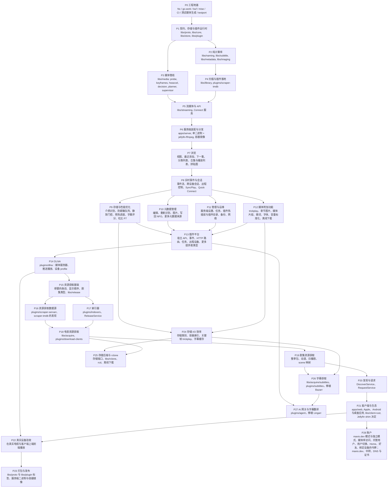

# Mavio 路线图

> [English](roadmap.md) | 简体中文

> 相关文档：[架构](architecture.zh-CN.md) · [领域模型](domain.zh-CN.md) · [开发指南](development.zh-CN.md) · [测试策略](testing.zh-CN.md) · [存储与性能优化](optimization.zh-CN.md) · [AGENTS.zh-CN.md](../AGENTS.zh-CN.md)

---

## 1. 推进原则

* **自底向上**：先实现零业务依赖的底层库，再逐层向上组装；每一层只依赖已完成的下层。
* **完成标准**：一个阶段的库通过各自的测试即为完成，包括全部移植的测试用例（或有明确标记、写明原因的 skip），见[测试策略 §2](testing.zh-CN.md#2-移植测试用例)。
* **服务端优先**：P7 至 P12 对照 Jellyfin 服务端（其 API 控制器与元数据提供者）补全服务端；P13 与 P14 让插件能力与 Jellyfin 对齐并加入 DLNA；P15 至 P20 加入资源获取，即 Seerr、Radarr、Sonarr 与 Prowlarr 在 Jellyfin 旁所做的事（[架构 §13](architecture.zh-CN.md#13-资源获取libsacquire)）；客户端在 P21 构建，其基础部分基于已完成的浏览与播放 API，与 P19、P20 并行；P22 在真实设备上端到端验证播放；P23 打包并发布版本。
* **集成冒烟**：从 P1 起，每个阶段结束时在 `apps/server/internal/smoke` 增加一个把已完成的库串起来的集成测试。它不是 MVP，只用来尽早暴露接口漂移，降低自底向上方式"后期集成才发现问题"的风险。

---

## 2. 阶段总览

| 阶段 | 主题 | 状态 |
| :--- | :--- | :--- |
| P0 | 工程地基 | ✅ 已完成 |
| P1 | 契约、存储与插件运行时 | ✅ 已完成 |
| P2 | 纯计算库 | ✅ 已完成 |
| P3 | 媒体管线 | ✅ 已完成 |
| P4 | 扫描与插件落地 | ✅ 已完成 |
| P5 | 流媒体与 API | ✅ 完成 |
| P6 | 服务端装配与分发 | 进行中 |
| P7 | 浏览 | ✅ 已完成 |
| P8 | 实时事件与会话 | ✅ 已完成 |
| P9 | 存储与性能优化 | ✅ 已完成 |
| P10 | 元数据管理 | ✅ 完成 |
| P11 | 管理与运维 | ✅ 完成 |
| P12 | 媒体附加功能 | ✅ 完成 |
| P13 | 插件平台 | ✅ 完成 |
| P14 | DLNA | ✅ 完成 |
| P15 | 资源获取基础 | ✅ 完成 |
| P16 | 资源获取数据源 | 进行中 |
| P17 | 索引器 | ✅ 完成 |
| P18 | 电影资源获取 | ✅ 完成 |
| P19 | 剧集资源获取 | ✅ 完成 |
| P20 | 发现与请求 | ✅ 完成 |
| P21 | 客户端与生态 | 进行中 |
| P22 | 真实设备验收 | 未开始 |
| P23 | 打包与发布 | 未开始 |
| P24 | 存储 I/O 效率 | 进行中 |
| P25 | 存储后端与 rclone | 进行中 |
| P26 | 字幕获取 | ✅ 完成 |
| P27 | AI 网关与字幕翻译 | 进行中 |
| P28 | 账户 | 进行中 |

---

## 3. 阶段详情

### P0 工程地基
**范围**：仓库骨架、mise、Nx、go.work、buf、golangci-lint + depguard；CI 矩阵（linux amd64/arm64、macOS、Windows）；`tools/fixtures`、`tools/testport`。

**完成标准**：`nx affected` 可用；`tidy-check`（`GOWORK=off`）通过。

**进度**：
- [x] Go 模块骨架与 `go.work`；Nx 及本地插件 `tools/nx-go`（自动推断项目与依赖图）
- [x] mise 锁定工具链版本
- [x] buf 与首个契约 `mavio.system.v1.SystemService`；`apps/server` 提供 Connect 健康检查接口
- [x] golangci-lint 与 depguard 依赖方向规则
- [x] CI 工作流：受影响项目检查、生成代码一致性检查、`buf breaking`、多平台测试矩阵
- [x] `tools/fixtures`：测试媒体生成
- [x] `tools/testport`：Jellyfin 测试用例提取

### P1 契约、存储与插件运行时
**范围**：`proto` 契约初版；`core` 领域模型；`store`（ent + Atlas + sqlc，双方言）与任务队列；`plugin` 两种运行时与握手。

**完成标准**：仓储一致性测试在 SQLite 与 PostgreSQL 上均通过；插件崩溃不影响宿主，并能自动重启。

**进度**：
- [x] `libs/core`：领域模型与仓储端口（[领域模型](domain.zh-CN.md)）
- [x] `libs/proto`：第一版契约（library、user、system、plugin）
- [x] `libs/store`：仓储端口的 SQLite 与 PostgreSQL 实现，包括任务队列
- [x] `libs/plugin`：WASM 与子进程两种运行时
- [x] 冒烟测试 `apps/server/internal/smoke`：排队的元数据刷新任务从插件（两种运行时）取得元数据，连同署名一起写入存储，并能被搜索到

### P2 纯计算库
**范围**：`naming`、`subtitle`、`metadata`（NFO）、`imaging`。

**完成标准**：对应的移植用例全部通过。

**进展**：
- [x] `libs/naming`：Jellyfin 的命名规则，覆盖电影、剧集、季、剧集系列、分段、多版本、附加内容、音乐、有声书、图书与外部文件；移植用例全部通过或带原因跳过
- [x] `libs/subtitle`：SRT / SSA / ASS / WebVTT 解析，转换为 SRT / SSA / ASS / WebVTT / TTML / JSON，按时间窗口过滤，以及字符集检测
- [x] `libs/metadata`：读取电影、视频、音乐视频、剧集、季、单集（含多集文件）、专辑与艺人的 NFO；从 URL 中识别提供者 ID；电影 NFO 的位置。写入 NFO 留到保存元数据的阶段。
- [x] `libs/imaging`：Jellyfin 的尺寸规则、缩小时带锐化的缩放、图片格式与 SVG 安全检查。WebP 编码与占位图（blurhash / thumbhash）随 P5 的图片 API 实现，拼贴图随 P7 的浏览实现。
- [x] 冒烟测试 `apps/server/internal/smoke`：解析一集的文件名，读取 NFO，连同署名写入存储并能查到；字幕转换为 WebVTT，海报缩放

### P3 媒体管线
**范围**：`probe`、`keyframes`、`hwaccel`、`decision`、`planner`、`supervisor`。

**完成标准**：StreamBuilder 与 EncodingHelper 的移植用例全部通过；在现有硬件（维护者自己的机器与 GitHub 托管的 CI runner）上的真实转码冒烟测试通过；没有对应硬件的厂商路径只由移植的参数推导用例覆盖。

**进展**：
- [x] `probe`：按 Jellyfin 的方式规范化 ffprobe 输出，包括杜比视界、HDR10+ 与范围类型；移植用例全部通过
- [x] `keyframes`：从 ffprobe 数据包标志得到关键帧时间
- [x] `hwaccel`：版本检查，编解码器、滤镜与选项清单，VideoToolbox 试编码，VA-API 驱动检查
- [x] `decision`：用 `ClientCapabilities` 替代 `DeviceProfile` 的 StreamBuilder 与流选择；StreamBuilder 的 307 个用例全部通过
- [x] `planner`：滤镜图 IR，CMAF HLS 与渐进式命令；软件与 VideoToolbox 策略；EncodingHelper 的移植用例全部通过
- [x] `supervisor`：生命周期、空闲回收、节流、进度、已提供分片
- [x] 冒烟测试 `apps/server/internal/smoke`：一个 HDR10 HEVC 文件经过探测，被有能力的客户端直放，并在监管下为网页客户端从拖动位置转码为 H.264 HLS
- [x] 在 GitHub 托管 runner 上的真实转码（CI 任务 `media`，Linux 与 macOS）

### P4 扫描与插件落地
**范围**：`library` 扫描器（全量对账，见[架构 §9](architecture.zh-CN.md#9-媒体库扫描与变更检测libslibrary)）、解析器链、任务调度；`plugins/scraper-tmdb`（WASM）。

**完成标准**：库解析器移植用例通过；扫描结果在两种数据库上一致；新增 / 删除 / 重命名 / 内容修改 / 挂载点暂时不可用等场景下，对账都收敛到正确状态。

**进展**：
- [x] 逐文件夹的解析器链：电影、剧集、音乐、图书、家庭视频与照片、附加内容、`.ignore` 文件；解析器移植用例通过
- [x] 扫描器：扫描世代，缺失条目保留并在宽限期后清除，按修改时间与文件 ID 剪枝文件夹，无法读取的文件夹保留其条目
- [x] 任务：扫描、探测与元数据刷新在任务队列上运行，带租约与定时扫描
- [x] `plugins/scraper-tmdb`：从 TMDB 获取电影、剧集、季与集；`TmdbUtils` 移植用例通过，缺失剧集用例在虚拟剧集进入领域模型前跳过
- [x] `apps/server` 中的适配器：元数据插件作为提供者，ffprobe 作为探测器
- [x] 冒烟测试 `apps/server/internal/smoke`：以 WASM 插件为提供者，把一个电影库和一个剧集库作为任务扫描；新增、删除、重命名、重写文件与媒体库文件夹不可用的情况下，SQLite 与 PostgreSQL 上收敛到相同状态

### P5 流媒体与 API
**范围**：`streaming`（CMAF HLS、按需分片、seek、分片缓存）；Connect 服务（库、播放、用户、系统）。

**完成标准**：HLS 移植用例通过；hls.js 与 AVFoundation 实机播放验证。Media3 在 P21 中随 Android 客户端验证。

**进度**：
- [x] `libs/streaming`：覆盖整个媒体源的播放列表、RFC 6381 编解码器字符串、按需生成分片并在拖动时重启、直接复制视频的分片由每个图像组一个文件拼接而成；HLS 移植用例通过
- [x] 认证：首个管理员、按设备登录并以散列保存访问令牌、argon2id 密码、`mavio.auth.v1.AuthService`、Bearer 令牌与请求校验拦截器
- [x] 播放：`mavio.playback.v1.PlaybackService` 及直接播放与 HLS 转封装、转码的媒体端点，记住的与偏好的流，续播位置与已播放状态；用真实 ffmpeg 端到端验证
- [x] 字幕交付：文本字幕以转换后的文件交付（来自外挂文件或由 ffmpeg 提取），以及 HLS 字幕轨
- [x] 媒体库、条目与用户的 Connect 服务；服务端运行媒体库任务
- [x] 图片端点：本地与提供者的图片，按 Jellyfin 的尺寸规则缩放并缓存
- [x] 与客户端协商的 WebP 编码（`gen2brain/vpx`）；在媒体库任务中计算 blurhash / thumbhash 占位图
- [x] 通过开发用播放器在 Chromium 的 hls.js 上验证播放：直接串流、转码、拖动并重启转码、同步的 HLS 字幕轨、进度与停止
- [x] 通过开发用播放器在 Safari 的原生 HLS（即 AVFoundation）上验证播放：直接串流、转码、拖动并重启转码、同步的 HLS 字幕轨。HLS 字幕轨是按视频分片切分、不带 `X-TIMESTAMP-MAP` 的 WebVTT；若有播放器错位，则按视频的时间戳推算并加上该头

### P6 服务端装配与分发
**范围**：`apps/server` 装配；`CGO_ENABLED=0` 交叉编译；容器镜像内置 jellyfin-ffmpeg 的便携版，即 `mise.toml` 锁定的那一份。镜像发布属于 P23。

**完成标准**：端到端冒烟测试：扫描 → 刮削 → 播放决策 → HLS 播放。

**进度**：
- [x] 装配位于 `apps/server/internal/server`，`cmd/mavio` 以命令行参数运行它
- [x] 从插件目录（`--plugin-dir`）启动插件；插件配置经 `SystemService` 保存、按清单的 schema 校验并即时生效，无需重启；元数据插件就绪后参与媒体库刷新
- [x] 端到端测试：通过 API 测试装配好的服务端，使用真实 ffmpeg 与 WASM 元数据插件：管理员配置插件，扫描媒体库，刮削其中的影片并以 HLS 直接串流播放
- [x] `CGO_ENABLED=0` 交叉编译到 Linux、macOS、Windows 的 amd64 与 arm64（`server:dist`），并在 CI 中检查
- [x] 内置 jellyfin-ffmpeg 便携版的 linux/amd64 与 linux/arm64 容器镜像，在 CI 中构建并运行

### P7 浏览
**范围**：客户端列出与打开的内容。

- 用户的媒体库视图；各媒体库的最近添加；继续观看与剧集的下一集
- 剧集、季与单集；专辑与艺人
- 带条目数的类型、工作室、人物与年份列表，`libs/store` 已有这类查询
- 合集与播放列表：创建、编辑、排序与删除；领域模型中已有这两者
- 媒体库与合集拼贴图
- 按用户与客户端保存的显示偏好，由服务端保存，因而随用户跨设备
- 继承的分级

**完成标准**：通过 API 的端到端测试：通过视图、最近添加、下一集与类型浏览扫描过的电影与剧集媒体库，创建一个播放列表，且分级高于用户上限的剧集中的单集不可见。

**进度**：
- [x] 继承的分级：未分级的条目取最近一个有分级的祖先的分数，由存储层在每次写入时推导，并为已有数据库回填；分级过滤与访问检查使用它
- [x] 分级分数：元数据刷新用 Jellyfin 的分级体系把内容分级映射为分数（`metadata.RatingScore`，移植用例通过）；条目与权限策略的最高分级中，未分级为 nil 而非零
- [x] 带条目数的类型、标签、工作室、艺人、年份与人物列表（`ItemService.ListValues`、`ListPeople`），只统计用户可访问的条目
- [x] 与 Jellyfin 一样按剧集、季与专辑分组的最近添加（`ListLatestItems`），以及按播出顺序插入特别篇的下一集（`ListNextUp`）；条目响应给出单集所属的剧集与季、曲目所属的专辑。继续观看即带 `resumable` 并按最近播放排序的 `ListItems`
- [x] 合集（`CollectionService`，由管理员整理）与播放列表（`PlaylistService`，每个用户各自的，条目项可重复且可移动），位于服务端创建的整理类媒体库中；以它们为 parent 通过 `ListItems` 列出其中的条目
- [x] 按用户、客户端与视图保存的显示偏好（`DisplayPreferencesService`），名称与值由客户端决定
- [x] 媒体库、合集与播放列表的拼贴图（`/images/collages/{id}`、`imaging.Collage`），不绘制文字
- [x] 扫描为新增的无媒体条目（剧集、季、专辑）刷新元数据，此前只有媒体文件的探测才会触发刷新
- [x] 通过 API 测试装配好的服务端的端到端测试（`internal/server`、`TestBrowsing`）：扫描电影与剧集及其 NFO 文件，并通过视图、最近添加、下一集与类型浏览；限于 PG 的用户创建播放列表，且看不到 TV-14 剧集的任何单集

### P8 实时事件与会话
**范围**：客户端无需询问即可得知的变化，以及一台设备对另一台设备的操作。

- 事件：每个已登录设备一条事件流，传递媒体库变化、用户在其他设备上的播放状态与进度、任务进度与插件状态
- 会话：每台设备正在播放的内容；从一台设备远程控制另一台（播放、暂停、拖动、停止、消息）
- 同步观看（SyncPlay）：组内共享同一播放状态，等待正在缓冲的成员
- 用已登录设备让新设备登录（Quick Connect）

**完成标准**：通过 API 的端到端测试：一台设备在扫描后收到媒体库变化及另一台设备的进度，并控制那台设备的播放；同一 SyncPlay 组的两台设备保持在同一位置。涉及计时的逻辑用 `testing/synctest` 测试。

**进度**：
- [x] 事件流（`EventService`）：媒体库变化、条目状态、会话、命令、扫描与插件，每个设备只收到其用户可见的内容；存储层被观察，写入在提交后到达各流
- [x] 会话（`SessionService`）：设备在事件流打开期间在线、各设备正在播放的内容、远程命令
- [x] Quick Connect（`AuthService`）：在已登录设备上输入新设备的代码，使其登录
- [x] SyncPlay（`SyncPlayService`）：设备分组以同一位置播放同一队列，并等待缓冲中的成员，与 Jellyfin 相同；计时逻辑用 `testing/synctest` 测试
- [x] 通过 API 测试装配好的服务端的端到端测试（`internal/server`、`TestLiveEvents`）：电视得知扫描发现的影片以及手机的播放与状态，暂停手机，两者在 SyncPlay 分组中被告知在同一时刻、同一位置开始

### P9 存储与性能优化
**范围**：端到端 I/O 延迟抑制与预热调度（[存储与性能优化](optimization.zh-CN.md)）；语言/方言感知字幕评分；高保真视频管线增强；零模糊分发验证。

- 多维度存储介质与挂载协议识别：跨 Linux、Windows、macOS 原生识别本地 SSD、机械硬盘（Rotational HDD）、远程网络共享（SMB/NFS）以及云盘网盘（Dataless Mount）
- 物理驱动器防颠簸串行化（`VolumeLedger`）：为机械硬盘建立单并发车道，消除扫描与探测时的多任务随机寻道竞争
- 前台流媒体播放静默门控（`QuietGate`）：前台活跃播放期间自动对后台扫描与磁盘维护任务实施避让降级与暂停
- 写入中未完成文件检测策略（`GrowthPolicy`）：基于写入窗口与尺寸稳定性轮询，避免扫描未下载完成的文件
- 投机式索引与元数据预热调度（`PrefetchHeadTail`）：利用 Linux `posix_fadvise` 与跨平台顺序分块回退，精准预热容器头部元数据与尾部索引
- 字幕评分与方言归一化：语言评分矩阵、中文别名与变体（繁简、地区方言）归一化，以及听障/特效字幕降权
- 高保真视频管线适配：杜比视界 Profile 7 双层 EL 提取与回退色调映射；黑边检测（`cropdetect`）集成
- 分发验证与安全不变量：锁定依赖零模糊验证与隐私防泄漏失败关闭测试

**完成标准**：存储识别、并发串行化、静默门控与预热调度在 Linux、Windows、macOS 上的单元测试与集成测试全部通过；媒体库扫描在机械硬盘上保持顺序吞吐；播放启动干净打断后台 I/O；字幕评分正确匹配中文各方言变体。

**进展**：
- [x] 多维度介质与协议识别：`libs/library/storage` 原生实现 Linux（`sysfs`/`st_dev`）、macOS（`statfs`/`fsid`）与 Windows（`GetDriveType`/`IOCTL_STORAGE_QUERY_PROPERTY`）
- [x] 驱动器防颠簸串行化：`VolumeLedger`，每个卷一个先来先得的槽位
- [x] 前台播放静默门控：`QuietGate`，由前台活动延长、后台读取等过的静默截止时间
- [x] 写入中文件检测：`GrowthPolicy` 排除带下载后缀或在写入窗口内修改过的文件并推迟它们；`Scanner.RunDeferred` 在被推迟的文件稳定或消失后重新扫描其媒体库
- [x] 投机式预热调度器：`PrefetchHeadTail` 在 Linux 上使用 `posix_fadvise(WILLNEED)` 并支持跨平台顺序分块预热回退
- [x] 将 `libs/library/storage` 接入扫描与探测：每个文件夹的设备只识别一次（`storage.Detector`）；只对有寻道代价的驱动器以及远程或云端卷串行化，在这些设备上遍历器一次读一个文件夹，每次列目录与探测都占用该设备；同一磁盘上多个版本的探测不再等待自己
- [x] 播放中的 `QuietGate` 与预热：与 khuaplayer 的前台存储门禁一样，开始播放与每个媒体请求都延长静默窗口，而不是在整个播放期间挡住后台 I/O
- [x] 字幕评分与中文别名归一化：扫描把外挂字幕文件附加到其视频，语言取自文件名（含中文变体），并按评分模型排序；播放选择按规范化后的别名匹配偏好语言
- [x] 杜比视界 Profile 7：仅凭配置识别的独立增强层轨道从不被选为视频；HDR10 客户端得到去掉杜比视界元数据的基础层
- [x] 黑边裁剪：通过采样帧找出黑边（`libs/media/borders`、任务 `media.borders`），记录在视频流上，规划器重新编码时裁掉
- [x] 锁定依赖：`mise.toml` 按平台锁定 jellyfin-ffmpeg 的 SHA-256，并由测试与 Dockerfile 中的锁定比对
- [x] 卷保活：`storage.Keeper` 以绕过缓存的心跳读（`VolumeHeartbeat`）保持进行中播放的卷、以及在场用户“继续观看”媒体的卷（`internal/warming`）不休眠，并在客户端打开条目时唤醒其卷
- [x] 续播延迟：播放从请求位置之前至多 5 秒的关键帧或分段起点开始（`StartPlaybackResponse.start_position`），HLS 在播放开始时即从该处启动 ffmpeg，并预读其附近的媒体
- [x] 每个存储机制的落地对照索引及其与 Jellyfin 的差异（[优化 §1.9](optimization.zh-CN.md)）

### P10 元数据管理
**范围**：修正与补全媒体库扫描得到的内容。

- 编辑条目并锁定字段；对照提供者重新识别条目；刷新单个条目
- 列出提供者的图片；选择、上传与删除图片
- 把 NFO 文件与图片写到媒体旁（`libs/metadata` 目前只读取 NFO 文件）
- 以插件形式提供的元数据来源：音乐与图书（MusicBrainz、TheAudioDB）、更多图片（fanart.tv）、字幕下载
- 按提供者的合集自动创建电影合集

**完成标准**：通过 API 的端到端测试：管理员重新识别一部识别错误的影片并编辑它，锁定的字段在刷新后保持不变，选定的海报写到文件旁并被新的扫描读回。

**进展**：
- [x] `MetadataService`：按更新掩码编辑条目（包括锁定）；刷新单个条目，可选择替换其元数据；搜索提供者并重新识别条目
- [x] 图片：列出提供者的图片；按 URL 选择或上传图片；删除图片及其文件；选定的图片保存在媒体旁或元数据目录（`--metadata-dir`）
- [x] 本地元数据：`metadata.WriteNFO`，可被 `ParseNFO` 读回；保存本地元数据的媒体库写出 NFO 文件，并按 Jellyfin 的本地图片命名保存提供者的图片
- [x] 提供者插件：`scraper-musicbrainz`（艺术家、专辑、音轨，Cover Art Archive）、`scraper-theaudiodb`、`scraper-openlibrary`（图书与有声书）、`scraper-fanart`；字幕提供者契约（`SubtitleProviderService`）与 `subtitles-opensubtitles`，下载的字幕保存在视频旁
- [x] 按提供者的合集自动创建电影合集（`AutoCollections`）
- [x] 端到端测试（`apps/server/internal/server/metadata_test.go`）

### P11 管理与运维
**范围**：运行服务端时无需重启或修改命令行参数。

- 服务端设置保存在数据库中并通过 `SystemService` 设置，把管理员需要在运行时修改的项从命令行参数中接过来；先做转码设置（由管理员选择硬件加速、编码器预设、色调映射、转码目录）
- 浏览服务端目录以选择媒体库路径
- 任务：列出计划任务及其最近一次运行，立即运行某个任务
- 插件热插拔：安装、升级、卸载插件都不需要重启服务端，即[架构 §7.3](architecture.zh-CN.md#73-子进程运行时)所述。目前插件目录只在启动时读取，只有配置修改无需重启
- 可安装与升级插件的插件目录；服务端接入认证与通知插件，其契约（`AuthProvider`、`Notifier`）已经存在
- 供集成使用的 API key、活动日志、服务端日志、备份与恢复、本地化数据（国家、语言、分级体系）
- 网络：使用配置证书的 HTTPS、反向代理下的 base URL、局域网内的服务端发现

**完成标准**：通过 API 的端到端测试：管理员修改一项转码设置，下一次转码即按其执行；服务端持续提供服务的同时从插件目录安装、升级并卸载一个插件；备份恢复到一个新的服务端。

**进展**：
- [x] 服务端设置保存在数据库中，立即生效，某部分拒绝时回滚：转码（硬件加速、编码预设与质量、色调映射、去隔行、缩混、裁剪、转码目录）、网络、插件目录
- [x] 文件夹浏览；任务及其上次与下次运行、立即运行；作业队列；每日清理已结束的作业
- [x] 从插件目录热插拔插件：安装、可回滚的升级、卸载；服务端使用认证与通知插件
- [x] API 密钥；发送给通知插件的活动日志；最近的服务端日志
- [x] 备份与恢复（在两种数据库上的 `store.Dump` 与 `store.Restore`，以及图片与插件）
- [x] 本地化数据：国家、语言、分级体系；移植的 Jellyfin 本地化用例通过（翻译除外）
- [x] 网络：基础 URL、使用配置证书的 HTTPS、局域网发现
- [x] 端到端测试（`apps/server/internal/server/admin_test.go`）

### P12 媒体附加功能
**范围**：播放媒体流之外的媒体功能。

- 预览缩略图（trickplay，[架构 §6.1](architecture.zh-CN.md#61-需求与实现方案)）与章节图片
- 来自媒体片段提供者插件的媒体片段（片头、片尾）
- 歌词；供客户端渲染 ASS 字幕的内嵌字体；音量标准化
- 渐进式转码与离线下载（§4）

**完成标准**：用真实 ffmpeg 的测试生成 trickplay 拼图与章节图片，并下载、播放一个渐进式转码的文件；Jellyfin 有对应用例的部分，移植用例通过。

**进展**：
- [x] 缩略图拼图与章节图片（`libs/media/thumbnails`，任务 `media.trickplay` 与 `media.chapters`），按检测到的黑边裁剪，带失败熔断；从元数据目录提供
- [x] 来自片段提供者插件的媒体片段（`MediaSegmentProviderService`，任务 `media.segments`）
- [x] 歌词（`metadata.ParseLyrics`；Jellyfin 的 ELRC 用例通过），通过 `ItemService.GetLyrics` 提供；向客户端提供字体附件；音轨与专辑的响度（`media.loudness`）作为归一化增益
- [x] 渐进式转封装与转码；下载文件本身或渐进式转码结果
- [x] 使用真实 ffmpeg 的端到端测试（`apps/server/internal/server/extras_test.go`）

### P13 插件平台
**范围**：让 Mavio 两种运行时的插件都能做到 Jellyfin 插件能做的事（频道与直播电视除外）（[插件平台](plugins.zh-CN.md)）：带作用域、可代表用户的宿主 API；面向消费者的事件，以及发给通知插件的全部活动；HTTP 路由；任务与数据目录；远程设备；图片、歌词、本地元数据、保存器、处理器、解析器、片头、图片生成器、媒体源与密码重置提供者；外部 ID 声明；按媒体库的提供者顺序。

**完成标准**：为两种运行时构建的测试插件在端到端测试中通过装配好的服务端使用每一种能力；契约与 SDK 有文档。

**进度**：
- [x] 宿主 API：作用域、代表用户、两种运行时的传输
- [x] 数据目录；任务
- [x] 事件：[插件平台 §4](plugins.zh-CN.md#4-事件) 的事件类型、事件消费者、通知插件
- [x] HTTP 路由
- [x] 远程设备；代表设备
- [x] 图片、歌词、本地元数据、保存器与处理器提供者；外部 ID
- [x] 解析器、片头提供者、图片生成器、媒体源提供者、密码重置
- [x] 按媒体库的提供者顺序
- [x] 端到端测试（使用真实 ffmpeg 的 `apps/server/internal/server/capabilities_test.go` 与 `plugins_test.go`），覆盖两种运行时

### P14 DLNA
**范围**：`plugins/dlna`，第一方进程插件（[插件平台 §10](plugins.zh-CN.md#10-dlnapluginsdlna)）：媒体服务器（SSDP、ContentDirectory、ConnectionManager、带 DLNA 头的媒体）、推送播放（发现渲染器、AVTransport 与 RenderingControl）、设备 profile；为服务端的每个平台构建，打包为目录插件包并内置于容器镜像。

**完成标准**：端到端测试在回环接口上用模拟的控制点与渲染器发现服务端、浏览媒体库、以 Range 请求播放文件，并驱动渲染器完成播放、暂停、跳转与停止且上报进度。在真实电视上的播放验证在 P22 进行。

**进度**：
- [x] SSDP 与设备描述
- [x] ContentDirectory 与 ConnectionManager
- [x] 带 DLNA 头的媒体与设备 profile
- [x] 推送播放
- [x] 构建、目录插件包与容器镜像（插件种子目录）
- [x] 端到端测试（`apps/server/internal/server/dlna_test.go`）

### P15 资源获取基础
**范围**：服务端在能"想要"自己没有的媒体之前所需的东西（[架构 §13](architecture.zh-CN.md#13-资源获取libsacquire)）。

- 想要的条目：元数据中已知、但还没有文件的电影与剧集，与[领域模型](domain.zh-CN.md) §4.7 的缺失条目分开；电影、剧集、季与单集的监控状态
- 剧集：TVDB ID、剧集类型（standard、daily、anime）与显示顺序，即 Jellyfin 的 `DisplayOrder` 加 TMDB episode groups
- `libs/release`：release 标题解析（标题、年份、季与集、绝对集数与日播日期、质量、来源、分辨率、编码、语言、版本、发布组），沿用 Radarr 与 Sonarr 解析规则的 .NET 语法，在 `regexp2` 上运行
- `tools/testport` 读取 NUnit 测试用例，使 Radarr 与 Sonarr 的解析用例能像 Jellyfin 的一样移植

**完成标准**：移植的解析用例通过或带原因跳过；P4 跳过的 `scraper-tmdb` 缺失剧集用例通过；剧集的单集按其显示顺序列出。

**进度**：
- [x] 虚拟条目与被监控条目（[领域模型 §4.8](domain.zh-CN.md#48-虚拟条目)）；集列表提供者（`EPISODE_LIST_PROVIDER`，[插件 §8.12](plugins.zh-CN.md#812-资源获取提供者)）；缺失剧集用例在 `libs/library` 中通过
- [x] 剧集类型、显示顺序与绝对集数；`scraper-tmdb` 按剧集的 TMDB episode group 给季与单集编号
- [x] `libs/release` 及 Radarr 与 Sonarr 的解析用例
- [x] `tools/testport` 读取 NUnit 测试用例
- [x] 监控剧集或更改其显示顺序会立即刷新它；端到端测试（`apps/server/internal/server/episodes_test.go`）

### P16 资源获取数据源
**范围**：资源获取所需的元数据，默认无需密钥。

- `plugins/scraper-servarr`（WASM）：Radarr 的电影元数据与列表、Sonarr SkyHook 中按 TVDB 编号的剧集与单集、scene 映射、日播剧、XEM
- `scraper-tmdb`：管理员未设置密钥时使用 Radarr 的 TMDB 只读访问令牌，TMDB 拒绝该令牌时使用 Mavio 自己的密钥；`DISCOVERY_PROVIDER`（趋势、热门、即将上映，按类型、制片公司、电视网、关键词与观看平台，推荐与相似作品）；episode groups

**完成标准**：在未配置任何密钥的情况下（包括 TMDB 拒绝 Radarr 令牌时）识别并刷新一部电影与一部剧集，剧集中想要的单集按 TVDB 编号，并按其 TVDB ID 挂上 TMDB 的单集元数据，TMDB 编号不同时亦然。

**进度**：
- [x] `scraper-tmdb` 无需密钥：使用 Radarr 的令牌，TMDB 拒绝后改用 Mavio 的密钥（由 `MAVIO_TMDB_KEY` 编入）
- [ ] 注册 Mavio 自己的 TMDB API 密钥，并在发布构建中设为 `MAVIO_TMDB_KEY`（需要项目的 TMDB 账号）
- [x] `scraper-tmdb` 的 `DISCOVERY_PROVIDER`
- [x] `plugins/scraper-servarr`：Radarr 的电影元数据与列表、SkyHook 的剧集与单集、scene 映射、日播剧、XEM
- [x] 端到端测试（`apps/server/internal/server/sources_test.go`）

### P17 索引器
**范围**：`plugins/indexers`，移植 Prowlarr 的第一方进程插件：Newznab、Torznab、Cardigann 引擎及 `indexers.prowlarr.com` 的定义、Prowlarr 以代码实现的全部站点、分类与能力、限速与退避、索引器代理（HTTP、SOCKS、FlareSolverr）。能力类型 `INDEXER_PROVIDER`；`ReleaseService` 搜索已配置的索引器，并用 `libs/release` 解析其结果。

**完成标准**：移植的 Prowlarr 用例通过；通过装配好的服务端，对 Newznab、Torznab、Cardigann 定义与代码实现站点的录制响应进行搜索，并解析为 release。

**进展**：
- [x] `INDEXER_PROVIDER` 契约（`mavio/plugin/v1/indexer.proto`）及其宿主客户端
- [x] Prowlarr 的用例与录制响应移植到 `plugins/indexers/testdata`
- [x] 数字、大小与日期解析（`internal/parse`）
- [x] 分类、能力与搜索条件（`internal/indexer`）
- [x] Newznab 与 Torznab（`internal/sites/newznab`、`internal/sites/torznab`）
  - [x] 搜索的时间与大小限制（`minage`、`maxage`、`minsize`、`maxsize`）：查询携带它们，Newznab 与 Torznab 发送它们，插件丢弃超出限制的发布；交互式的 `SearchReleases` 如 Prowlarr 的搜索那样接受它们
  - [x] 能力跨重启保存在插件的数据目录中，只在索引器的 URL 或 API 密钥改变或满一周后重新读取
- [x] Cardigann 引擎（`internal/sites/cardigann`）：从目录及其 `Custom` 子目录读取定义，模板、过滤器、HTML、XML 与 JSON 选择器，登录、搜索与下载
  - [x] 拉取并更新 `indexers.prowlarr.com` 的定义，由插件的装配完成
  - [ ] 手动解答验证码：目前没有界面展示图片验证码，自动登录遇到时失败
  - [x] 像 Prowlarr 的 GetCookies 那样，以 `cookie` 设置的 cookie 取代响应设置的 cookie
- [x] Prowlarr 以代码实现的站点，其标记为过时者除外
  - [x] Gazelle（`internal/sites/gazelle`）：AlphaRatio、BrokenStones、DesiGaane、DICMusic、GreatPosterWall、Secret Cinema；使用 API 密钥的 Orpheus、Redacted
  - [x] AvistaZ（`internal/sites/avistaz`）：AnimeZ、AvistaZ、CinemaZ、ExoticaZ、PrivateHD
  - [x] SpeedApp（`internal/sites/speedapp`）：RetroFlix、SpeedApp.io
  - [x] BroadcasTheNet（`internal/sites/broadcasthenet`），以 API 每小时 150 次调用作为其定义的默认限额
    - [x] 其发布的来源组、片源、容器、编码与分辨率，如同 Prowlarr 的 TorrentInfo 所保留
  - [x] FileList（`internal/sites/filelist`）
  - [x] HDBits（`internal/sites/hdbits`）
  - [x] PassThePopcorn（`internal/sites/passthepopcorn`）
  - [x] GazelleGames（`internal/sites/gazellegames`），在测试或首次下载时获取 passkey
    - [x] 其大小限制（`sizesmall`、`sizeslarge`），由查询的 `minsize` 与 `maxsize` 发送
  - [x] IPTorrents（`internal/sites/iptorrents`），使用浏览器的 Cookie 和 User-Agent 抓取其页面
  - [x] BitHDTV、HD-Torrents、ImmortalSeed、Libble、NorBits 和 PiXELHD（`internal/sites/<name>`），抓取其页面
  - [x] Headphones、Knaben、NzbIndex、RuTracker、TorrentPotato 和 TorrentsCSV（`internal/sites/<name>`）
    - [x] 像 Prowlarr 的 NzbValidationService 那样，在转交前检查每个 Usenet 索引器下载的 NZB
    - [ ] RuTracker 的登录验证码：尚无界面显示它，自动登录会失败
  - [x] BeyondHD、M-Team TP、MyAnonamouse、Nebulance、Shazbat 和 TorrentDay（`internal/sites/<name>`）
    - [x] MyAnonamouse 的大小限制（`tor[minSize]`、`tor[maxSize]`），由查询的 `minsize` 和 `maxsize` 发送
    - [x] 像 Prowlarr 那样在测试 MyAnonamouse 前清除其 Cookie
  - [x] PreToMe、RevolutionTT、SceneHD、SpeedCD、TorrentBytes、TorrentSyndikat、Uniotaku 和 XSpeeds（`internal/sites/<name>`）
  - [x] AnimeBytes、Anidex、Anidub、BakaBT、SubsPlease 和 Toloka.to（`internal/sites/<name>`）
    - [x] 像 Prowlarr 那样将 AnimeBytes 的结果缓存三分钟
    - [x] Anidub 的分辨率，从每个种子的质量块读取（Prowlarr 从错误的元素读取，因而读不到）
  - [x] AvistaZ 与 SpeedApp 站点的 API 令牌跨重启保存在插件的数据目录中，如同 Prowlarr 将其存入设置
  - [x] torrent 索引器的做种设置：决策检查最少做种数，分享率、做种时间与整季包做种时间在抓取时交给下载客户端，如同 Radarr 与 Sonarr 的 SeedConfigProvider
- [x] 限速、退避与索引器代理（HTTP、SOCKS、FlareSolverr）
- [x] `ReleaseService`（`mavio/acquisition/v1/release.proto`、`apps/server/internal/releases`）：列出各就绪提供方的索引器；如 Radarr 与 Sonarr 的 FetchReleases 那样逐级为媒体库中的电影、季或单集搜索（先按各索引器支持的 ID，再按标题），或按文本搜索；用 `libs/release` 解析 release
  - [x] 如 Sonarr 的 SearchAnimeSeason 那样逐集搜索动漫的季，每个已播出的单集按其绝对集数搜索
  - [x] Newznab 的 `title` 参数：如 Sonarr 那样，以原始标题发给支持它的索引器
  - [x] 剧集除标题外也按 scene 标题与映射（XEM）搜索，随 P19 完成
  - [x] 服务器保存索引器及其能力一小时，直到其插件重启或重新配置，搜索无需先列出索引器
- [x] 端到端测试（`apps/server/internal/server/releases_test.go`）：经装配好的服务器搜索 Newznab、Torznab、以 `indexers.prowlarr.com` 的方式提供的 Cardigann 定义以及 NzbIndex

### P18 电影资源获取
**范围**：`libs/acquire` 及其 `movie` 包，移植 Radarr；`plugins/download-clients`，包含 Radarr 与 Sonarr 支持的全部下载客户端的第一方进程插件。

- 质量定义与质量档案，每部被监控的电影、剧集与季一个档案；custom formats、delay profile 与 release profile
- 决策：Radarr 决策引擎的各项规格；排序
- 以作业执行的 RSS 同步与搜索；被跟踪下载的队列；远程路径映射
- 入库：完成的下载经 ffprobe 校验，按命名模板硬链接或移动进媒体库，并扫描其所在目录；升级到截止质量为止，被替换的文件移入回收目录；下载失败时加入黑名单并重新搜索
- 历史

**完成标准**：端到端测试在回环接口上模拟索引器与下载客户端：一部想要的电影被找到、发送、跟踪、入库并播放，随后被更好的 release 升级；失败的下载被加入黑名单并被替换。

**进度**：
- [x] `DOWNLOAD_CLIENT_PROVIDER` 契约（`mavio/plugin/v1/download_client.proto`）及其宿主客户端
- [x] `plugins/download-clients`：Radarr 与 Sonarr 的下载客户端，并移植其用例（`internal/clients/<name>`：Aria2、Torrent 与 Usenet Blackhole、Deluge、Download Station、Flood、Freebox、Hadouken、NZBGet、NzbVortex、Pneumatic、qBittorrent、rqbit、rTorrent、SABnzbd、Transmission、uTorrent、Vuze）
  - [x] 抓取时给出的做种限制保存在插件数据目录（`seeds.json`）中，重启后保留，如同 Radarr 保存其做种配置
  - [x] 下载客户端标签（`tags`）：电影或剧集只使用与其共享某个标签的客户端，否则使用无标签的客户端
  - [x] Flood 的附加标签（标题 slug、质量、语言、发布组、年份、索引器、制片公司或电视网、合集），取自抓取携带的信息
  - [x] Sonarr 对 Pneumatic 整季的拒绝，由抓取表明是否为整季
  - [x] release 未给出哈希的种子，若其哈希已被拉黑则被拒绝，仅针对设置为拒绝的索引器与非交互式搜索的 release，如同 Radarr 的 TorrentClientBase.EnsureReleaseIsNotBlocklisted；客户端得知的哈希随抓取记录
  - [x] 各客户端共用的辅助代码，取代各自的副本：远程路径拼接、.NET 版本解析、JSON-RPC 与 XML-RPC、URL base 校验、自由格式的标签字段、“发布被拒”与“发布被拉黑”错误、测试的警告、NZB 有效性检查、可配置的历史条数上限（`history_limit`）、保留客户端给出的 ID 大小写，以及把 `::1` 视为本机
- [x] `libs/acquire`：质量及其定义、质量档案、custom formats、delay profile、release profile
- [x] 决策：Radarr 决策引擎的各项规格及其排序，并移植其用例（`libs/acquire`）
  - [x] 按 ID 找不到索引器时按名称查找，如同 Radarr 的 AggregateLanguages
  - [x] 区分未知语言与任意语言（`release.Any`），如同 Radarr 的 Language.Unknown 与 Language.Any：要求任意语言的档案接受所有发布，要求 Unknown 的档案只接受语言未知的发布
  - [x] 索引器的标签，由索引器标签规格检查
- [x] 领域与存储：档案、custom formats、被跟踪下载的队列、历史、黑名单、远程路径映射、命名（`libs/core/acquisition.go`、`libs/store`）
  - [x] 质量档案的格式评分对照已有的 custom formats 进行检查，如同 Radarr 的 QualityProfileController：不得为不存在的格式打分或为同一格式打两次分，最低分必须可以达到；删除最后一个格式时重置各档案的格式分数，如同 Radarr 的 QualityProfileService
- [x] 按 TMDB ID 把想要的电影加入媒体库，带质量档案与最低可用状态（`WantedService`、`apps/server/internal/acquisition`）
  - [x] 电影的数字版与实体版发行日期（来自 TMDB 的发行日期或 Radarr 的元数据），最低可用性如同 Radarr 的 Movie.IsAvailable 使用它们；没有这些日期的电影在首映 90 天后视为已发行
  - [x] 电影的原始语言，要求"Original"的档案取它，没有语言标记的发布即为该语言；原始语言未知的电影，档案接受任何语言
  - [x] 识别失败的电影保留其占位名称（"TMDB <id>"），由每日刷新想要的电影的作业再次刷新；该作业如同 Radarr 的 RefreshMovieService 与 ShouldRefreshMovie，刷新到期的电影：从未刷新、超过 180 天未刷新，或至少 12 小时未刷新且尚未发行或在最近 30 天内发行实体版
- [x] 以作业执行的电影搜索与 RSS 同步；通过 `DownloadService` 抓取；`SearchReleases` 给出决策
  - [x] 按电影的别名、译名与次要年份匹配发布，如同 Radarr 的 MovieService.FindByTitle 与 TryGetMovieBySearchCriteria
  - [x] 索引器的标签、必需标志、最少做种数与 MULTi 语言，由索引器插件按其配置提供
  - [x] 下载客户端的标签，以及优先级最高的客户端之间轮流使用，如同 Radarr 的 DownloadClientProvider.GetDownloadClient
  - [x] 索引器指定的下载客户端（`download_client_id`），其 release 总发送给它，如同 Radarr 的 IndexerDefinition.DownloadClientId；索引器指定的客户端不存在时，release 转为待定
  - [x] 某协议的客户端都因失败而暂被排除时，抓取仍尝试其中之一，如同 Radarr 的 DownloadClientProvider；只有因等待客户端恢复而待定的 release 继续等待
  - [x] 交互式搜索抓取的失败发布仅在开启 `AutoRedownloadFailedFromInteractiveSearch` 时重新搜索，如同 Radarr 的 RedownloadFailedDownloadService
  - [x] 在另一次 RSS 同步执行中时请求的 RSS 同步在其后再执行一次，而非被丢弃（在另一次待执行时请求的由那一次应答）：作业队列只对待执行的作业去重，且从不同时租用同一唯一 key 的两个作业
- [x] 队列：从客户端轮询的被跟踪下载
  - [x] 无法应答或因失败而暂被排除的客户端的下载保留最后状态，而非被标记
- [x] 入库、升级与回收目录
  - [x] 入库文件的质量由其文件名、下载文件夹名、发布名称与媒体信息汇总而成，分辨率以视频尺寸为准，如同 Radarr 的 AggregateQuality；文件名中的 MediaInfo 标记由入库时读取的文件写入
  - [x] 随电影入库的字幕按其语言、标签与副本编号命名，按视频文件名或电影标题与年份匹配，视频是下载中唯一的视频时全部采用，如同 Radarr 的 SubtitleService；升级替换的文件，其附加文件一并移入回收站
    - [x] 在数据库中记录附加文件（`core.ExtraFile`、`extra_files`），如同 Radarr 与 Sonarr 的 SubtitleFile 与 OtherExtraFile 表，涵盖电影与单集：入库时连同语言与标签记录它们，升级回收所记录的文件，而非按名称在旧文件旁查找的文件
  - [x] 手动导入跟踪中的电影下载的文件（`DownloadService` 的 `ListManualImport`、`ManualImport`）：列出其视频文件及入库将给出的质量与拒绝原因，并无视拒绝原因、按所选质量导入所选文件，如同 Radarr 的 ManualImportService
    - [x] 手动导入非跟踪下载的文件夹与文件（其文件按名称匹配想要的电影，否则以“Unknown Movie”拒绝）、为下载所属电影以外的电影导入文件，以及选择语言、发布组与导入方式（移动或复制），如同 Radarr 的 ManualImportService 与 ImportMode
  - [x] 在入库写入的电影文件夹（或其最近的已存在上层文件夹）所在的卷上检查剩余空间，而非媒体库文件夹，如同 Radarr 的 FreeSpaceSpecification
  - [x] 入库把电影移出下载文件夹后，若其中只剩样片与小 RAR 文件，则删除该文件夹，如同 Radarr 的 DownloadedMovieImportService.ShouldDeleteFolder；媒体库与远程路径映射的文件夹保留
  - [x] 只扫描电影入库写入的文件夹（`library.scan_folder`），而非其所在的整个媒体库
- [x] 失败的下载：黑名单与重新搜索
- [x] 获取作业（RSS 同步、队列检查、回收目录清理）列于 `TaskService` 的任务中，并可按需运行
- [x] 端到端测试（`apps/server/internal/server/acquisition_test.go`）：在回环接口上模拟 Newznab 索引器与 SABnzbd，经由索引器与下载客户端插件；一部想要的电影被搜索、抓取、跟踪、按 Radarr 的命名入库并播放，随后被 RSS 同步找到的发布升级，旧文件移入回收目录；失败的下载被加入黑名单，并由新的搜索替换
  - [x] 种子客户端（`torrent_acquisition_test.go`）：在回环接口上模拟 Torznab 索引器与 qBittorrent；磁力链接连同索引器的做种限制一起发送，仍在做种的下载以硬链接入库，关闭硬链接后的升级以复制入库，种子在达到限制暂停后连同文件一起移除
  - [x] 端到端测试中的远程路径映射：qBittorrent 所在另一台机器的目录映射为服务端的目录

### P19 剧集资源获取
**范围**：`libs/acquire/series`，移植 Sonarr：单集、整季与整剧搜索，整季包，多集文件，按绝对集数的动漫，按播出日期的日播剧，scene 映射与 XEM，新季与新集的监控。

**完成标准**：P18 的端到端测试换成剧集：想要的单集以单集和整季包的形式被找到，动漫与日播剧按其编号匹配，每一集入库后即可播放。

**进展**：
- [x] 决策：Sonarr 决策引擎的各项规格及其排序，并移植其用例（`libs/acquire/series`）
  - [x] 按 ID 找不到索引器时按名称查找，如同 Sonarr 的 AggregateLanguages
- [x] 按 Sonarr 的方式命名剧集文件、剧集与季文件夹（`libs/acquire/organize`）
- [x] 想要的剧集与单集：按 TVDB ID 加入剧集，带质量档案，监控新季与新集（`WantedService.AddSeries`、`apps/server/internal/acquisition`）
  - [x] 扫描在磁盘上找到的季与单集按 Sonarr 的 GetMonitoredStatus 监控：单集随其季，但第 1 季以外的第 0 集不监控；季随剧集的新季，但特别篇不监控
  - [x] Sonarr 的 `AutoUnmonitorPreviouslyDownloadedEpisodes`：扫描发现文件丢失的想要剧集的单集被取消监控，在此之前 RSS 同步跳过它们
  - [x] 每一集自己的上次搜索时间（`EpisodeState.LastSearchedAt`），在为其搜索了索引器时设置，并决定缺失单集批量搜索的顺序
- [x] 以作业执行的单集、整季与整剧搜索及 RSS 同步；通过 scene 映射、XEM、绝对集数与播出日期把发布匹配到单集（`libs/acquire/series`、作业 `acquisition.episode_search`，scene 映射由 `acquisition.scene_mappings` 刷新）
  - [x] 像 Sonarr 一样把 scene 编号保存在单集上（`EpisodeState`），并像 Sonarr 的 `XemService` 那样推算并标记为未验证；在剧集加入时以及随 scene 映射一同刷新
  - [x] 对设置了 `anime_standard_format_search`（Sonarr 的 `AnimeStandardFormatSearch`）的索引器，按季与集搜索动漫，按季搜索动漫整季包；同时按 ID 与标题搜索的 scene 映射
  - [x] 整部剧集的交互式搜索：如 Sonarr 的剧集搜索那样逐季搜索（特别篇除外），动画逐集搜索，发布如 RSS 那样决策
  - [x] 剧集与电影引擎使用服务器的日志记录器，而不是默认的
- [x] 单集、整季包与多集文件的入库；升级
  - [x] 剧集命名设置：是否重命名单集、单集文件格式、剧集、季与特别篇目录格式与多集样式，为空时使用 Sonarr 的默认值
  - [x] Sonarr 关于单集标题（含 `EpisodeTitleRequired` 设置）、解压中、未验证的 scene 编号、绝对集数与文件夹匹配的入库规格，以及其 scene 名称计算
    - [x] 下载客户端工作文件夹作为设置（`DownloadClientWorkingFolders`），默认为 Sonarr 的 `_UNPACK_|_FAILED_`
  - [x] 按 Sonarr 的 AggregateQuality 汇总单集文件的质量：来自文件、下载文件夹、下载与抓取的发布的名称，以及文件视频的画面尺寸
    - [x] 文件容器标题标签所示的来源，如 Sonarr 的 AugmentQualityFromMediaInfo 所读：探测把该标签与各流的标签分开保留（`ContainerTitle`），电影入库也读取它，如同 Radarr
  - [x] 在 Sonarr 与 Radarr 行为相同之处，单集入库与电影入库一致：按 Sonarr 的 FreeSpaceSpecification 对每个文件检查剧集文件夹所在卷的剩余空间；按 Sonarr 的 SubtitleService，字幕按语言、标签与副本序号命名，并按视频文件名或其名称所含的季与集匹配；被替换文件的附加文件一并回收；按 Sonarr 的 ShouldDeleteFolder，删除因移动而清空的下载文件夹；只扫描剧集文件夹
  - [x] 多集文件所涵盖的各集的历史记录在入库与扫描时由该文件的条目保留
- [x] 端到端测试（`apps/server/internal/server/series_acquisition_test.go`）：普通剧集的整季包与单集、以 scene 映射标题和绝对集数命名的动漫 release、以播出日期命名的日播剧 release 被找到，按 Sonarr 的命名入库并播放
  - [x] 端到端测试中的剧集 RSS 同步、多集文件与单集升级（`series_flows_test.go`）：RSS 同步抓取包含两集的 release 并作为一个文件入库，随后被另一个 release 升级
  - [x] 端到端测试中 XEM 的 scene 编号（`series_flows_test.go`）：按 scene 编号搜索索引器，以其命名的 release 按 TVDB 的编号入库
  - [x] 端到端测试中失败的单集下载、阻止列表以及替代它们的搜索（`series_flows_test.go`）
  - [x] `RunTask` 在未排入新作业时返回已排队的作业

### P20 发现与请求
**范围**：移植 Seerr。`DiscoverService` 列出发现提供者给出的内容，并标明已入库、想要或已请求；`RequestService`：电影与季的请求，由管理员审批或自动通过，按用户的配额，用户的分级限制同样作用于其可请求的内容，通知请求者；报告条目的问题。

**完成标准**：端到端测试：限制为 PG 的用户通过发现找到一部电影与一部剧集，无法请求分级超出限制的作品，请求其余作品；管理员审批；作品被获取，用户收到可播放的通知。

**进展**：
- [x] 领域与存储：请求及其季、问题及其评论、用户的请求权限与配额、服务器的请求设置（`libs/core/request.go`、`libs/store`）
- [x] `DiscoverService`：发现提供者的目录，其中的作品标明已入库、想要或已请求，并应用用户的分级限制（`apps/server/internal/requests`）
  - [x] 发现中的文本搜索（`DiscoverService.SearchTitles`），经发现提供者的 `SearchTitles`；scraper-tmdb 按 Seerr 的方式搜索，支持 `tmdb:`、`imdb:`、`tvdb:` 与 `year:` 前缀
  - [x] 剔除作品后的页数与总数：`hidden_results` 统计本页剔除的作品，`total_results` 为提供者的总数减去它们，仅一页时精确，否则为上限
  - [x] 除非用户策略屏蔽未分级作品，分级筛选保留未分级作品：仅当调用者指定分级或屏蔽未分级作品时才把分级交给提供者，否则由服务器自行分级筛选
  - [x] 作品详情，含其各季的状态（`DiscoverService.GetTitle`），如 Seerr 的电影与剧集详情
- [x] `RequestService`：按 Seerr 的方式检查电影与季的请求（权限、分级限制、配额、重复），自动或由管理员审批，经 `WantedService` 获取，其条目可用时完成（`requests.availability`）
  - [x] 为请求的动漫使用单独的质量档案与媒体库（`RequestSettings.AnimeQualityProfileID`、`AnimeLibraryID`），并作为动漫剧集添加，如 Seerr 的动漫设置
  - [x] Seerr 中作品的已阻止与已删除状态：阻止列表（`BlockTitle`、`UnblockTitle`、`ListBlockedTitles`、`core.BlockedTitle`）拒绝其中作品的请求；已完成请求的文件已不存在的作品为已删除，可再次请求
    - [x] Seerr 的阻止标签，按关键词自动阻止作品（`BlocklistedTags`、`BlocklistedTagsLimit`、每周的 `requests.blocklisted_tags` 任务，作品以 `BlockedTitle.Tags` 标记），以及阻止整个合集（`BlockCollection`、`UnblockCollection`，经由发现提供者的合集目录，由 `scraper-tmdb` 提供）
  - [x] 分级与名称使用服务器级元数据设置（`ServerSettings.Metadata`）的国家与语言，而非目标媒体库的
  - [x] 可用性作业列入任务列表（`TaskService`，“Sync request availability”）
- [x] `IssueService`：报告条目的问题，评论、解决与重新打开
- [x] 通知：所涉用户的活动，经 `ActivityService.ListMyActivities` 读取，由通知插件投递
  - [x] 向所涉用户的会话推送事件，待管理员处理的请求与问题也推送给管理员的会话（`NotificationReceived`）
- [x] 端到端测试（`apps/server/internal/server/requests_test.go`）：限制为 PG 的用户经 scraper-tmdb 发现一部电影与一部剧集，请求 R 级电影被拒，请求其余作品；管理员审批；作品被抓取、入库并播放，用户收到可播放的通知；用户报告的问题被解决
  - [x] 端到端测试中被拒绝的请求、耗尽的配额与重试的失败请求（`request_flows_test.go`）
  - [x] 端到端测试中修改待审批请求的季，以及请求全部季（`request_flows_test.go`）
  - [x] 端到端测试中对策略屏蔽未分级内容的用户隐藏未分级作品（`request_flows_test.go`）：从目录中略去，`GetTitle` 与请求被拒绝，并按分级向 TMDB 查询

### P21 客户端与生态
**范围**：基于完成的服务端 API 构建[客户端](clients.zh-CN.md)：内嵌于服务端的 Web UI（`apps/web`，在 `/` 提供）、面向 iPhone 与 iPad、Apple TV 与 Mac 的 Apple 应用（`apps/ios`、`apps/tvos`、`apps/macos`）、面向手机与平板及 Android TV 的 Android 应用（`apps/android`、`apps/android-tv`）、基于 MyGo、面向 macOS、Windows 与 Linux 的桌面应用（`apps/desktop`），以及它们共享的库（`libs/client-ts`、`libs/client-rust`、`libs/apple`、`libs/android`、`libs/design`）；决定是否采用 Jellyfin API 兼容垫片（shim）（[评估](jellyfin-compat.zh-CN.md)）。其基础部分不等待 P20：工具链与构建目标、从 `libs/proto` 生成的 TypeScript 与 Rust 代码、`libs/design`、§4 中客户端待决事项所列的原型，以及各应用与库的骨架。只有发现与请求页面等待 P20。基础部分以每个应用的一个切片收尾，在完成任何客户端之前一并验证共享核心、设计系统与该平台的播放器：登录两台服务器，显示合并的首页，打开条目详情，直接播放一个源并播放一个由服务端以 HLS 发送的源，上报进度并可继续播放。Web UI 与 iPhone 和 iPad 应用已超出其切片。之后选定先完成哪个客户端，其余随后。

**完成标准**：每个客户端同时登录两台服务器，显示一个合并了两者推荐行的首页，两台服务器都有的作品只显示一次；浏览媒体库，在两台服务器中搜索，打开条目并播放——直接播放，以及客户端需要时的转码——可选择音轨与字幕，上报进度并在另一个客户端上继续播放；从热门中请求一部作品，经批准、获取后显示为可观看；原生应用离线时以缓存内容启动，支持下载的应用离线播放已下载的条目。每个客户端的页面通过截图测试，`libs/design/parity.md` 中不再有计划中的功能。

**进度**：
- [x] 工具链与构建目标：`libs/client-rust` 中的 Rust 与 `tools/nx-cargo`；更新 Go、Node.js 与 pnpm
- [x] 从 `libs/proto` 生成 TypeScript 与 Rust（`@mavio/proto`、`mavio-api`）
- [x] `libs/design`：tokens、图标、字符串、组件规范与功能对齐表，为每个客户端编译
- [x] 服务端：`HomeService`，提供首页与媒体库标签页的推荐行（`apps/server/internal/home`），由 `Library.Hubs` 按媒体库选择
  - [ ] 管理员推荐到首页的合集推荐行
  - [ ] 每种以种子生成的推荐行使用多个种子，如 Plex 显示多行"因为你看过"
- [x] 服务端：`ItemService.ListSimilarItems`，由 `ItemQuery.SimilarTo` 评分（`libs/store/items.go`）
  - [ ] 在本地结果之后，加入发现提供者给出、媒体库拥有的相似作品，如 Jellyfin 的远程相似条目提供者所做
- [x] 服务端：`ListItems` 以 `owner_id` 列出条目的附加内容（`ItemQuery.OwnerID`），在其详情中显示，预告片列入操作
- [x] Web 详情与 Seerr 同样丰富：附加内容、合集横幅、发现提供方的推荐、评分、关键词、更多主创，类型、关键词与制片厂打开媒体库中具有该值的条目
  - [ ] 元数据模型尚未保存的信息：预算与票房、原始语言、与制片厂分开的剧集播出网络、各类发行日期（影院、数字、实体）、剧集的下集播出日期，以及用户所在地区的流媒体服务
  - [ ] 完整演职人员页面，如 Seerr 的"查看完整剧组"
- [x] 服务端：所有路由的跨域请求（`apps/server/internal/httpserver/cors.go`）
- [x] 服务端：`AuthService.GetAuthInfo` 与发现应答中带上服务端的 ID、名称和版本，客户端据此在任意地址上认出同一服务端
- [x] 服务端：`ListItems` 可按外部 ID 筛选（`ItemQuery.ExternalIDs`），客户端据此在其他服务端上找到同一作品的版本
- [x] 服务端：为调用者列出的条目带上其用户数据（`Item.user_data`），即客户端绘制条目、跨服务器合并“继续观看”所依据的进度、已播放标记和最近活动
- [ ] 原型：
  - [x] tvOS 上的 Rust：在 `nightly-2026-10-10` 上以 `-Zbuild-std` 构建，`mavio-api` 及其 `events` 示例可为 `aarch64-apple-tvos` 与 `aarch64-apple-tvos-sim` 构建，示例在 tvOS 模拟器中运行，TLS（rustls 与 aws-lc-rs）可构建
  - [x] connect-rust 与 `EventService` 的流：`libs/client-rust/api/examples/events.rs` 登录并打印设备的事件，在 macOS 与 tvOS 模拟器上均可运行
  - [x] macOS、iOS 与 tvOS 上的 AetherEngine 7.34.0：在 Mac 上，HDR10 Matroska 源经引擎重封装由 AVPlayer 播放、VideoToolbox 解码，并提高显示器的 EDR 余量；画中画在其 `AVPlayerLayer` 上启动，VP9、AV1 与 MPEG-2 走软件路径时则在其 `AVSampleBufferDisplayLayer` 上启动；ASS 轨道以原始事件行连同脚本头送达。iPad 与 Apple TV 模拟器以软件路径播放相同的源，iPad 模拟器在应用转入后台时在样本缓冲显示层上进入画中画
    - [ ] 在用户的设备上：iPhone 或 iPad 上画中画内的画面、Apple TV 上的 HDR10 与显示条件，以及杜比视界源
  - [x] macOS 上的 MyGo 视频元素：MyGo 分叉 `mavioai/mygo` 的 `v0.4.5-mavio` 分支上的 `Window.NewVideoView` 与 `ui.Video`，附 MyGo 的单元测试与端到端测试；来自 mavio-deps 的 macOS 版 libmpv（`mpv-macos-0.41.0.g88eb9f2-1`），带有 Mavio 把它嵌入 `wid` 所指视图的补丁。以 purego 加载 libmpv 的原型在 MyGo 窗口中播放 SDR H.264 与 HDR10 HEVC，由 VideoToolbox 解码，`gpu-next` 运行在 MoltenVK 上，HDR10 以 PQ 输出；视频之上的 MyGo 控件接收点击；mpv 不打开自己的窗口
    - [ ] 播放中调整窗口大小、把窗口移到另一块屏幕，以及 HDR 显示器上的 HDR10
    - [ ] 把视频元素贡献给上游 MyGo，并把 mpv 补丁提交给 mpv，以便不再需要分叉与补丁
  - [ ] Windows 上带 HDR10 的 MyGo 视频元素，在有 Windows 机器时完成，于桌面应用在 Windows 上发布之前
  - [x] Android 上的核心：在 `libs/android/core` 的插桩测试（`ClientTest`，服务器与账户以运行器参数传入）中，Kotlin 绑定登录、经事件流上线、收到事件并送达首页，运行于 16 KB 页面的 Android 17 模拟器，64 位库按 16 KB 对齐。访问局域网中的服务器需要运行时权限 `ACCESS_LOCAL_NETWORK`
  - [x] Media3 播放服务端的 fMP4 HLS：Media3 1.11.1 拒绝早于零点开始的音频所写出的负 `tfdt`，因此服务端现在把这样的音频平移到零点。在 `libs/android/player` 的插桩测试（`HlsTest`，以运行器参数传入一次播放的主播放列表）中，ExoPlayer 播放一个音频转码为 AAC 的重封装，跨越分片，跳转到服务端重启转码之处并播放到结尾。除非应用允许，Media3 拒绝明文 HTTP
  - [x] Media3 的 FFmpeg 解码扩展，当前的 Media3 版本没有其发布的构件：`android-lib:ffmpeg` 按 LGPL 构建 FFmpeg 的音频解码器，并把 Media3 的 JNI 层与之链接，版本取版本目录中的 Media3，约需四分钟（CI 中缓存）。在 `libs/android/player` 的插桩测试（`FfmpegAudioTest`，以运行器参数传入文件）中，ExoPlayer 在模拟器上以它解码 DTS 与 TrueHD
  - [x] Android 上的 libmpv：以 mpv-android 的构建脚本与 JNI 层按锁定版本从源码构建（`android-lib:mpv`，三个 ABI 约需一小时，CI 中缓存），FFmpeg 与 mpv 按 GPL-3.0 构建。在 `libs/android/player` 的插桩测试（`MpvPlayerTest`，以运行器参数传入一个 Matroska 文件）中，Media3 `SimpleBasePlayer` 实现的 `MpvPlayer` 以 OpenGL ES 渲染到 `SurfaceView`；在 `MediaSession` 之后，控制器从某一偏移开始播放，看到其就绪并播放，暂停、跳转并播放到结尾；释放安全。模拟器上 MediaCodec 会使 libmpv 停滞，因此测试以软件解码
    - [ ] 在用户的设备上：MediaCodec 解码（`mediacodec`，以 `mediacodec-copy` 为后备），以及叠加在画面上的带样式 ASS 字幕
    - [ ] HTTPS 源：libmpv 的 TLS（mbedtls）需要 CA 文件，如 mpv-android 随附的那样（`tls-ca-file`）
  - [x] Apple 平台上的 libass：`apple:ass` 把 libass 0.17.5 及 FreeType、FriBidi 与 HarfBuzz 构建为面向 macOS、iOS、tvOS 及其模拟器的静态 XCFramework，以 Core Text 为字体提供者，耗时约四分钟（CI 中缓存）；应用链接它。`MavioPlayer` 中的 `ASSRenderer` 接收脚本头、作为内存字体的字体与 AetherEngine cue 中的事件行，把一帧的字幕渲染为 `CGImage`；其测试在 Mac 上按样式渲染一个事件以及一个 cue 的各行
  - [x] macOS 上的 Go 绑定：`mavio-capi` 导出 C ABI（`mavio_open`、`mavio_call`、`mavio_close`），以 `mavio.capi.v1` 的消息支持打开核心、其版本、探测、登录、事件流与服务器列表；Go 模块 `libs/client-rust/capi` 不经 cgo、以 purego 加载它。其测试（`capi:test`，`CGO_ENABLED=0`）在核心的线程上经同一回调收到应答与错误，其中包括同时进行的 200 个调用；在环境中给出服务器与账户时，登录、收到要保存的令牌，并跟随事件流直到 Connected
    - [ ] Linux 与 Windows：在其 runner 上运行同样的测试（Windows 上用 `syscall`），CI 运行之前未经验证
  - [x] 各平台的快照测试：`libs/design/snapshots/screens.json` 中的页面及其固定数据；Web 上用 Playwright 1.63，浏览器运行在其容器镜像中，以手机、平板与桌面尺寸绘制登录与首页；iOS 模拟器上用 swift-snapshot-testing 1.19，以 `MavioUI` 在 iPhone 与 iPad 上绘制首页；JVM 上用 Roborazzi 1.76 与 Robolectric 4.17，在手机与电视上绘制 wordmark；`design:gallery` 把它们并排展示，CI 任务负责比对
    - [ ] 桌面应用以 MyGo 测试器进行的快照测试，随其骨架
    - [ ] Android 应用的页面，随其切片
    - [ ] 若 CI runner 上的绘制与 Mac 不同，在其上重新录制参考图（Android 测试运行在 linux amd64 上）
- [ ] 各应用与库的骨架
  - [x] `libs/client-rust`：`mavio-core`，以及 `mavio-uniffi`，其 `uniffi-bindgen` 生成 Swift 模块 `MavioCore` 与 Kotlin 包 `dev.mavio.core`；C ABI 及其消息（`capi`、`proto`），含 Go 绑定原型的调用；其余随其唯一使用者桌面应用一同到来
  - [x] Web：`apps/web`（React、Vite、TanStack Router 与 Query、基于设计 tokens 的 Tailwind CSS）与 `libs/client-ts`；服务端内嵌其构建（`apps/server/internal/webui`）并在 `/` 提供，容器镜像先构建它
  - [x] Apple：`libs/apple`（基于核心 XCFramework 的 `MavioKit`、使用 AetherEngine 的 `MavioPlayer`、基于 `libs/design` 的 Swift 包 `MavioDesign` 的 `MavioUI`）与应用 `apps/ios`、`apps/tvos`、`apps/macos`，各自在模拟器与 Mac 上显示核心的版本
  - [x] Android：`libs/android`（含核心 Kotlin API 与库的 `core`、使用 Media3 的 `player`、含设计 tokens、图标与字符串的 `ui`）与应用 `apps/android`、`apps/android-tv`，均能构建并通过 Android lint
  - [ ] 桌面：`apps/desktop` 及核心的 C ABI（`capi`、`proto`），先在 macOS 上，在那里的 MyGo 视频元素之后；macOS 版 libmpv 固定在 `tools/deps` 中，应用包在它旁边找到 MoltenVK（`@executable_path/../Frameworks`）；Windows 与 Linux 的 libmpv 在 mavio-deps 中构建
  - [x] 预构建的依赖：libass、libmpv 与 Media3 的 FFmpeg 扩展从 mavio-deps 的发布（`libass-0.17.5-2`、`mpv-0.41.0.g88eb9f2-1`、`media3-ffmpeg-1.11.1-1`）中下载并按校验和验证，不再自行构建（`tools/deps`）
- [x] `libs/client-rust`：服务器、其发现与登录（密码、首个用户、Quick Connect）、带退避的事件流、离线存储、带离线补发的播放上报、下载、页面状态、多台服务器的合并（首页、搜索、条目在其他服务器上的副本）；Swift 与 Kotlin 绑定
  - [ ] C ABI 与 Go 绑定（`capi`、`proto`）中核心的其余调用：Quick Connect、首页、媒体库、详情、搜索、播放与下载，随桌面应用
  - [ ] 经由事件流的远程控制命令与 SyncPlay，随接收它们的应用播放器
- [x] Web UI（`apps/web`、`libs/client-ts`）：登录（密码、首个用户、Quick Connect）、多台服务器及其顺序、合并的首页、带推荐与全部标签的媒体库、推荐栏、跨服务器搜索、带版本与其他服务器副本的详情、播放器（直放与 HLS、音轨与字幕轨、外部播放器）、授权设备；由事件流刷新
  - [x] 发现与请求页面，随 P20
  - [x] 管理页面：媒体库、用户、设备、插件、任务、设置
  - [x] 合集与播放列表（`apps/web/src/screens/lists.tsx`、`libs/client-ts/src/lists.ts`）
    - [ ] 按顺序播放播放列表或合集，播放器接着播放下一项
  - [x] 一集结束时播放下一集
  - [ ] 借助 JASSUB 保留样式的 ASS 字幕
  - [ ] 离线保存查询缓存
  - [ ] 组件的 Storybook
  - [ ] 登录与首页以外页面的快照测试
  - [ ] 热门搜索：各服务器记录并排名的搜索词，电视的搜索在未输入时显示它们，目前那里显示首页的各行
- [x] iPhone 与 iPad 应用（`apps/ios`、`libs/apple`）：登录（密码、首个用户、Quick Connect、附近发现的服务器）、多台服务器且令牌保存在钥匙串、合并的首页、带推荐与媒体库标签的媒体库、排序与筛选、推荐栏、跨服务器搜索、带版本与其他服务器副本的详情、播放器（按应用声明的能力选用 AVPlayer 或 AetherEngine、服务端的 HLS、音轨与字幕轨、播放速度、AirPlay、AVPlayer 的画中画）、以后台 `URLSession` 下载并离线播放且补报进度、授权设备；iPhone 上为标签栏，iPad 上为侧边栏
  - [ ] 发现与请求页面，随 P20
  - [ ] AetherEngine 播放时的画中画
  - [ ] 借助 libass 保留样式的 ASS 字幕
  - [ ] 正在播放与远程命令（`MPNowPlayingInfoCenter`、`MPRemoteCommandCenter`）
  - [ ] 一集结束时播放下一集
  - [ ] 手势：长按倍速、滑动调节亮度与音量
  - [ ] 服务端发送 HLS 时的外挂字幕文件
  - [ ] AetherEngine 暂停时跳转后重绘画面，以及拖动缩略图
  - [ ] 多播权限（entitlement），使真机而不只是模拟器能发现网络中的服务器
  - [ ] 首页以外页面的快照测试
- [ ] 在每个客户端实现[客户端 §6.3](clients.zh-CN.md) 的导航，Web UI 优先：按窗口宽度选择的三种布局、桌面布局的侧边栏及其用户菜单、电视布局的顶部导航与遥控器焦点，以及两种模式的登录页面；Apple 与 Android 应用还要把主按钮改为以 `color.button` 填充，强调色只用于进度、选中、链接与开关
  - [x] Web UI：三种布局、带用户菜单的侧边栏与图标栏、方向键移动焦点的电视模式、分部分的设置、分步登录、首页头图、媒体库页头、按 `libs/design/components.zh-CN.md` 规定的详情页（接下来要看的一集、各季与各集、版本菜单、演职人员、信息与媒体），以及带画质与下一集的播放器侧面板
  - [ ] Web UI 的管理功能：设置中用户管理的服务器，及其媒体库、用户与任务
    - [x] 插件（`apps/web/src/screens/plugins.tsx`、`libs/client-ts/src/plugins.ts`）：已安装的插件及其状态，可启用、停用（`SystemService.SetPluginEnabled`）、更新与卸载；插件目录提供的插件，可安装；以卡片展示于“可用”与“已安装”选项卡，可按分类筛选，点击进入其详情与版本页；以及增删插件目录的插件目录页；位于设置的“服务器”分组，mavio.dev 模式下可选择服务器
    - [x] 插件的配置，按其清单的 schema 或其自己的页面（`GetPluginConfig`、`SetPluginConfig`）
    - [ ] 插件分区加入 Web UI 的快照测试
    - [x] 概览（`apps/web/src/screens/admin/overview.tsx`）：服务器的版本与健康状况、正在播放的会话与最近的活动（`GetSystemInfo`、`GetHealth`、`SessionService.ListSessions`、`ListActivities`）
    - [x] 常规（`apps/web/src/screens/admin/general.tsx`）：服务器名称、元数据的语言与国家以及其他服务器设置（`UpdateServerSettings`、`LocalizationService`）
    - [x] 转码（`apps/web/src/screens/admin/transcoding.tsx`）：硬件加速、编码器、色调映射、去隔行、缩混与转码文件夹（`TranscodingSettings`）
    - [x] 媒体库（`apps/web/src/screens/admin/libraries.tsx`、`libs/client-ts/src/admin.ts`）：添加、编辑、删除与扫描媒体库，带目录选择器（`LibraryService`、`ListDirectory`）
    - [ ] 媒体库按顺序排列的提供者，以及其在首页与“推荐”中的行（`ProviderOrder`、`LibraryHubs`）
    - [x] 存储（`apps/web/src/screens/admin/storage.tsx`、`libs/client-ts/src/storage.ts`）：rclone 远端及其授权步骤，以及离线客户端（`StorageService`）；在目录选择器中浏览 rclone 远端的文件夹
    - [x] 用户（`apps/web/src/screens/admin/users.tsx`、`sign-in.tsx` 中的 `InviteScreen`）：添加、编辑与删除用户，其登录方式，邀请链接及位于 `/invite` 的邀请页面，用户的媒体库与家长分级（`UserService`、`ListRatings`、`AuthService.GetInvitation`、`AcceptInvitation`）
    - [x] 获取（`apps/web/src/screens/admin/{acquisition,quality,formats,rules}.tsx`、`libs/client-ts/src/profiles.ts`）：质量定义与质量配置、自定义格式、延迟配置与发布配置、远程路径映射，以及索引器与下载客户端（`ProfileService`、`ListIndexers`、`ListDownloadClients`）
      - [ ] 在质量配置中将质量编组与取消编组；目前配置中的质量只能启用、停用与排序
    - [x] 字幕（`apps/web/src/screens/admin/{subtitles,subtitle-settings}.tsx`、`libs/client-ts/src/subtitles.ts`）：字幕配置及其适用的媒体库、提供商与翻译器，以及搜索与保存、同步和翻译的设置（`SubtitleService`、`ListSubtitleProfileAssignments`）
      - [ ] 在详情页为电影或剧集分配其自己的字幕配置（`AssignSubtitleProfile`）
    - [x] AI（`apps/web/src/screens/admin/ai.tsx`、`libs/client-ts/src/ai.ts`）：AI 网关插件的提供商及其凭据、API 密钥、跟随显示并就地回答问题的登录、退出登录，以及模型（`AiService`）
    - [x] 计划任务（`apps/web/src/screens/admin/tasks.tsx`）：计划任务、立即运行与作业（`TaskService`）
    - [x] 备份与日志（`apps/web/src/screens/admin/backups.tsx`、`libs/client-ts/src/backups.ts`）：创建、下载与删除备份，以及按级别、时间段与词筛选的最近日志记录（`BackupService`、`ListLogs`）
    - [x] API 密钥（`apps/web/src/screens/admin/backups.tsx` 中的 `ApiKeysSection`）：作为“服务器”分组的一个部分，因为密钥属于服务器，在两种模式下都能访问；创建密钥并只显示一次其令牌，以及撤销密钥（`CreateApiKey`、`ListApiKeys`、`RevokeApiKey`）
  - [ ] Web UI：在 mavio.dev 模式的服务器上切换 Home 的成员，目前在 mavio.dev 上进行
  - [ ] Web UI 的详情页：预告片与其他附加内容
  - [x] Web UI 的人物页面（`apps/web/src/screens/person.tsx`、`libs/client-ts/src/people.ts`），由演职人员卡片打开：人物及署名此人的作品
  - [x] Web UI 的发现页（`apps/web/src/screens/discover.tsx`、`libs/client-ts/src/discover.ts`）：第一台提供发现的服务器的目录按行显示，每个目录的网格，作品及其各季，观看，以及请求电影或剧集的若干季；首页热门趋势中没有服务器拥有的作品打开作品页
    - [x] 目录的筛选与排序（`apps/web/src/screens/discover-filters.tsx`）：目录支持的排序、类型、制片公司、关键词、按国家的流媒体服务、原始语言、年份、时长、评分与评分人数，保存在页面地址中（`ListFilterValues`）；以及搜索结果中提供发现的服务器找到的作品（`SearchTitles`）
    - [ ] 电视网与分级筛选：提供者无法搜索电视网，只能按其 ID 选择；分级需要某个国家的分级体系
    - [x] 请求（`apps/web/src/screens/requests.tsx`、`libs/client-ts/src/requests.ts`）：用户的请求及其状态与配额，管理员则可看所有人的请求，按状态筛选；批准、拒绝、重试、更改季与删除请求（`RequestService`）
    - [ ] 黑名单：在作品或合集页面屏蔽它们，以及列出已屏蔽的作品以解除屏蔽（`BlockTitle`、`ListBlockedTitles`、`BlockCollection`）
    - [ ] 管理员代其他用户请求或不计入配额（`CreateRequest` 的 `user_id` 与 `ignore_quota`）
    - [ ] 发现页的各页面加入 Web UI 的快照测试
  - [x] Web UI 的获取：想要的电影与剧集，按季或按集添加与监控，搜索与 RSS 同步（`WantedService`）；作品在索引器中的发布，带其质量、自定义格式与拒绝原因，可抓取（`SearchReleases`、`GrabRelease`）；以及下载的队列、历史、黑名单与手动导入（`DownloadService`）
    - [x] 设置中的“想要”与“下载”（`apps/web/src/screens/admin/wanted.tsx`、`apps/web/src/screens/admin/downloads.tsx`、`libs/client-ts/src/acquisition.ts`）：缺失与未达截止质量的电影与分集，可搜索、取消监控与 RSS 同步；队列、历史、黑名单与文件夹的手动导入
    - [x] 详情中条目的获取（`apps/web/src/screens/acquire.tsx`）：监控、质量配置、自动与交互式搜索及抓取，以及该条目的下载与历史
    - [ ] 剧集的监控选项（`MonitorSeries`）及其他想要设置：标签、最低可用性、新条目、季文件夹
    - [ ] 手动导入与想要的电影都不匹配的文件，为其选择电影或分集
    - [ ] 从发现的作品将电影与剧集添加到想要（`AddMovie`、`AddSeries`）
  - [x] Web UI 中面向管理员的条目操作：编辑元数据、识别、刷新与选择图片（`MetadataService`，§6.3.22）
  - [ ] Web UI 的播放与媒体库：播放列表与合集（`PlaylistService`、`CollectionService`）；在详情页与播放器中搜索、下载、上传、提取、同步与翻译字幕（`SubtitleService`）；以及音乐的歌词（`GetLyrics`）
    - [x] 通过条目的“更多”菜单使用播放列表与合集，播放列表的条目与合集的成员（§6.3.20）
    - [x] 在详情页管理条目的字幕：搜索、下载、上传、提取、同步、修改、翻译与删除（§6.3.21）
    - [ ] 在播放器的字幕面板中搜索与下载字幕
    - [x] 播放器中曲目的歌词，同步歌词逐字跟随歌曲（§6.3.27）
    - [ ] 由管理员搜索与下载歌词（`SearchRemoteLyrics`、`DownloadRemoteLyrics`）
  - [ ] Web UI 的共同观看：同步播放组（`SyncPlayService`）、控制其他会话（`SessionService.SendCommand`），以及对作品报告问题并由管理员处理（`IssueService`）
    - [x] 控制用户的其他设备：条目“更多”菜单中的“在…上播放”和“设备”设置中的控制；浏览器执行发给它的命令（§6.3.23）
    - [ ] “播放”命令中第一个之后的条目，在播放器中排队
    - [x] 同步播放组：从“一起看”创建、加入和离开，播放器跟随小组并保持时钟同步（§6.3.24）
    - [ ] 编辑同步播放组的队列：添加、移动和移除条目（需要 `SyncPlayService` 的新请求）
    - [x] 问题：从条目的“更多”菜单报告，条目详情中的未解决问题，以及设置中的“问题”及其评论、标记为已解决、重新打开和删除（§6.3.25）
  - [x] Web UI 的 AI 助手会话（`AgentSessionService`）：设置中供管理员使用的“AI 对话”，回答以流式传送（§6.3.26）
    - [ ] 管理员以外用户的对话，各自独立（需要 `AgentSessionService` 会话的所有者）
  - [ ] Apple 与 Android 应用，其横向列表也采用[横向列表](../libs/design/components.zh-CN.md#横向列表)的间距，Mac 上还有标题栏末端的箭头
- [ ] 切片：Android 手机与平板应用、Apple TV 与 Android TV 应用、Mac 应用
- [ ] Android 手机与平板应用（`apps/android`、`libs/android`）
- [ ] Apple TV 与 Android TV 应用
- [ ] Mac 应用
- [ ] 桌面应用（macOS、Windows 与 Linux）
- [ ] 关于 Jellyfin API 兼容层的决定

### P22 真实设备验收
**范围**：在客户端完成之后，于真实设备上端到端验证播放：在真实电视上验证 DLNA 媒体服务器与推送播放，并按其实际行为调整 profile。

**完成标准**：真实电视通过媒体服务器浏览并播放媒体库，并能通过推送播放被驱动且上报进度。

**进度**：
- [ ] 在真实电视上验证 DLNA

### P23 打包与发布
**范围**：首批版本发布（[开发指南 §7](development.zh-CN.md#7-发布与版本)）：依次为 `libs/proto` 与 `libs/plugin` 打标签；发布服务端的版本二进制与容器镜像；发布包含 DLNA 插件的官方插件目录。

**完成标准**：仓库外的插件以 `GOWORK=off`、不用 `replace` 基于打了标签的 `libs/proto` 与 `libs/plugin` 构建成功；某个版本的二进制与镜像已发布，且镜像能启动。

**进度**：
- [ ] 为 `libs/proto` 与 `libs/plugin` 打发布标签
- [ ] 发布服务端的版本二进制与容器镜像
- [x] 第一方插件及其目录的打包（`tools/plugindist`）；`plugin-catalog` 默认是 mavioai/plugins 最新发布版本的 `catalog.json`
- [ ] 发布官方插件目录：创建 mavioai/plugins 仓库，其工作流取得 Mavio 最新发布版本的源码，运行 `plugindist:dist`，并把各插件的包与 `catalog.json` 作为一个发布版本发布

### P24 存储 I/O 效率
**范围**：按读取的代价决定服务端自行读取多少媒体（[优化 §2](optimization.zh-CN.md#2-按存储类别访问存储storage-access-by-storage-class)）：媒体库路径的存储类别；从容器索引读取关键帧；只用关键帧生成 trickplay；本地存储上的内嵌字幕一次提取并缓存，云存储上边播边读。

**完成标准**：在归为云存储的媒体库上，扫描、probe、keyframes、trickplay 和带内嵌字幕的播放只读取每个文件的一小部分，由测试中的字节数断言；在本地存储上，内嵌文字字幕每个文件只提取一次，供之后的所有播放使用。

**进度**：
- [x] 存储类别：`core.StorageClass` 按媒体库路径设定或由设备检测得出，`LibraryService` 同时返回实际类别
- [x] 检测：Linux 按子类型识别 FUSE 挂载，macOS 识别本机回环的 NFS、SMB 和 macFUSE，Windows 识别 WinFsp 卷
- [x] 存储策略：按类别决定整文件读取、抽样、推测式读取和目录跳过（`library.PolicyOf`）
- [ ] 在 Web 界面中设定存储类别，随其媒体库管理一起实现
- [x] 从 Matroska Cues 和 MP4 的样本表、`mfra`、`sidx` 读取关键帧，随 probe 一起提取；只在没有索引且不在云存储上时用 ffprobe
- [x] 用关键帧生成 trickplay：Matroska 按索引抽样，适用于所有存储类别；其他文件只解码关键帧，失败时解码每一帧，云存储上不做；ffmpeg 单线程、低优先级运行
- [x] 本地存储上内嵌文字字幕一次提取到持久缓存；云存储上由播放视频的流一并输出，绝不整条提取
- [ ] 字幕搜索下载，把字幕文件写在视频旁边

### P25 存储后端与 rclone
**范围**：服务端经存储端口而非文件系统访问的媒体库：基于 `os.Root` 的本地实现，以及经服务端运行或连接的 `rclone rcd` 访问 rclone 远端（[架构 §9](architecture.zh-CN.md)）。

**完成标准**：rclone 远端上的媒体库经 `rclone rcd` 完成扫描、probe、播放和下载导入，以 rclone 的 memory 后端测试；远端通过 API 配置；云盘离线下载作为下载客户端使用。

**进度**：
- [x] `core.Storage` 端口及其本地实现；扫描、本地元数据、外挂文件、写入、播放和导入都经由它
- [x] `libs/rclone`：rc 客户端和基于 `rclone rcd` 的存储，媒体字节经本机回环代理
- [x] 托管和外部 `rclone rcd`；远端配置 API（`mavio.storage.v1`）
- [x] 离线下载作为内置下载客户端，其任务记录在数据库中
- [x] 分发 mavioai/rclone 二进制：由 fork 的 CI 为 Linux、macOS 与 Windows 的 amd64 和 arm64 构建发布版本，`mise.toml` 锁定这些构建，容器镜像内置之
- [ ] Web UI：服务器设置中的远端管理、媒体库表单目录选择器中的 rclone 目录（`StorageService.ListFolders`），以及下载客户端设置中的离线下载客户端
- [ ] Web UI 目录选择器中从远端目录手动导入
- [ ] rclone 远端读取（[优化 §3](optimization.zh-CN.md#3-通过-rclone-读取远端存储reading-remote-storage-through-rclone)），按以下顺序：
  - [x] 经 rcd 与 Mavio 惠及所有后端：mavioai/rclone 中带版本校验的对象缓存、经 `--rc-serve` 传递存储状态码与拖动方式、由选项设定的数据流限制，以及对 webdav 与 http（以 200 回应的范围请求）和 crypt（nonce）的修正；Mavio 中每个远端一个 `Fs`、每次读取固定版本，以及 `libs/rclone` 中按意图预读的块缓存
  - [x] 块缓存：播放开始或拖动时按源的关键帧预读，HLS 时预读其后几个分段的字节范围；淘汰已打开项中落后于读取位置最远的范围
  - [x] 对象缓存：按缓存中远端的 `ChangeNotify` 失效，以及按路径读取的后端（s3、webdav、azureblob、swift、oracleobjectstorage 与 qingstor；googlecloudstorage 与 b2 本就只读一个版本）在 `Object.Open` 中以存储的 ETag 发送 `If-Match`
  - [x] §3.2 中的各后端：`FindByListing`、链接缓存（存储未标明过期时间时按估计的有效期）、为限制下载的云盘估计的默认数据流限制，以及对单个后端的修正（filelu 的范围请求、shade 的第一个请求与"另外"一列）
  - [ ] 实测 fork 的云盘与常用个人云盘（§3.5），取代估计的链接有效期与数据流限制，并找出需要顺序读取的远端；protondrive 的 SDK 能从保存的链接读取后，为其加上链接缓存
- [ ] 后续：远端插件（运行在其他机器上的插件进程）、云盘直链、按变更通知增量扫描

### P26 字幕获取
**范围**：移植 Bazarr（[架构 §14](architecture.zh-CN.md#14-字幕获取libsacquiresubtitles)）：按字幕配置的语言，为电影与单集搜索、评分、下载、处理并升级它们缺少的字幕；`plugins/subtitles`，包含 Bazarr 设置中提供的各提供者的第一方进程插件。

- 字幕配置（Bazarr 的语言配置），分配给媒体库、电影与剧集，或按标签分配；字幕历史、阻止列表与失败记录
- `libs/acquire/subtitles`：Bazarr 的缺少字幕计算、评分、择优、升级与自适应搜索
- 缺字幕搜索与升级作为作业，文件入库或被发现时搜索一次；手动搜索、下载、上传与删除；外挂字幕按 Bazarr 的方式命名
- 扩展 `SUBTITLE_PROVIDER`；`plugins/subtitles` 包含 Bazarr 的提供者、其限流与验证码识别服务；`subtitles-opensubtitles` 并入其中
- `libs/subtitle` 中的 subzero 修正、编码与语言识别；按 ffsubsync 的方式同步时间轴
- 遵守存储类别（[架构 §14.3](architecture.zh-CN.md#143-存储类别)）：云存储上从不提取内嵌字幕，也从不读取音频

**完成标准**：移植的 Bazarr 用例通过或带理由跳过；端到端测试在本机回环地址上模拟字幕提供者：入库的电影与单集得到其配置想要的字幕，一个被更好的字幕升级，一个解码失败的被阻止并替换，一个不同步的被同步。

**进度**：
- [x] 领域与存储：字幕配置及其分配、字幕历史、阻止列表与失败记录、字幕设置（`libs/core`、`libs/store`）
- [x] `tools/testport` 读取 pytest 用例；移植 Bazarr 的评分、修正与提供者用例
- [x] `libs/acquire/subtitles`：缺少的字幕、评分、择优、升级、自适应搜索、语言等同、禁用词与按标签的档案，均为纯函数；发布名由 `libs/release` 猜测，按 subliminal 的 `guess_matches` 匹配
  - [x] guessit 为 Bazarr 评分提供而 `libs/release` 原先缺少的字段，按 guessit 的模式补入：流媒体服务、音频与视频编码（版本沿用 Radarr 的规则）；在已移植用例的 940 个 release 名称上，除 4 个外都与 guessit 的结果相同
- [x] 扩展 `SUBTITLE_PROVIDER`：列出提供者、查询中的视频描述与多种语言、结果中的匹配属性、失败类型
- [x] `plugins/subtitles`：插件本身、压缩包（zip、RAR、7z）、限流、代理与 FlareSolverr、验证码识别服务（Anti-Captcha、CaptchaAI、DeathByCaptcha）；移入 OpenSubtitles.com，删除 `subtitles-opensubtitles`
  - [x] 插件本身：提供者设置、同时搜索所有启用的提供者、按失败类型的 Bazarr 限流并保存在其数据目录中，按 Bazarr 的提供者移植 OpenSubtitles.com（无 IMDb ID 时按名称查找标题、过滤强制与翻译字幕、其重试与失败）；删除 `subtitles-opensubtitles`
  - [x] 压缩包：zip、RAR 与 7z，以及未压缩直接提供的字幕文件，按内容区分；按 Bazarr 的 `get_subtitle_from_archive` 挑选字幕，依据剧集标题（difflib 的相似度）、集号（按 guessit 读取文件名的方式）或电影取第一个；移植 Bazarr 的压缩包用例
  - [x] 网络：所有提供者共用一个代理（HTTP、SOCKS4、SOCKS5），带 Bazarr 的直连主机列表；用 FlareSolverr 解答 Cloudflare 的质询，按主机复用其 cookie 与 user agent；按 Bazarr 的 pitcher 用 Anti-Captcha、CaptchaAI 或 DeathByCaptcha 识别验证码（reCAPTCHA v2 与图片）
  - [x] 需要账号的 JSON API：SubDL、SubSource、Jimaku、Assrt、BetaSeries、Titlovi、LegendasNet、SubX、Subs.ro、HDBits、Ktuvit、SubsDump、Subsarr
  - [x] 无需账号的 JSON API 与其他协议：Gestdown、AnimeTosho（两者）、Tsukihime、Subtis、RegieLive、Bayflix、Vladoonmooo、Subsynchro、Wizdom、BSPlayer、NapiProjekt、Napisy24；用于动漫 ID 的 AniDB 与 anime lists
  - [x] 无需账号的抓取站点：AnimeKalesi、AnimeSubInfo、GreekSubs、GreekSubtitles、Hosszupuska、Nekur、PrijevodiOnline、SousTitres.eu、SubClub、Subf2m、Subs4Free、SubsCenter、SubsSabbz、SubsUnacs、SubtitleCat、Subtitrari Noi、Subtitriid、SubtitulamosTV、SuperSubtitles、Titrari、TVSubtitles、YavkaNet、YIFY Subtitles
  - [x] 需要登录、cookie 或验证码的站点：Addic7ed、AvistaZ、CinemaZ、Karagarga、LegendasDivx、Pipocas、Subs4Series、Titulky、TurkceAltyazi.org、XSubs、Zimuku
  - [x] 提供者的缓存（作品与剧集 ID、搜索结果、会话）由 `internal/cache` 保存在数据目录中，重启后保留，如同 Bazarr 基于文件后端的 region 缓存；下载的压缩包仍只保存在内存中
  - [x] Jimaku 通过 `internal/anidb` 获取 AniList ID 与 AniDB 的集偏移，如 Bazarr 的 refiner 所给
  - [x] 提供者需要 guessit 在季、集、年份与标题之外的属性时，用 `libs/release` 解析发布名（Tsukihime 的流媒体服务，用以区分其发布）；名称中的季与集（如压缩包内的文件）仍用 `scrape` 与 `archivemix` 对 guessit 的解读
  - [x] 各提供者的名称清理与发布组辅助函数合并到 `scrape`，并为 `sitekit` 补充测试
  - [x] Bazarr 随机挑选 user agent 之处也从 Bazarr 的列表中随机挑选；GreekSubtitles 的文件按 Windows-1253 解码
- [x] `SubtitleService` 与作业：字幕配置及其分配与字幕设置、缺少的字幕、缺字幕搜索、升级、入库与扫描时的搜索、手动搜索、下载、上传、删除、历史、阻止列表；`subtitle.downloaded` 活动；下载后按设置的分数阈值同步时间轴，以及手动同步，本地和网络存储上按音频，所有存储类别上按另一个字幕文件
  - [x] `apps/server/internal/subtitles` 与 `SubtitleService`：字幕配置、分配与设置；缺少的字幕按配置与流求出；缺字幕搜索与升级作为周期作业；新增或变化的文件经 probe 且条目刷新后搜索（含入库的文件）；手动搜索、下载、上传、删除、修正与加入阻止列表；历史与阻止列表；无法使用的字幕加入阻止列表，保存失败的不加入；`subtitle.*` 活动；下载后按阈值以及手动按音频同步时间轴，仅限本地和网络存储，并可在任何存储上手动按该视频的另一个字幕文件同步；本地和网络文件的 NapiProjekt 哈希；字幕保存在视频旁、视频所在目录下的某个目录或元数据目录中该条目的目录里，扫描也在那里查找
  - [x] 缺少的字幕保存在表中，由搜索、手动操作与扫描更新，并在启动时以及字幕配置、分配或设置变化时刷新
  - [x] 条目不再存在时，由每日的 `jobs.cleanup` 删除其在元数据目录中的目录及其中的图片与字幕
- [x] 每个文件的 OpenSubtitles 哈希保存到文件变化为止：保存在其媒体源上，文件变化时扫描会替换媒体源
- [x] 内嵌字幕：按设置计为已有；本地和网络存储上手动从播放缓存提取为外挂字幕，云存储上从不提取
  - [x] 按设置计为已有，并按设置忽略 PGS、VobSub 与 ASS
  - [x] 本地和网络存储上手动从播放缓存提取为外挂字幕
- [x] `libs/subtitle` 中的 subzero 修正（common、标签、去除听障内容、带词典的 OCR 修正、颜色、emoji、RTL、大写、偏移、帧率、两点拟合）与 UTF-8；按文本识别听障字幕；识别没有语言的外挂字幕的语言，区分中文简繁
  - [x] Subzero 的修正（`Subtitle.ApplyMods`）：每个修正按其 Bazarr 标识符，以 Subzero 的顺序与规则应用（互斥修正、合并的偏移、限定语言的修正、大写检查、变空的字幕条目被丢弃），Subzero 的正则表达式由 regexp2 执行；OCR 修正词典、emoji、公共后缀、guess_language 的模型与 CC-CEDICT 字符集由 `internal/cmd/subzerogen` 生成；在 25 个场景上结果与 Bazarr 自身代码一致（`testdata/mods/golden.py`）
  - [x] UTF-8：`ToUTF8` 转换旧字符集的字幕
  - [x] 按文本识别听障字幕（`DetectHearingImpaired`），如 Bazarr 的 `parse_for_hi_regex`
  - [x] 语言识别（`DetectLanguage`），如不带拼写词典的 guess_language；中文按 hanzidentifier 的字符集区分（`zh-Hans`、`zh-Hant`，只出现简繁共用字符时为 `zh`；`DetectChineseScript`）
  - [x] 按设置的修正应用于下载的字幕，并可手动应用于外挂字幕（`ModifySubtitle`）；检查设置中指定的修正
  - [x] ftfy 的文本修复，Bazarr 对保存的每个字幕都会执行（乱码、HTML 实体、控制字符）：`subtitle.FixText`，移植自 ftfy 6.3.1 并与之比较
  - [x] 修正之后保留 ASS 与 SSA 文件的样式和注释，修正只作用于字幕条目：按读取的脚本写出，只重写有变化的条目
- [x] Silero VAD（`libs/media/vad`）：以 Go 实现 16 kHz 模型的推理，其权重由 `internal/cmd/silerogen` 从 Silero 的 ONNX 文件读出并嵌入，在生成的噪声和 Silero 的测试录音（`speech.wav` 样本）上，概率与 onnxruntime 的结果相差不超过 1e-5；一分钟音频在 M1 Max 的十个核心上耗时 0.16 s，单核 0.5 s
- [x] 时间轴同步（`libs/media/subsync`，基于 Silero 语音检测的 ffsubsync 算法）：由字幕条目和由 ffmpeg 读出的音频得到语音信号，以 FFT 互相关对齐，并尝试帧率比、黄金分割搜索与推断的比例，沿用 ffsubsync 的质量门槛；在生成的字幕对上，偏移量、比例与分数与 ffsubsync 的结果相同（`testdata/golden.py`）；两小时的字幕对齐耗时 0.25 s
- [x] 端到端测试（`apps/server/internal/server/subtitles_test.go`、`subtitle_flows_test.go`）
  - [x] 扫描到的电影从字幕插件获得其媒体库配置所要的法语字幕，插件对接回环接口上的模拟 Subsarr；通过 `SubtitleService` 删除、上传、手动修正以及检查设置
  - [x] 从模拟 Newznab 索引器经模拟 SABnzbd 抓取并入库的电影与单集立即得到法语字幕；电影得分最高的字幕无法解码，被加入阻止列表并由下一个替换，后者比作为电影音轨的语音录音晚 2.5 秒，按音轨同步；Subsarr 有了更好的字幕后，升级任务替换单集的字幕
  - [x] 用模拟 Lingarr 手动把单集的法语字幕翻译为西班牙语并署名；Whisper（模拟 whisper-asr-webservice）从电影音频的前 30 秒识别出法语，并把全片翻译为英语，插件经宿主 API 读取音频
- [x] 翻译与转写，如 Bazarr（[架构 §14.5](architecture.zh-CN.md#145-翻译与转写)）：只能手动翻译，经 `SUBTITLE_TRANSLATOR`；Whisper 作为提供者，只转写为音频的语言或翻译为英语
  - [x] `SUBTITLE_TRANSLATOR` 与 `SubtitleService.TranslateSubtitle`、`ListSubtitleTranslators`：外挂文件以及本地与网络存储上的内嵌文字字幕流作为 `subtitles.translate` 任务翻译，按翻译器的批次，带或不带 SubRip 标记，保留格式或输出 SubRip，署名，以设置中的默认分数记为 `translated`
  - [x] `plugins/subtitles` 中的 Google 翻译（如 deep_translator 访问其免费手机页面）、Gemini（密钥轮换与冷却、批次拆分、从右到左的行加嵌入标记）与 Lingarr
  - [x] Whisper 作为 `plugins/subtitles` 的提供者：音频从宿主 API 流式取得（`/subtitles/audio/{token}`，与视频对齐的 16 kHz PCM，仅限本地与网络存储），语言取自音频流标签或经识别，沿用 Bazarr 的映射与含义不明的代码

### P27 AI 网关与字幕翻译
**范围**：移植 Lingarr：字幕由 AI 模型通过 `plugins/agent`（[插件 §8.15](plugins.zh-CN.md#815-ai-网关与智能体会话)，它持有所有 AI 凭据与会话）以及 Lingarr 支持的翻译服务翻译；Lingarr 的提示词、上下文行、批次、重试、断行、自动化与统计放在服务端；取代 P26 的翻译器（Google、Gemini、Lingarr）。

- `AI_GATEWAY` 与 `AGENT_SESSION`；没有 Unix 套接字时经回环 TCP 连接子进程插件；子进程插件的 TypeScript SDK（`libs/plugin/ts`）
- 基于 pi-ai 与 pi-durable 的 `plugins/agent`：使用 API key 与 OAuth 登录（含订阅）的提供者、由配置添加的提供者、持久的会话
- 服务端的 AI 管理：提供者、模型、key，以及转给客户端的登录
- 服务端中 Lingarr 的翻译：其提示词与上下文行、以 JSON 回答的批次、后备链、重试、断行、重叠修正、按媒体库的自动化、校对与统计，AI 翻译经由网关
- `plugins/subtitles` 中的翻译服务：DeepL、LibreTranslate、Google、Bing、Microsoft 与 Yandex

**完成标准**：Lingarr 移植的用例通过或附理由跳过；端到端测试经由构建出的 `plugins/agent`，用回环接口上伪造的 OpenAI 兼容 API 提供的模型翻译一集的字幕，并重试一个被限流的批次，再用伪造的翻译服务翻译。

**进展**：
- [x] 没有 Unix 套接字时（Windows）经回环 TCP 连接子进程插件
- [x] `libs/proto` 中的 `AiGatewayService` 与 `AgentSessionService`
- [x] 子进程插件的 TypeScript SDK（`libs/plugin/ts`）：握手、令牌校验、HTTP 路由、宿主的传输
- [x] `plugins/agent`：pi-ai 的所有提供者，API key 与 OAuth 登录（以事件与提示转发），凭据存于其数据目录，自定义 OpenAI 兼容提供者，带输出 schema 的补全，存于 SQLite 且跨重启保留的会话；由 Bun 为所有平台构建并预置在容器镜像中
- [x] 服务端的 AI 管理（`AiService`）：提供者、模型、key 与登录转发给 AI 网关插件；使用 Bun 构建出的插件与伪造的 OpenAI 兼容 API 所提供的提供者的端到端测试
- [x] 服务端中 Lingarr 的翻译：AI 模型（`ai/<提供商>/<模型>`）经由网关，逐条附带上下文或以 JSON 回答的批次翻译，以及插件翻译器，按语言匹配排成带后备的链；重试、断行、重叠修正、校验、校对（`ProofreadSubtitle`）、自动化（`subtitles.translate_wanted`）与基于译文记录的统计（`GetSubtitleTranslationStatistics`）；端到端测试通过构建的 `plugins/agent` 与假的 OpenAI 兼容 API 翻译一集的字幕，重试一次被限速的请求，然后校对
- [x] `plugins/subtitles` 中的翻译服务（DeepL、LibreTranslate、Google、Bing、Microsoft、Yandex）及其语言；移除 P26 的翻译器（Google 翻译的手机页面、Gemini、Lingarr）
- [x] 由 `tools/testport` 移植 Lingarr 的测试用例（翻译、语言匹配、自动化、SSA）：矢量绘图不再送去翻译，同一语言的其他地区不再匹配（pt-BR 不匹配 pt-PT），空回答不作为上下文，格式错误的批次会重试，听障字幕排在其他字幕之后作为来源，可读取没有层的对白行
- [x] 端到端测试也经由 `plugins/subtitles` 用 LibreTranslate 翻译这一集的字幕，其服务器是回环接口上的伪造服务；Google、Bing、Microsoft 与 Yandex 的非官方端点已手动对照真实服务检查（2026-10-14）
- [x] 校对自翻译后时间轴变化的字幕条，按顺序、精确时间或重叠与来源配对；登录（`WatchAiLogin`）、补全（`StreamAi`）与智能体回答（`StreamAgentMessage`）以流式传送；已删除会话的对话在插件下次启动时从 pi-durable 的数据库中清除
- [ ] 以后：客户端提示订阅登录的风险，交由管理员决定是否接受；在 Windows 上验证该插件
### P28 账户
**范围**：[账户](accounts.zh-CN.md)中的账户设计：首次启动时选择模式；设备密钥与以签名随机数续期的短期访问令牌，签名的媒体 URL，API 密钥；独立模式下的管理员、成员与托管用户，媒体库访问记录，PIN 与在管理员设备上的切换，邀请链接，Quick Connect，从命令行恢复；mavio.dev 模式下的认领、登录断言、从 mavio.dev 同步的访问记录与吊销、电视代码登录、带托管账户与切换的 Home、好友和 Mavio Pass；[mavio.dev](mavio-dev.zh-CN.md) 本身（`apps/website`）及其向服务端的推送、中转（`apps/relay`）、`mavio.site` 的名称服务器（`apps/dns`）和服务端的证书。

**完成标准**：一个经由 API 的端到端测试：独立服务端用密码和通行密钥让管理员和成员登录，用设备密钥续期会话并拒绝重放的随机数，从邀请链接创建成员，隐藏成员访问记录所排除的媒体库和分级，并从管理员切换到带 PIN 的托管用户；由模拟的 mavio.dev 认领的服务端只在账户接受访问后用断言让它登录，在访问被撤销时结束其会话并保留其观看记录，在托管账户被移出 Home 时删除其数据，并在 mavio.dev 停止后继续为已打开的会话续期。

**进度**：
- [x] 首次启动时选择模式：账户设置、`GetAuthInfo` 中的模式，以及通过 `CreateFirstUser` 以独立模式安装；以 mavio.dev 模式安装随认领实现
- [x] 会话与设备密钥；以签名随机数续期的访问令牌；只保存哈希的 API 密钥：绑定设备 Ed25519 密钥的会话，以从 `identity.key` 中服务端身份密钥派生的密钥认证、有效期一小时的访问令牌，`StartRefresh` 与 `RefreshSession`，`SessionIdleDays` 与每日清理，以及 Web UI、开发播放器与共享 Rust 核心的设备密钥与续期
- [x] 签名的媒体 URL：`signed/{token}/{path}`，为一个会话和路径的前几段签名，密钥从身份密钥派生；播放的 URL 随播放失效，图片的 URL 在 12 到 24 小时后失效；响应中图片、拼贴图、缩略图拼图和章节图片的 URL，由 Web UI、开发播放器和共享的 Rust 核心使用；不带签名的路径接受 Bearer 令牌和插件
- [x] 独立模式的用户：管理员、成员、托管用户、PIN、限制档、登录限速：只有一个管理员的用户种类、单独存放的凭据、`UserService.SetPin`、通过设置密码使托管用户成为成员，以及按用户名和地址对失败登录限速
- [x] 独立模式登录的通行密钥与 TOTP：在请求来源的主机上的可发现通行密钥，作为密码第二因素且秘密密封保存的 TOTP，以及供测试使用的软件认证器
- [x] 媒体库访问记录及其执行：与用户权限策略分开的 `LibraryAccess`，其允许与屏蔽的标签与条目从祖先继承的标签匹配，查询与单个条目的检查一致
- [x] 邀请链接、Quick Connect 与在管理员设备上的切换：以令牌散列保存的邀请，以密码或通行密钥创建成员或转换托管用户，使用次数原子计数，过期的每日清除；切换在验证目标的 PIN 后把会话转给目标，按用户限速
- [x] 从命令行恢复管理员：`mavio admin reset-password`，在独立服务端的数据库中设置新密码、关闭 TOTP 并结束管理员的会话
- [x] 服务端身份密钥、认领、重新认领，以及服务端到 mavio.dev 的连接：由身份密钥得出的服务端 ID、`AuthService.ClaimServer` 与 `claim-token`、`mavio admin unclaim`、以 JWT 签名调用 `mavio.cloud.v1.ServerService`，以及保持 WebSocket 并应用游标之后变更的连接，均以模拟的 mavio.dev 测试；变更的种类随访问记录一起实现
- [x] 服务端的登录断言、访问记录与吊销：用缓存的 mavio.dev 密钥集检查的 `AuthService.SignInWithAssertion`，应用到用户和会话的各类变更，`PublishLibraries`，以及 mavio.dev 模式下拒绝服务端自身凭据和用户的 RPC
- [x] mavio.dev：账户、登录断言、电视代码登录、访问记录、邀请与吊销：基于 TanStack Start 与 better-auth 的 `apps/website`，支持密码、通行密钥、TOTP 和设备代码；基于 PostgreSQL 的 `ServerService` 与 `AccountService` 及其变更；认领、服务端、访问记录、邀请与账户的页面；针对 PGlite 测试，并端到端测试了服务端通过 workerd 中的 Worker 认领和登录（推送完成后服务端才取回变更）
- [ ] 通过 Cloudflare Email Service 发送 mavio.dev 的邮件：验证邮箱地址、重置密码、通知账户收到邀请
- [ ] mavio.dev 工作人员停用账户，并把停用发送给账户能访问的服务端
- [ ] 从 CI 部署 `apps/website`：Hyperdrive 配置、机密与迁移
- [ ] 翻译 mavio.dev 的页面，其字符串与 Web UI 一样放在 `libs/design/strings` 中
- [x] mavio.dev：好友、Home、托管账户及其转换、切换、Mavio Pass 与冻结的 Home：`FriendService` 与 `HomeService`，通过 Mavio 的 better-auth 插件以 PIN 切换，服务端应用托管账户的限制配置，以及 Home 与好友的页面
- [ ] 购买与续订 Mavio Pass
- [x] mavio.dev：通过 Durable Object 向服务端推送，按游标取回变更：`NoticeHub` 保持每个服务端可休眠的 WebSocket，在记录变更的请求之后收到通知；在 workerd 中与服务端端到端测试
- [x] `apps/dns` 与通过 ACME DNS-01 质询获取的服务端证书：用 `miekg/dns` 从名称计算区域应答；基于 Cloudflare DNS API 与 Google Public CA API 的 `ServerService.SetAcmeChallenge`、`ClearAcmeChallenge` 和 `CreateAcmeBinding`；服务端的 `internal/certs` 从 Let's Encrypt 或 Google Trust Services 获取并按 ACME 续期信息续期 `*.<ID>.mavio.site`，并用它提供 HTTPS；以 `certstest` 中模拟的 ACME CA 测试
- [ ] 在两台虚拟机上运行 `apps/dns`，用胶水记录把 `mavio.site` 委派给它们，并把 `mavio.site` 加入公共后缀列表
- [x] `apps/relay` 与中转票据：中转按 ClientHello 中的名称把客户端的连接拼接到服务端回连的连接上，服务端以身份密钥认证；`AccountService.CreateRelayTicket`、`ServerService.ListRelays` 与 `SetRelayRegion`；服务端的 `internal/relay` 与最近的中转保持连接，并在中转来的连接上提供 TLS；两侧分别按对方的协议测试，票据以共享的测试向量核对
- [ ] 在欧洲、美国和新加坡的虚拟机上运行 `apps/relay`，在 `apps/dns` 的配置中加入各中转的 A 与 AAAA 记录，在 Worker 的配置中加入 `RELAYS` 与 `RELAY_TICKET_SECRET`
- [x] Web UI：新服务器上由 `/setup` 选择模式（服务端首次启动时打开），第一个登录的 Mavio 账户通过服务端推送给 mavio.dev 的授权请求（`AuthService.StartSignIn`、`/authorize?request_uri=…`）认领服务器；唯一的登录身份：Mavio 账户通过 mavio.dev 带 PKCE 的授权码流程（`/authorize`、`/auth/callback`、`/api/oauth/token`）得到设备密钥的会话，在服务器自身的 Web UI 上仅限管理员并把其他人引导到 app.mavio.dev，或独立服务器的登录；账户的每台服务器使用其发布的 URL 中第一个有应答的地址；电视上的关联代码；退出所有会话；凭 PIN 切换独立服务器的用户；用通行密钥和 TOTP 验证码登录，以及管理通行密钥、TOTP 与 PIN
- [ ] 新服务器的电视设置页显示服务器地址的二维码，电视关联代码旁显示 mavio.dev/link 的二维码
- [ ] Mavio 账户的服务器发布的 URL 均无应答时，经中转访问
- [ ] 在 Web UI 中而不是 mavio.dev 的页面上管理账户、其 Home、好友与访问记录
- [ ] 部署 app.mavio.dev：在 Cloudflare 上以该地址部署以 `VITE_MAVIO_DEV_URL` 构建的 Web UI
- [ ] 各应用（Apple、Android 与桌面）和共享的 Rust 核心：与 Web UI 相同，Mavio 账户以它们自己的 mavio.dev 会话登录（Bearer 会话与电视代码）

---

## 4. 风险与待决事项

| 事项 | 说明 | 处理时机 |
| :--- | :--- | :--- |
| wazero 解释器平台 | armv7 / riscv64 上 SQLite 与 WASM 编解码器性能退化 | P1 实测；必要时为这些平台启用纯 Go 兜底 build tag |
| sqlc 双方言维护成本 | 热点查询需要两份 SQL | 坚持 ≤ 30 条预算；靠一致性测试兜底 |
| 纯 Go 图像缩放性能 | 大图缩放可能过慢 | 大图改走 ffmpeg 缩放（[架构 §6.2](architecture.zh-CN.md#62-性能策略)） |
| SVG 栅格化 | 纯 Go 方案不完善 | P2 已决定：检查后原样下发，不做栅格化 |
| 硬件测试覆盖 | 只有维护者自己的机器与 GitHub 托管 runner，其他厂商的编码器无法在实机上测试 | 真实转码测试在有硬件处运行、其余处跳过；其他厂商路径依赖移植的 EncodingHelper 用例 |
| Go 模块拆分过细 | 依赖升级与 tidy 的摩擦 | 持续观察，必要时合并模块 |
| 图形字幕 | PGS 与 VobSub 只能烧录，因而强制视频转码 | 有客户端能自行渲染 PGS 时（P21），改为以 `.sup` 交付该流 |
| Servarr 的服务 | 资源获取使用 Radarr、Sonarr 与 Prowlarr 所用的服务及 Radarr 的 TMDB 令牌，自身不持有密钥；服务的运营方可能变更或撤回它们 | 请求携带该服务所属应用的 User-Agent；管理员可设置自己的 TMDB 密钥；Radarr 的令牌被拒绝时由 Mavio 自己的密钥接替；`scraper-servarr` 随版本跟进这些服务 |
| 剧集编号 | release 与文件按 TVDB 编号，TMDB 的元数据可能对同样的单集另行编号，动漫尤甚 | P15 与 P16 的显示顺序（TMDB episode groups）与单集 TVDB ID；P19 的 scene 映射与 XEM |
| 索引器变动 | 站点会改变页面与 API | Cardigann 定义在运行时拉取；索引器插件从插件目录升级，无需发布服务端 |
| 字幕站点变动 | Bazarr 的大多数提供者抓取的站点会改版、拦截机器人或关闭 | 提供者在 `plugins/subtitles` 中，从插件目录升级，无需发布服务端；录制的响应保证其解析器有测试覆盖 |
| 同步所需的语音检测 | Silero VAD 是神经网络，纯 Go 实现每 32 ms 音频约 70 万次乘加，两小时的电影约需单核一分钟；ffsubsync 默认用 WebRTC 的 VAD 得出偏移量 | 卷积并行计算，只有 LSTM 按顺序，作为给播放让路的低优先级作业；在 P26 中于录制的样本上与 ffsubsync 的偏移量比较 |
| 原生应用中的通行密钥 | 通行密钥属于某个 Web 来源的主机名；Web 界面可以使用，但 Apple 与 Android 应用只能使用列出了它们的域名的通行密钥（关联域、Digital Asset Links），而自托管服务端自己的主机名无法为商店中的应用这样做 | 在 P27 客户端登录时决定：例如在系统浏览器中通过服务端的 Web 界面用通行密钥登录 |
| 电视直播、录像与频道 | Jellyfin 中体量很大的部分，Mavio 既未采纳也未排除；插件平台不包含它们的提供者类型，媒体库访问记录也没有相应字段 | P21 之前决定 |
| 客户端许可证与应用商店 | 客户端将与仓库其余部分一样采用 GPL-3.0，其条款与 App Store 的条款冲突；以 LGPL 构建的 FFmpeg（Apple 平台上为 AetherEngine 的框架）还要求允许用户重新链接，而 Android 应用中按 GPL-3.0 构建的 libmpv 使其受 GPL-3.0 约束 | 首次在 App Store 发布前决定：为客户端另定许可证、要求贡献者协议，或不通过 App Store 分发 |
| AetherEngine | Apple 应用的第二引擎是一个年轻的包，主要由一位维护者开发，7.x 版本发布频繁 | P21 先做原型：macOS、iOS 与 tvOS 上 HDR10 Matroska 源的 EDR 输出、杜比视界、带样式的 ASS 字幕与画中画；固定版本并跟进其发布 |
| Android 上的 libmpv | libmpv 是 Android 应用的第二引擎；在 Android TV 设备（其中许多为 32 位）孱弱的 GPU 上，其 OpenGL ES 渲染可能过慢，且不能输出 HDR | P21 在低端 Android TV 设备上实测；libmpv 跟不上的设备，应用不在能力中声明它，由服务端处理该源 |
| 1.0 之前的 connect-rust | `libs/client-rust` 使用的 connect-rust 仍处于 0.x，API 可能变化 | 固定版本；跟进其发布 |
| Linux 上的 HDR | Linux 应用以 OpenGL 在 GTK 3 的 `GtkGLArea` 中绘制视频，后者只能呈现 SDR，因此 HDR 经色调映射输出 | MyGo 的 Linux 后端能呈现 HDR 表面时再评估 |
| MyGo | `apps/desktop` 基于 MyGo 构建，该框架始于 2026 年 9 月，仍处于 0.x，主要由一位维护者开发。其发布版没有能把由其他渲染器绘制的原生表面放在其原生 UI 之下的元素，而播放器显示 mpv 的视频需要它（macOS 上的视图、Windows 上的子窗口、Linux 上的 `GtkGLArea`） | 视频元素已在分叉 `mavioai/mygo`（`v0.4.5-mavio` 分支）中于 macOS 上完成，固定到某一提交，并随 MyGo 的发布变基；贡献给上游；接下来是带 HDR10 的 Windows |
| macOS 上的 mpv | mpv 的 macOS 输出不能嵌入宿主的视图；mavio-deps 中 Mavio 的补丁使之可行，并须跟随 mpv 对该代码的修改 | 每次更新 mpv 的固定版本时变基补丁；提交给 mpv |
