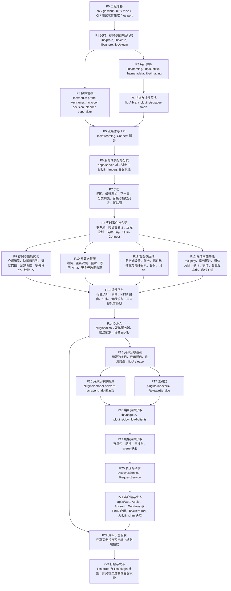

# Mavio 路线图

> [English](roadmap.md) | 简体中文

> 相关文档：[架构](architecture.zh-CN.md) · [领域模型](domain.zh-CN.md) · [开发指南](development.zh-CN.md) · [测试策略](testing.zh-CN.md) · [存储与性能优化](optimization.zh-CN.md) · [AGENTS.zh-CN.md](../AGENTS.zh-CN.md)

---

## 1. 推进原则

* **自底向上**：先实现零业务依赖的底层库，再逐层向上组装；每一层只依赖已完成的下层。
* **完成标准**：一个阶段的库通过各自的测试即为完成，包括全部移植的测试用例（或有明确标记、写明原因的 skip），见[测试策略 §2](testing.zh-CN.md#2-移植测试用例)。
* **服务端优先**：P7 至 P12 对照 Jellyfin 服务端（其 API 控制器与元数据提供者）补全服务端；P13 与 P14 让插件能力与 Jellyfin 对齐并加入 DLNA；P15 至 P20 加入资源获取，即 Seerr、Radarr、Sonarr 与 Prowlarr 在 Jellyfin 旁所做的事（[架构 §13](architecture.zh-CN.md#13-资源获取libsacquire)）；客户端在 P21 构建，其基础部分基于已完成的浏览与播放 API，与 P19、P20 并行；P22 在真实设备上端到端验证播放；P23 打包并发布版本。
* **集成冒烟**：从 P1 起，每个阶段结束时在 `apps/server/internal/smoke` 增加一个把已完成的库串起来的集成测试。它不是 MVP，只用来尽早暴露接口漂移，降低自底向上方式"后期集成才发现问题"的风险。

---

## 2. 阶段总览

| 阶段 | 主题 | 状态 |
| :--- | :--- | :--- |
| P0 | 工程地基 | ✅ 已完成 |
| P1 | 契约、存储与插件运行时 | ✅ 已完成 |
| P2 | 纯计算库 | ✅ 已完成 |
| P3 | 媒体管线 | ✅ 已完成 |
| P4 | 扫描与插件落地 | ✅ 已完成 |
| P5 | 流媒体与 API | ✅ 完成 |
| P6 | 服务端装配与分发 | 进行中 |
| P7 | 浏览 | ✅ 已完成 |
| P8 | 实时事件与会话 | ✅ 已完成 |
| P9 | 存储与性能优化 | ✅ 已完成 |
| P10 | 元数据管理 | ✅ 完成 |
| P11 | 管理与运维 | ✅ 完成 |
| P12 | 媒体附加功能 | ✅ 完成 |
| P13 | 插件平台 | ✅ 完成 |
| P14 | DLNA | ✅ 完成 |
| P15 | 资源获取基础 | ✅ 完成 |
| P16 | 资源获取数据源 | 进行中 |
| P17 | 索引器 | ✅ 完成 |
| P18 | 电影资源获取 | ✅ 完成 |
| P19 | 剧集资源获取 | ✅ 完成 |
| P20 | 发现与请求 | ✅ 完成 |
| P21 | 客户端与生态 | 进行中 |
| P22 | 真实设备验收 | 未开始 |
| P23 | 打包与发布 | 未开始 |

---

## 3. 阶段详情

### P0 工程地基
**范围**：仓库骨架、mise、Nx、go.work、buf、golangci-lint + depguard；CI 矩阵（linux amd64/arm64、macOS、Windows）；`tools/fixtures`、`tools/testport`。

**完成标准**：`nx affected` 可用；`tidy-check`（`GOWORK=off`）通过。

**进度**：
- [x] Go 模块骨架与 `go.work`；Nx 及本地插件 `tools/nx-go`（自动推断项目与依赖图）
- [x] mise 锁定工具链版本
- [x] buf 与首个契约 `mavio.system.v1.SystemService`；`apps/server` 提供 Connect 健康检查接口
- [x] golangci-lint 与 depguard 依赖方向规则
- [x] CI 工作流：受影响项目检查、生成代码一致性检查、`buf breaking`、多平台测试矩阵
- [x] `tools/fixtures`：测试媒体生成
- [x] `tools/testport`：Jellyfin 测试用例提取

### P1 契约、存储与插件运行时
**范围**：`proto` 契约初版；`core` 领域模型；`store`（ent + Atlas + sqlc，双方言）与任务队列；`plugin` 两种运行时与握手。

**完成标准**：仓储一致性测试在 SQLite 与 PostgreSQL 上均通过；插件崩溃不影响宿主，并能自动重启。

**进度**：
- [x] `libs/core`：领域模型与仓储端口（[领域模型](domain.zh-CN.md)）
- [x] `libs/proto`：第一版契约（library、user、system、plugin）
- [x] `libs/store`：仓储端口的 SQLite 与 PostgreSQL 实现，包括任务队列
- [x] `libs/plugin`：WASM 与子进程两种运行时
- [x] 冒烟测试 `apps/server/internal/smoke`：排队的元数据刷新任务从插件（两种运行时）取得元数据，连同署名一起写入存储，并能被搜索到

### P2 纯计算库
**范围**：`naming`、`subtitle`、`metadata`（NFO）、`imaging`。

**完成标准**：对应的移植用例全部通过。

**进展**：
- [x] `libs/naming`：Jellyfin 的命名规则，覆盖电影、剧集、季、剧集系列、分段、多版本、附加内容、音乐、有声书、图书与外部文件；移植用例全部通过或带原因跳过
- [x] `libs/subtitle`：SRT / SSA / ASS / WebVTT 解析，转换为 SRT / SSA / ASS / WebVTT / TTML / JSON，按时间窗口过滤，以及字符集检测
- [x] `libs/metadata`：读取电影、视频、音乐视频、剧集、季、单集（含多集文件）、专辑与艺人的 NFO；从 URL 中识别提供者 ID；电影 NFO 的位置。写入 NFO 留到保存元数据的阶段。
- [x] `libs/imaging`：Jellyfin 的尺寸规则、缩小时带锐化的缩放、图片格式与 SVG 安全检查。WebP 编码与占位图（blurhash / thumbhash）随 P5 的图片 API 实现，拼贴图随 P7 的浏览实现。
- [x] 冒烟测试 `apps/server/internal/smoke`：解析一集的文件名，读取 NFO，连同署名写入存储并能查到；字幕转换为 WebVTT，海报缩放

### P3 媒体管线
**范围**：`probe`、`keyframes`、`hwaccel`、`decision`、`planner`、`supervisor`。

**完成标准**：StreamBuilder 与 EncodingHelper 的移植用例全部通过；在现有硬件（维护者自己的机器与 GitHub 托管的 CI runner）上的真实转码冒烟测试通过；没有对应硬件的厂商路径只由移植的参数推导用例覆盖。

**进展**：
- [x] `probe`：按 Jellyfin 的方式规范化 ffprobe 输出，包括杜比视界、HDR10+ 与范围类型；移植用例全部通过
- [x] `keyframes`：从 ffprobe 数据包标志得到关键帧时间
- [x] `hwaccel`：版本检查，编解码器、滤镜与选项清单，VideoToolbox 试编码，VA-API 驱动检查
- [x] `decision`：用 `ClientCapabilities` 替代 `DeviceProfile` 的 StreamBuilder 与流选择；StreamBuilder 的 307 个用例全部通过
- [x] `planner`：滤镜图 IR，CMAF HLS 与渐进式命令；软件与 VideoToolbox 策略；EncodingHelper 的移植用例全部通过
- [x] `supervisor`：生命周期、空闲回收、节流、进度、已提供分片
- [x] 冒烟测试 `apps/server/internal/smoke`：一个 HDR10 HEVC 文件经过探测，被有能力的客户端直放，并在监管下为网页客户端从拖动位置转码为 H.264 HLS
- [x] 在 GitHub 托管 runner 上的真实转码（CI 任务 `media`，Linux 与 macOS）

### P4 扫描与插件落地
**范围**：`library` 扫描器（全量对账，见[架构 §9](architecture.zh-CN.md#9-媒体库扫描与变更检测libslibrary)）、解析器链、任务调度；`plugins/scraper-tmdb`（WASM）。

**完成标准**：库解析器移植用例通过；扫描结果在两种数据库上一致；新增 / 删除 / 重命名 / 内容修改 / 挂载点暂时不可用等场景下，对账都收敛到正确状态。

**进展**：
- [x] 逐文件夹的解析器链：电影、剧集、音乐、图书、家庭视频与照片、附加内容、`.ignore` 文件；解析器移植用例通过
- [x] 扫描器：扫描世代，缺失条目保留并在宽限期后清除，按修改时间与文件 ID 剪枝文件夹，无法读取的文件夹保留其条目
- [x] 任务：扫描、探测与元数据刷新在任务队列上运行，带租约与定时扫描
- [x] `plugins/scraper-tmdb`：从 TMDB 获取电影、剧集、季与集；`TmdbUtils` 移植用例通过，缺失剧集用例在虚拟剧集进入领域模型前跳过
- [x] `apps/server` 中的适配器：元数据插件作为提供者，ffprobe 作为探测器
- [x] 冒烟测试 `apps/server/internal/smoke`：以 WASM 插件为提供者，把一个电影库和一个剧集库作为任务扫描；新增、删除、重命名、重写文件与媒体库文件夹不可用的情况下，SQLite 与 PostgreSQL 上收敛到相同状态

### P5 流媒体与 API
**范围**：`streaming`（CMAF HLS、按需分片、seek、分片缓存）；Connect 服务（库、播放、用户、系统）。

**完成标准**：HLS 移植用例通过；hls.js 与 AVFoundation 实机播放验证。Media3 在 P21 中随 Android 客户端验证。

**进度**：
- [x] `libs/streaming`：覆盖整个媒体源的播放列表、RFC 6381 编解码器字符串、按需生成分片并在拖动时重启、直接复制视频的分片由每个图像组一个文件拼接而成；HLS 移植用例通过
- [x] 认证：首个管理员、按设备登录并以散列保存访问令牌、argon2id 密码、`mavio.auth.v1.AuthService`、Bearer 令牌与请求校验拦截器
- [x] 播放：`mavio.playback.v1.PlaybackService` 及直接播放与 HLS 转封装、转码的媒体端点，记住的与偏好的流，续播位置与已播放状态；用真实 ffmpeg 端到端验证
- [x] 字幕交付：文本字幕以转换后的文件交付（来自外挂文件或由 ffmpeg 提取），以及 HLS 字幕轨
- [x] 媒体库、条目与用户的 Connect 服务；服务端运行媒体库任务
- [x] 图片端点：本地与提供者的图片，按 Jellyfin 的尺寸规则缩放并缓存
- [x] 与客户端协商的 WebP 编码（`gen2brain/vpx`）；在媒体库任务中计算 blurhash / thumbhash 占位图
- [x] 通过开发用播放器在 Chromium 的 hls.js 上验证播放：直接串流、转码、拖动并重启转码、同步的 HLS 字幕轨、进度与停止
- [x] 通过开发用播放器在 Safari 的原生 HLS（即 AVFoundation）上验证播放：直接串流、转码、拖动并重启转码、同步的 HLS 字幕轨。HLS 字幕轨是按视频分片切分、不带 `X-TIMESTAMP-MAP` 的 WebVTT；若有播放器错位，则按视频的时间戳推算并加上该头

### P6 服务端装配与分发
**范围**：`apps/server` 装配；`CGO_ENABLED=0` 交叉编译；容器镜像内置 jellyfin-ffmpeg 的便携版，即 `mise.toml` 锁定的那一份。镜像发布属于 P23。

**完成标准**：端到端冒烟测试：扫描 → 刮削 → 播放决策 → HLS 播放。

**进度**：
- [x] 装配位于 `apps/server/internal/server`，`cmd/mavio` 以命令行参数运行它
- [x] 从插件目录（`--plugin-dir`）启动插件；插件配置经 `SystemService` 保存、按清单的 schema 校验并即时生效，无需重启；元数据插件就绪后参与媒体库刷新
- [x] 端到端测试：通过 API 测试装配好的服务端，使用真实 ffmpeg 与 WASM 元数据插件：管理员配置插件，扫描媒体库，刮削其中的影片并以 HLS 直接串流播放
- [x] `CGO_ENABLED=0` 交叉编译到 Linux、macOS、Windows 的 amd64 与 arm64（`server:dist`），并在 CI 中检查
- [x] 内置 jellyfin-ffmpeg 便携版的 linux/amd64 与 linux/arm64 容器镜像，在 CI 中构建并运行

### P7 浏览
**范围**：客户端列出与打开的内容。

- 用户的媒体库视图；各媒体库的最近添加；继续观看与剧集的下一集
- 剧集、季与单集；专辑与艺人
- 带条目数的类型、工作室、人物与年份列表，`libs/store` 已有这类查询
- 合集与播放列表：创建、编辑、排序与删除；领域模型中已有这两者
- 媒体库与合集拼贴图
- 按用户与客户端保存的显示偏好，由服务端保存，因而随用户跨设备
- 继承的分级

**完成标准**：通过 API 的端到端测试：通过视图、最近添加、下一集与类型浏览扫描过的电影与剧集媒体库，创建一个播放列表，且分级高于用户上限的剧集中的单集不可见。

**进度**：
- [x] 继承的分级：未分级的条目取最近一个有分级的祖先的分数，由存储层在每次写入时推导，并为已有数据库回填；分级过滤与访问检查使用它
- [x] 分级分数：元数据刷新用 Jellyfin 的分级体系把内容分级映射为分数（`metadata.RatingScore`，移植用例通过）；条目与权限策略的最高分级中，未分级为 nil 而非零
- [x] 带条目数的类型、标签、工作室、艺人、年份与人物列表（`ItemService.ListValues`、`ListPeople`），只统计用户可访问的条目
- [x] 与 Jellyfin 一样按剧集、季与专辑分组的最近添加（`ListLatestItems`），以及按播出顺序插入特别篇的下一集（`ListNextUp`）；条目响应给出单集所属的剧集与季、曲目所属的专辑。继续观看即带 `resumable` 并按最近播放排序的 `ListItems`
- [x] 合集（`CollectionService`，由管理员整理）与播放列表（`PlaylistService`，每个用户各自的，条目项可重复且可移动），位于服务端创建的整理类媒体库中；以它们为 parent 通过 `ListItems` 列出其中的条目
- [x] 按用户、客户端与视图保存的显示偏好（`DisplayPreferencesService`），名称与值由客户端决定
- [x] 媒体库、合集与播放列表的拼贴图（`/images/collages/{id}`、`imaging.Collage`），不绘制文字
- [x] 扫描为新增的无媒体条目（剧集、季、专辑）刷新元数据，此前只有媒体文件的探测才会触发刷新
- [x] 通过 API 测试装配好的服务端的端到端测试（`internal/server`、`TestBrowsing`）：扫描电影与剧集及其 NFO 文件，并通过视图、最近添加、下一集与类型浏览；限于 PG 的用户创建播放列表，且看不到 TV-14 剧集的任何单集

### P8 实时事件与会话
**范围**：客户端无需询问即可得知的变化，以及一台设备对另一台设备的操作。

- 事件：每个已登录设备一条事件流，传递媒体库变化、用户在其他设备上的播放状态与进度、任务进度与插件状态
- 会话：每台设备正在播放的内容；从一台设备远程控制另一台（播放、暂停、拖动、停止、消息）
- 同步观看（SyncPlay）：组内共享同一播放状态，等待正在缓冲的成员
- 用已登录设备让新设备登录（Quick Connect）

**完成标准**：通过 API 的端到端测试：一台设备在扫描后收到媒体库变化及另一台设备的进度，并控制那台设备的播放；同一 SyncPlay 组的两台设备保持在同一位置。涉及计时的逻辑用 `testing/synctest` 测试。

**进度**：
- [x] 事件流（`EventService`）：媒体库变化、条目状态、会话、命令、扫描与插件，每个设备只收到其用户可见的内容；存储层被观察，写入在提交后到达各流
- [x] 会话（`SessionService`）：设备在事件流打开期间在线、各设备正在播放的内容、远程命令
- [x] Quick Connect（`AuthService`）：在已登录设备上输入新设备的代码，使其登录
- [x] SyncPlay（`SyncPlayService`）：设备分组以同一位置播放同一队列，并等待缓冲中的成员，与 Jellyfin 相同；计时逻辑用 `testing/synctest` 测试
- [x] 通过 API 测试装配好的服务端的端到端测试（`internal/server`、`TestLiveEvents`）：电视得知扫描发现的影片以及手机的播放与状态，暂停手机，两者在 SyncPlay 分组中被告知在同一时刻、同一位置开始

### P9 存储与性能优化
**范围**：端到端 I/O 延迟抑制与预热调度（[存储与性能优化](optimization.zh-CN.md)）；语言/方言感知字幕评分；高保真视频管线增强；零模糊分发验证。

- 多维度存储介质与挂载协议识别：跨 Linux、Windows、macOS 原生识别本地 SSD、机械硬盘（Rotational HDD）、远程网络共享（SMB/NFS）以及云盘网盘（Dataless Mount）
- 物理驱动器防颠簸串行化（`VolumeLedger`）：为机械硬盘建立单并发车道，消除扫描与探测时的多任务随机寻道竞争
- 前台流媒体播放静默门控（`QuietGate`）：前台活跃播放期间自动对后台扫描与磁盘维护任务实施避让降级与暂停
- 写入中未完成文件检测策略（`GrowthPolicy`）：基于写入窗口与尺寸稳定性轮询，避免扫描未下载完成的文件
- 投机式索引与元数据预热调度（`PrefetchHeadTail`）：利用 Linux `posix_fadvise` 与跨平台顺序分块回退，精准预热容器头部元数据与尾部索引
- 字幕评分与方言归一化：语言评分矩阵、中文别名与变体（繁简、地区方言）归一化，以及听障/特效字幕降权
- 高保真视频管线适配：杜比视界 Profile 7 双层 EL 提取与回退色调映射；黑边检测（`cropdetect`）集成
- 分发验证与安全不变量：锁定依赖零模糊验证与隐私防泄漏失败关闭测试

**完成标准**：存储识别、并发串行化、静默门控与预热调度在 Linux、Windows、macOS 上的单元测试与集成测试全部通过；媒体库扫描在机械硬盘上保持顺序吞吐；播放启动干净打断后台 I/O；字幕评分正确匹配中文各方言变体。

**进展**：
- [x] 多维度介质与协议识别：`libs/library/storage` 原生实现 Linux（`sysfs`/`st_dev`）、macOS（`statfs`/`fsid`）与 Windows（`GetDriveType`/`IOCTL_STORAGE_QUERY_PROPERTY`）
- [x] 驱动器防颠簸串行化：`VolumeLedger`，每个卷一个先来先得的槽位
- [x] 前台播放静默门控：`QuietGate`，由前台活动延长、后台读取等过的静默截止时间
- [x] 写入中文件检测：`GrowthPolicy` 排除带下载后缀或在写入窗口内修改过的文件并推迟它们；`Scanner.RunDeferred` 在被推迟的文件稳定或消失后重新扫描其媒体库
- [x] 投机式预热调度器：`PrefetchHeadTail` 在 Linux 上使用 `posix_fadvise(WILLNEED)` 并支持跨平台顺序分块预热回退
- [x] 将 `libs/library/storage` 接入扫描与探测：每个文件夹的设备只识别一次（`storage.Detector`）；只对有寻道代价的驱动器以及远程或云端卷串行化，在这些设备上遍历器一次读一个文件夹，每次列目录与探测都占用该设备；同一磁盘上多个版本的探测不再等待自己
- [x] 播放中的 `QuietGate` 与预热：与 khuaplayer 的前台存储门禁一样，开始播放与每个媒体请求都延长静默窗口，而不是在整个播放期间挡住后台 I/O
- [x] 字幕评分与中文别名归一化：扫描把外挂字幕文件附加到其视频，语言取自文件名（含中文变体），并按评分模型排序；播放选择按规范化后的别名匹配偏好语言
- [x] 杜比视界 Profile 7：仅凭配置识别的独立增强层轨道从不被选为视频；HDR10 客户端得到去掉杜比视界元数据的基础层
- [x] 黑边裁剪：通过采样帧找出黑边（`libs/media/borders`、任务 `media.borders`），记录在视频流上，规划器重新编码时裁掉
- [x] 锁定依赖：`mise.toml` 按平台锁定 jellyfin-ffmpeg 的 SHA-256，并由测试与 Dockerfile 中的锁定比对
- [x] 卷保活：`storage.Keeper` 以绕过缓存的心跳读（`VolumeHeartbeat`）保持进行中播放的卷、以及在场用户“继续观看”媒体的卷（`internal/warming`）不休眠，并在客户端打开条目时唤醒其卷
- [x] 续播延迟：播放从请求位置之前至多 5 秒的关键帧或分段起点开始（`StartPlaybackResponse.start_position`），HLS 在播放开始时即从该处启动 ffmpeg，并预读其附近的媒体
- [x] 每个存储机制的落地对照索引及其与 Jellyfin 的差异（[优化 §1.9](optimization.zh-CN.md)）

### P10 元数据管理
**范围**：修正与补全媒体库扫描得到的内容。

- 编辑条目并锁定字段；对照提供者重新识别条目；刷新单个条目
- 列出提供者的图片；选择、上传与删除图片
- 把 NFO 文件与图片写到媒体旁（`libs/metadata` 目前只读取 NFO 文件）
- 以插件形式提供的元数据来源：音乐与图书（MusicBrainz、TheAudioDB）、更多图片（fanart.tv）、字幕下载
- 按提供者的合集自动创建电影合集

**完成标准**：通过 API 的端到端测试：管理员重新识别一部识别错误的影片并编辑它，锁定的字段在刷新后保持不变，选定的海报写到文件旁并被新的扫描读回。

**进展**：
- [x] `MetadataService`：按更新掩码编辑条目（包括锁定）；刷新单个条目，可选择替换其元数据；搜索提供者并重新识别条目
- [x] 图片：列出提供者的图片；按 URL 选择或上传图片；删除图片及其文件；选定的图片保存在媒体旁或元数据目录（`--metadata-dir`）
- [x] 本地元数据：`metadata.WriteNFO`，可被 `ParseNFO` 读回；保存本地元数据的媒体库写出 NFO 文件，并按 Jellyfin 的本地图片命名保存提供者的图片
- [x] 提供者插件：`scraper-musicbrainz`（艺术家、专辑、音轨，Cover Art Archive）、`scraper-theaudiodb`、`scraper-openlibrary`（图书与有声书）、`scraper-fanart`；字幕提供者契约（`SubtitleProviderService`）与 `subtitles-opensubtitles`，下载的字幕保存在视频旁
- [x] 按提供者的合集自动创建电影合集（`AutoCollections`）
- [x] 端到端测试（`apps/server/internal/server/metadata_test.go`）

### P11 管理与运维
**范围**：运行服务端时无需重启或修改命令行参数。

- 服务端设置保存在数据库中并通过 `SystemService` 设置，把管理员需要在运行时修改的项从命令行参数中接过来；先做转码设置（由管理员选择硬件加速、编码器预设、色调映射、转码目录）
- 浏览服务端目录以选择媒体库路径
- 任务：列出计划任务及其最近一次运行，立即运行某个任务
- 插件热插拔：安装、升级、卸载插件都不需要重启服务端，即[架构 §7.3](architecture.zh-CN.md#73-子进程运行时)所述。目前插件目录只在启动时读取，只有配置修改无需重启
- 可安装与升级插件的插件目录；服务端接入认证与通知插件，其契约（`AuthProvider`、`Notifier`）已经存在
- 供集成使用的 API key、活动日志、服务端日志、备份与恢复、本地化数据（国家、语言、分级体系）
- 网络：使用配置证书的 HTTPS、反向代理下的 base URL、局域网内的服务端发现

**完成标准**：通过 API 的端到端测试：管理员修改一项转码设置，下一次转码即按其执行；服务端持续提供服务的同时从插件目录安装、升级并卸载一个插件；备份恢复到一个新的服务端。

**进展**：
- [x] 服务端设置保存在数据库中，立即生效，某部分拒绝时回滚：转码（硬件加速、编码预设与质量、色调映射、去隔行、缩混、裁剪、转码目录）、网络、插件目录
- [x] 文件夹浏览；任务及其上次与下次运行、立即运行；作业队列；每日清理已结束的作业
- [x] 从插件目录热插拔插件：安装、可回滚的升级、卸载；服务端使用认证与通知插件
- [x] API 密钥；发送给通知插件的活动日志；最近的服务端日志
- [x] 备份与恢复（在两种数据库上的 `store.Dump` 与 `store.Restore`，以及图片与插件）
- [x] 本地化数据：国家、语言、分级体系；移植的 Jellyfin 本地化用例通过（翻译除外）
- [x] 网络：基础 URL、使用配置证书的 HTTPS、局域网发现
- [x] 端到端测试（`apps/server/internal/server/admin_test.go`）

### P12 媒体附加功能
**范围**：播放媒体流之外的媒体功能。

- 预览缩略图（trickplay，[架构 §6.1](architecture.zh-CN.md#61-需求与实现方案)）与章节图片
- 来自媒体片段提供者插件的媒体片段（片头、片尾）
- 歌词；供客户端渲染 ASS 字幕的内嵌字体；音量标准化
- 渐进式转码与离线下载（§4）

**完成标准**：用真实 ffmpeg 的测试生成 trickplay 拼图与章节图片，并下载、播放一个渐进式转码的文件；Jellyfin 有对应用例的部分，移植用例通过。

**进展**：
- [x] 缩略图拼图与章节图片（`libs/media/thumbnails`，任务 `media.trickplay` 与 `media.chapters`），按检测到的黑边裁剪，带失败熔断；从元数据目录提供
- [x] 来自片段提供者插件的媒体片段（`MediaSegmentProviderService`，任务 `media.segments`）
- [x] 歌词（`metadata.ParseLyrics`；Jellyfin 的 ELRC 用例通过），通过 `ItemService.GetLyrics` 提供；向客户端提供字体附件；音轨与专辑的响度（`media.loudness`）作为归一化增益
- [x] 渐进式转封装与转码；下载文件本身或渐进式转码结果
- [x] 使用真实 ffmpeg 的端到端测试（`apps/server/internal/server/extras_test.go`）

### P13 插件平台
**范围**：让 Mavio 两种运行时的插件都能做到 Jellyfin 插件能做的事（频道与直播电视除外）（[插件平台](plugins.zh-CN.md)）：带作用域、可代表用户的宿主 API；面向消费者的事件，以及发给通知插件的全部活动；HTTP 路由；任务与数据目录；远程设备；图片、歌词、本地元数据、保存器、处理器、解析器、片头、图片生成器、媒体源与密码重置提供者；外部 ID 声明；按媒体库的提供者顺序。

**完成标准**：为两种运行时构建的测试插件在端到端测试中通过装配好的服务端使用每一种能力；契约与 SDK 有文档。

**进度**：
- [x] 宿主 API：作用域、代表用户、两种运行时的传输
- [x] 数据目录；任务
- [x] 事件：[插件平台 §4](plugins.zh-CN.md#4-事件) 的事件类型、事件消费者、通知插件
- [x] HTTP 路由
- [x] 远程设备；代表设备
- [x] 图片、歌词、本地元数据、保存器与处理器提供者；外部 ID
- [x] 解析器、片头提供者、图片生成器、媒体源提供者、密码重置
- [x] 按媒体库的提供者顺序
- [x] 端到端测试（使用真实 ffmpeg 的 `apps/server/internal/server/capabilities_test.go` 与 `plugins_test.go`），覆盖两种运行时

### P14 DLNA
**范围**：`plugins/dlna`，第一方进程插件（[插件平台 §10](plugins.zh-CN.md#10-dlnapluginsdlna)）：媒体服务器（SSDP、ContentDirectory、ConnectionManager、带 DLNA 头的媒体）、推送播放（发现渲染器、AVTransport 与 RenderingControl）、设备 profile；为服务端的每个平台构建，打包为目录插件包并内置于容器镜像。

**完成标准**：端到端测试在回环接口上用模拟的控制点与渲染器发现服务端、浏览媒体库、以 Range 请求播放文件，并驱动渲染器完成播放、暂停、跳转与停止且上报进度。在真实电视上的播放验证在 P22 进行。

**进度**：
- [x] SSDP 与设备描述
- [x] ContentDirectory 与 ConnectionManager
- [x] 带 DLNA 头的媒体与设备 profile
- [x] 推送播放
- [x] 构建、目录插件包与容器镜像（插件种子目录）
- [x] 端到端测试（`apps/server/internal/server/dlna_test.go`）

### P15 资源获取基础
**范围**：服务端在能"想要"自己没有的媒体之前所需的东西（[架构 §13](architecture.zh-CN.md#13-资源获取libsacquire)）。

- 想要的条目：元数据中已知、但还没有文件的电影与剧集，与[领域模型](domain.zh-CN.md) §4.7 的缺失条目分开；电影、剧集、季与单集的监控状态
- 剧集：TVDB ID、剧集类型（standard、daily、anime）与显示顺序，即 Jellyfin 的 `DisplayOrder` 加 TMDB episode groups
- `libs/release`：release 标题解析（标题、年份、季与集、绝对集数与日播日期、质量、来源、分辨率、编码、语言、版本、发布组），沿用 Radarr 与 Sonarr 解析规则的 .NET 语法，在 `regexp2` 上运行
- `tools/testport` 读取 NUnit 测试用例，使 Radarr 与 Sonarr 的解析用例能像 Jellyfin 的一样移植

**完成标准**：移植的解析用例通过或带原因跳过；P4 跳过的 `scraper-tmdb` 缺失剧集用例通过；剧集的单集按其显示顺序列出。

**进度**：
- [x] 虚拟条目与被监控条目（[领域模型 §4.8](domain.zh-CN.md#48-虚拟条目)）；集列表提供者（`EPISODE_LIST_PROVIDER`，[插件 §8.12](plugins.zh-CN.md#812-资源获取提供者)）；缺失剧集用例在 `libs/library` 中通过
- [x] 剧集类型、显示顺序与绝对集数；`scraper-tmdb` 按剧集的 TMDB episode group 给季与单集编号
- [x] `libs/release` 及 Radarr 与 Sonarr 的解析用例
- [x] `tools/testport` 读取 NUnit 测试用例
- [x] 监控剧集或更改其显示顺序会立即刷新它；端到端测试（`apps/server/internal/server/episodes_test.go`）

### P16 资源获取数据源
**范围**：资源获取所需的元数据，默认无需密钥。

- `plugins/scraper-servarr`（WASM）：Radarr 的电影元数据与列表、Sonarr SkyHook 中按 TVDB 编号的剧集与单集、scene 映射、日播剧、XEM
- `scraper-tmdb`：管理员未设置密钥时使用 Radarr 的 TMDB 只读访问令牌，TMDB 拒绝该令牌时使用 Mavio 自己的密钥；`DISCOVERY_PROVIDER`（趋势、热门、即将上映，按类型、制片公司、电视网、关键词与观看平台，推荐与相似作品）；episode groups

**完成标准**：在未配置任何密钥的情况下（包括 TMDB 拒绝 Radarr 令牌时）识别并刷新一部电影与一部剧集，剧集中想要的单集按 TVDB 编号，并按其 TVDB ID 挂上 TMDB 的单集元数据，TMDB 编号不同时亦然。

**进度**：
- [x] `scraper-tmdb` 无需密钥：使用 Radarr 的令牌，TMDB 拒绝后改用 Mavio 的密钥（由 `MAVIO_TMDB_KEY` 编入）
- [ ] 注册 Mavio 自己的 TMDB API 密钥，并在发布构建中设为 `MAVIO_TMDB_KEY`（需要项目的 TMDB 账号）
- [x] `scraper-tmdb` 的 `DISCOVERY_PROVIDER`
- [x] `plugins/scraper-servarr`：Radarr 的电影元数据与列表、SkyHook 的剧集与单集、scene 映射、日播剧、XEM
- [x] 端到端测试（`apps/server/internal/server/sources_test.go`）

### P17 索引器
**范围**：`plugins/indexers`，移植 Prowlarr 的第一方进程插件：Newznab、Torznab、Cardigann 引擎及 `indexers.prowlarr.com` 的定义、Prowlarr 以代码实现的全部站点、分类与能力、限速与退避、索引器代理（HTTP、SOCKS、FlareSolverr）。能力类型 `INDEXER_PROVIDER`；`ReleaseService` 搜索已配置的索引器，并用 `libs/release` 解析其结果。

**完成标准**：移植的 Prowlarr 用例通过；通过装配好的服务端，对 Newznab、Torznab、Cardigann 定义与代码实现站点的录制响应进行搜索，并解析为 release。

**进展**：
- [x] `INDEXER_PROVIDER` 契约（`mavio/plugin/v1/indexer.proto`）及其宿主客户端
- [x] Prowlarr 的用例与录制响应移植到 `plugins/indexers/testdata`
- [x] 数字、大小与日期解析（`internal/parse`）
- [x] 分类、能力与搜索条件（`internal/indexer`）
- [x] Newznab 与 Torznab（`internal/sites/newznab`、`internal/sites/torznab`）
  - [x] 搜索的时间与大小限制（`minage`、`maxage`、`minsize`、`maxsize`）：查询携带它们，Newznab 与 Torznab 发送它们，插件丢弃超出限制的发布；交互式的 `SearchReleases` 如 Prowlarr 的搜索那样接受它们
  - [x] 能力跨重启保存在插件的数据目录中，只在索引器的 URL 或 API 密钥改变或满一周后重新读取
- [x] Cardigann 引擎（`internal/sites/cardigann`）：从目录及其 `Custom` 子目录读取定义，模板、过滤器、HTML、XML 与 JSON 选择器，登录、搜索与下载
  - [x] 拉取并更新 `indexers.prowlarr.com` 的定义，由插件的装配完成
  - [ ] 手动解答验证码：目前没有界面展示图片验证码，自动登录遇到时失败
  - [x] 像 Prowlarr 的 GetCookies 那样，以 `cookie` 设置的 cookie 取代响应设置的 cookie
- [x] Prowlarr 以代码实现的站点，其标记为过时者除外
  - [x] Gazelle（`internal/sites/gazelle`）：AlphaRatio、BrokenStones、DesiGaane、DICMusic、GreatPosterWall、Secret Cinema；使用 API 密钥的 Orpheus、Redacted
  - [x] AvistaZ（`internal/sites/avistaz`）：AnimeZ、AvistaZ、CinemaZ、ExoticaZ、PrivateHD
  - [x] SpeedApp（`internal/sites/speedapp`）：RetroFlix、SpeedApp.io
  - [x] BroadcasTheNet（`internal/sites/broadcasthenet`），以 API 每小时 150 次调用作为其定义的默认限额
    - [x] 其发布的来源组、片源、容器、编码与分辨率，如同 Prowlarr 的 TorrentInfo 所保留
  - [x] FileList（`internal/sites/filelist`）
  - [x] HDBits（`internal/sites/hdbits`）
  - [x] PassThePopcorn（`internal/sites/passthepopcorn`）
  - [x] GazelleGames（`internal/sites/gazellegames`），在测试或首次下载时获取 passkey
    - [x] 其大小限制（`sizesmall`、`sizeslarge`），由查询的 `minsize` 与 `maxsize` 发送
  - [x] IPTorrents（`internal/sites/iptorrents`），使用浏览器的 Cookie 和 User-Agent 抓取其页面
  - [x] BitHDTV、HD-Torrents、ImmortalSeed、Libble、NorBits 和 PiXELHD（`internal/sites/<name>`），抓取其页面
  - [x] Headphones、Knaben、NzbIndex、RuTracker、TorrentPotato 和 TorrentsCSV（`internal/sites/<name>`）
    - [x] 像 Prowlarr 的 NzbValidationService 那样，在转交前检查每个 Usenet 索引器下载的 NZB
    - [ ] RuTracker 的登录验证码：尚无界面显示它，自动登录会失败
  - [x] BeyondHD、M-Team TP、MyAnonamouse、Nebulance、Shazbat 和 TorrentDay（`internal/sites/<name>`）
    - [x] MyAnonamouse 的大小限制（`tor[minSize]`、`tor[maxSize]`），由查询的 `minsize` 和 `maxsize` 发送
    - [x] 像 Prowlarr 那样在测试 MyAnonamouse 前清除其 Cookie
  - [x] PreToMe、RevolutionTT、SceneHD、SpeedCD、TorrentBytes、TorrentSyndikat、Uniotaku 和 XSpeeds（`internal/sites/<name>`）
  - [x] AnimeBytes、Anidex、Anidub、BakaBT、SubsPlease 和 Toloka.to（`internal/sites/<name>`）
    - [x] 像 Prowlarr 那样将 AnimeBytes 的结果缓存三分钟
    - [x] Anidub 的分辨率，从每个种子的质量块读取（Prowlarr 从错误的元素读取，因而读不到）
  - [x] AvistaZ 与 SpeedApp 站点的 API 令牌跨重启保存在插件的数据目录中，如同 Prowlarr 将其存入设置
  - [x] torrent 索引器的做种设置：决策检查最少做种数，分享率、做种时间与整季包做种时间在抓取时交给下载客户端，如同 Radarr 与 Sonarr 的 SeedConfigProvider
- [x] 限速、退避与索引器代理（HTTP、SOCKS、FlareSolverr）
- [x] `ReleaseService`（`mavio/acquisition/v1/release.proto`、`apps/server/internal/releases`）：列出各就绪提供方的索引器；如 Radarr 与 Sonarr 的 FetchReleases 那样逐级为媒体库中的电影、季或单集搜索（先按各索引器支持的 ID，再按标题），或按文本搜索；用 `libs/release` 解析 release
  - [x] 如 Sonarr 的 SearchAnimeSeason 那样逐集搜索动漫的季，每个已播出的单集按其绝对集数搜索
  - [x] Newznab 的 `title` 参数：如 Sonarr 那样，以原始标题发给支持它的索引器
  - [x] 剧集除标题外也按 scene 标题与映射（XEM）搜索，随 P19 完成
  - [x] 服务器保存索引器及其能力一小时，直到其插件重启或重新配置，搜索无需先列出索引器
- [x] 端到端测试（`apps/server/internal/server/releases_test.go`）：经装配好的服务器搜索 Newznab、Torznab、以 `indexers.prowlarr.com` 的方式提供的 Cardigann 定义以及 NzbIndex

### P18 电影资源获取
**范围**：`libs/acquire` 及其 `movie` 包，移植 Radarr；`plugins/download-clients`，包含 Radarr 与 Sonarr 支持的全部下载客户端的第一方进程插件。

- 质量定义与质量档案，每部被监控的电影、剧集与季一个档案；custom formats、delay profile 与 release profile
- 决策：Radarr 决策引擎的各项规格；排序
- 以作业执行的 RSS 同步与搜索；被跟踪下载的队列；远程路径映射
- 入库：完成的下载经 ffprobe 校验，按命名模板硬链接或移动进媒体库，并扫描其所在目录；升级到截止质量为止，被替换的文件移入回收目录；下载失败时加入黑名单并重新搜索
- 历史

**完成标准**：端到端测试在回环接口上模拟索引器与下载客户端：一部想要的电影被找到、发送、跟踪、入库并播放，随后被更好的 release 升级；失败的下载被加入黑名单并被替换。

**进度**：
- [x] `DOWNLOAD_CLIENT_PROVIDER` 契约（`mavio/plugin/v1/download_client.proto`）及其宿主客户端
- [x] `plugins/download-clients`：Radarr 与 Sonarr 的下载客户端，并移植其用例（`internal/clients/<name>`：Aria2、Torrent 与 Usenet Blackhole、Deluge、Download Station、Flood、Freebox、Hadouken、NZBGet、NzbVortex、Pneumatic、qBittorrent、rqbit、rTorrent、SABnzbd、Transmission、uTorrent、Vuze）
  - [x] 抓取时给出的做种限制保存在插件数据目录（`seeds.json`）中，重启后保留，如同 Radarr 保存其做种配置
  - [x] 下载客户端标签（`tags`）：电影或剧集只使用与其共享某个标签的客户端，否则使用无标签的客户端
  - [x] Flood 的附加标签（标题 slug、质量、语言、发布组、年份、索引器、制片公司或电视网、合集），取自抓取携带的信息
  - [x] Sonarr 对 Pneumatic 整季的拒绝，由抓取表明是否为整季
  - [x] release 未给出哈希的种子，若其哈希已被拉黑则被拒绝，仅针对设置为拒绝的索引器与非交互式搜索的 release，如同 Radarr 的 TorrentClientBase.EnsureReleaseIsNotBlocklisted；客户端得知的哈希随抓取记录
  - [x] 各客户端共用的辅助代码，取代各自的副本：远程路径拼接、.NET 版本解析、JSON-RPC 与 XML-RPC、URL base 校验、自由格式的标签字段、“发布被拒”与“发布被拉黑”错误、测试的警告、NZB 有效性检查、可配置的历史条数上限（`history_limit`）、保留客户端给出的 ID 大小写，以及把 `::1` 视为本机
- [x] `libs/acquire`：质量及其定义、质量档案、custom formats、delay profile、release profile
- [x] 决策：Radarr 决策引擎的各项规格及其排序，并移植其用例（`libs/acquire`）
  - [x] 按 ID 找不到索引器时按名称查找，如同 Radarr 的 AggregateLanguages
  - [ ] 区分未知语言与任意语言；目前未知语言视为任意语言
  - [x] 索引器的标签，由索引器标签规格检查
- [x] 领域与存储：档案、custom formats、被跟踪下载的队列、历史、黑名单、远程路径映射、命名（`libs/core/acquisition.go`、`libs/store`）
  - [ ] 质量档案的格式评分对照已有的 custom formats 进行检查
- [x] 按 TMDB ID 把想要的电影加入媒体库，带质量档案与最低可用状态（`WantedService`、`apps/server/internal/acquisition`）
  - [ ] 电影的数字版与实体版发行日期，可用状态需要它们；在此之前，电影在首映 90 天后视为已发行，与 Radarr 缺少这些日期时的假定相同
  - [ ] 电影的原始语言，要求"Original"的档案需要它；在此之前这些档案接受任何语言
  - [ ] 识别失败的电影保留其占位名称（"TMDB <id>"）
- [x] 以作业执行的电影搜索与 RSS 同步；通过 `DownloadService` 抓取；`SearchReleases` 给出决策
  - [ ] 按电影的别名、译名与次要年份匹配发布
  - [x] 索引器的标签、必需标志、最少做种数与 MULTi 语言，由索引器插件按其配置提供
  - [x] 下载客户端的标签，以及优先级最高的客户端之间轮流使用，如同 Radarr 的 DownloadClientProvider.GetDownloadClient
  - [ ] 索引器指定的下载客户端，Radarr 总把该索引器的 release 发送给它
  - [ ] 某协议的客户端都因失败而暂被排除时，非待定 release 的抓取仍尝试其中之一，如同 Radarr；目前该 release 转为待定
  - [x] 交互式搜索抓取的失败发布仅在开启 `AutoRedownloadFailedFromInteractiveSearch` 时重新搜索，如同 Radarr 的 RedownloadFailedDownloadService
- [x] 队列：从客户端轮询的被跟踪下载
  - [x] 无法应答或因失败而暂被排除的客户端的下载保留最后状态，而非被标记
- [x] 入库、升级与回收目录
  - [ ] 由文件的媒体信息汇总质量，以及文件名中的媒体信息标记
  - [ ] 按语言命名的附加文件，以及升级时删除旧的附加文件
  - [ ] 手动导入下载中的文件
  - [ ] 在入库写入的卷上检查剩余空间，而非媒体库文件夹
  - [ ] 删除入库后留空的下载文件夹
  - [ ] 只扫描入库的文件，而非其所在的整个媒体库
- [x] 失败的下载：黑名单与重新搜索
- [x] 获取作业（RSS 同步、队列检查、回收目录清理）列于 `TaskService` 的任务中，并可按需运行
- [x] 端到端测试（`apps/server/internal/server/acquisition_test.go`）：在回环接口上模拟 Newznab 索引器与 SABnzbd，经由索引器与下载客户端插件；一部想要的电影被搜索、抓取、跟踪、按 Radarr 的命名入库并播放，随后被 RSS 同步找到的发布升级，旧文件移入回收目录；失败的下载被加入黑名单，并由新的搜索替换
  - [ ] 种子客户端，以及以硬链接或复制入库，而非 SABnzbd 的下载所用的移动
  - [ ] 端到端测试中的远程路径映射；单元测试已覆盖

### P19 剧集资源获取
**范围**：`libs/acquire/series`，移植 Sonarr：单集、整季与整剧搜索，整季包，多集文件，按绝对集数的动漫，按播出日期的日播剧，scene 映射与 XEM，新季与新集的监控。

**完成标准**：P18 的端到端测试换成剧集：想要的单集以单集和整季包的形式被找到，动漫与日播剧按其编号匹配，每一集入库后即可播放。

**进展**：
- [x] 决策：Sonarr 决策引擎的各项规格及其排序，并移植其用例（`libs/acquire/series`）
  - [x] 按 ID 找不到索引器时按名称查找，如同 Sonarr 的 AggregateLanguages
- [x] 按 Sonarr 的方式命名剧集文件、剧集与季文件夹（`libs/acquire/organize`）
- [x] 想要的剧集与单集：按 TVDB ID 加入剧集，带质量档案，监控新季与新集（`WantedService.AddSeries`、`apps/server/internal/acquisition`）
  - [x] 扫描在磁盘上找到的季与单集按 Sonarr 的 GetMonitoredStatus 监控：单集随其季，但第 1 季以外的第 0 集不监控；季随剧集的新季，但特别篇不监控
  - [x] Sonarr 的 `AutoUnmonitorPreviouslyDownloadedEpisodes`：扫描发现文件丢失的想要剧集的单集被取消监控，在此之前 RSS 同步跳过它们
  - [x] 每一集自己的上次搜索时间（`EpisodeState.LastSearchedAt`），在为其搜索了索引器时设置，并决定缺失单集批量搜索的顺序
- [x] 以作业执行的单集、整季与整剧搜索及 RSS 同步；通过 scene 映射、XEM、绝对集数与播出日期把发布匹配到单集（`libs/acquire/series`、作业 `acquisition.episode_search`，scene 映射由 `acquisition.scene_mappings` 刷新）
  - [x] 像 Sonarr 一样把 scene 编号保存在单集上（`EpisodeState`），并像 Sonarr 的 `XemService` 那样推算并标记为未验证；在剧集加入时以及随 scene 映射一同刷新
  - [x] 对设置了 `anime_standard_format_search`（Sonarr 的 `AnimeStandardFormatSearch`）的索引器，按季与集搜索动漫，按季搜索动漫整季包；同时按 ID 与标题搜索的 scene 映射
  - [ ] 整部剧集的交互式搜索
  - [x] 剧集与电影引擎使用服务器的日志记录器，而不是默认的
- [x] 单集、整季包与多集文件的入库；升级
  - [x] 剧集命名设置：是否重命名单集、单集文件格式、剧集、季与特别篇目录格式与多集样式，为空时使用 Sonarr 的默认值
  - [ ] Sonarr 关于单集标题、解压中、未验证的 scene 编号、绝对集数与文件夹匹配的入库规格，以及其 scene 名称检查
  - [ ] 按 Sonarr 的方式汇总单集文件的质量
  - [x] 多集文件所涵盖的各集的历史记录在入库与扫描时由该文件的条目保留
- [x] 端到端测试（`apps/server/internal/server/series_acquisition_test.go`）：普通剧集的整季包与单集、以 scene 映射标题和绝对集数命名的动漫 release、以播出日期命名的日播剧 release 被找到，按 Sonarr 的命名入库并播放
  - [ ] 端到端测试中的剧集 RSS 同步、多集文件与单集升级
  - [ ] 端到端测试中 XEM 的 scene 编号
  - [ ] 端到端测试中失败的单集下载、阻止列表以及替代它们的搜索
  - [x] `RunTask` 在未排入新作业时返回已排队或运行中的作业

### P20 发现与请求
**范围**：移植 Seerr。`DiscoverService` 列出发现提供者给出的内容，并标明已入库、想要或已请求；`RequestService`：电影与季的请求，由管理员审批或自动通过，按用户的配额，用户的分级限制同样作用于其可请求的内容，通知请求者；报告条目的问题。

**完成标准**：端到端测试：限制为 PG 的用户通过发现找到一部电影与一部剧集，无法请求分级超出限制的作品，请求其余作品；管理员审批；作品被获取，用户收到可播放的通知。

**进展**：
- [x] 领域与存储：请求及其季、问题及其评论、用户的请求权限与配额、服务器的请求设置（`libs/core/request.go`、`libs/store`）
- [x] `DiscoverService`：发现提供者的目录，其中的作品标明已入库、想要或已请求，并应用用户的分级限制（`apps/server/internal/requests`）
  - [x] 发现中的文本搜索（`DiscoverService.SearchTitles`），经发现提供者的 `SearchTitles`；scraper-tmdb 按 Seerr 的方式搜索，支持 `tmdb:`、`imdb:`、`tvdb:` 与 `year:` 前缀
  - [x] 剔除作品后的页数与总数：`hidden_results` 统计本页剔除的作品，`total_results` 为提供者的总数减去它们，仅一页时精确，否则为上限
  - [x] 除非用户策略屏蔽未分级作品，分级筛选保留未分级作品：仅当调用者指定分级或屏蔽未分级作品时才把分级交给提供者，否则由服务器自行分级筛选
  - [x] 作品详情，含其各季的状态（`DiscoverService.GetTitle`），如 Seerr 的电影与剧集详情
- [x] `RequestService`：按 Seerr 的方式检查电影与季的请求（权限、分级限制、配额、重复），自动或由管理员审批，经 `WantedService` 获取，其条目可用时完成（`requests.availability`）
  - [x] 为请求的动漫使用单独的质量档案与媒体库（`RequestSettings.AnimeQualityProfileID`、`AnimeLibraryID`），并作为动漫剧集添加，如 Seerr 的动漫设置
  - [x] Seerr 中作品的已阻止与已删除状态：阻止列表（`BlockTitle`、`UnblockTitle`、`ListBlockedTitles`、`core.BlockedTitle`）拒绝其中作品的请求；已完成请求的文件已不存在的作品为已删除，可再次请求
    - [ ] Seerr 的阻止标签（按关键词自动阻止作品）与阻止整个合集
  - [x] 分级与名称使用服务器级元数据设置（`ServerSettings.Metadata`）的国家与语言，而非目标媒体库的
  - [x] 可用性作业列入任务列表（`TaskService`，“Sync request availability”）
- [x] `IssueService`：报告条目的问题，评论、解决与重新打开
- [x] 通知：所涉用户的活动，经 `ActivityService.ListMyActivities` 读取，由通知插件投递
  - [x] 向所涉用户的会话推送事件，待管理员处理的请求与问题也推送给管理员的会话（`NotificationReceived`）
- [x] 端到端测试（`apps/server/internal/server/requests_test.go`）：限制为 PG 的用户经 scraper-tmdb 发现一部电影与一部剧集，请求 R 级电影被拒，请求其余作品；管理员审批；作品被抓取、入库并播放，用户收到可播放的通知；用户报告的问题被解决
  - [ ] 端到端测试中被拒绝的请求、耗尽的配额与重试的失败请求
  - [ ] 端到端测试中修改待审批请求的季，以及请求全部季
  - [ ] 端到端测试中对策略屏蔽未分级内容的用户隐藏未分级作品

### P21 客户端与生态
**范围**：基于完成的服务端 API 构建[客户端](clients.zh-CN.md)：内嵌于服务端的 Web UI（`apps/web`，在 `/` 提供）、面向 iPhone 与 iPad、Apple TV 与 Mac 的 Apple 应用（`apps/ios`、`apps/tvos`、`apps/macos`）、面向手机与平板及 Android TV 的 Android 应用（`apps/android`、`apps/android-tv`）、基于 MyGo 的 Windows 与 Linux 应用（`apps/windows-linux`），以及它们共享的库（`libs/client-ts`、`libs/client-rust`、`libs/apple`、`libs/android`、`libs/design`）；决定是否采用 Jellyfin API 兼容垫片（shim）（[评估](jellyfin-compat.zh-CN.md)）。其基础部分不等待 P20：工具链与构建目标、从 `libs/proto` 生成的 TypeScript 与 Rust 代码、`libs/design`、§4 中客户端待决事项所列的原型，以及各应用与库的骨架。只有发现与请求页面等待 P20。之后按以下顺序构建客户端，每一个都先验证共享核心与设计系统，下一个平台再在其上构建：Web UI，连同 `libs/client-ts` 与 `libs/design`；iPhone 与 iPad 应用，连同 `libs/client-rust` 与 `libs/apple`；Android 手机与平板应用，连同 `libs/android`；Apple TV 与 Android TV 应用；Mac 应用；Windows 与 Linux 应用。

**完成标准**：每个客户端同时登录两台服务器，显示一个合并了两者推荐行的首页，两台服务器都有的作品只显示一次；浏览媒体库，在两台服务器中搜索，打开条目并播放——直接播放，以及客户端需要时的转码——可选择音轨与字幕，上报进度并在另一个客户端上继续播放；从热门中请求一部作品，经批准、获取后显示为可观看；原生应用离线时以缓存内容启动，支持下载的应用离线播放已下载的条目。每个客户端的页面通过截图测试，`libs/design/parity.md` 中不再有计划中的功能。

**进度**：
- [x] 工具链与构建目标：`libs/client-rust` 中的 Rust 与 `tools/nx-cargo`；更新 Go、Node.js 与 pnpm
- [x] 从 `libs/proto` 生成 TypeScript 与 Rust（`@mavio/proto`、`mavio-api`）
- [x] `libs/design`：tokens、图标、字符串、组件规范与功能对齐表，为每个客户端编译
- [x] 服务端：`HomeService`，提供首页与媒体库标签页的推荐行（`apps/server/internal/home`），由 `Library.Hubs` 按媒体库选择
  - [ ] 管理员推荐到首页的合集推荐行
  - [ ] 每种以种子生成的推荐行使用多个种子，如 Plex 显示多行"因为你看过"
- [x] 服务端：`ItemService.ListSimilarItems`，由 `ItemQuery.SimilarTo` 评分（`libs/store/items.go`）
  - [ ] 在本地结果之后，加入发现提供者给出、媒体库拥有的相似作品，如 Jellyfin 的远程相似条目提供者所做
- [x] 服务端：所有路由的跨域请求（`apps/server/internal/httpserver/cors.go`）
- [ ] 原型：
  - [x] tvOS 上的 Rust：在 `nightly-2026-10-10` 上以 `-Zbuild-std` 构建，`mavio-api` 及其 `events` 示例可为 `aarch64-apple-tvos` 与 `aarch64-apple-tvos-sim` 构建，示例在 tvOS 模拟器中运行，TLS（rustls 与 aws-lc-rs）可构建
  - [x] connect-rust 与 `EventService` 的流：`libs/client-rust/api/examples/events.rs` 登录并打印设备的事件，在 macOS 与 tvOS 模拟器上均可运行
  - [x] macOS、iOS 与 tvOS 上的 AetherEngine 7.34.0：在 Mac 上，HDR10 Matroska 源经引擎重封装由 AVPlayer 播放、VideoToolbox 解码，并提高显示器的 EDR 余量；画中画在其 `AVPlayerLayer` 上启动，VP9、AV1 与 MPEG-2 走软件路径时则在其 `AVSampleBufferDisplayLayer` 上启动；ASS 轨道以原始事件行连同脚本头送达。iPad 与 Apple TV 模拟器以软件路径播放相同的源，iPad 模拟器在应用转入后台时在样本缓冲显示层上进入画中画
    - [ ] 在用户的设备上：iPhone 或 iPad 上画中画内的画面、Apple TV 上的 HDR10 与显示条件，以及杜比视界源
  - [ ] MyGo 的视频元素，含 Windows 上的 HDR10：延后到有 Windows 机器时，在 Windows 与 Linux 应用开始之前完成
- [ ] 各应用与库的骨架
  - [x] `libs/client-rust`：`mavio-core`，以及 `mavio-uniffi`，其 `uniffi-bindgen` 生成 Swift 模块 `MavioCore` 与 Kotlin 包 `dev.mavio.core`；C ABI 及其消息（`capi`、`proto`）随其唯一使用者 Windows 与 Linux 应用一同到来
  - [x] Web：`apps/web`（React、Vite、TanStack Router 与 Query、基于设计 tokens 的 Tailwind CSS）与 `libs/client-ts`；服务端内嵌其构建（`apps/server/internal/webui`）并在 `/` 提供，容器镜像先构建它
  - [x] Apple：`libs/apple`（基于核心 XCFramework 的 `MavioKit`、使用 AetherEngine 的 `MavioPlayer`、基于 `libs/design` 的 Swift 包 `MavioDesign` 的 `MavioUI`）与应用 `apps/ios`、`apps/tvos`、`apps/macos`，各自在模拟器与 Mac 上显示核心的版本
  - [x] Android：`libs/android`（含核心 Kotlin API 与库的 `core`、使用 Media3 的 `player`、含设计 tokens、图标与字符串的 `ui`）与应用 `apps/android`、`apps/android-tv`，均能构建并通过 Android lint
  - [ ] Windows 与 Linux：`apps/windows-linux` 及核心的 C ABI（`capi`、`proto`）；与 MyGo 的视频元素一同延后到有 Windows 机器时
- [ ] `libs/client-rust`：服务器与登录、事件流、离线存储、播放上报、下载、页面状态、多台服务器的合并；Swift、Kotlin 与 Go 绑定
- [ ] Web UI（`apps/web`、`libs/client-ts`）
- [ ] iPhone 与 iPad 应用（`apps/ios`、`libs/apple`）
- [ ] Android 手机与平板应用（`apps/android`、`libs/android`）
- [ ] Apple TV 与 Android TV 应用
- [ ] Mac 应用
- [ ] Windows 与 Linux 应用
- [ ] 关于 Jellyfin API 兼容层的决定

### P22 真实设备验收
**范围**：在客户端完成之后，于真实设备上端到端验证播放：在真实电视上验证 DLNA 媒体服务器与推送播放，并按其实际行为调整 profile。

**完成标准**：真实电视通过媒体服务器浏览并播放媒体库，并能通过推送播放被驱动且上报进度。

**进度**：
- [ ] 在真实电视上验证 DLNA

### P23 打包与发布
**范围**：首批版本发布（[开发指南 §7](development.zh-CN.md#7-发布与版本)）：依次为 `libs/proto` 与 `libs/plugin` 打标签；发布服务端的版本二进制与容器镜像；发布包含 DLNA 插件的官方插件目录。

**完成标准**：仓库外的插件以 `GOWORK=off`、不用 `replace` 基于打了标签的 `libs/proto` 与 `libs/plugin` 构建成功；某个版本的二进制与镜像已发布，且镜像能启动。

**进度**：
- [ ] 为 `libs/proto` 与 `libs/plugin` 打发布标签
- [ ] 发布服务端的版本二进制与容器镜像
- [ ] 发布官方插件目录

---

## 4. 风险与待决事项

| 事项 | 说明 | 处理时机 |
| :--- | :--- | :--- |
| wazero 解释器平台 | armv7 / riscv64 上 SQLite 与 WASM 编解码器性能退化 | P1 实测；必要时为这些平台启用纯 Go 兜底 build tag |
| sqlc 双方言维护成本 | 热点查询需要两份 SQL | 坚持 ≤ 30 条预算；靠一致性测试兜底 |
| 纯 Go 图像缩放性能 | 大图缩放可能过慢 | 大图改走 ffmpeg 缩放（[架构 §6.2](architecture.zh-CN.md#62-性能策略)） |
| SVG 栅格化 | 纯 Go 方案不完善 | P2 已决定：检查后原样下发，不做栅格化 |
| 硬件测试覆盖 | 只有维护者自己的机器与 GitHub 托管 runner，其他厂商的编码器无法在实机上测试 | 真实转码测试在有硬件处运行、其余处跳过；其他厂商路径依赖移植的 EncodingHelper 用例 |
| Go 模块拆分过细 | 依赖升级与 tidy 的摩擦 | 持续观察，必要时合并模块 |
| 图形字幕 | PGS 与 VobSub 只能烧录，因而强制视频转码 | 有客户端能自行渲染 PGS 时（P21），改为以 `.sup` 交付该流 |
| fMP4 中为负的音频解码时间 | HLS 输出保留负时间戳，因此早于零点开始的音频（AAC 编码器的预填充）会以负的 `tfdt` 写出，而格式规定该字段为无符号数。hls.js 与 Safari 能正常播放，Jellyfin 对其 fMP4 客户端也写出同样的值；此外的播放器未经验证 | 若有播放器放错或丢弃音频：只把音频平移到零点，视频保持源文件的时间戳 |
| Servarr 的服务 | 资源获取使用 Radarr、Sonarr 与 Prowlarr 所用的服务及 Radarr 的 TMDB 令牌，自身不持有密钥；服务的运营方可能变更或撤回它们 | 请求携带该服务所属应用的 User-Agent；管理员可设置自己的 TMDB 密钥；Radarr 的令牌被拒绝时由 Mavio 自己的密钥接替；`scraper-servarr` 随版本跟进这些服务 |
| 剧集编号 | release 与文件按 TVDB 编号，TMDB 的元数据可能对同样的单集另行编号，动漫尤甚 | P15 与 P16 的显示顺序（TMDB episode groups）与单集 TVDB ID；P19 的 scene 映射与 XEM |
| 索引器变动 | 站点会改变页面与 API | Cardigann 定义在运行时拉取；索引器插件从插件目录升级，无需发布服务端 |
| 电视直播、录像与频道 | Jellyfin 中体量很大的部分，Mavio 既未采纳也未排除；插件平台不包含它们的提供者类型 | P21 之前决定 |
| 客户端许可证与应用商店 | 客户端将与仓库其余部分一样采用 GPL-3.0，其条款与 App Store 的条款冲突；以 LGPL 构建的 FFmpeg（Apple 平台上为 AetherEngine 的框架）与 libmpv 还要求允许用户重新链接 | 首次在 App Store 发布前决定：为客户端另定许可证、要求贡献者协议，或不通过 App Store 分发 |
| AetherEngine | Apple 应用的第二引擎是一个年轻的包，主要由一位维护者开发，7.x 版本发布频繁 | P21 先做原型：macOS、iOS 与 tvOS 上 HDR10 Matroska 源的 EDR 输出、杜比视界、带样式的 ASS 字幕与画中画；固定版本并跟进其发布 |
| Android 上的 libmpv | libmpv 是 Android 应用的第二引擎；在 Android TV 设备（其中许多为 32 位）孱弱的 GPU 上，其 OpenGL ES 渲染可能过慢，且不能输出 HDR | P21 在低端 Android TV 设备上实测；libmpv 跟不上的设备，应用不在能力中声明它，由服务端处理该源 |
| tvOS 上的 Rust | `aarch64-apple-tvos` 是 Rust 的 tier 3 目标：没有预编译的标准库，需在 nightly 上以 `-Zbuild-std` 构建 | P21 已做原型：核心的依赖在 `nightly-2026-10-10` 上可构建并运行（[开发 §1](development.zh-CN.md#1-工具链与环境)）；有意识地推进该固定版本 |
| 1.0 之前的 connect-rust | `libs/client-rust` 使用的 connect-rust 仍处于 0.x，API 可能变化 | 固定版本；跟进其发布 |
| Linux 上的 HDR | Linux 应用以 OpenGL 在 GTK 3 的 `GtkGLArea` 中绘制视频，后者只能呈现 SDR，因此 HDR 经色调映射输出 | MyGo 的 Linux 后端能呈现 HDR 表面时再评估 |
| MyGo | `apps/windows-linux` 基于 MyGo 构建，该框架始于 2026 年 9 月，仍处于 0.x，主要由一位维护者开发。它还没有能把由其他渲染器绘制的原生表面放在其原生 UI 之下的元素，而播放器显示 mpv 的视频需要它（Windows 上的子窗口、Linux 上的 `GtkGLArea`）；可参照它放置自身 Web 视图的方式实现 | P21 先做原型：视频元素（贡献给 MyGo），以及 Windows 上的 HDR10；固定 MyGo 版本 |
